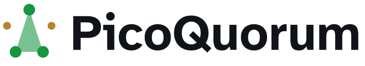
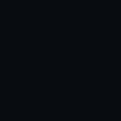
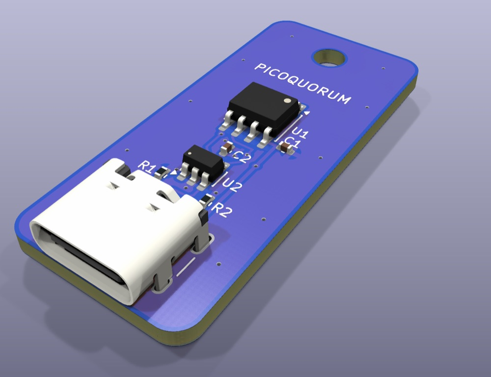
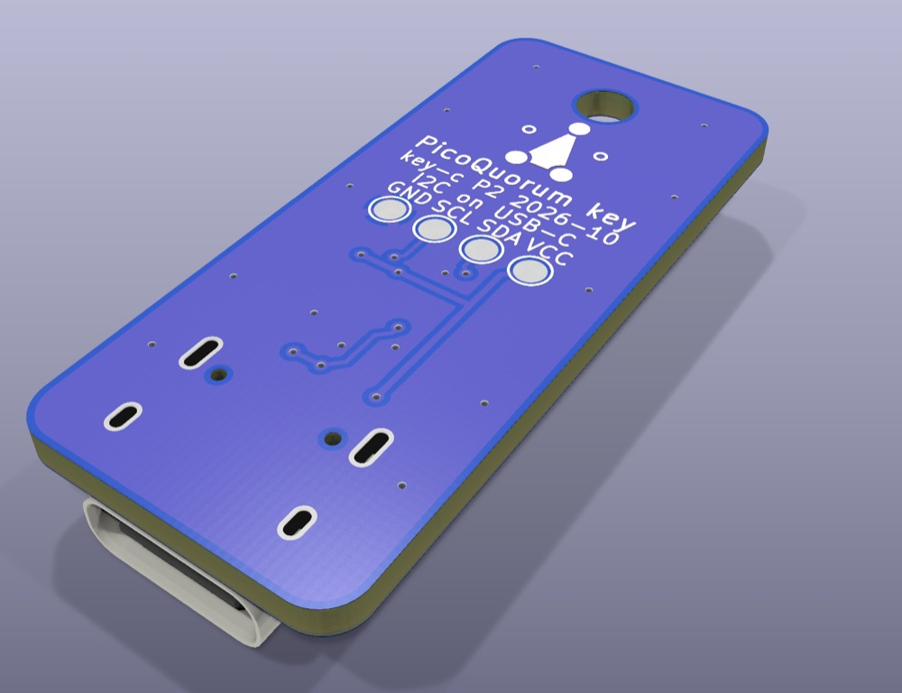
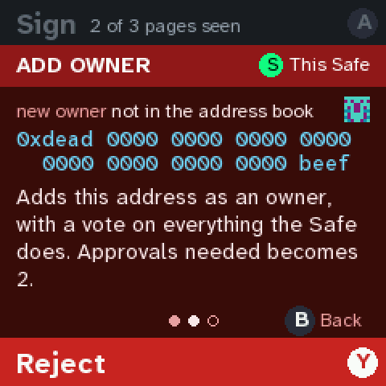
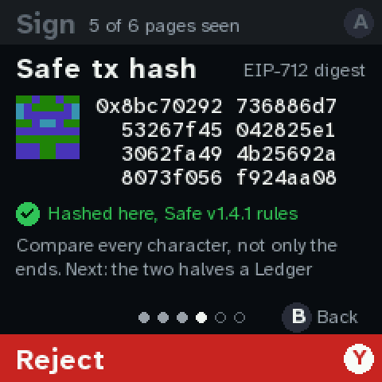
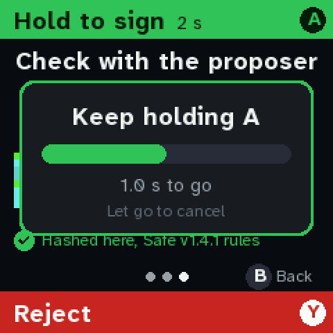
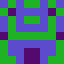
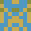

  <picture>
    <source media="(prefers-color-scheme: dark)" srcset="docs/brand/lockup-dark.svg">
    <source media="(prefers-color-scheme: light)" srcset="docs/brand/lockup-light.svg">
    
  </picture>

  <strong>Several people, several keys, one Safe.</strong> 
  Hardware approvals for <a href="https://safe.global">Safe</a> multisig wallets.

  
  
  
  
   
  
  
  
  
   
  
  
  

  

PicoQuorum is a small console that is **one owner of a Safe**. Each signer holds a plug-in key with a
secure element inside. The console shows what a transaction does on its own screen, works out the
Safe transaction hash itself, and asks the key to sign only after you have seen every page and held
the green **Sign** button. **Reject** is red and easy.

The same console also runs [in your browser](https://picoquorum.app/console/), with
your own passkey as its key. That version is one short folder you can read, check against this
README, and sign from on your own computer.

### A pico quorum

A *pico quorum* is a small group that agrees before anything moves: a family's savings, a club's
treasury, a two-person company, a project's release keys. Two of three. Three of five. Too small for
a custody desk, too important for one laptop. PicoQuorum gives each person in that group the same
small box and their own key, and makes every approval a deliberate thing you do with your hands.

> **Experimental.** Early design. Use a testnet first, and only small amounts on mainnet. The Safe's
> threshold is the real control: always keep owners on the Safe that are not this console.

## Four ideas

### 1. A key that can't leak

The key is a secure element on a small board you plug in. Its P-256 private key is generated inside
the chip, never leaves it, and never exists as a seed phrase. There is nothing to write down,
photograph or phish. The chip has no command that reads a private key out, it is locked after
provisioning, and the console asks it to sign only a hash the console worked out itself.

Each key owns the Safe through Safe's audited passkey signer
([`firmware/webauthn.py`](firmware/webauthn.py)), with the same owner address on every chain. The
contracts it relies on were checked onchain on Base and Ethereum.

**The USB-C key, in production now.** [key-c P2](hardware/key-pcb/key-c-usbc/README.md) is the key
as a part you can hold: an ATECC608C behind a USB-C receptacle on a 16 × 36 mm board, with an ESD
array between the connector and the chip.
- The receptacle is plain wires, not USB: D+ carries SDA, D− carries SCL, and VBUS is key power
  that the console switches on only when the key is fully in.
- 5.1 kΩ on each CC pin tells the console a key is present.
- Five boards are being assembled at JLCPCB; the first bench bring-up is next.

| parts side | back |
|---|---|
|  |  |

Until it arrives, the dev console's key is an Infineon OPTIGA Trust M or an ATECC608 breakout. The
other key designs (card edge, pogo pads) are in [`hardware/key-pcb/`](hardware/key-pcb/README.md).
How a chip is locked: [docs/LOCKING.md](docs/LOCKING.md) and [docs/TRUSTM.md](docs/TRUSTM.md).
What a sealed key can't protect you from: [docs/SECURITY.md](docs/SECURITY.md).

### 2. A simple console that checks on its own

The console is a Raspberry Pi Pico 2 W with a 240 × 240 screen and a few buttons, running a small
amount of MicroPython you can read. It doesn't take anyone's word for a transaction: not your
laptop's, not your browser's, not Safe{Wallet}'s, and not the transaction service's.

- **Its own hash.** It rebuilds the Safe's EIP-712 transaction hash from the fields it shows, for
  the chain and Safe it was set up for, and its key signs that hash and nothing else. A service
  that lies about the hash, the Safe or the chain gets a refusal, not a signature.
- **Its own words.** It decodes each call into plain language. Anything that changes who controls
  the Safe, or can't be undone, is a red page, red all over.
- **Its own screen.** You page through every screen before Sign is allowed, then hold it for two
  seconds. The verify code (the hash's last eight characters and its blockie) is there to check
  with whoever proposed it.
- **Its own path.** It talks to the transaction service over its own Wi-Fi and TLS, checking
  certificates against the roots it carries. Nothing on your computer is in the loop.

| | | | |
|---|---|---|---|
|  |  |  |  |
| **Plain language.** What it does, who it pays, who has signed. | **Red pages.** Owners, thresholds, anything that can't be undone. | **A verify code.** To check with the proposer. | **Hold to sign.** Two seconds on a guarded button. |

That independence is the point. A second check is only worth something if it fails differently from
the first: different hardware, different code, a different network path, a different person looking
at it. More screens: [docs/quorum-ui](docs/quorum-ui/README.md).

### 3. One owner in a multisig

PicoQuorum is never the whole wallet. It is one owner among several, and it is built to sit next to
the others: a hardware wallet, a passkey, Safe{Wallet} in a browser, another PicoQuorum in another
house. The project's own Safe is planned around one rule ([docs/GOVERNANCE.md](docs/GOVERNANCE.md)),
and we suggest it for yours: **no technology, and no person, holds a threshold's worth of keys.**

- **Standard Safe.** Any Safe from 1.3.0 on, on Base and Ethereum. Propose anywhere; the console
  reads the same queue Safe{Wallet} does.
- **The app** ([launch it](https://picoquorum.app/app/)) opens any Safe, proposes,
  checks every confirmation in your browser, and executes with your wallet. It holds no key.
- **Several Safes, several chains.** One console watches up to 4 Safes on Base Sepolia, Base and
  Ethereum, with one queue across them ([networks](docs/guide/NETWORKS.md)).
- **A pico quorum per Safe.** A family Safe at 2 of 3, a team Safe at 3 of 5, each owner with a
  console and a key of their own.

### 4. A short stack you can check yourself

[The console page](https://picoquorum.app/console/) runs the console's firmware,
file for file, on MicroPython for WebAssembly, with your passkey (Touch ID, Windows Hello, a phone,
a security key) as its key. It is one folder, it loads nothing from the rest of the site, and it can
reach only Safe's transaction service: its Content-Security-Policy says so, and the browser enforces
it.

| in the folder | |
|---|---|
| `firmware/` | the console image a Pico runs, as plain files: about 11,000 lines of MicroPython |
| `shims/` | Python in place of the Pico's hardware: about 630 lines |
| `console.js`, `worker.js`, `web/`, `core/` | the page: about 1,100 lines of JavaScript |
| `vendor/micropython/` | MicroPython 1.26 for WebAssembly, pinned by its hash: the one part built elsewhere |

That is short enough to read, and you can check it without trusting the site that sent it:
- **Save a copy.** `SHA256SUMS` lists every file: fetch them, then `sha256sum -c SHA256SUMS`. There
  is no build step; these are the files that run.
- **Hold it up to this README.** `firmware/`, hashed with `sha256sum` in a one-line loop, gives the
  console's release fingerprint in [the build table](#the-build-youre-looking-at): the same one a
  Pico running that release shows on its Device screen.
- **Rebuild it.** `cd emu && npm ci && node build.mjs` writes the same bytes. CI checks that on every
  push, and a check from outside compares what Pages serves with the source every six hours.
- **Sign from your copy.** Run `python3 -m http.server` in the folder and open `localhost:8000`. A
  passkey belongs to the site that made it, so one made on your copy can be asked to sign by your
  copy and never by a later version of the site. Its owner address works on a Safe like any other.

The commands: [docs/guide/BROWSER.md](docs/guide/BROWSER.md). The screen is still drawn by your
computer, and the passkey's prompt never shows the transaction, so the hardware console is the
stronger owner: keep passkey owners below the threshold.

## Try it

- **[The site](https://picoquorum.app/)**, with the app.
- **[The console in your browser](https://picoquorum.app/console/)**: the same
  firmware in MicroPython on WebAssembly, with your own passkey as its key. Save it, check it and
  run your own copy ([how](docs/guide/BROWSER.md); the design: [EMU-WEB.md](docs/EMU-WEB.md)).
- **[The owner's guide](docs/guide/README.md)**: from a board to a console that signs for your
  Safes.
- **Build a dev console**: a Pico 2 W, a Waveshare Pico-LCD-1.3 and an ATECC608 breakout, about
  $35 with no soldering ([build guide](hardware/DEV-CONSOLE.md), [parts](hardware/bom/README.md)).
- **On a laptop**, no hardware: `tools/quorum e2e` runs a whole approval with the emulator against a
  Safe 1.4.1 on an Anvil fork of Base ([details](tools/mock-tx-service/README.md)).
- **The hash, checked**: `python3 test-vectors/run.py` runs every vector in
  [`test-vectors/`](test-vectors/), including real mainnet Safe transactions, on CPython; CI runs
  them on MicroPython 1.26 too.

## The build you're looking at

Every firmware image has a **release fingerprint**: one SHA-256 over its source files
([docs/releases](docs/releases/README.md)). A console shows its blockie and first 8 hex digits on the
Device screen; the console page shows the same picture for the same files, and its `firmware/`
folder hashes to it with `sha256sum` ([how](docs/guide/BROWSER.md#2-hold-it-up-to-the-readme)); the
app's Releases page lists each release's. The badges above and this table name the source in this commit, so you can hold a
console up to the README:

<!-- build:begin (node tools/releases/badge.mjs writes this table) -->

| | image | release fingerprint |
|---|---|---|
|  | **console** | `a675bcda48ac88c50abf8a59b3f809e30215bc36be3f0aec9bd6a1683f01f150` |
|  | **ceremony** | `538dbcd9fe0bcec70feb2e1d370ea58b08af8aa7644cf6d7a7fcd2a2509d67e8` |
|  | **brand** | `e710fe16e3738300ca9dbc9ada732abb1b8dcd3daa990ecdbd2214d641e304a8` |
|  | **dual** | `7100a27f2306ba025b6ee2bc820dc45cf8823a8bd989890f39e1dfad47db40ec` |

<!-- build:end -->

How a release is trusted ([docs/RELEASES.md](docs/RELEASES.md)):
- **Signed tags.** A release is an SSH-signed tag, `fw-<version>`, checked against
  [`.github/allowed_signers`](.github/allowed_signers) before anything is built.
- **Reproducible pages.** CI rebuilds the app and the console page from source and fails if they
  differ from what is committed. The site check then compares what GitHub Pages serves, byte for byte,
  with the commit it deployed.
- **Approved by a Safe.** The project Safe will approve each release on chain, signed on PicoQuorum
  consoles, and the app then shows **Approved by the project Safe**. The code is ready; the Safe
  comes at launch ([docs/GOVERNANCE.md](docs/GOVERNANCE.md)).

## Where it stands

PicoQuorum is built in public. **[docs/STATUS.md](docs/STATUS.md)** is the one page for what exists
today: the name (picoquorum.eth) and the domains, every Safe and key with its address, the contracts
the console relies on, and what's next.

The [test ladder](docs/LADDER.md) tracks each chain:
- ✅ a simulated Safe and a local fork, on the real Pico
- ✅ Base Sepolia, end to end over HTTPS on the real Pico
- Base with a few dollars: the Safe is checked and a chip's confirmation has executed there; the
  console's own approval is next
- then Ethereum mainnet, whose contracts have been checked onchain

The design and the open questions are in the [kickoff](docs/KICKOFF.md), and the project Safe's plan
in [GOVERNANCE.md](docs/GOVERNANCE.md). Dated notes and photos, mistakes included, are in
[`buildlog/`](buildlog/).

## Layout

| path | what |
|---|---|
| `firmware/` | the console in MicroPython: `quorum.py` and `quorum_ui.py` (the console), `safe_tx.py` (the Safe hash), `decode.py`, `txservice.py`, `webauthn.py`, the chip drivers `trustm.py` and `atecc.py` |
| `hardware/` | `key-pcb/` (the keys, [key-c](hardware/key-pcb/key-c-usbc/README.md) among them), `wiring/` ([Build 1](hardware/wiring/BUILD1.md), [perfboard](hardware/wiring/SOLDERING.md), [breadboard](hardware/wiring/BREADBOARD.md), [on an ESP32](hardware/wiring/ESP32.md)), `bom/` |
| `docs/` | everything to read ([index](docs/README.md)), and the site GitHub Pages serves: the front page, `app/`, `console/`, `brand/` |
| `web/` | the app's source; `npm run build` writes `docs/app/` |
| `emu/` | the console in a browser: MicroPython in WebAssembly and a virtual secure element. `build.mjs` writes the console page (`docs/console/`); `tools/emu` adds an editor and the case in 3D, for development |
| `test-vectors/` | Safe transactions with known-correct hashes, and the suites CI runs |
| `tools/` | `quorum` (Safes on a fork and on chain), `fw` (build and push images), `emu`, `usb`, `release`, `releases/`, `brand/`, `keypcb`, `wiring`, `wiring-esp32` |
| `contracts/` | PicoQuorum's own contracts, when there are any; today each key owns a Safe through Safe's passkey signer |
| `buildlog/` | dated notes and photos |

The name, the mark and the colours: [docs/BRAND.md](docs/BRAND.md). `tools/brand/lockup.py` draws the
logo at the top of this page.

## Credit

PicoQuorum exists because of [picowallet](https://github.com/austintgriffith/picowallet) by
**Austin Griffith**. picowallet proved that a Raspberry Pi Pico can drive a secure element from
MicroPython, rebuild an EIP-712 digest on the device, show it on its own screen, and sign with a
key that never leaves the chip, all on mainnet. PicoQuorum began as a fork of it and is still
built on it:
- the ATECC608 and Trust M drivers, the display driver, keccak and P-256, blockies and the WiFi join;
- the emulator that runs the console in your browser.

Each of those files says so on its first line, under Austin's MIT license. Fixes to the drivers go
back upstream ([docs/UPSTREAM-TRACKING.md](docs/UPSTREAM-TRACKING.md)). Everything else this project
uses is credited in [NOTICE](NOTICE).

PicoQuorum runs on Raspberry Pi Pico 2 W. It is not affiliated with Raspberry Pi or Safe.

## License

| | license |
|---|---|
| Code and firmware: `firmware/`, `emu/`, `web/`, `tools/`, `test-vectors/`, the built site | [MIT](LICENSE) |
| Hardware: `hardware/` (the key boards, wiring, parts lists) | [CERN-OHL-W-2.0](LICENSE-HARDWARE) |
| Docs, the build log, photos and screenshots | [CC BY-SA 4.0](LICENSE-DOCS) |
| The name PicoQuorum and its mark | not licensed: [TRADEMARK.md](TRADEMARK.md) |

Hardware made from these sources must show where the source is ([hardware/README.md](hardware/README.md#license)).
Third-party parts and their licenses are in [NOTICE](NOTICE).
