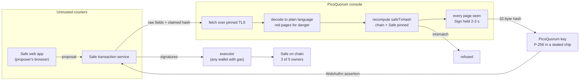

# Where PicoQuorum fits: keys, consoles and the 2026 custody picture

*Written 2026-10-03. A companion to the research report "Cryptocurrency Key Security in 2026:
Multisignature, Secure Hardware, MPC, and Institutional Custody" (research cutoff 2026-10-03),
which is not in this repo. Where this page repeats one of the report's findings, it says so.
Everything said about PicoQuorum comes from this repo's own docs, linked as it goes.*

> **Experimental.** PicoQuorum is early hardware with no track record. It is for testnet and
> pocket change. Nothing on this page is a reason to put meaningful money behind one of its keys
> yet. The point of writing it now is to be clear about what the design is for, so that the
> track record, when it comes, is measured against the right goals.

---

## Contents

1. [The short version](#the-short-version)
2. [The two parts, in one minute](#the-two-parts-in-one-minute)
3. [Where PicoQuorum sits on the report's map](#where-picoquorum-sits-on-the-reports-map)
4. [Archive versus operation: what a seed phrase is for](#archive-versus-operation-what-a-seed-phrase-is-for)
5. [Concern by concern](#concern-by-concern)
   - [Someone copies the key](#someone-copies-the-key)
   - [Copies of seed phrases](#copies-of-seed-phrases)
   - [Supply-chain attacks](#supply-chain-attacks)
   - [Malware, up and down the stack](#malware-up-and-down-the-stack)
   - [A lost, stolen or borrowed key](#a-lost-stolen-or-borrowed-key)
   - [Urgent owner changes and other social attacks](#urgent-owner-changes-and-other-social-attacks)
   - [Bad entropy and unpatchable chips](#bad-entropy-and-unpatchable-chips)
6. [An unleakable key in a world of software agents](#an-unleakable-key-in-a-world-of-software-agents)
7. [What PicoQuorum does not solve](#what-picoquorum-does-not-solve)
8. [A worked example: one Safe, five owners](#a-worked-example-one-safe-five-owners)
9. [What comes next](#what-comes-next)
10. [Glossary](#glossary)
11. [Further reading in this repo](#further-reading-in-this-repo)

---

## The short version

- **The report's main finding is that no single control solves custody.** A secure element
  protects a secret, a threshold removes reliance on one key, and on-device verification protects
  against a lying host. They fail in different ways and work best together. PicoQuorum is built
  on that idea. It is not a better hardware wallet. It is one piece of a multisig, designed to be
  a good piece.
- **A PicoQuorum key is a private key that cannot be written down.** It is made inside a secure
  element, it never leaves, and there is no seed phrase. You cannot copy it, back it up, photograph
  it, paste it, sync it or leak it. You can only hold it, use it, lose it, or have it taken.
- **That only makes sense inside a quorum.** A key with no backup would be reckless as the only
  key to anything. As one owner of a 3-of-5 Safe, it is the opposite: losing it costs one
  signature, and the other owners rotate it out. Recovery happens at the quorum layer, not by
  rebuilding a secret.
- **The console's job is to make the signature mean something.** It fetches the transaction
  itself, decodes it into plain language, recomputes the Safe transaction hash from the fields it
  shows, and only then lets the key sign, after every page has been seen and the Sign button held.
  A lying transaction service, a compromised web app, or a laptop full of malware cannot change
  what gets signed.
- **Splitting a seed phrase is an archive strategy, not an operating strategy.** Shamir shares,
  metal plates, copies in two safes: these decide how a secret survives fire, theft and death.
  They say nothing about how approvals happen day to day, and at the moment of use every one of
  them turns back into a single complete key. A multisig never reassembles anything.
- **In a world where software agents can reach almost everything, a key that cannot exist as
  data is a feature in itself.** An agent can read a file, a password vault, an environment
  variable or a cloud secret. It cannot read a P-256 key out of a sealed chip, and it cannot hold
  a button down in someone's hand.
- **The limits are real and written down.** There is no PIN on the key, the console's USB REPL is
  open, and there is no secure boot yet. Whoever holds a key, or a console with a key in it, can
  make it sign anything. That is one signature out of three, and the design assumes it will
  happen eventually.

---

## The two parts, in one minute

PicoQuorum is a physical approval device for [Safe](https://safe.global) multisig wallets. It has
two parts.

**The key** is a secure element on a tiny board that plugs into the console. Today that chip is a
Microchip ATECC608 or an Infineon OPTIGA Trust M. The board around it is almost nothing: the chip,
an ESD protection array, a decoupling capacitor and the contacts. The form factor is still being
worked out in copper:
- rev A puts gold fingers on the board edge, so **the PCB is the plug**
  ([hardware/key-pcb](hardware/key-pcb/README.md));
- key-c, ordered on 2026-10-02, puts the same circuit behind a USB-C receptacle, used as plain
  wires rather than USB ([key-c](hardware/key-pcb/key-c-usbc/README.md)).

Each key holds exactly one P-256 private key, generated inside the chip during a provisioning
ceremony and then sealed so it can never be regenerated, replaced or exported.

**The console** is a Raspberry Pi Pico 2 W with a screen, a paging knob, a guarded green **Sign**
button and an easy red **Reject** button. It:
- polls Safe's transaction service over Wi-Fi, with TLS pinned to known roots;
- decodes each pending transaction into plain language, with red pages for dangerous ones;
- recomputes the Safe EIP-712 transaction hash on the device, from the same fields it put on the
  screen, with the chain and the Safe pinned in its config;
- refuses anything whose hash the service lied about, anything for another Safe, and any
  delegatecall except a batch through a pinned MultiSend;
- asks the key to sign only after every page was seen and Sign was held (3 seconds when a page is
  red).

**The Safe** treats each key as an owner through Safe's own audited passkey signer
(`SafeWebAuthnSignerProxy`). The key signs a WebAuthn assertion whose challenge is the hash the
console computed. PicoQuorum has no smart contract of its own.

The multisig is the star. The name says it: a **quorum** of owners has to agree before anything
moves. The console and keys exist to make that agreement physical and understandable: several
people, several keys, one Safe, and a deliberate ceremony for every approval.

---

## Where PicoQuorum sits on the report's map

The report sorts custody controls by what each one is strongest against and what it does not
solve. Here is where PicoQuorum lands on each.

| The report's control | What PicoQuorum does | Where it differs from the usual product |
|---|---|---|
| **Secure element** | The key is generated, held and used inside the chip. No command exports it. After the seal, nothing can replace it. | Only the *key* lives in the secure element. The display, the decoder and the hash are run by the Pico, not by the chip. See below. |
| **Air gap** | None in the strict sense: the console uses Wi-Fi. | The idea behind an air gap is kept a different way: the network is treated as an untrusted courier, and nothing it says changes what is signed. |
| **PSBT** (Bitcoin) | Not applicable. The Ethereum equivalent is Safe's off-chain signature collection through the transaction service. | The service is the courier, as a PSBT file is, and the console treats its contents as hostile input. |
| **Independent display** | Yes. The console decodes and shows every field that goes into the hash, and requires every page to be seen. | The display is driven by open MicroPython firmware rather than a secure element, so its integrity depends on the firmware (see [the limits](#what-picoquorum-does-not-solve)). |
| **Multisig / threshold** | The whole point. Each key is one owner of a Safe. | The threshold is Safe's smart-contract multisig, so it inherits Safe's risks too (modules, guards, upgrades, delegatecall). PicoQuorum's recommended config bans most of them. |
| **Passphrase / PIN** | No. There is no PIN on either chip today. | A deliberate decision, explained in [PROVISIONING.md](docs/PROVISIONING.md): the ATECC608 has no lockout, and the threshold is the protection. A Trust M PIN may come later. |
| **Attestation** | The Trust M key ships with a ceremony record that anyone can check with `tools/quorum verify`: Infineon's certificate, the chip's binding of the key, and the owner address derived on chain. | The report's caution applies in full: attestation is evidence about identity, not proof of security. [THREAT-MODEL.md](docs/mainnet/THREAT-MODEL.md) spells out exactly what the binding does and doesn't prove. |
| **Backup** | None for the key, by design. Recovery is rotation by the other owners. | This inverts the usual picture. See [the next section](#archive-versus-operation-what-a-seed-phrase-is-for). |

### "Contains a secure element" versus "the key never leaves"

The report makes a distinction that hardware-wallet marketing often blurs: a device can contain a
secure element without the private key living only inside it. PicoQuorum is firmly on the
strict side for the key itself. On an ATECC608, the signing slot is configured so that the Write
command never works, `PrivWrite` is forbidden (so no key can be imported), and the slot lock after
key generation means that "modification via PrivWrite, Write, GenKey, and/or DeriveKey is
permanently prohibited" (Microchip datasheet §2.4.3, quoted in
[PROVISIONING.md](docs/PROVISIONING.md)). On a Trust M, the key object's lifecycle state is raised
to operational at the seal, and a lifecycle state never goes down ([TRUSTM.md](docs/TRUSTM.md)).

But the report also points out that Ledger's secure element controls the trusted display, so the
thing that shows you the transaction is inside the same boundary as the key. PicoQuorum does not
work that way. The ATECC608 and the Trust M are small authentication chips: they can sign a
32-byte digest and not much more. The Pico decides which digest to hand them. That makes the
console's firmware part of the signing boundary, and it is why the project puts so much weight on
a small, checkable firmware image (more in [supply-chain attacks](#supply-chain-attacks)).

### The signing oracle

The report's sharpest warning is that a protected key is still useful to an attacker as a
**signing oracle**: they don't need to extract the key if they can get it to sign. PicoQuorum's
own threat model says the same thing in plain words: "Whoever holds the device can make it sign
anything" ([THREAT-MODEL.md](docs/mainnet/THREAT-MODEL.md)). The design answers it in three ways:

1. **Bound what one oracle can do.** A key is one owner of a 3-of-5. A signing oracle gets an
   attacker one signature.
2. **Notice when the oracle was used.** On an ATECC608, every use of the key raises a counter that
   can never go down. The console shows the count and flags any rise it didn't cause ("signed
   outside this console"). A Trust M has no such record, which is why its threat model says to
   rotate it out if it was ever out of the operator's hands.
3. **Make the legitimate path the only easy one.** In the production image, exactly one function,
   `quorum.sign_it`, asks the chip to sign, and only after the rehash and the hold.

### Safe's own risks

The report's Safe row lists the price of programmability: modules, guards, upgrades and
delegatecall all become part of the security perimeter. PicoQuorum's recommended mainnet setup
([CONFIGURATION.md](docs/mainnet/CONFIGURATION.md)) takes most of that surface away:
- **No modules or guards at the start.** "A module can move funds without the owners'
  signatures, so each one is a new owner in practice."
- **Delegatecall refused by the console**, except a `multiSend` to the pinned `MultiSendCallOnly`.
- **Owner and threshold changes shown red**, with a 3 second hold, and agreed offchain first.
- **Safe v1.4.1**, with the singleton and proxy factory checked on chain before deployment.

---

## Archive versus operation: what a seed phrase is for

This section is the educational heart of the page. It is worth reading even if you never touch a
PicoQuorum.

### A seed phrase is the key, written down

A 12- or 24-word seed phrase is not a password to your wallet. It *is* your wallet, in a form a
person can copy with a pen. Every private key the wallet will ever use can be derived from it.

That has a consequence people often miss about hardware wallets. A hardware wallet protects the
key while it is in use: it signs inside the device and shows you what you are signing. But during
setup it shows you the seed phrase so you can write it down. From that moment there are **two
copies of the key**: one in the device, which is hard to attack, and one on paper or steel, which
is exactly as safe as wherever you put it. The security of the whole arrangement is the security
of the weaker copy.

So "I use a hardware wallet" and "my key is safe" are different statements. The second also
depends on the drawer, the safe, the safe-deposit box, the relative who knows where it is, the
photo someone took "just in case," and the cloud backup the phone made of that photo.

### Splitting the phrase

The natural next step is to split the backup so that no single location holds the whole thing.
There are several ways, and they are not equal.

**Cutting the word list into pieces** (words 1-6 here, 7-12 there) is the common homemade
version. Each piece leaks part of the key. Half of a 12-word phrase leaves 6 words, about 66
bits, to guess, which is within reach of a well-funded attacker. And losing any piece loses
everything, so the scheme adds a point of failure for every point of theft it removes.

**Overlapping pieces** (three sheets, any two of which cover every word) fix the availability
problem but make the leak worse. With a 12-word phrase on three sheets of 8 words, one sheet
leaves only 4 words, about 44 bits, which a rented GPU farm can search.

**Shamir secret sharing** (SLIP-39 and similar) does it properly. The secret is split into, say,
five shares, any three of which rebuild it, and fewer than three reveal nothing at all. This is
good cryptography.

**Several devices loaded with the same seed** improve availability, since any one device can
sign, but each device is another full copy of the key to steal.

### Every one of these is an archive strategy

Here is the point. The report puts it in one sentence: "Shamir shares reconstruct one underlying
secret; once reconstructed, that one key can sign alone."

Every scheme above, including proper Shamir, answers the question **"how does the secret survive?"**
It decides how many places must burn down, or be broken into, before the key is lost or stolen.
That is an *archive* question, and these are reasonable answers to it.

None of them answers the *operational* question: **"how does an approval happen, day to day, and
what happens when something goes wrong in the middle of one?"** When you actually need to move
money with a Shamir-backed wallet, you gather the shares, rebuild the seed into one device, and
from then on you have a single-key wallet. One malware infection on the machine doing the
recovery, one compromised device, one person coerced, and the whole key is gone. The splitting
protected the archive; it did nothing for the operation.

A multisig is different in kind, not degree. Its keys are independent and are **never combined**.
Each owner signs separately, on their own device, in their own place, and the blockchain counts
the signatures. There is no moment when the full authority exists in one room.

| | What it protects | When used, the full authority exists… | What one compromise costs | Answers |
|---|---|---|---|---|
| Seed phrase on paper or steel | Survival of one key | in the device and on the paper | everything | archive |
| Hardware wallet with a seed backup | The key while signing | in the device *and* the backup | everything (from either copy) | operation, for one key |
| Words cut into pieces | Partial: each piece weakens the key | in one place, after reassembly | everything, sooner or later | archive, badly |
| Shamir shares (3 of 5) | Survival of one key across places | in one device, after reconstruction | nothing, until reconstruction; then everything | archive |
| Same seed on several devices | Availability | in each device | everything | archive |
| MPC (threshold signing) | No complete key ever exists | nowhere | one share | operation |
| Multisig (3 of 5 owners) | No single key matters | nowhere | one owner | **operation** |
| PicoQuorum key in a multisig | A key that can't be copied, in a quorum that doesn't need it | nowhere | one owner, rotatable | **operation** |

### Recovery without a secret

If PicoQuorum keys have no seed phrase, how do you recover from losing one? You don't recover
*the key*. You recover *the Safe*.

The other owners propose a `swapOwner` transaction that replaces the lost key's owner address with
a new one, sign it to the threshold, and execute it. The lost chip is now just a chip. Its key still
exists inside it, but it is no longer an owner of anything
([COSIGNERS.md](docs/mainnet/COSIGNERS.md), section 4).

This is the inversion at the centre of the design. In a single-key wallet, the backup is the
recovery plan, so the backup must exist, and so a copy of the key must exist. In a well-shaped
multisig, the other owners are the recovery plan, so no individual key needs a backup at all, and
one kind of key can be built to have none. PicoQuorum keys are that kind. The report's warning
that "a 3-of-5 wallet whose recovery package reconstructs three keys in one safe is operationally
a one-of-one wallet disguised as multisig" cannot apply to them, because there is no recovery
package to reconstruct.

### Where seed phrases still belong

None of this makes seed phrases bad. It puts them in the right job.

PicoQuorum's own target shape ([KICKOFF.md](docs/KICKOFF.md)) is a 3-of-5 that includes **a paper
seed sealed with a lawyer**, and the mainnet recommendation suggests "a cold 'recovery' owner that
signs only owner changes" as a good fifth ([CONFIGURATION.md](docs/mainnet/CONFIGURATION.md)).
That owner is the archive. It sits in a vault, is touched perhaps once in years, and exists to
survive the death or disappearance of other owners. It is optimized for survival, not for
day-to-day use, and it is exactly one owner of five, so its theft costs one signature, the same
as any other.

The operational owners, the ones that sign routinely, are where unbackupable keys earn their
place. They get used often, so they get exposed often, so they should be the ones that can't be
copied and that are cheapest to rotate out.

**The rule of thumb:** use backups for the archive, use a quorum for operations, and don't
confuse the two.

---

## Concern by concern

### Someone copies the key

**The worry.** Someone gets a copy of the private key, uses it quietly, and you find out when the
money is gone. Or never.

**What PicoQuorum does.** There is nothing to copy.
- The key is generated inside the chip (`GenKey` on the ATECC608, `GenKeyPair` in object E0F1 on
  the Trust M) during the ceremony. No person, laptop or script ever sees it.
- The chip has no command that exports a private key.
- On the ATECC608, the slot forbids `PrivWrite`, so a known key can't be planted either. The
  ceremony seals the slot *before* the data zone lock specifically so there's no window where a
  plaintext `PrivWrite` could put a known key into slot 0 ([PROVISIONING.md](docs/PROVISIONING.md)).
- There is no seed phrase, no derivation path and no backup file.

**How this compares with the alternatives.** A software key is a file. A hardware wallet key is a
chip *plus* a seed phrase. A synced passkey, the kind most phones and password managers create
today, is copied to the cloud by design so that it survives a lost phone. PicoQuorum uses the
same WebAuthn signature format as a passkey, but the key is bound to one physical chip and has no
sync. It is closer to a hardware security key than to a phone passkey.

The report also notes that a phone's trusted execution environment is not the same as a dedicated
secure element, citing 2026 reporting on CVE-2025-20435, which affected cryptographic material
below Android on some MediaTek devices. A dedicated chip with one job has a much smaller surface
than a phone's system-on-chip.

**What remains.** A copy is impossible; *use* is not. See
[a lost, stolen or borrowed key](#a-lost-stolen-or-borrowed-key). And extraction by a
well-equipped lab can never be ruled out for any chip, as the report's TROPIC01 case shows. See
[bad entropy and unpatchable chips](#bad-entropy-and-unpatchable-chips).

### Copies of seed phrases

**The worry.** Every copy of a seed phrase is a way to steal everything: the photo on a phone, the
sheet in a drawer, the copy given to a family member, the steel plate a burglar can carry out.

**What PicoQuorum does.** For its own keys, it removes the problem entirely. There are no seed
phrases to copy, store, inherit, or be coerced into revealing.

For the Safe as a whole, it shrinks the problem. If one owner of five is a seed phrase in a lawyer's
vault, a copy of that phrase is worth one signature, not the treasury. Every seed-backed owner in
the Safe is reduced from "the whole wallet" to "one vote."

**What remains.** The other owners' backups still need care. A Safe where three owners' seed
phrases are kept in the same drawer is a 1-of-1 in practice. The configuration guidance is that
the owners should be "different kinds of device in different hands," held by at least two people
in at least two places ([CONFIGURATION.md](docs/mainnet/CONFIGURATION.md)).

### Supply-chain attacks

**The worry.** The device was tampered with before it reached you, or the software that runs on it
or around it was poisoned upstream. The report's examples include the 2023 Ledger Connect Kit
compromise, where a phished account published malicious versions of a JavaScript library that
dApps loaded, and the 2026 TRM Labs report linking thefts to old COLDCARD firmware with weak
randomness (which the report notes was not confirmed by an equivalent vendor advisory).

PicoQuorum's supply chain has several links. Here is each one.

**The chip.**
- *Trust M:* each chip carries an Infineon factory certificate. During the ceremony, the Pico
  verifies that certificate against Infineon's CA key and has the factory key sign a challenge. The
  factory key then signs a binding statement: "this chip (UID) holds this key (E0F1, qx, qy)."
  `tools/quorum verify` checks the certificate, the binding, the owner address, and that Safe's
  on-chain passkey factory derives the same address. It runs on any machine with Node, without the
  board ([COSIGNERS.md](docs/mainnet/COSIGNERS.md)).
- *ATECC608:* the ceremony checks the chip's revision, its factory configuration and its unlocked
  state, and saves a snapshot. There is no factory certificate in the path today, so its genuineness
  check is weaker than the Trust M's.
- *The honest caveat* ([THREAT-MODEL.md](docs/mainnet/THREAT-MODEL.md)): the factory key "signs
  whatever it is asked," so a genuine chip could vouch for a key kept elsewhere. What ties the key
  to the chip is the seal, the ceremony being run on the device, and the operator's word.

**The key board.** It is about as simple as a circuit can be: the chip, an ESD array, a capacitor
and contacts. It is designed in the open (KiCad files, Gerbers and parts lists are in
[hardware/key-pcb](hardware/key-pcb/README.md)), and the provisioning happens *after* it arrives.
A board from the factory has no key on it. An attacker who wants to plant a known key would have
to swap in a chip that fakes Infineon's certificate (Trust M) or a chip whose `GenKey` isn't
random. Meanwhile, the ceremony's pre-flight checks and the recommended practice of running
irreversible steps on a sacrificial chip first raise the bar.

**The console hardware.** A stock Pico 2 W and a stock display. These are commodity parts, which
cuts both ways: easy to source from many places, and with no anti-tamper of their own. The
threat model is blunt: "The secure element resists physical attack. The board, the I2C wires and
the Pico do not."

**The firmware.**
- All of it is open MicroPython in this repo.
- The production image is exactly the files in `firmware/manifest.json`. A test
  (`test-vectors/manifest.mjs`) checks that each image contains exactly its imports, that in the
  console image only `quorum.sign_it` can sign, and that nothing in it can make, replace or lock a
  key.
- The ceremony that creates and seals keys is a separate image. The signing console never carries
  it.
- `tools/fw verify` compares the hash of every file on the board with a checkout of the repo.
- The Safe hash code (`firmware/safe_tx.py`) passes every vector in `test-vectors/`, including real
  mainnet Safe transactions, on both CPython and MicroPython.

The gap: there is no secure boot yet, so only someone holding the board can run `tools/fw verify`,
and "a co-signer can't see from outside which firmware runs."

**The surrounding software.** This is where PicoQuorum changes the picture most. The console
loads no JavaScript, no browser extension, no dApp library and no wallet connector. It talks to
Safe's transaction service over HTTPS with three pinned root certificates. A Connect Kit-style
attack on a web library can poison the Safe web app in a proposer's browser, and that would change
what gets *proposed*, but not what the console shows or what it signs, because the console decodes
and rehashes from the raw fields itself.

**The contracts.** PicoQuorum writes none. It uses Safe v1.4.1 and Safe's passkey signer, both
deployed and audited, with addresses checked on chain.

**Diversity as a supply-chain control.** The report argues that heterogeneous signers lower common
mode risk: a firmware-signing compromise, an entropy bug or a parser defect has to cross
independent implementations before it reaches the threshold. PicoQuorum's recommended Safe makes
this a hard rule: the PicoQuorum firmware family holds at most 2 of 5 owners, and at least three
owners are on hardware wallets from at least two vendors. Even a total compromise of PicoQuorum,
chips and firmware and all, stops one signature short.

### Malware, up and down the stack

**The worry.** Malware somewhere between you and the chain changes what you sign. The report's
threat table puts host malware first, and two well-known Safe incidents that are *not* in the
report show how it plays out:
- **Radiant Capital (October 2024):** malware on signers' machines showed normal-looking
  transactions in the Safe interface while their hardware wallets were asked to sign something
  else. Funds were lost when enough signers approved.
- **Bybit (February 2025):** malicious JavaScript served through the Safe{Wallet} front end showed
  Bybit's signers an ordinary transfer, while the transaction they actually signed was a
  delegatecall that replaced their Safe's implementation. Roughly $1.5 billion in ETH left the
  wallet.

In both cases the multisig worked exactly as designed: enough owners signed. The failure was that
none of them could see what they were signing. Their hardware wallets showed an opaque hash or
raw calldata, and the people trusted the screen that had been compromised.

PicoQuorum is designed around exactly this. Here is the stack, layer by layer.

| Layer | If it's compromised | What PicoQuorum does about it | What's left |
|---|---|---|---|
| **The proposer's browser or the Safe web app** | Proposes a malicious transaction that looks benign there | The console never uses the web app's view. It decodes the raw fields itself and shows what the transaction does. A delegatecall like Bybit's is **refused outright** unless it's a `multiSend` to the pinned `MultiSendCallOnly`. | A malicious proposal that is a plain, well-formed call still shows up, decoded. A person has to read it. |
| **Safe's transaction service** | Lies about the transaction, the hash, the owners or the threshold | The console recomputes the hash with the chain and Safe pinned. A different hash means refused. A transaction for another Safe is refused. | A lying service can mislead the *display* of owners and approval counts, and can withhold transactions. It cannot change what is signed. |
| **The network** | Tampers with or reads traffic | HTTPS with three pinned roots; the API key is sent only after the handshake. | Denial of service. |
| **The operator's laptop** | Could push malicious firmware, or drive the chip over USB | The console doesn't need a laptop to sign: it fetches over Wi-Fi. Day to day, it shouldn't be plugged into one. `tools/fw verify` checks the image. | With the USB REPL open, a compromised laptop connected to the console can run code on it and have the chip sign any digest. One signature, which the ATECC counter records. |
| **The console firmware** | Shows one thing and signs another | Open, small, hash-pinned image; one signing path; tests over every refusal. | No secure boot. Firmware that someone with the board replaced could lie. Rotation is the remedy if the board was out of your hands. |
| **The I2C bus between console and key** | Something else talks to the chip | Key power is switched on only after full insertion is detected. | Anyone on the bus can have the chip sign. No PIN. The ATECC counter shows it. |
| **The secure element** | The key is extracted | Generated inside, sealed, no export command, no import possible. | Lab-grade physical attacks are always possible in principle. One chip is one owner. |
| **The Safe contracts** | A bug or a malicious module | Audited Safe 1.4.1 and passkey signer; no modules or guards in the recommended setup; owner changes are red. | Safe's own risk, shared with every Safe user. |
| **The people** | Approve something they shouldn't | Every page must be seen; red pages and longer holds; an 8-character verify code from the hash for phone confirmation; "never accept an urgent owner change that arrives only by chat." | Judgment. No device replaces it. |

The pattern across the table: **PicoQuorum moves the trust boundary from the screen you're
looking at on your computer to a small device whose only job is to show you the truth.** The host,
the network, the web app and the service are all treated as couriers. They can be slow, wrong or
malicious, and the worst they can do is waste time or show you a misleading count. What gets
signed is decided by the bytes the console checked.

**A note to the other owners.** The console protects *its* signature. If you sign the same
transaction with a conventional hardware wallet through the Safe web app, your signature is only
as good as what *your* device shows you. The co-signer guide puts it plainly: "A Pico confirmation
means 'the operator looked at this on the Pico'. It does not mean 'this is safe'"
([THREAT-MODEL.md](docs/mainnet/THREAT-MODEL.md)).

### A lost, stolen or borrowed key

**The worry.** Someone picks up the key, plugs it in somewhere, and signs.

**What's true today.** This is PicoQuorum's largest known gap, and the project says so.
- There is no PIN on the key. The ATECC608 has no lockout after failed attempts: at about 40 tries
  a second, a 6-digit PIN would fall in about 7 hours, and a PIN's rules can only be tested after
  the irreversible data lock ([PROVISIONING.md](docs/PROVISIONING.md)).
- The Trust M's "security event counter" is a brake, not a lock: measured on a sacrificial chip,
  it slowed a burst of signatures to about one every 5 seconds, which is still thousands an hour
  ([THREAT-MODEL.md](docs/mainnet/THREAT-MODEL.md)).
- So a stolen key can sign anything, on any I2C host, not just a console.

**Why that's acceptable for now.**
- **One key, one vote.** A stolen key is one signature of three needed. The others still need to
  be compromised separately, in other places, from other vendors.
- **The ATECC key keeps a tally.** Every signature raises a counter that only goes up, and the
  console flags any rise it didn't cause. A borrowed-and-returned key tells on itself the next time
  it is plugged in. (Anyone on the bus can also raise the counter without signing, so a raised
  count can be a false alarm, never a hidden signature.)
- **The response is simple.** Treat the key as compromised and have the other owners swap it out.
  Until the swap executes, look harder at anything that already carries its confirmation.
- **The guidance is plain:** treat it like a hardware wallet with no PIN. Keep it physically
  secure, and if it was out of sight, rotate it.

The difference from a leaked software key is worth stating. A leaked key can be used by anyone,
anywhere, forever, without your knowing. A stolen chip is one object in one place. Its absence is
noticeable. And the moment the Safe swaps it out, it is worth nothing.

### Urgent owner changes and other social attacks

**The worry.** An attacker can't break the cryptography, so they persuade the owners instead: "We
need to rotate a key right now, sign this."

**What PicoQuorum does.**
- **Owner, threshold, module and guard changes are red pages,** red all over, with the thing at
  stake (the address that gains power) shown in its own colour, and a 3 second hold instead of 2.
- **The red is a prompt to stop, not a check.** The configuration guide says to agree owner and
  threshold changes offchain first, with a message to every owner, and never to sign one under
  time pressure.
- **The verify code.** The last 8 characters of the Safe transaction hash, in large type, so two
  owners on a phone call can confirm they're looking at the same transaction.
- **Reject is easy.** The red button is unguarded and instant. Saying no should always be easy.

**Coercion.** A threshold spread across people and places means one coerced person can give up
one signature. PicoQuorum doesn't add more than that, and doesn't claim to.

### Bad entropy and unpatchable chips

**The worry.** The report has two cautionary examples:
- the TRM Labs attribution of COLDCARD thefts to old firmware that could fall back to weak
  randomness when creating seeds;
- Ledger Donjon's 2026 laser fault-injection attack on the TROPIC01 secure element, a hardware
  weakness that no firmware update can remove.

**What PicoQuorum does.**
- **Randomness comes from the chip.** The key is generated by the secure element's own `GenKey`,
  not by MicroPython. Right after the configuration lock, the ATECC ceremony checks that the
  chip's random number generator is live, not returning the fixed pattern an unlocked chip
  gives. There's no software fallback in the
  production image: an earlier picowallet behaviour that fell back to a software key on flash is
  ignored by the console image, which fails closed ([SECURITY.md](docs/SECURITY.md)).
- **One chip is one owner.** If a batch of chips turns out to have weak keys, or a lab extracts
  keys from one model, the damage is one owner per affected chip, and the response is rotation.
- **Two chip families.** The console already supports both the ATECC608 and the Trust M with the
  same owner scheme. A Safe with one of each has two independent random number generators and
  two independent physical designs behind its PicoQuorum owners.
- **Cheap to replace.** A key board costs less than ten dollars, assembled. Replacing a chip is a ceremony and
  a `swapOwner`, not a new device.

The report's conclusion about TROPIC01 is the right one to carry: hardware bugs are harder to fix
than firmware bugs, so architecture should assume any one component can fall. PicoQuorum is built
on that assumption.

---

## An unleakable key in a world of software agents

This section steps back from specific attacks to the bigger picture.

### Software keys are data, and data flows

Most private keys in the world today are data. A key file on a server. A mnemonic in a password
manager. A secret in an environment variable, a CI pipeline, a cloud secrets manager. A passkey in
a synced keychain. Even keys in a cloud HSM are reachable by any process holding the right API
credential, which is itself data.

Data moves. It gets copied into logs, backed up, synced, pasted into chats, read by any process
with the right permissions. That was already the main way keys leaked before 2026. What has
changed is how many processes now have broad permissions and act on their own.

Software agents, including AI agents, now read inboxes, run shell commands, browse the web, write
and deploy code, and operate cloud consoles on people's behalf. This repo was itself built with
heavy help from one. That is enormously useful. It also means that the set of things that can
reach a secret stored as data now includes an agent that has been handed a poisoned web page, a
malicious instruction hidden in a document, or a compromised tool. A key that lives anywhere an
agent can read is a key one prompt injection away from leaving.

### Leaking versus using

It helps to separate two failures that are often lumped together.

**A leak** is when a copy of the key leaves your control. It is:
- **silent:** you usually don't know it happened;
- **permanent:** you can't un-leak a key;
- **scalable:** the copy can be used from anywhere, by anyone it's passed to, as often as they
  like, long after the moment of compromise.

**Misuse** is when someone gets your key to sign something while it stays where it is. It is:
- **local:** it needs physical access to the key, or to something attached to it;
- **bounded:** it lasts only while the access lasts;
- **visible:** a missing device is noticed, and on an ATECC key a counter records every signature.

A PicoQuorum key can be misused. It **cannot leak**. There is no form of it that can travel over a
network, sit in a file, or be read out by any software, whatever that software's permissions. An
agent with full control of a laptop, a cloud account and every password vault you own still cannot
obtain it. The worst it can do is drive a console or a key it is physically connected to, and
that turns a silent, permanent, global failure into a noisy, temporary, local one. In a quorum,
that is the difference between losing the treasury and losing a vote.

### A button an agent can't press

The console adds a second physical fact: a Sign button that has to be held down by a person's
thumb, after a person has paged through every screen. The intended division of labour is clear.
Software, including agents, can propose transactions, decode them, monitor the queue, prepare the
rotation script and execute once the threshold is reached. Execution needs no owner key, only gas,
so an agent can safely do that part. What it cannot do, on the intended path, is approve. Approval
is a person, at a device, holding a button.

**The honest caveat.** Today, that button is enforced by the console's firmware, not by the chip.
The WebAuthn "user verified" flag is "the firmware's word that someone held A, not a chip-enforced
factor" ([SECURITY.md](docs/SECURITY.md)). With the USB REPL open, any code that can reach the
console over USB, an agent on the connected laptop included, can have the chip sign a digest
without the button. So, today:
- **Don't leave a console plugged into a machine an agent controls.** It doesn't need a laptop to
  work: it fetches over Wi-Fi.
- **The threshold is the backstop.** One console driven by an agent gets one signature.
- **The fixes are on the list:** a production image with the USB REPL closed, and RP2350 secure
  boot so only signed firmware runs ([CONFIGURATION.md](docs/mainnet/CONFIGURATION.md), "Later").

Even with that gap, the key itself stays unleakable. A misbehaving agent gets one signature while
connected, not a copy it can keep.

### Physical gestures as a habit, not just a feature

The project applies the same idea to its own development. Every irreversible chip operation, such
as locking a configuration zone, sealing a key or freezing spare objects, needs:
- an `ALLOW_*` flag turned on deliberately from the laptop,
- a two-button arm held for 3 seconds on the device,
- and the confirm button held for another 3.

Those steps were added after a real mistake: on 2026-09-15 a chip was locked with a wrong
configuration table that had never been read back, and that chip can never hold a key
([buildlog](buildlog/2026-09-15-config-table-bug.md)). The rule in the security notes since then
is written for "people and bots alike: read the chip back before any permanent step, and ask before
running one." An assistant can write the ceremony code, run it in the emulator, and walk through
every step. It cannot hold two buttons on a board in someone's hand.

### Keeping it concrete

There is a quieter benefit too. As custody moves into policy engines, MPC protocols, cloud HSMs
and agents acting on our behalf, the question "who can move this money?" gets harder to answer.
The answer is spread across API permissions, share-holders, admin roles and code paths that
nobody has fully read.

With PicoQuorum, the answer can be pointed at. Five owners. Two of them are small objects in two
people's pockets. One is a hardware wallet in another city. One is a warm wallet on a laptop. One
is an envelope in a lawyer's vault. Three of those five, in different places and different hands,
have to agree, and two of the agreements are physical acts on devices that show exactly what is
being approved. You can explain that to a family member or a board. You can draw it on a napkin.
The brand mark is that drawing: five dots, three green, one filled triangle.

That clarity is a security property. People defend what they understand, notice when something
doesn't match, and say no when it doesn't add up.

---

## What PicoQuorum does not solve

Nothing on this list is hidden; all of it comes from the project's own threat model and security
notes.

- **It is experimental.** Testnet and pocket change only. The report's case studies are a reminder
  that good designs fail in practice in ways nobody predicted. That's what a track record finds.
- **No PIN on the key.** Whoever holds it can make it sign. See
  [a lost, stolen or borrowed key](#a-lost-stolen-or-borrowed-key).
- **USB REPL open, no secure boot.** Anyone with the console and a USB cable can run their own
  code on it. The display is only as trustworthy as the firmware, and a co-signer cannot check
  the firmware remotely.
- **The display isn't in the secure element.** Unlike Ledger's design, the screen is driven by the
  Pico, not by the chip that holds the key.
- **The Trust M keeps no record of its signatures.** Only the ATECC has the counter.
- **The binding doesn't prove everything.** It proves a genuine Trust M signed the statement, not
  that the key could never have been made elsewhere. The seal and the ceremony do that, and
  neither is signed by the chip.
- **The decoder knows a limited set of things.** Known tokens and contracts come from a list built
  into the firmware, per chain. Anything else is shown red as unknown, with its full address. That
  is safe, but it puts the burden on the person reading it.
- **The transaction service is still in the loop.** It can withhold transactions or show wrong
  owner counts, and it has a request quota.
- **Execution has friction.** Once a transaction carries the key's contract signature and the
  threshold is 2 or more, the Safe web app can't execute it (error GS021), so execution goes through
  `tools/quorum live exec` ([COSIGNERS.md](docs/mainnet/COSIGNERS.md)).
- **Evaluation-grade boards.** The current Trust M sits on an Adafruit breakout, wired to a Pico.
  The chip resists physical attack; the board and wires don't.
- **Collusion and coercion of a full quorum.** No multisig solves three owners who agree to steal,
  or three people coerced at once.
- **It is Safe only, and Ethereum-family only.** It is not a general-purpose wallet and is not
  trying to be.
- **It is not institutional custody.** The report's institutional sections cover policy engines,
  quorum-authenticated HSMs, audit trails and regulated custodians. PicoQuorum borrows their
  principles (separate proposing, approving and executing; no single role sufficient) but it is a
  tool for small groups, families and teams, not a replacement for a custodian.

---

## A worked example: one Safe, five owners

This is the shape the mainnet guidance recommends ([CONFIGURATION.md](docs/mainnet/CONFIGURATION.md),
[KICKOFF.md](docs/KICKOFF.md)), with roles named so the trade-offs are easy to see.

| Owner | Device | Held by | Where | Role |
|---|---|---|---|---|
| 1 | PicoQuorum key (Trust M) in a console | Alex | Home office | Operational approver |
| 2 | PicoQuorum key (ATECC608) in a console | Blair | Different city | Operational approver |
| 3 | Hardware wallet, vendor A | Casey | Their home | Operational approver |
| 4 | Hardware wallet, vendor B | Alex | Bank safe-deposit box | Off-site cold owner |
| 5 | Paper seed in a sealed envelope | Lawyer | Law office vault | Archive: owner changes only |

Threshold: **3 of 5**. A separate hot wallet holding only gas money executes, and owns nothing.
Executing needs no owner key.

The rules this follows:
- No single technology reaches three: PicoQuorum holds 2, hardware wallets 2 (from two vendors),
  paper 1.
- No single person reaches three: Alex holds 2 (one in a bank).
- No single place reaches three.
- Without either PicoQuorum key, the Safe can still reach 3.
- The archive owner is one vote, kept for survival, touched rarely.
- No modules, no guards, delegatecall only through `MultiSendCallOnly`.

What each failure costs:

| What happens | Signatures an attacker gets | What the owners do |
|---|---|---|
| Alex's PicoQuorum key is stolen | 1 | Owners 2, 3 and 4 swap it out. If it's the ATECC key, its counter shows what it signed. |
| The PicoQuorum firmware turns out to be malicious | 2 at most | Still one short. Owners 3, 4 and 5 remove both. |
| A batch of Trust M chips has weak keys | 1 | Rotate the affected key. |
| Vendor A's hardware wallet firmware is compromised | 1 | Rotate owner 3. |
| Malware on Casey's laptop shows a fake transaction in the Safe web app | 0 from PicoQuorum, possibly 1 from Casey | The consoles decode the real transaction; a Bybit-style delegatecall is refused. Casey's signature depends on what Casey's device shows. |
| Safe's transaction service is compromised | 0 | It can show wrong counts or hide transactions. It can't change what the consoles sign. |
| Someone photographs the lawyer's envelope | 1 | Rotate owner 5 to a new archive owner. |
| Alex's house burns down | Nothing lost | Owner 1 is gone. Owners 2, 3, 4 swap in a new key. Owner 4 was in the bank. |
| Alex dies | Nothing lost | Owners 2, 3 and the lawyer's archive owner (5) can still reach 3 and reorganize. |
| An AI agent with full access to everyone's laptops and cloud accounts goes rogue | 0 keys copied. At most 1 signature, from a console left plugged into a machine it controls | Unplug, rotate that owner. Nothing it read lets it sign later. |
| Three owners collude | Everything | No multisig defends against this. Choose owners accordingly. |

---

## What comes next

From the project's own lists ([CONFIGURATION.md](docs/mainnet/CONFIGURATION.md),
[HEGOTA-WATCH.md](docs/HEGOTA-WATCH.md), [hardware/key-pcb](hardware/key-pcb/README.md)):

- **RP2350 secure boot,** so only signed firmware runs, and a co-signer can rely on more than the
  operator's word for which firmware is on the console.
- **A production image with the USB REPL closed,** which makes the Sign button the only way to get
  a signature.
- **A PIN on the key,** probably on a later Trust M generation, whose authorization features and
  lockout would make a stolen key inert.
- **A use record on the Trust M,** a counter tied to the key, as the ATECC has.
- **Real key hardware.** key-c, the USB-C board, was ordered on 2026-10-02. The card-edge rev A
  and a pogo-pin design are still on paper.
- **Frame transactions (EIP-8141, proposed for Ethereum's Hegotá fork).** A validation frame could
  check the key's P-256 WebAuthn signature directly, so the last approver presses Sign and the
  console submits the transaction itself, with no browser wallet or ETH-funded account needed.
  The key would sign nothing new.
- **Transaction assertions.** A proposed opcode could let the console add a closing assertion,
  something like "only 50 USDC leaves the Safe, to this address," so a hidden side effect reverts.
  The key would then be approving an *outcome*, not just a hash.
- **Post-quantum.** The report points to NIST's ML-DSA (FIPS 204). Neither the ATECC608 nor the
  Trust M can make ML-DSA signatures, and signing on the Pico would break "the key never leaves the
  chip." A post-quantum PicoQuorum key would be a new chip, which means a new key revision, not a
  new console. The goal to aim for is a hybrid owner that requires both a P-256 and an ML-DSA
  signature per approval. Because keys are one owner each and rotation is routine, migrating them
  is a sequence of `swapOwner` transactions, not a scramble to move funds.

---

## Glossary

**Archive strategy.** How a secret or an authority survives disasters: fire, theft, death, lost
devices. Optimized for survival. Touched rarely.

**Operational strategy.** How approvals happen day to day, and what one mistake or compromise
costs. Optimized for verified intent, bounded damage, and noticing misuse.

**Delegatecall.** A Safe operation that runs another contract's code *as* the Safe, with full
power over its storage. The Bybit attack used one to replace the Safe's implementation. The
console refuses them except for batching through `MultiSendCallOnly`.

**Owner.** An address that can approve a Safe's transactions. A PicoQuorum key's owner address is
a small passkey signer contract derived from the chip's public key.

**Passkey signer.** Safe's audited contract (`SafeWebAuthnSignerProxy`) that lets a P-256 key, in
WebAuthn format, act as a Safe owner.

**Quorum / threshold.** The number of owners that must approve before a transaction can execute:
3 of 5, for example.

**Rotation.** Replacing one owner with another (`swapOwner`), signed by a quorum of the others.
PicoQuorum's answer to a lost or suspect key.

**safeTxHash.** The EIP-712 hash of a Safe transaction's fields, including the chain and the Safe
address. It is what owners actually sign. The console computes it itself.

**Seal.** The irreversible step in the ceremony after which the chip's key can never be
regenerated, replaced or written.

**Secure element.** A small chip designed to hold keys and resist physical extraction. PicoQuorum
uses the Microchip ATECC608 and the Infineon OPTIGA Trust M.

**Shamir secret sharing.** Splitting one secret into *n* shares, any *t* of which rebuild it. An
archive technique: using the secret means rebuilding it in one place.

**Signing oracle.** A device that will sign whatever it's given. A protected key that can be made
to sign is still dangerous, even if it can never be extracted.

**Verify code.** The last 8 characters of the safeTxHash in large type, for confirming over the
phone that two owners are looking at the same transaction.

---

## Further reading in this repo

| Page | For |
|---|---|
| [README.md](README.md) | What PicoQuorum is and what works today |
| [docs/KICKOFF.md](docs/KICKOFF.md) | The plan, the hardware, the open decisions |
| [docs/SECURITY.md](docs/SECURITY.md) | The production console's security model |
| [docs/mainnet/THREAT-MODEL.md](docs/mainnet/THREAT-MODEL.md) | For the other owners: what you can rely on, and what you can't |
| [docs/mainnet/CONFIGURATION.md](docs/mainnet/CONFIGURATION.md) | The recommended 3-of-5, and the open lock-down questions |
| [docs/mainnet/COSIGNERS.md](docs/mainnet/COSIGNERS.md) | How to verify a signer yourself, and what to do if one is lost |
| [docs/PROVISIONING.md](docs/PROVISIONING.md) | The ATECC608 ceremony and why there is no PIN |
| [docs/TRUSTM.md](docs/TRUSTM.md) | The Trust M profile, ceremony and binding |
| [docs/CLEARSIGNING.md](docs/CLEARSIGNING.md) | Research notes on verifiable and clear signing |
| [docs/HEGOTA-WATCH.md](docs/HEGOTA-WATCH.md) | Ethereum protocol changes that could matter |
| [hardware/key-pcb/README.md](hardware/key-pcb/README.md) | The key boards |
| [docs/guide/USING.md](docs/guide/USING.md) | Using the console: approving, red pages, refusals |
| [buildlog/](buildlog/BUILDLOG.md) | Dated notes, including the mistakes |
