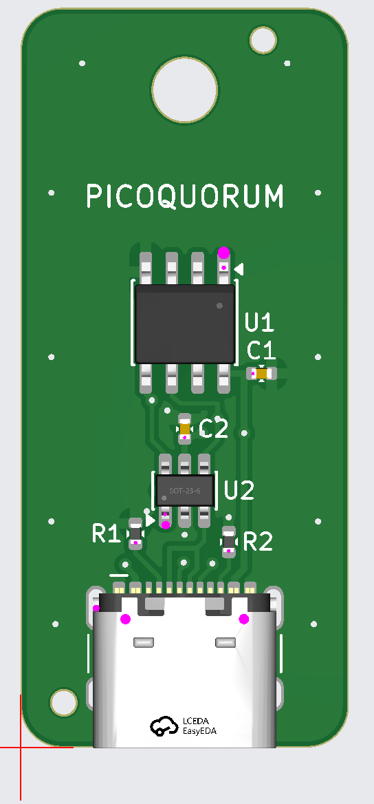

# key-c P2 ordered: the first key board

The first key board actually ordered is the USB-C proposal, not rev A. It's an ATECC608C (I2C,
SOIC-8) behind a USB-C receptacle used as plain wires, with JLCPCB assembling all 5. The design is
in [hardware/key-pcb/PROPOSALS.md](../hardware/key-pcb/PROPOSALS.md), and the files as ordered are
commit `ac34fc55` on `key-pcb-learn`.

**Current status, newest first:** [hardware/key-pcb/key-c-usbc/README.md](../hardware/key-pcb/key-c-usbc/README.md).

| parts side | back |
|---|---|
|  |  |

KiCad renders in the ordered colours. The connector is a stand-in model of the same size: KiCad has
none for the HCTL part.

## How it got here, in one day

1. **Starting point.** The morning's plan was a spring-contact keychain token around a blank
   ATECC608C ("PQ Key C1").
   - Pulling `main` brought in rev A from another session: the PCB is the plug, with gold fingers
     into a card-edge socket and two KiCad projects (key-a SOIC, key-b UDFN).
   - C1 was parked on `key-c1-concept`.
   - Rev A became the design to learn on: [LEARN.md](../hardware/key-pcb/LEARN.md), and
     `tools/keypcb calc` for finger timing, I2C rise time, GPIO power and SPICE.
2. **What `calc` showed.**
   - Build 1's 10 kΩ pull-ups come in at 105 % of the ATECC608C's 300 ns rise time.
   - A GPIO at the 4 mA setting would brown the chip out while signing.
   - Pull-ups on always-on 3V3 would power an "unpowered" key through its ESD diodes.
3. **Why not gold fingers.**
   - JLCPCB's hard-gold, bevelled fingers need a 50 × 50 mm board or panel.
   - Electroplating them needs plating leads, which would defeat the staggered DETECT finger.
   - The socket costs $3–6 and is rated for about 500 insertions.
   - So the question became which off-the-shelf connector.
4. **Two proposals**, written by `gen_cd.py` beside rev A, both with the same circuit:
   - **key-c:** a USB-C *receptacle* on the key. That's 16 pins on one side, cheap and
     JLCPCB-assembled. The plug-on-key option needed a 24-pin straddle part with pads on both
     sides.
   - **key-d:** five pogo pads and two magnet holes.
   - USB-C won the first order because a $3–5 breakout and any cable test it on Build 1, and nothing
     needs hand-soldering. Pogo needs a dock first.
5. **The logo.** The brand mark went onto the back in one colour: the signed dots solid and the
   waiting dots as rings.
6. **First upload (P1).** It went as far as the parts page. Then an outside review of the design
   found four things:
   - the console can't power USB-C from a GPIO, and must stop back-feed
   - the console must sense CC1 and CC2 separately
   - J1's land pattern came 0.18 mm from its peg holes, under JLCPCB's 0.20 mm limit
   - U2 could sit closer to the connector, with its own bypass cap
7. **P2** fixed the key-side points and added test pads. The console-side points became
   requirements in PROPOSALS.md. That's the design ordered.

## Lessons from the first order

- **Fixed costs dominate a small order.** Setup ($8.24), stencil ($1.55) and $3.09 per *extended*
  part type come to about $19 of the $38.96. Basic parts (the 0402 R and C) add no feeder fee.
- **Economic vs Standard assembly.**
  - Economic wasn't offered with ENIG, but was with HASL.
  - Standard forces the board to 70 × 70 mm with rails, which would have cost several times as
    much.
- **A yellow ⓘ isn't always a stock problem.** J1 showed qty 0, unticked, with a warning. That was
  only a $0.03/pc special-handling fee, and ticking the box accepted it.
- **KiCad and JLCPCB disagree about rotation.** SOIC-8 and SOT-23-6 both came up 90° off. Check
  every pin-1 dot against its silkscreen triangle, every time.
- **Edits made in the placement preview aren't in any file you can download.** Only the placement
  confirmation shows them.
- **Economic assembly adds tooling holes inside the board.** Paying $1.05 for Confirm Production
  file shows where, before anything is drilled.
- **The production file can be checked independently.**
  - `yg/` holds the original upload; `ok/` holds JLCPCB's CAM output (`tl`/`bl` copper, `to`/`bo`
    silkscreen, `ts`/`bs` mask, `drl`, `ko` outline, `sk` via covering). All are Gerbers without
    extensions.
  - A drill-by-drill comparison and a pixel diff per layer showed exactly what they changed.
  - GerbView opens all of it.
- **Read the cart line before paying.** The finish, the size and the price can quietly differ
  from the quote. Deleting one line of a PCB+PCBA pair deletes both.
- **Shipping.** Global Standard (about $6–7.50) covers orders under $59. Otherwise choose
  express with **DDP**, so duties are prepaid.

## The order

| | |
|---|---|
| Placed | 2026-10-02 16:10, JLCPCB order **W2026100307101209** |
| PCB | **Y4-13710122A** (customer code 13710122A, order Y4), production order 86289523 |
| PCBA | Economic, top side, **SMT026100263772-13710122A** |
| Quantity | 5 boards, 5 assembled |
| Board | 2 layers, 16 × 36 mm, 1.6 mm FR-4 TG135, 1 oz, LeadFree HASL, blue mask, white ink-jet silkscreen, tented vias, 0.3 mm via holes (0.4/0.45 mm pads), "Remove Mark", ±0.2 mm outline, IPC Class 2, flying-probe electrical test |
| Edges | **not deburred.** The final order says "Deburring/Edge rounding: No", although an earlier quote had it. Sand the edges lightly if they feel sharp |
| Approvals | Production file: **confirmed**. Parts placement: yes, pending |
| Shortage | "Require Full Quantity": all 5 or nothing |
| Tooling holes | added by JLCPCB (Economic) |
| Shipping | Global Standard Direct Line, 8–13 business days |
| Cost | PCB $6.22 (0.12 kg), PCBA $22.95 (after a $10 new-customer coupon), shipping $7.51, sales tax $2.28. **Total $38.96**, about $7.80 per assembled key |
| Timing | factory closed Oct 1–4 for the holiday; estimated ship date 2026-10-04 |

## Parts, as JLCPCB matched them

From the order's parts page. The maker is read from the part number.

| ref | part | MPN | maker | LCSC | JLCPCB type |
|---|---|---|---|---|---|
| U1 | secure element, I2C, SOIC-8 | ATECC608C-SSHDA-T | Microchip | C28975195 | Extended |
| U2 | 2-line ESD array, SOT-23-6 (3.5 pF, 5.25 V) | USBLC6-2SC6 | STMicroelectronics | C7519 | Extended |
| J1 | USB-C receptacle, 16 pins, 5 A, 7.35 mm | HC-TYPE-C-16P-01A | HCTL | C2894897 | Extended, plus a $0.03/pc special-handling fee |
| C1, C2 | 100 nF 16 V X7R ±10 %, 0402 | CL05B104KO5NNNC | Samsung Electro-Mechanics | C1525 | Basic |
| R1, R2 | 5.1 kΩ 50 V 62.5 mW thick film, 0402 | 0402WGF5101TCE | UNI-ROYAL | C25905 | Basic |
| TP1–TP4 | test pads on the back | (copper only, not assembled) | | | |

- **U1 is the SSHDA part, the I2C version.** SSHCZ is single-wire and would never answer the
  console.
**The final list,** from the PCBA line's Product Details (2026-10-02). All five parts are
selected, none left out:

| ref | LCSC | qty bought | cost |
|---|---|---|---|
| J1 | C2894897 | 5 | $0.50 |
| U2 | C7519 | 7 (2 spare) | $1.24 |
| U1 | C28975195 | 5 | $9.90 |
| C1, C2 | C1525 | 10 | $0.05 |
| R1, R2 | C25905 | 10 | $0.02 |

- **Components $11.71.** The quote also had extended-part fees of $9.27 (3 × $3.09), setup $8.24
  and stencil $1.55.
- **PCBA settings:**
  - Economic, top side, 1 × 1, tooling holes by JLCPCB
  - High-temperature paste, nitrogen reflow
  - Antistatic bubble film
  - No baking, cleaning, coating, flying-probe or function test
  - **No photo confirmation**, so no pictures of the finished boards before they ship
  - "Complete File, just proceed with my own files"
- **Customs:** "Research/Education/DIY/Entertainment/Development Board", HS code 847330.

## The files

| what | SHA-256 |
|---|---|
| `key-c-usbc-gerbers.zip`, as uploaded | `99a6dbb54376a3be0319bdf24b05c34b59a89f06e64d144d533db4c7fc5d8c3a` |
| `bom.csv` | `35e4c74bba236b069fb0b4d20083d5f99ac83824c5c7ac436c0a2607fca88ca0` |
| `cpl.csv` | `71cbe0855ffa0489ed827248a1cd9645d6a2e000b907d65cbb106b7b41ee7704` |
| JLCPCB's production file, `key-c-usbc-gerbers_Y4.zip` | `d201d93096be3f5b463d4a1935a87e5e4cd1961694f1fbb1d9a71d7d4b7bfa9f` |

## Checking JLCPCB's production file

They send back their own CAM output (`ok/`, made with jlccam) next to the upload (`yg/`). Compared
against the design:
- **The input is unchanged.** `yg/` is byte-identical to the uploaded files, all 11 of them.
- **Drills match.**
  - All 29 of ours are there, at **0.000 mm** offset.
  - The 22 vias stay 0.30 mm.
  - The shell-leg slots went from 0.60 to 0.75 mm, the peg holes from 0.65 to 0.70 mm and the
    lanyard hole from 3.00 to 3.05 mm. That's plating allowance.
  - **They added 2 tooling holes, 1.152 mm**, at (2.1, 2.2) and (11.8, 34.4) mm from the
    bottom-left corner. Both are in plain ground pour with the pour cleared around them, away from
    any trace, the logo and the connector.
- **Copper** is the same except that cleared pour, plus a hair of etch allowance on the edges.
- **Silkscreen:** the logo and all the text are intact. Only marks touching pads were trimmed.
- **Mask:** the usual fab additions. There's a mask-free strip along the board edge, openings at
  the tooling holes and slightly larger pad openings.
- **Settings** in their parameter file: lead-free HASL, blue/white, vias covered, no order mark,
  16 × 36 mm, auto-CAM passed.
- Checked again by hand in KiCad's GerbView, then **confirmed**.

## Placement, in JLCPCB's preview

- **U1 and U2 came up turned 90°.** Each was rotated until its pin-1 dot sat at the silkscreen
  triangle and its legs were on the pads.
- **J1 was nudged slightly** onto its pads. In the 3D view its pegs drop into the peg holes and its
  shell tabs into the slots.
- **C1, C2, R1 and R2** were left as placed.
- **The saved placement view checks out.**
  - U1's pin-1 dot is at its triangle (top right) and U2's at its triangle (bottom left), with the
    legs on the pads.
  - J1's peg marks measure 6.28 mm from the edge and ±2.89 mm from the centre on the image (about
    39 px/mm). That's exactly the peg holes, with the leg row on the pad row.
- **These changes live in JLCPCB's system, not in the file.** The `cpl.csv` you can download from
  the order is byte-identical to the one uploaded (same SHA-256 as above). The rotations and the
  nudge will only show up in the parts-placement confirmation.

## JLCPCB's parts-placement review (2026-10-04)

Email: "The parts placement of your order SMT026100263772 is completed. The order is ready for
manufacturing now." It has to be confirmed in Order History within 72 hours, or the order goes
into production anyway.

The pink dots in JLCPCB's preview mark the pin each part's model calls pin 1. They only matter on
parts that have a right way round:
- **U1 (ATECC608C):** the dot is on the top-right pad at the silkscreen triangle, and the body's
  dimple is at the same end. ✅
- **U2 (USBLC6-2SC6):** the dot is on the bottom-left pad at its triangle, with the
  "SOT-23-6" marking reading upright. This one matters, because pin 2 is GND and pin 5 is VBUS. ✅
- **J1 (HCTL USB-C):** the dots are the model's reference points on the pegs and the shell. The
  opening faces the board edge and the pin row lands on the pad row. ✅
- **C1, C2, R1, R2:** 0402 capacitors and resistors aren't polarized, so which end has the dot
  doesn't matter. Nothing to do.

This matches the placement view saved on 2026-10-02, so nothing moved in their review.

| line | part | package | LCSC |
|---|---|---|---|
| C1, C2 | Samsung CL05B104KO5NNNC, 100 nF | 0402 | C1525 |
| R1, R2 | UNI-ROYAL 0402WGF5101TCE, 5.1 kΩ | 0402 | C25905 |
| J1 | HCTL HC-TYPE-C-16P-01A | SMD | C2894897 |
| U1 | Microchip ATECC608C-SSHDA-T | SOIC-8 | C28975195 |
| U2 | ST USBLC6-2SC6 | SOT-23-6L | C7519 |

All 7 are on the top side, with SMT assembly.

## 3D models for CAD (2026-10-04)

These are STEP files of the board as ordered, for designing a handle or cap in Onshape:
- [`key-c-P2.step`](../hardware/key-pcb/key-c-usbc/3d/key-c-P2.step) is the assembled board.
- [`key-c-P2-board-only.step`](../hardware/key-pcb/key-c-usbc/3d/key-c-P2-board-only.step) is the
  bare board.

How they were made and what's in them:
- **Source:** a scratch copy of the ordered board, with
  `kicad-cli pcb export step --user-origin 108x118mm`. The board files are untouched.
- **Origin:** the board centre. Z = 0 is the back face, the USB-C end is at −Y, and units are mm.
- **Connector:** KiCad has no HCTL model, so J1 is the GCT USB4105 model, as in the renders. Its
  pads and pegs are identical to the HCTL's, at the same footprint origin. Its body may differ from
  the real HCTL shell by a few tenths of a mm. Check the HCTL drawing, or measure a real board,
  before designing a tight fit around it.
- **Thickness:** the bare board is modelled at 1.51 mm (no copper or mask). The real board is
  1.6 mm nominal.

## Still to record

- [x] The PCB's final details, from the order's Product Details (2026-10-02): as above
- [x] The PCBA's final parts list (above): C2 is on the C1525 line, 10 bought
- [x] The saved placement view (above)
- [x] JLCPCB's parts-placement review (2026-10-04): checked, as above
- [ ] Placement confirmed in Order History (due within 72 h of the 2026-10-04 email)
- [ ] Tracking, arrival, and the first bench test (the console end needs its protected VBUS switch
      and separate CC sensing first: see PROPOSALS.md)
