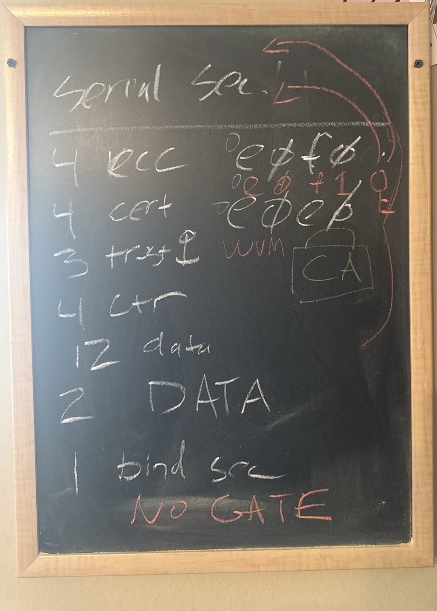
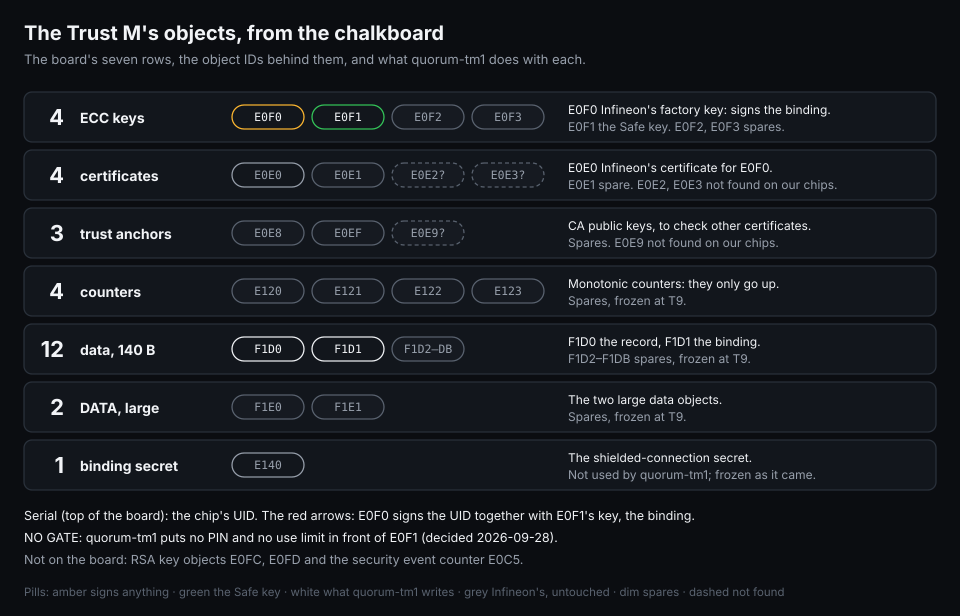

# 2026-10-05 — chalkboard: the Trust M's objects

A chalkboard session while listening through how the OPTIGA Trust M is laid out. These are notes
to myself on how to picture its configuration, and not everything made it onto the board. The
redraw below fills in the object IDs from `firmware/tmcfg.py` and [docs/TRUSTM.md](../docs/TRUSTM.md).

## What's on the board

| On the board | Objects | In quorum-tm1 |
|---|---|---|
| Serial sec. | the chip's UID | bytes 11–20 are the serial the console shows |
| 4 ecc, `e0f0`, `e0f0 +1` | E0F0–E0F3 | E0F0 Infineon's factory key; E0F1 (E0F0 + 1) the Safe key; E0F2, E0F3 spares |
| 4 cert, `e0e0` | E0E0–E0E3 | E0E0 Infineon's certificate for E0F0; E0E1 spare |
| 3 trust, the CA padlock | E0E8, E0E9, E0EF | trust anchors: CA public keys for checking other certificates; E0E8, E0EF spares |
| 4 ctr | E120–E123 | monotonic counters, spares |
| 12 data | F1D0–F1DB, 140 bytes each | F1D0 the record, F1D1 the binding, F1D2–F1DB spares |
| 2 DATA | F1E0, F1E1 | the large data objects, spares |
| 1 bind sec | E140 | the shielded-connection binding secret, untouched, frozen at T9 as it came |
| NO GATE, in red | | nothing gates E0F1: no PIN, no use limit |

How I read the rest:
- **The red arrows** run from E0F0 and E0F0 + 1 up to "Serial sec.". That's the binding: E0F0
  signs a statement over the UID and E0F1's public key (TRUSTM.md, "The binding").
- **NO GATE** is the 2026-09-28 decision: no use limit and no PIN in the first profile. The kickoff
  still lists a PIN with attempt limiting as the critical open question for a portable key.
- I can't make out the red word beside the trust anchors.

## Redrawn

Drawn by `tools/brandkey-figures`.

## What the board turned up

The board has 4 certificate objects and 3 trust anchors: E0E0–E0E3, E0E8, E0E9 and E0EF. The
2026-09-28 probe of the real chip listed E0E1, E0E8 and E0EF as spares (`tmcfg.SPARES`). E0E2,
E0E3 and E0E9 aren't in it: either this chip doesn't have them, or the probe didn't ask.

That matters for T9. T9 freezes only the objects it lists, so on a Trust M that has E0E2, E0E3 or
E0E9 they would stay as they came. Before TM3:
- probe E0E2, E0E3 and E0E9 on TM2 and on TM3;
- if any answers, add it to the spares, or have T1 refuse a chip with an object the profile
  doesn't know.

## Also today

The plan for branded ATECC608 keys, with figures: [docs/BRANDKEY.md](../docs/BRANDKEY.md). The
chalkboard was about the Trust M; the brand key is the ATECC608's answer to the Trust M's factory
key, and a stricter one, because it can't sign anything the chip didn't compose.
