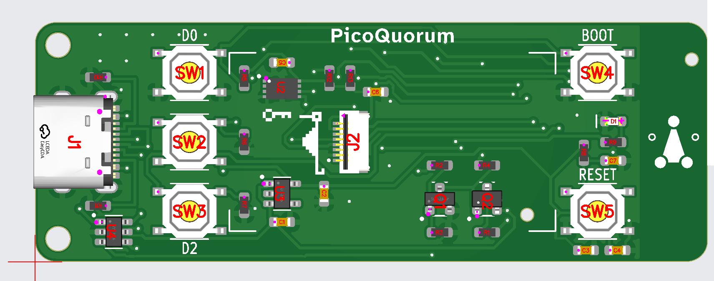

# console-s3 rev A ordered: five boards

The first console board ordered: [hardware/console-s3](../hardware/console-s3/DESIGN.md), five made
and assembled by JLCPCB, the module still to go on by hand. This is option A from
[ORDER-PLAN-2026-10-24.md](../ORDER-PLAN-2026-10-24.md): Economic assembly, front only. PicoQuorumKey
isn't in this order.

What this page is from: the PCB and PCBA lines of the order, the PCBA's price breakdown (a
screenshot), the order's BOM page, JLCPCB's invoice and its sales contract. Not yet seen: the
receipts for the parts bought elsewhere (modules, panels).

## The order

| | |
|---|---|
| Placed | 2026-10-24; JLCPCB dates the invoice and contract 2026-10-25. Batch **W…1507** |
| PCB | order **Y6**, production order …122A (the account's customer code is left out here) |
| PCBA | Economic (setup $8.24 is Economic's), top side, **SMT…2244** |
| Quantity | 5 boards, 5 assembled |
| Status | Data Preparation, both lines, when read |
| Board | 2 layers, 64 × 22.86 mm, 1.6 mm FR-4 TG135, 1 oz, LeadFree HASL, green mask, white ink-jet silkscreen, tented vias, 0.3 mm via holes (0.4/0.45 mm pads), "Remove Mark", ±0.2 mm outline, IPC Class 2, flying-probe test of every board |
| Delivery | single PCBs, not a panel |
| Edges | not deburred ("Deburring/Edge rounding: No") |
| Approvals | Production file: **No**. Parts placement: **yes** ($0.45); JLCPCB's review checked 2026-10-25 ([below](#jlcpcbs-parts-placement-review-2026-10-25)) |
| Shortage | "Require Full Quantity": all 5 or nothing |
| Build time | PCB 24 hours (PCBA only); assembly 1–2 days |
| Weight | PCB 0.14 kg, PCBA 0.18 kg |
| Files | `console-s3-gerbers.zip`, `bom.csv`, `cpl.csv` (JLCPCB names the order `console-s3-gerbers_Y6`) |
| Shipping | UPS Express Saver, **DDP**: duties paid with the order |

## What it cost

From the invoice. The lines add up to the total.

| line | |
|---|---|
| PCB, Y6 | $5.10 |
| PCBA, SMT…2244 | $45.75 |
| **Merchandise** (5 × $10.17) | **$50.85** |
| Shipping | $29.66 |
| Shipping discount | −$10.00 |
| Subtotal | $70.51 |
| Sales and use tax | $3.95 |
| Import taxes | $17.81 |
| Duty and tax disbursement fee | $4.45 |
| **Total** | **$96.72**, about $19.34 a board |

The PCBA's $45.75, from its price breakdown:

| | |
|---|---|
| Setup | $8.24 |
| Stencil | $1.55 |
| Components | $17.93 |
| Extended components fee | $15.45: 5 × $3.09, so five Extended part types |
| SMT assembly | $1.07 |
| Special components fee | $0.15 |
| Confirm parts placement | $0.45 |
| **These add to** | **$44.84** |

- **$0.91 isn't in the breakdown.** The screenshot's popup may have had another line out of view.
  Check it on the order page.
- **The five Extended types** are U2, U3, U4, J1 and J2, as the plan said: the BOM page marks
  them so ([below](#parts-as-jlcpcb-matched-them)).
- **The $0.15 special fee** is $0.03 × 5, the same as key-c's J1 (the same HCTL USB-C, C2894897).
  Most likely J1 again; neither the breakdown nor the BOM page names it.
- **No small-board fee showed.** The plan warned of one for a side at 30 mm or less. The PCB line is
  $5.10 in all.
- **Not in this order:** the ESP32-S3 modules (LCSC, C2913204), the 1.14″ panels. The plan's $75–90
  counts them, so it can't be held against $96.72 until their receipts are in.
- **Shipping and import were $46** of the $96.72. Import taxes alone are 35 % of the merchandise.

Against the plan's figures: setup $8.24 (plan $8.18), stencil $1.55 ($1.53), Extended fees $15.45
(about $15).

## Parts, as JLCPCB matched them

From the order's BOM page, top side, "Complete File". The page reads "21 parts detected" (the 21
lines of `bom.csv`) and "27 Parts confirmed"; what the 27 counts isn't clear, since the board has 33
placements. Every line is selected, every part from JLCPCB's stock, and each matches `bom.csv`'s
LCSC number.

| ref | value | MPN | part | LCSC | type | qty bought | cost |
|---|---|---|---|---|---|---|---|
| C1, C2, C3 | 10 µF | CL10A106KP8NNNC | 10 V X5R ±10 %, 0603 | C19702 | Basic | 15 | $0.4080 |
| C4, C5, C6 | 100 nF | CC0603KRX7R9BB104 | 50 V X7R ±10 %, 0603 | C14663 | Basic | 15 | $0.1260 |
| C7 | 1 µF | CL10A105KB8NNNC | 50 V X5R ±10 %, 0603 | C15849 | Basic | 5 | $0.0730 |
| D1 | red LED | KT-0603R | 0603, 1.8–2.4 V, 20 mA | C2286 | Basic | 5 | $0.0385 |
| J1 | USB-C | HC-TYPE-C-16P-01A | HCTL, 16 pins, 5 A | C2894897 | Extended | 5 | $0.5020 |
| J2 | panel ZIF | 0.5K-HX-8PWB | HDGC, 8 pins at 0.5 mm, hinged lid, top and bottom contacts | C2919492 | Extended | 7 | $0.6783 |
| Q1 | NPN | SS8050 (range 200–350) | SOT-23, 1.5 A, 25 V | C2150 | Basic | 5 | $0.0740 |
| Q2 | P-MOSFET | AO3401A | SOT-23, 30 V, 4 A | C15127 | Basic | 5 | $0.4795 |
| R1 | 150 Ω | 0603WAF1500T5E | ±1 %, 0603 | C22808 | Basic | 5 | $0.0075 |
| R2, R9 | 1 kΩ | 0603WAF1001T5E | ±1 %, 0603 | C21190 | Basic | 10 | $0.0170 |
| R3–R8 | 10 kΩ | 0603WAF1002T5E | ±1 %, 0603 | C25804 | Basic | 30 | $0.0660 |
| R10, R11 | 5.1 kΩ | 0603WAF5101T5E | ±1 %, 0603 | C23186 | Basic | 10 | $0.0150 |
| R12, R13 | 4.7 kΩ | 0603WAF4701T5E | ±1 %, 0603 | C23162 | Basic | 10 | $0.0280 |
| SW1–SW5 | D0, D1, D2, BOOT, RESET | TS-1187A-B-A-B | 5.1 × 5.1 mm tactile, SMD | C318884 | Basic | 25 | $0.5175 |
| U2 | secure element | ATECC608C-MAHDA-S | Microchip, UDFN-8 2 × 3 mm | C23291019 | Extended | 5 | $13.1985 |
| U3 | 3.3 V LDO | ME6211C33M5G-N | SOT-23-5, 500 mA | C82942 | Extended | 7 | $0.4459 |
| U4 | ESD array | USBLC6-2SC6 | SOT-23-6, 3.5 pF | C7519 | Extended | 7 | $1.2579 |

- **The lines add to $17.93,** the breakdown's Components.
- **U2 is three quarters of it:** $13.20, $2.64 a chip, the plan's price. It was in stock: five
  bought, none short.
- **Spares:** two each of J2, U3 and U4 (seven bought for five boards). Everything else is exact.
- **Not on the page:** U1, the module. It isn't in `bom.csv`, as option A means.

## JLCPCB's parts-placement review (2026-10-25)

JLCPCB's engineer adjusted the placement and asked: "Can we proceed PCBA with the corrected parts
placement?" The page lists 33 designators, all assembled, none left out, all top side, SMT. Each
row's maker, part and LCSC number matches the BOM page above. The page doesn't say which parts the
engineer moved.

`tools/keypcb jlc` wasn't run for this (no KiCad here), so there was no `cpl-overlay.png`. Instead
each part's pad 1 was read from `console-s3.kicad_pcb` and turned into the CPL's coordinates (origin
the bottom-left corner, y up), then found in the preview. The pink dot is the pin JLCPCB's model
calls pin 1.

- **U2 (ATECC608C):** dot and the body's dimple at the top-left pad, our pad 1 at (22.05, 17.25). ✅
- **U3 (ME6211):** dot and dimple at the top-left pad, pad 1 at (22.36, 7.45). Three pins left, two
  right, as the footprint. ✅
- **U4 (USBLC6-2SC6):** dot at the top-left pad, pad 1 at (6.36, 3.8). ✅
- **Q1, Q2 (SOT-23):** dot at the bottom-left pad, pad 1 at (37.55, 4.9) and (42.05, 4.9); the single
  lead at the top, as the footprint. ✅
- **D1 (red LED):** JLCPCB marks the left end − (with the part's green cathode mark) and the right
  end +. Our pad 1, on the left at (54.22, 13.4), is GND, the cathode; pad 2 is LED_A. ✅
- **J1 (USB-C):** the opening faces the left edge and the pin row lands on the pad row. The dots are
  the model's reference points. ✅
- **J2 (panel ZIF):** the leads sit on the eight pads at x 28.75 and the body and its two tabs are to
  the right, so the slot faces right, where the ribbon comes in from (DESIGN.md). ✅
  JLCPCB's pin-1 triangle is at the **top** of the row; our pad 1 (LCD_LEDA) is at the **bottom**,
  y 9.68, and the top one is pad 8 (LCD_CS). That is only the model's numbering: the eight contacts
  are the same, so each pad still meets the same ribbon conductor. Nothing to change.
- **SW1–SW5:** each sits on its four pads with the same dot, at rotation 0 as in the CPL. The preview
  can't show which legs are joined inside, so a switch turned 90° would look the same. **On the
  bench, before anything else:** meter pad 1 to pad 2 of each switch, open until pressed. Turned 90°,
  D0 or BOOT would read as always pressed.
- **R1–R13, C1–C7:** not polarized. Each sits on its pads.

Nothing found that needs "No, modification needed."

## The files

The design files in the repository at `2c76e25` (2026-10-24), the last commit to touch `fab/`:

| what | SHA-256 |
|---|---|
| `console-s3-gerbers.zip` | `981659a1af8d4211ced5b98fefd6cf0fee05c22684e1d8c409c7603eceebbc82` |
| `bom.csv` | `17d619a182168daaf0002c4474c381d5098c370ec591d821170753e3c9183c0c` |
| `cpl.csv` | `25a60504b7f1c9146d39fed78f6eb906e833b8c459290d7458aa91458874962d` |

**Not yet checked against what was uploaded.** Download the BOM and CPL from the order, and the
Gerbers if JLCPCB offers them, and compare hashes as for key-c.

## Different from the plan

- **Confirm Production File: No.** The plan said yes. On key-c it showed where Economic assembly put
  its tooling holes, and that board is 16 mm wide; this one is 22.86 mm. The holes go in without
  that check. Look for them when the boards arrive, and on the placement preview if it shows them.

## Still to record

- [x] The BOM page as JLCPCB matched it (above): $17.93, U2 in stock
- [ ] The $0.91 the breakdown doesn't show
- [ ] The PCBA settings (paste, packaging, photo confirmation, customs category)
- [ ] The receipts for the parts bought elsewhere: modules, panels
- [ ] The uploaded files' hashes, against the table above
- [x] JLCPCB's parts-placement review (2026-10-25): checked, as above
- [ ] Placement confirmed in Order History ("Yes, please proceed to production"), and the production
      progress after
- [ ] On the bench: each switch open until pressed (the preview can't show it)
- [ ] Tracking, arrival, and the bench steps in the plan's "When they arrive"
