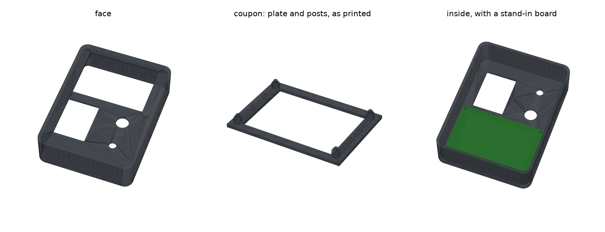

# 2.8-inch console case

Jason's Onshape draft of a console built around the Lonely Binary 2.8-inch SPI LCD (240 × 320,
ST7789, ASIN B0GR4HRVV2), with mounting posts for the LCD board added by [`gen.py`](gen.py).
It is not the Waveshare dev console in the folders above.



```sh
uv run --python 3.11 --with cadquery python cad/console/lcd28/gen.py
```

| file | what |
|---|---|
| `dial-and-button.step` | the Onshape draft, as exported: the shell, no posts. Source of truth for the shell |
| `LCD-REFERENCE.md` | what is and isn't known about the LCD, and the measurement worksheet |
| `out/console28_v1.stl` | the case with posts, face down, ready to slice |
| `out/console28_v1.step` | the same, in the draft's own frame, to import back into Onshape |
| `out/console28_v1_coupon.stl` | the face plate around the screen, with the posts. Prints in a fraction of the time; try the real board on it first |

## The draft

The shell is 90 × 120 × 30 mm and open at the bottom, with 2.5 mm walls, a 2.5 mm face plate and
r 8 outer corners.

The face plate holds:
- **Screen window:** 68 × 48 mm, landscape, centred at (0, 28).
- **Dial hole:** 12 mm, at (21, −14).
- **Button hole:** 7 mm, at (21, −40).
- **Chip slot:** 30 × 40 mm, at (−19, −25). An open rectangle for now; a way to swap signing
  chips comes later.
- **Blind holes:** two 3 mm holes, 1 mm deep, on the plate's underside at (−37, −25) and
  (−1, −25), flanking the chip slot.

`gen.py` keeps all of that as is. To change the shell, edit it in Onshape, export it over
`dial-and-button.step`, and run `gen.py` again. If the shell's size changes, `gen.py` stops and
asks you to update its shell numbers.

## v1 (2026-10-02): LCD posts

The posts work like the [key tray's](../../key/README.md): a boss the board rests on and a
chamfered peg through each mounting hole, 0.1 mm under the hole size. The 2.40 mm in 2.5 mm fit
won the tray's fit check.
- The bosses hang from the underside of the face plate.
- The board's front face rests on them, and its glass stops 0.3 mm short of the plate, so the
  plate never presses on the glass.
- The case prints face down, so the posts print standing up, with no supports.

`gen.py` checks four things:
- no post lands in the screen window
- the board fits inside the walls
- nothing in the case overlaps the board
- no post runs into a wall

**The LCD numbers are placeholders.** Lonely Binary publishes no mechanical drawing (see
`LCD-REFERENCE.md`). Every `_GUESS` value at the top of `gen.py` is a stand-in.

| name | placeholder | measure |
|---|---|---|
| `PCB_X_GUESS`, `PCB_Y_GUESS` | 80 × 54 | board outline, landscape |
| `PCB_T_GUESS` | 1.6 | board thickness |
| `HOLE_D_GUESS` | 3.0 | mounting hole diameter |
| `HOLE_INSET_GUESS` | 3.0 | hole centre to the board edges; if the holes aren't symmetric, give each hole's x, y instead |
| `FRONT_Z_GUESS` | 4.0 | front of the glass or frame above the board's front face |
| `LAND_D_GUESS` | 5.5 | flat ring around each hole the boss can press on |
| `BOARD_OFFSET_GUESS` | (0, 0) | where the board sits relative to the window: the glass may be off-centre on its board |

With those placeholders, the posts land at (±37, 4) and (±37, 52), just outside the window
corners. The board's front face is 4.3 mm below the plate.

**Open:**
- **The board doesn't stay on by itself.** With the case face up, the board hangs on the pegs, so
  something has to keep it there. Options: screw bosses instead of pegs (pilot holes for M2.5 or
  M3 self-tappers, once the hole size is known), a back cover that presses the board up, or
  melting the peg tips over.
- **The window.** It is 68 × 48. The estimated active image is 56.9 × 42.7. Once the glass and the
  lit area are measured, the window should overlap the dark border around the image and hide the
  board.
- **The ribbon and connector.** Their room behind the board isn't modelled yet.
- **The rest of the case:** the dial and button mounts, and the chip carrier.
