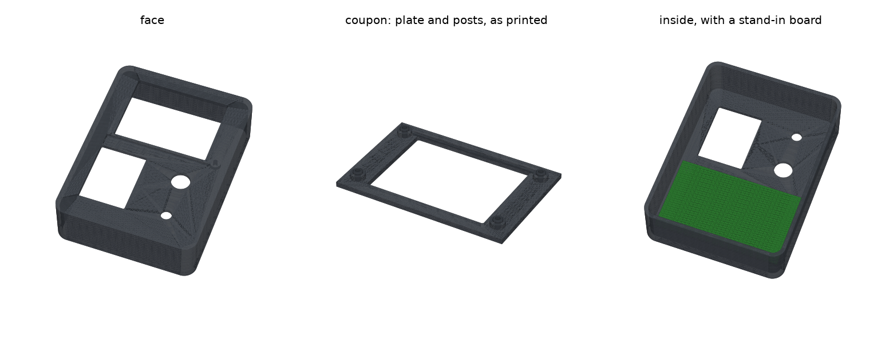

# 2.8-inch console case

Jason's Onshape draft of a console built around the Lonely Binary 2.8-inch SPI LCD (240 × 320,
ST7789, ASIN B0GR4HRVV2). [`gen.py`](gen.py) resizes its screen window and adds mounting posts
for the LCD board. It is not the Waveshare dev console in the folders above.



```sh
uv run --python 3.11 --with cadquery python cad/console/lcd28/gen.py
```

| file | what |
|---|---|
| `dial-and-button.step` | the Onshape draft, as exported: the shell, no posts. Source of truth for the shell |
| `LCD-REFERENCE.md` | what is and isn't known about the LCD, and the measurement worksheet |
| `out/console28_v2.stl` | the case with posts, face down, ready to slice |
| `out/console28_v2.step` | the same, in the draft's own frame, to import back into Onshape |
| `out/console28_v2_coupon.stl` | the face plate around the screen, with the posts. Prints in a fraction of the time; try the real board on it first |

## The draft

The shell is 90 × 120 × 30 mm and open at the bottom, with 2.5 mm walls, a 2.5 mm face plate and
r 8 outer corners.

The face plate holds:
- **Screen window:** 68 × 48 mm, landscape, centred at (0, 28).
- **Dial hole:** 12 mm, at (21, −14).
- **Button hole:** 7 mm, at (21, −40).
- **Chip slot:** 30 × 40 mm, at (−19, −25). An open rectangle for now; a way to swap signing
  chips comes later.
- **Blind holes:** two 3 mm holes, 1 mm deep, on the plate's underside at (−37, −25) and
  (−1, −25), flanking the chip slot.

`gen.py` keeps all of that except the screen window, which it fills and re-cuts (v2 below). To
change the shell, edit it in Onshape, export it over `dial-and-button.step`, and run `gen.py`
again. If the shell's size changes, `gen.py` stops and
asks you to update its shell numbers.

## v2 (2026-10-02): measured board, smaller window, screw pilots

**The LCD, from Jason's calipers:**

| what | mm |
|---|---|
| board | 80 × 48.6 × 1.6 (bare board) |
| mounting holes | 4.5, centres about 4 from the edges |
| board back to glass front | 3.8, so the glass front is 2.2 above the board |
| glass | 64.3 × 47.5, about centred on the board |

The active image is still an estimate: 56.9 × 42.7, calculated from the 2.8-inch diagonal and
assumed centred on the glass.

**The window:** 60 × 45, r 1, centred where the draft's was. The draft's 68 × 48 was bigger than
the glass, so the board would have shown around it, and the holes sit inside its width. `gen.py`
fills it and cuts the new one. That leaves 1.5 mm (x) and 1.15 mm (y) of margin around the
estimated image, and the plate covers the glass edge by about 2 mm (x) and 1.25 mm (y).

**The posts:**
- **Positions:** (±36, 7.7) and (±36, 48.3).
- **Bosses:** 7 mm across, so they clear the glass by 0.35 mm. The board's front face rests on
  them, 2.5 mm below the plate, which leaves the glass 0.3 mm short of the plate.
- **Pegs:** 4.4 mm in the 4.5 mm holes. They stop 0.3 mm inside the board, so they locate the
  board but don't stick out the back.
- **Pilot holes:** each post has a 2.5 mm pilot hole for an M3 self-tapping screw from behind. Its
  head (with a washer: an M3 head only just covers a 4.5 hole) clamps the board onto the boss.
  Use **M3 × 5 or shorter**: the pilot stops 1 mm under the face, 5.6 mm from the board's back
  face. Set `PILOT_D = 0` for solid pegs.

The checks:
- The window shows the whole estimated image and stays at least 1 mm inside the glass.
- No post lands in the window or presses on the glass.
- Nothing in the case overlaps the board or the glass.
- No post runs into a wall.

**Print the coupon first** (`out/console28_v2_coupon.stl`): just the plate around the screen
and the four posts, 85 × 57 × 6 mm. Check that:
- the pegs go into all four holes, which checks the 4 mm hole inset
- the glass sits under the window with dark border showing all round
- the screws bite

**Open:**
- **Hole diameter:** if 4.5 was the gold ring rather than the drilled hole, the pegs won't go in.
  Measure the drilled hole and set `HOLE_D`.
- **The window:** once the screen is lit with an edge test pattern, measure the real image and
  where it sits on the glass. The image is often off-centre, away from the ribbon side. Then set
  `WINDOW` to cover it with a hair of margin.
- **The ribbon and connector:** their room behind the board isn't modelled yet.
- **The rest of the case:** the dial and button mounts, and the chip carrier.

v1 put the posts on placeholder numbers before the board was measured. It was never printed, and
its files are gone.
