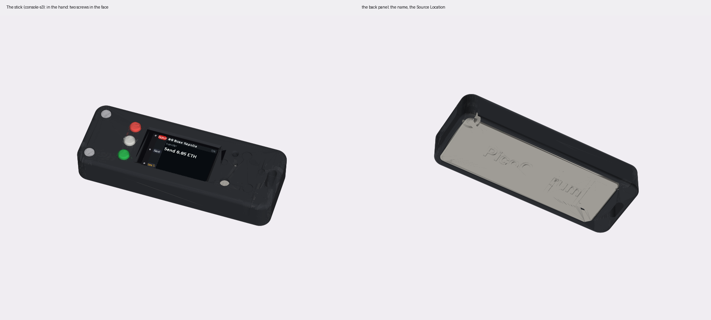
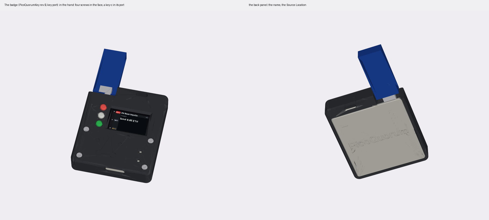
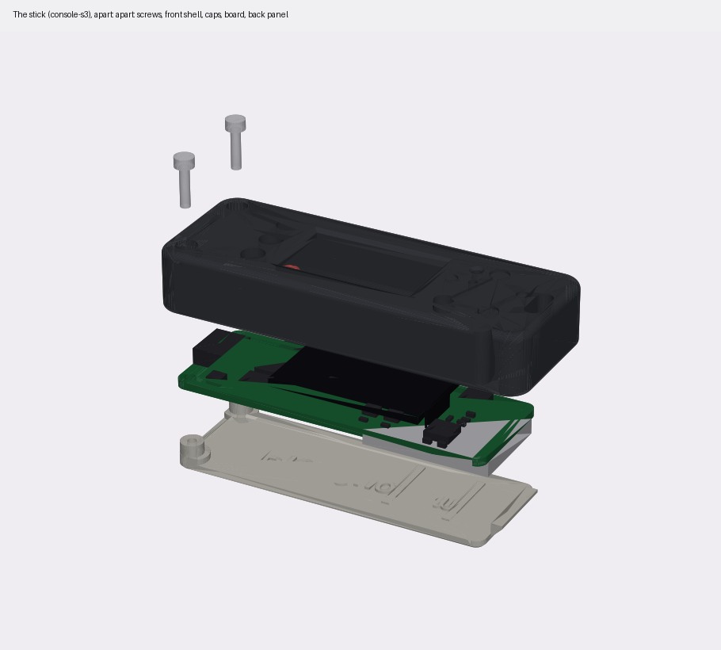
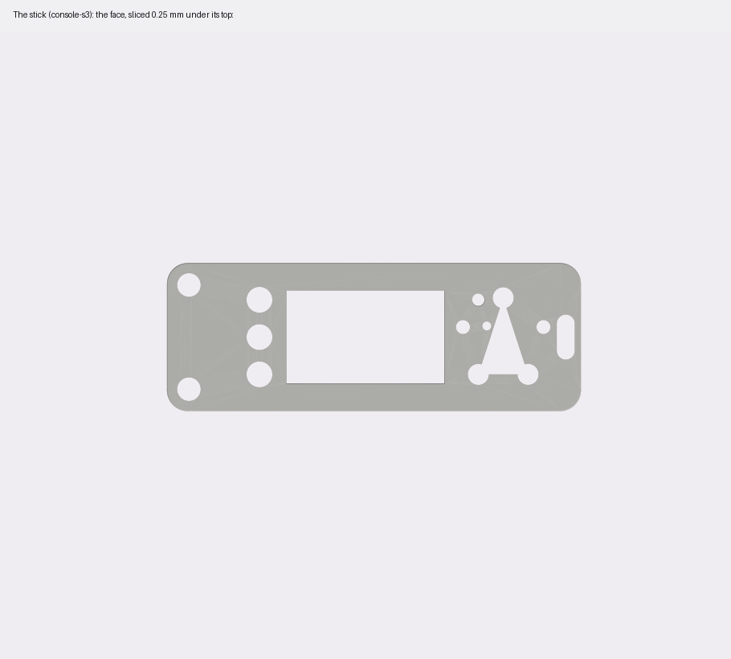
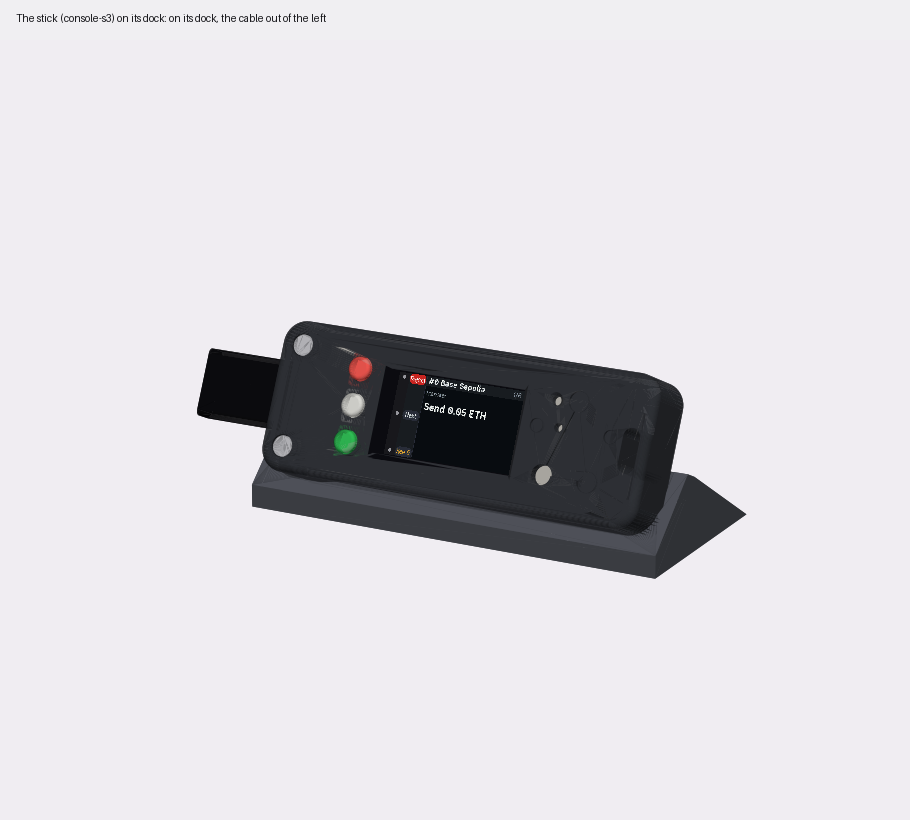
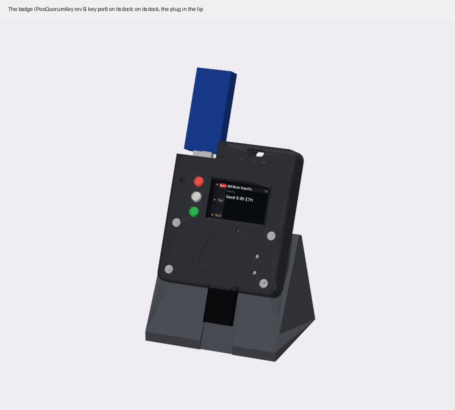
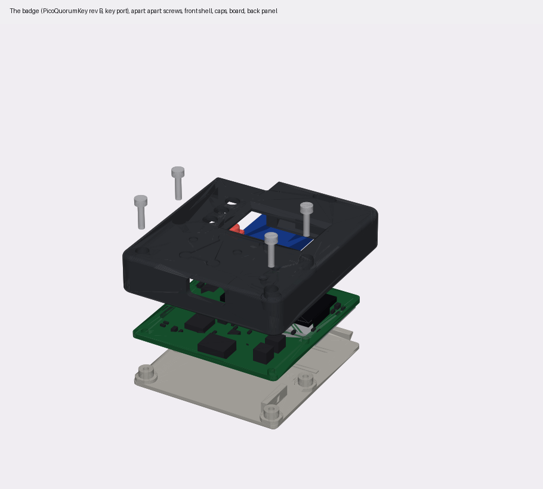

# Cases for the console boards

Two cases for the two S3 boards from JLCPCB, and a dock for each:
- **the stick**, for [console-s3](../../hardware/console-s3/DESIGN.md)
- **the badge**, for [PicoQuorumKey rev B](../../hardware/picoquorum-key/README.md) with its key port fitted

**Status, 2026-11-03:** a first draft of each, drawn the day the boards arrived. The first badge was
drawn for rev A. Its plate was printed and laid on a board: the board was rev B, and the rib above
the screen sat on U6 and U7, the key port's chips. The badge is drawn for rev B now
([below](#the-badge-picoquorumkey-rev-b)). Then, with caps on, the plate still stood off the board:
its switches are taller than their datasheet says (calipers: 5.5 mm from the board's back to a switch's
top). The badge took that height and became a front shell and a back panel like the stick. Printed, its
caps sat well but flush, and its back panel stood about 1 mm proud. Both are what a 1.6 mm board does
to a case drawn for rev B's 0.8, so the badge is drawn for 1.6 now
([below](#the-badge-picoquorumkey-rev-b)). The badge hasn't been fitted to its board since.

| | the stick | the badge |
|---|---|---|
| board | console-s3 rev A, 64 × 22.86 × 1.6 mm | PicoQuorumKey rev B with the key port, 50 × 53 mm, taken as 1.6 mm thick |
| layout | a front shell and a back panel | a front shell and a back panel |
| closed | 74.6 × 27.5 × 12.4 mm | 54.6 × 63.6 × 12.5 mm |
| screws | 2 × M2 × 8 from the front, at the USB end | 4 × M2 × 8 from the front |
| USB-C | the left end | the bottom edge |
| key | on the board | the top-left corner is open: a key-c plugs into the key port from outside |
| lanyard | a lug at the antenna end | a lug at the top right |
| dock | 81 × 38 × 15 mm, the cable out of the left | 61 × 50 × 48 mm, the plug in a slot in its lip |





## How they go together

One script, [`shell.py`](shell.py), makes both, in the same layout ("shell"):
- **The face and the walls are one front shell,** and a flat panel closes the back.
- **The screws go in from the front,** through the shell's posts and the board's holes, into bosses on
  the back panel. Their heads sit in counterbores in the face: flush, or a little lower where a kit
  screw needs it to reach 3 mm into its boss.
- **The back panel's antenna end hooks in.** That end of the board has no holes, so a tab goes into a
  slot in the end wall. The tab reaches 2.3 mm past the board's edge and stands 2.0 mm over the panel.
  Its underside slopes at 45° from its 0.6 mm tip down to the panel, and the slot's roof slopes with
  it, 0.2 mm clear. So neither prints a flat underside in the air: the first tabs did, and drooped.
  The wall behind the slot is 0.7 mm at its thinnest.

`shell.py` has a second layout, "plate": a tub, and a front plate set into its opening, with the screws
from the back. The first drafts used it; neither case does now.

Both cases also share these:
- **The board's own holes hold it,** clamped between the posts on the face's side and the bosses on the
  back's. Both stay inside the 2.5 mm keep-out ring round each hole on the board.
- **The antenna end is held without metal.** A rib under the face presses on the board's front where it
  has no copper. Two ribs on the back come up under the module's shield. The nearest screw is 23 mm
  from the antenna on the badge, 55 mm on the stick.
- **The window** shows the active area and 0.5 mm round it. The face keeps at least 0.8 mm over the
  glass's edge, and sits 0.15 mm above the glass, so it keeps the glass on its tape.
- **Caps on D0, D1 and D2.** Each cap has a round stem through the face, and a square flange under it
  that keeps it in. The caps are in the brand's colours ([BRAND.md](../../docs/BRAND.md)):
  - D0 is Reject red
  - D1 is white
  - D2 is Sign green

  All three take the same light press. A case mustn't make Reject harder to reach than Sign.
- **BOOT and RESET are holes too small for a thumb.** A paperclip or a pen's tip reaches them, and a thumb
  doesn't press them by mistake. BOOT is a 1.8 mm pinhole. On the badge RESET is too; on the stick it
  is the mark's lower-left dot, 3.75 mm across.
- **A hole over the LED.**
- **The back carries the name, alone.** The faces carry only the mark.



## The stick (console-s3)

[`stick.py`](stick.py). The board is a bar, and the case follows it.
- **The screws are at the USB end only,** in the face. The board's only holes are there, by design: a
  screw at the far end would be metal by the antenna. The posts round them are 6 mm across, so each
  counterbore has a wall; they run into the shell's walls at the corners.
- **The back panel's tab** goes into the end wall inside the lanyard's lug.
- **The mark is big, at the antenna end,** engraved 0.5 mm, 17 mm across its dots. Its lower-left dot is
  RESET's hole, cut through over the switch. The script places the mark from RESET's position and stops
  if the dot isn't over it. The mark misses BOOT's pinhole by 1.1 mm and the LED's hole by 0.4 mm; the
  LED lights just outside the triangle's left edge.
- **The window is 1 mm wider than the active area needs.** The board's render centres the active area
  on the glass. ER-TFT1.14-2's drawing puts it 2.0 mm from the end away from the ribbon. The window
  shows the active area wherever it is, until a panel is measured.
- **The dock** holds it leaning back 25°. The cable comes out of a slot in the dock's left side.





## The badge (PicoQuorumKey rev B)

[`badge.py`](badge.py). Portrait, like a small handheld, with a lug for a lanyard.
- **The key port's corner is open.** The plug stands 9.6 mm out of the board's top edge, at the
  top-left. The case is cut away there, through its whole thickness, for a key-c on the plug: 16 mm
  wide, its edge about 3 mm past the tip. The key stands out of the top like a cartridge. The script
  checks the plug and a plugged key-c against the case.
- **The rib above the screen is on the antenna's keep-out band** (x 30.5–46, the top 7 mm), which has no
  parts. The band to its left holds U6, U7 (the port's ESD chips, 1.45 mm tall), R18 and R17. The
  first badge's rib ran across all of them, x 6–38, so its plate stood about 1.45 mm proud: run against
  rev B, the script finds it on U6 and U7.
- **The board is taken as 1.6 mm thick,** not rev B's 0.8: drawn for 0.8, the printed case's back
  panel stood about 1 mm proud and its caps came out flush. With 1.6, the switches as measured (5.5 mm
  from the board's back to a switch's top, 5.1–5.2 pressed) are 3.9 mm over its front, their
  datasheet's 3.8. The board's thickness hasn't been measured. A straddle plug for the key port needs
  a 0.8 mm board.
- **The caps stand 1.5 mm proud,** not the stick's 1.0, and travel about 0.35 mm. Their flanges sit in
  pockets in the face's underside, so the face is 2.5 mm thick over the glass. The window's edge is
  chamfered 1.5 mm, not 0.8, to keep the screen in view.
- **Four screws in the face,** one by each corner of the board. The back panel's top edge has its tab
  into the top wall, right of the key port's opening.
- **Ribs back the board where it's pressed:** a rib on the back panel under D0–D2, and one under
  BOOT and RESET. They come up to 0.1 mm under the board's back and miss its test pads.
- **A hole over D4,** the key port's LED, at the left edge by D0. It lights when the port powers a key.
- **The mark is big, under the screen,** 18 mm across its dots, with no name beside it. The face over the
  key chip is solid. The back carries "PicoQuorum", 42 mm wide.
- **The dock** holds it leaning back 25°. The plug goes down into a slot in the lip, and the cable
  leaves at the front.

**Rev B only.** Rev A is 44 mm wide and 1.6 mm thick, with no key port; its holes are 6 mm closer
together. The rev A badge is in this folder's history (commit `7990d14`). A rev B board without the
port's parts fits this case; its corner is just open.





## Where the numbers come from

| | the stick | the badge |
|---|---|---|
| outline, holes | the generator (`gen_console_s3.py`) | the outline and the key port's notch from DESIGN.md; the holes from rev B's NPTH drill file |
| every part on the front | `console-s3/fab/cpl.csv` and `bom.csv`, the files JLCPCB built from. The script stops if they disagree with the generator | `hardware/out/rev-b/cpl-port.csv` and `bom-port.csv`, the files for the boards with the port. The script stops if the port's parts aren't in them |
| glass, tape, ribbon fold | the generator: 31 × 17 mm glass, 1.6 mm thick on 2.0 mm tape | DESIGN.md: 31 × 17.6 mm glass, 1.6 mm thick on 1.5 mm tape |
| module | the generator: the WROOM-1 on the back, 3.1 mm | DESIGN.md |
| the key port | | the plug's footprint drawing: 8.4 mm wide, 9.6 mm past the tip; its height (3.4 mm) is a guess. A key-c, 16 × 36 mm, from its design |
| test pads on the back | | `tools/gen/gen_pcb.py`. The ribs under the board miss them |

Each part is a box, at its footprint's usual size and height (`PACKAGES` in `shell.py`). These are not
the makers' models.

## What the script checks, and what it doesn't

When a case builds, the script checks that none of these overlap each other:
- the printed parts: the front shell, the back panel and the caps
- the board, each part's box, the glass and its ribbon fold, the module
- a USB-C plug pushed fully home: 12.4 × 5.5 mm overmold, the handheld's measured cable
- on the badge, the key port's plug and a key-c on it
- the screws
- the dock, with the case in it

It prints a line for each overlap and exits 1 if there is one; both cases build with none. It also
chooses the screw: the longest in the bench's kit (4, 8, 12, 16 mm) that leaves at least 3 mm of
thread in the post or boss, and stops short of the end of its hole.

**It doesn't check fit against a real board.** One thing is measured: the badge's switches. Before printing
the big parts, measure the rest and change the numbers in the scripts:
- **the panel:** the glass's thickness and the tape's (`glass_z`). The face's height follows them.
- **the stick's switches:** the TS-1187A is taken as 1.5 mm tall (`PACKAGES`). The caps sit on them. If
  it is wrong, reprint the caps. The badge's are measured (`SWITCH_TOP` in `badge.py`, from the board's
  back).
- **the badge's board:** taken as 1.6 mm (`T` in `badge.py`). The back's depth and the switches' height
  over the front follow it.
- **the module, as soldered:** 3.1 mm (`WROOM`). The ribs under it follow it.
- **your cable's overmold**, against the 13.2 × 6.2 mm opening (`USB_OPEN`).
- **the badge's key port:** the plug's height, and a key-c on it, against the open corner (`PLUG`,
  `KEYC` in `badge.py`).

## Printing

Every part prints without supports, judging by the shapes. They haven't been sliced.
- **shell:** face down, as written. The USB-C opening's far side is a 13 mm bridge.
- **back panel:** outside down, as written. The bosses, ribs and tab point up.
- **caps:** flange down, one STL each, so each can be its own colour.
- **dock:** on its base, as written.
- PLA or PETG, 0.2 mm layers. The engraving is 0.5 mm deep.

**The fit check:** print the shell first and lay the board in it, face down, with the caps in. Check that:
- the posts land round the holes
- the window frames the screen
- the caps' holes sit over D0, D1 and D2, and the board lies flat on the posts with the caps on its
  switches

## Putting it together

Both go together the same way:
1. Lay the shell face down. Drop the caps in from behind, flange inside: red D0 at the top, white D1,
   green D2.
2. Lay the board in face down, its USB-C to the opening, the glass on the window's lip. On the badge,
   the key port's plug goes into the open corner.
3. Put the back panel's tab into the slot in the end wall (the stick's right end, the badge's top),
   then lower the other end onto the board.
4. Hold the panel on, turn the case face up, and put the M2 × 8 screws in through the face.
5. Turn each screw until it is snug, no tighter: it cuts its own thread in the panel's boss.
6. Press each cap. It should click and come back.

## Run

```sh
tools/case build stick badge
```

Each script runs on its own too:

```sh
uv run --python 3.11 --with cadquery --with matplotlib --with pillow python cad/consoles/stick.py [screen.png]
```

They write `out/stick/` and `out/badge/`:
- the STLs to print
- `<name>_assembly.step`, with the board's stand-ins
- `<name>_face.png`: the face sliced just under its top, which shows the engraving
- the other pictures, with the Feather's review screen (`docs/quorum-ui/feather/03-review-head.png`) on the
  panel, or the PNG given
