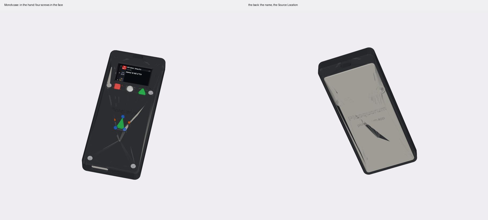
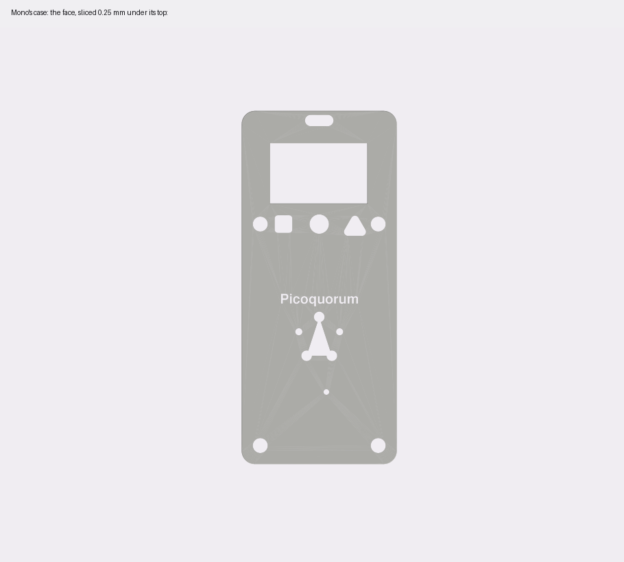
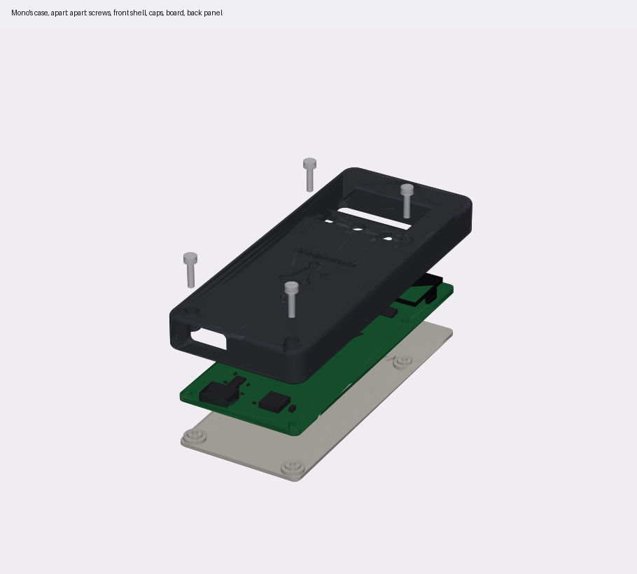
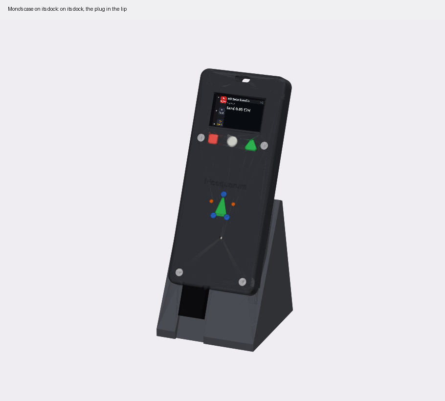
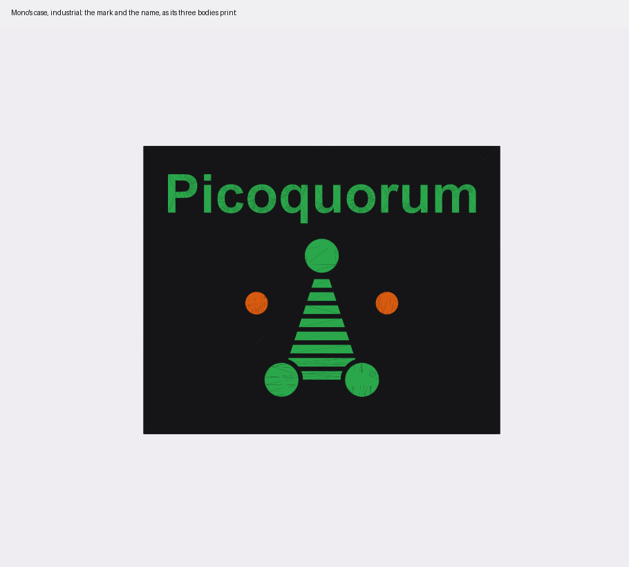
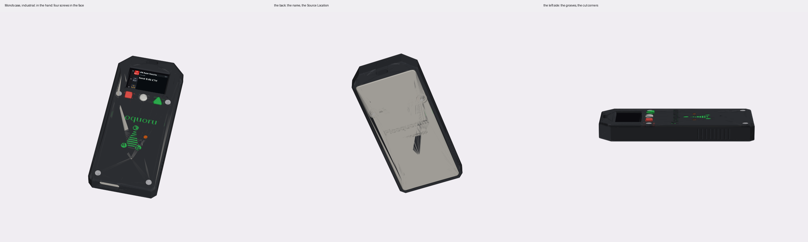
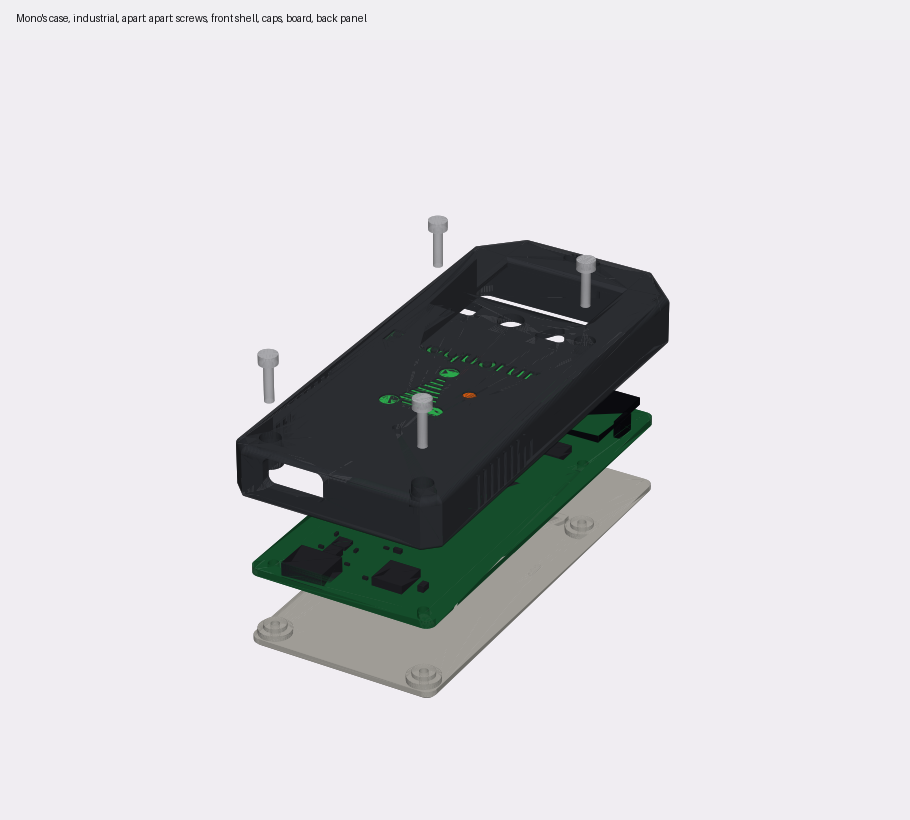
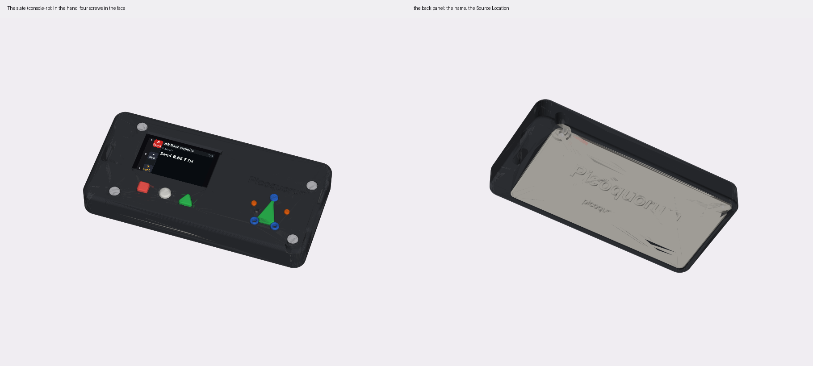
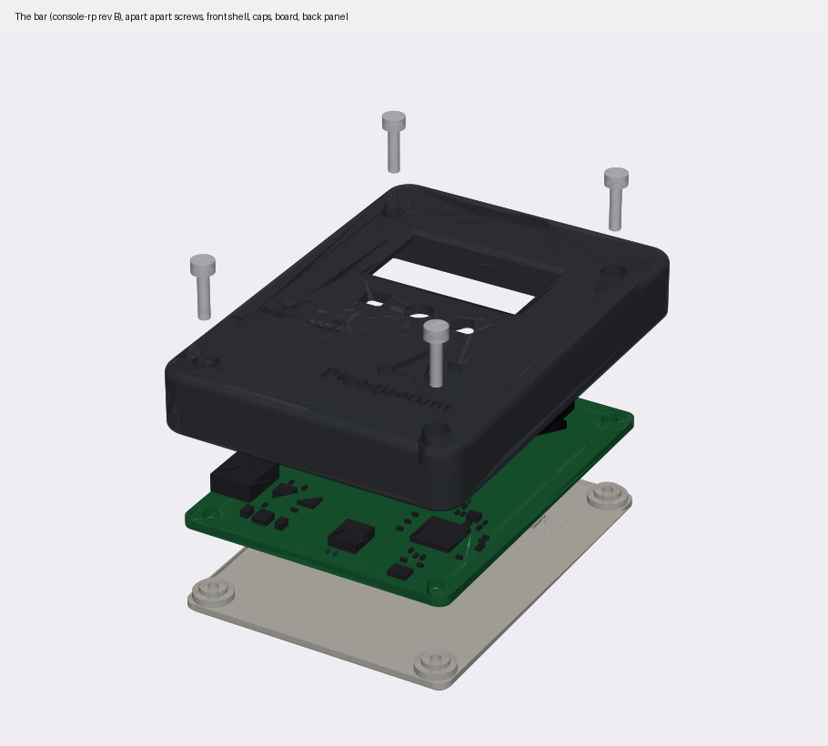

# Cases for the console boards

Printed cases for the console boards, and a dock for each. Every case is drawn by a CadQuery script
from its board's own files, and one script, [`shell.py`](shell.py), makes them all. **Mono's are the
ones being worked on.**

| case | for | script | build | where it stands |
|---|---|---|---|---|
| **[Mono's](#mono)** | [Mono](../../hardware/mono/README.md) | [`mono.py`](mono.py) | `tools/case build mono` | a first draft, not printed |
| **[Mono's, industrial](#mono-industrial)** | Mono | [`mono_ind.py`](mono_ind.py) | `tools/case build mono-industrial` | a variant of the first draft, not printed |
| [the slate](#the-slate-console-rp) | [console-rp](../../hardware/console-rp/README.md) | [`rp.py`](rp.py) | `tools/case build rp` | a first draft |
| [the stick](#the-stick-console-s3) | [console-s3](../../hardware/prototypes/console-s3/DESIGN.md), an early prototype | [`stick.py`](stick.py) | `tools/case build stick` | a first draft, not fitted to its board |
| [the badge](#the-badge-picoquorumkey-rev-b) | [PicoquorumKey rev B](../../hardware/prototypes/picoquorum-key/README.md), an early prototype | [`badge.py`](badge.py) | `tools/case build badge` | a first draft; the rev A plate was printed once |

Each script writes a folder in [`out/`](out/): the STLs to print, a STEP of the whole assembly, and
pictures ([Run](#run)). `tools/case check <name>` rebuilds a case and lists every output that
changed, so a case is up to date when it lists nothing.

**To change Mono's case:**
- [`mono.py`](mono.py) holds what is Mono's own, in `board()`: the window, the caps' shapes and size,
  the mark's place (`MARK`), the words on the back. The board's numbers come from its generator and
  its fab files (`hardware/mono/`), so the case follows the board.
- [`mono_ind.py`](mono_ind.py) holds the industrial variant's: `CORNER_CUT`, `GROOVES`, and its own
  mark and name, printed in the face: `MARK_R`, `HATCH`, `NAME_FIT`, `COLOUR` and `decor`.
- [`rp.py`](rp.py) draws the badge (`decor`) and the name (`name`). A change there changes the slate too.
- [`shell.py`](shell.py) holds what every case shares: the walls, the posts, the caps' fit, the dock
  and the checks. A change there changes every case here.

## Mono

[`mono.py`](mono.py), for [Mono](../../hardware/mono/README.md), the 40 × 89.5 mm board: a slender bar, 44.6 × 100.1 × 10.9 mm
closed, in the stick's "shell" layout like console-rp's slate ([`rp.py`](rp.py)). **A first draft, not
printed, and no Mono board has been built.**
- **Four M2 × 8 screws from the face,** through the shell's posts and the board's four M2 holes (one either
  side of the buttons, one at each bottom corner), into bosses on the back panel. The posts are 2.5 mm
  across, the board's own keep-out (`HOLE_RING` in its generator). No tab: the board has no radio.
- **The window** shows the active area where the generator puts it, centred on the board, and 0.555 mm
  further from the ribbon, where it would be if PicoquorumKey's 2.0 mm reading of the drawing is right.
- **The caps** are the slate's shapes, D0 a red square, D1 a white circle, D2 a green triangle, but
  1.2 times as wide (circle 5.0 mm, square 4.6, triangle 7.2), for a thumb. Their flanges are 7.4 mm,
  not 6.1, to hold them in: 0.3 mm off the posts beside D0 and D2. Each still sits on its switch with
  the same 0.2 mm of play and clearance, so the switch clicks as on the slate.
- **The name and the mark** are in the plain field under the buttons, made as the slate's are
  (`rp.decor`): the mark is a badge in three colours glued into a pocket, and the name over it is cut to
  show a second colour. Mono has no RESET or BOOTSEL buttons, so the mark's dots are whole, with no
  pinholes. The script checks the mark misses the LED's hole and the name misses the counterbores.
- **A hole over the LED** (D1), below the mark.
- **The USB-C is open at the bottom end,** left of centre. A lanyard lug at the top.
- **A rib on the back panel under D0–D2.** The jig's pads on the board's back are covered: take the back
  panel off to reach them.
- **KEY 2's five holes are covered too.** A breakout soldered there would need its own opening.
- **The ribbon's fold** is taken as 1.5 mm past the glass's end. Mono's README reads the drawing as
  0.5 at most; the slate allows 2.0.
- **The dock** holds it leaning back 25°, the plug down into a slot in its lip, as the badge's.









## Mono, industrial

[`mono_ind.py`](mono_ind.py): Mono's case with cut corners. **A variant of the first draft, not printed.**
Inside, it is Mono's case: the same posts, screws, caps, window, back panel and dock. Only the front
shell changes:
- **The corners are cut off at 45°**, not rounded. At the bottom, 3 mm along each edge, as far as the
  board's corner inside allows: the wall there is 1.66 mm at its thinnest, against 2.0 along the sides.
  The script stops if a cut leaves less than 1.5 (`CORNER_WALL`). At the top, 8 mm, across the lanyard's
  lug, so the top end tapers.
- **The edges are rounded as Mono's**, the face's 1.5 mm and the back's 0.8, and the screws'
  counterbores are plain. An earlier draft chamfered them, the face's edge 1.6 mm and the counterbores
  0.4 mm, which left 1.2 mm of plastic between a counterbore and the edge's slope. Now the face is flat
  for 2.2 mm between each counterbore and the round.
- **Nine V-grooves, 0.5 mm deep and 2.5 mm apart, run across each long side** where the hand holds it, 14
  to 34 mm up from the board's bottom edge. They stop short of both rounds.

- **The mark is printed with the shell, in colours, with no badge to glue in.** It is 8 mm in
  radius (Mono's badge: 6), at the same centre. Its lowest edge is 5.7 mm over the LED's hole.
  - Its pocket is 0.4 mm deep, the shell's first two layers, not the badge's 1.0 mm. The badge's
    pocket left a triangle 7 × 11 mm to bridge.
  - All five dots are open: the signed 4 mm across, the waiting 2.7 mm.
  - Lines of the face's plastic, 0.5 mm wide, cross the triangle 1.53 mm apart, with 1.03 mm between
    them. A ring 0.5 mm wide goes round each signed dot inside the triangle, so every line ends on a
    wall or a ring.
  - The colour lies behind, on the lines, and bridges 1 mm at a time. From the front the dots are
    the colour, and the triangle is the colour behind black lines, so darker.
  - The script stops if two lines come closer than 0.8 mm (`HATCH_GAP`).
- **The name over the mark is 36 mm wide and 5.8 mm tall** (Mono's: 22.5 × 3.6), cut 0.6 mm to show
  the same colour. That is as wide as the screws' counterbores, outside to outside, near enough
  (37.2 mm). The face is flat for 2.8 mm past each end, and the caps' holes are 11 mm over it.
- **Two ways to print the colours** ([Printing](#printing)):
  - **One body, one filament change:** `mono_ind_shell.stl`, the first two layers black, then green.
    All five dots come out green, and [the mark is never five green dots](../../docs/BRAND.md#dont).
    The whole of those layers is green too, so it shows as a band round the face's edge.
  - **Three bodies, a filament each:** `mono_ind_shell_black.stl`, `_green.stl` and `_orange.stl`. They
    are the same shell cut in three, each in the shell's own place. Green lies behind the triangle,
    the signed dots and the name; orange behind the two waiting dots. Each is 0.6 mm thick, three
    layers, and reaches 0.6 mm under the face round its opening, so its edge lies on the black
    (`COLOUR`). Behind the name the green is one block, 37.2 × 7.0 mm.

The case closes at the same 44.6 × 100.1 × 10.9 mm, and the build finds no overlap. It prints face down
like Mono's. The grooves' closed ends are 1 mm bridges.

Checked on the shell as built, at 13 points: open in a signed dot and in each waiting dot; green
0.6 mm under the face in a signed dot, in the triangle and in a letter; orange in a waiting dot, and
under the black 0.3 mm outside it; black beside the mark, over the name and behind both colours. The
script stops if the three bodies' volumes don't add up to the shell's. The three STLs span the same
place as the one. Not sliced, and not printed: whether a slicer draws each 0.5 mm line as one pass,
how the lines hold on the bed, and how a slicer takes the three bodies are not known.







## The slate (console-rp)

[`rp.py`](rp.py), for [console-rp](../../hardware/console-rp/README.md), the 72 × 36 mm board: a flat bar,
79 × 41 × 11 mm, in the "shell" layout. **A first draft.** Mono's case takes its caps' shapes, its badge
and its name from this one (`rp.decor`).
- **Four M2 screws from the face,** through the shell's posts and the board's four M2.5 holes, into bosses on
  the back panel. No tab: the board has no radio.
- **The mark is at the right, drawn from RESET and BOOTSEL.** Its two lower dots are their holes, 7.5 mm
  apart on the board. The mark is a badge, its pieces printed in colour and glued into a pocket: the
  triangle green, the three signed dots blue, the two waiting dots orange. The lower two blue dots are rings
  round 1.4 mm pinholes.
- **The name is over it,** on one line, cut 0.6 mm: print the first two layers black and the rest in a
  colour, and the letters show the colour.
- **The USB-C is open at the right end.** A lanyard lug at the left.
- **The dock** holds it leaning back, its cable out of the right side.
- **The glass** is taken from the panel's datasheet, 31.0 × 17.6 mm; the board's generator still has 17.0.
  Not measured: the foam, the switches' height, how far the USB-C's legs stand out of the back.





## The stick and the badge

The first two cases, for the two ESP32-S3 boards from JLCPCB
([early prototypes](../../hardware/prototypes/README.md)), and a dock for each:
- **the stick**, for [console-s3](../../hardware/prototypes/console-s3/DESIGN.md)
- **the badge**, for [PicoquorumKey rev B](../../hardware/prototypes/picoquorum-key/README.md) with its key port fitted

**Status, 2026-11-03:** a first draft of each, drawn the day the boards arrived. The first badge was
drawn for rev A. Its plate was printed and laid on a board: the board was rev B, and the rib above
the screen sat on U6 and U7, the key port's chips. The badge is drawn for rev B now
([below](#the-badge-picoquorumkey-rev-b)). Neither case has been fitted to its board since.

| | the stick | the badge |
|---|---|---|
| board | console-s3 rev A, 64 × 22.86 × 1.6 mm | PicoquorumKey rev B with the key port, 50 × 53 × 0.8 mm |
| layout | a front shell and a back panel | a tub and a front plate |
| closed | 74.6 × 27.5 × 12.4 mm | 54.6 × 63.6 × 11.4 mm |
| screws | 2 × M2 × 8 from the front, at the USB end | 4 × M2 × 8 from the back |
| USB-C | the left end | the bottom edge |
| key | on the board | the top-left corner is open: a key-c plugs into the key port from outside |
| lanyard | a lug at the antenna end | a lug at the top right |
| dock | 81 × 38 × 15 mm, the cable out of the left | 61 × 50 × 48 mm, the plug in a slot in its lip |


## How they go together

One script, [`shell.py`](shell.py), makes both. It has two layouts:
- **"shell" (the stick):** the face and the walls are one front shell, and a flat panel closes the
  back. The screws go in from the front, through the shell's posts and the board's holes, into bosses
  on the back panel. Their heads sit flush in counterbores in the face.
- **"plate" (the badge):** a tub, and a front plate set into its opening, flush with its rim. The screws
  go in from the back, through bosses in the tub and the board's holes, into posts on the plate's
  underside. There is nothing to see on the front.

Everything else is the same:
- **The board's own holes hold it,** clamped between the posts on the face's side and the bosses on the
  back's. Both stay inside the 2.5 mm keep-out ring round each hole on the board.
- **The antenna end is held without metal.** A rib under the face presses on the board's front where it
  has no copper. Two ribs on the back come up under the module's shield. The nearest screw is 23 mm
  from the antenna on the badge, 55 mm on the stick.
- **The window** shows the active area and 0.5 mm round it. The face keeps at least 0.8 mm over the
  glass's edge, and sits 0.15 mm above the glass, so it keeps the glass on its tape.
- **Caps on D0, D1 and D2.** Each cap has a round stem through the face, and a square flange under it
  that keeps it in. The caps are in the brand's colours ([BRAND.md](../../docs/BRAND.md)):
  - D0 is Reject red
  - D1 is white
  - D2 is Sign green

  All three take the same light press. A case mustn't make Reject harder to reach than Sign.
- **BOOT and RESET are holes too small for a thumb.** A paperclip or a pen's tip reaches them, and a thumb
  doesn't press them by mistake. BOOT is a 1.8 mm pinhole. On the badge RESET is too; on the stick it
  is the mark's lower-left dot, 3.75 mm across.
- **A hole over the LED.**
- **The back carries the name.** On the badge, `picoquorum.app` is under it: the Source Location
  (CERN-OHL-W v2, section 4.1), since the case covers the board's own. The stick's back has the name
  alone.


## The stick (console-s3)

[`stick.py`](stick.py). The board is a bar, and the case follows it.
- **The screws are at the USB end only,** in the face. The board's only holes are there, by design: a
  screw at the far end would be metal by the antenna. The posts round them are 6 mm across, wider than
  the badge's, so each counterbore has a wall; they run into the shell's walls at the corners.
- **The back panel's other end hooks in.** A tab, 2.0 × 1.2 mm, goes into a slot in the end wall,
  inside the lanyard's lug. Fit that end first, then lower the USB end and screw it.
- **The mark is big, at the antenna end,** engraved 0.5 mm, 17 mm across its dots. Its lower-left dot is
  RESET's hole, cut through over the switch. The script places the mark from RESET's position and stops
  if the dot isn't over it. The mark misses BOOT's pinhole by 1.1 mm and the LED's hole by 0.4 mm; the
  LED lights just outside the triangle's left edge.
- **The window is 1 mm wider than the active area needs.** The board's render centres the active area
  on the glass. ER-TFT1.14-2's drawing puts it 2.0 mm from the end away from the ribbon. The window
  shows the active area wherever it is, until a panel is measured.
- **The dock** holds it leaning back 25°. The cable comes out of a slot in the dock's left side.


## The badge (PicoquorumKey rev B)

[`badge.py`](badge.py). Portrait, like a small handheld, with a lug for a lanyard.
- **The key port's corner is open.** The plug stands 9.6 mm out of the board's top edge, at the
  top-left. The case is cut away there, through its whole thickness, for a key-c on the plug: 16 mm
  wide, its edge about 3 mm past the tip. The key stands out of the top like a cartridge. The script
  checks the plug and a plugged key-c against the case.
- **The rib above the screen is on the antenna's keep-out band** (x 30.5–46, the top 7 mm), which has no
  parts. The band to its left holds U6, U7 (the port's ESD chips, 1.45 mm tall), R18 and R17. The
  first badge's rib ran across all of them, x 6–38, so its plate stood about 1.45 mm proud: run against
  rev B, the script finds it on U6 and U7.
- **Ribs back the 0.8 mm board where it's pressed:** a rib in the tub under D0–D2, and one under BOOT
  and RESET. They come up to 0.1 mm under the board's back and miss its test pads.
- **A hole over D4,** the key port's LED, at the left edge by D0. It lights when the port powers a key.
- **The mark and the name** are engraved under the screen. The plate over the key chip is solid.
- **The caps sit in pockets in the plate's underside,** because these switches stand 3.8 mm, higher
  than the glass. So the plate is 2.3 mm thick over the glass, not 1.8.
- **The dock** holds it leaning back 25°. The plug goes down into a slot in the lip, and the cable
  leaves at the front.

**Rev B only.** Rev A is 44 mm wide and 1.6 mm thick, with no key port; its holes are 6 mm closer
together. The rev A badge is in this folder's history (commit `7990d14`). A rev B board without the
port's parts fits this case; its corner is just open.


## Where the numbers come from

| | the stick | the badge |
|---|---|---|
| outline, holes | the generator (`gen_console_s3.py`) | the outline and the key port's notch from DESIGN.md; the holes from rev B's NPTH drill file |
| every part on the front | `console-s3/fab/cpl.csv` and `bom.csv`, the files JLCPCB built from. The script stops if they disagree with the generator | `hardware/out/rev-b/cpl-port.csv` and `bom-port.csv`, the files for the boards with the port. The script stops if the port's parts aren't in them |
| glass, tape, ribbon fold | the generator: 31 × 17 mm glass, 1.6 mm thick on 2.0 mm tape | DESIGN.md: 31 × 17.6 mm glass, 1.6 mm thick on 1.5 mm tape |
| module | the generator: the WROOM-1 on the back, 3.1 mm | DESIGN.md |
| the key port | | the plug's footprint drawing: 8.4 mm wide, 9.6 mm past the tip; its height (3.4 mm) is a guess. A key-c, 16 × 36 mm, from its design |
| test pads on the back | | `tools/gen/gen_pcb.py`. The ribs under the board miss them |

Each part is a box, at its footprint's usual size and height (`PACKAGES` in `shell.py`). These are not
the makers' models.

## What the script checks, and what it doesn't

When a case builds, the script checks that none of these overlap each other:
- the printed parts: the tub and the plate, or the front shell and the back panel, and the caps
- the board, each part's box, the glass and its ribbon fold, the module
- a USB-C plug pushed fully home: 12.4 × 5.5 mm overmold, the handheld's measured cable
- on the badge, the key port's plug and a key-c on it
- the screws
- the dock, with the case in it

It prints a line for each overlap and exits 1 if there is one; both cases build with none.
It also checks that each cap's flange reaches at least 0.2 mm past the edge of its hole in the face, so the
cap can't fall out (`CAP_LIP`). It also
chooses the screw: the longest in the bench's kit (4, 8, 12, 16 mm) that leaves at least 3 mm of
thread in the post or boss, and stops short of the end of its hole.

**It doesn't check fit against a real board.** Nothing here is measured. Before printing the big parts, measure
these and change the numbers in the scripts:
- **the panel:** the glass's thickness and the tape's (`glass_z`). The face's height follows them.
- **the switches:** the stick's TS-1187A is taken as 1.5 mm tall, the badge's 4.5 × 4.5 tacts as
  3.8 mm (`PACKAGES`). The caps sit on them. If a height is wrong, reprint the caps; on the badge,
  the plate too.
- **the module, as soldered:** 3.1 mm (`WROOM`). The ribs under it follow it.
- **your cable's overmold**, against the 13.2 × 6.2 mm opening (`USB_OPEN`).
- **the badge's key port:** the plug's height, and a key-c on it, against the open corner (`PLUG`,
  `KEYC` in `badge.py`).

## Printing

Every part prints without supports, judging by the shapes. They haven't been sliced.
- **the stick's shell:** face down, as written. The USB-C opening's far side is a 13 mm bridge.
- **the stick's back panel:** outside down, as written. The bosses, ribs and tab point up.
- **the badge's tub:** on its back, as written. The opening over the USB-C is a short bridge.
- **the badge's plate:** face down, as written. The posts, ribs and pockets point up.
- **Mono's shell and back panel:** as the stick's. The USB-C opening's far side is a 13.2 mm bridge.
- **Mono's badge:** its six pieces face down, the triangle green, the three signed dots blue, the two
  waiting dots orange. For the name, print the shell's first two layers black and the rest in a colour.
- **The industrial shell's mark** has no badge. Slice at 0.2 mm, the first layer 0.2 mm too. In the
  slicer's preview, look for the lines in layers 1 and 2, each one pass 0.5 mm wide. A slicer that
  draws walls at a fixed width may leave them out: use its variable-width walls (Arachne), or its
  thin-wall setting. Then one of:
  - **one body** (`mono_ind_shell.stl`), on a printer with one filament:
    - layers 1 and 2 (to 0.4 mm) black: the face, and the lines across the triangle
    - change to green at layer 3 (0.4 mm), and stay green to the end of layer 4 (0.8 mm) at the least:
      layer 3 is the mark's floor, layer 4 the letters'
    - after that, black again or any colour: none of it shows from the front
  - **three bodies** (`mono_ind_shell_black.stl`, `_green.stl`, `_orange.stl`), on a printer that
    changes filament itself: load the three as one object with three parts, not three objects, so
    they keep their places, and give each its filament. The colours are in layers 3 to 6 (0.4 to
    1.2 mm). The rest is black.
- **caps:** flange down, one STL each, so each can be its own colour.
- **dock:** on its base, as written.
- PLA or PETG, 0.2 mm layers. The engraving is 0.5 mm deep.

**The counterbores are bridged in the model.** Every case's screw counterbores print from the bed up: in the
shells, face down, and in the badge's tub, on its back. Each ends in a ceiling with the screw's hole in it, a
ring with nothing to bridge to. So `shell.py` steps the hole for two layers over the counterbore
(`BRIDGE_LAYER`):
1. a strip as wide as the hole, right across the counterbore, so that layer is two bridges from wall to
   wall, along the strip
2. a square as wide as the hole, so the next layer bridges across the first, the other way
3. then the round hole

Because it is in the model, it works the same in any slicer: PrusaSlicer, Cura, OrcaSlicer, Bambu Studio.
- **Slice at 0.2 mm.** Each step is one 0.2 mm layer, and each counterbore is 2.2 mm deep, 11 layers,
  so the steps fall on layer lines. For other layer heights, set `bridge_layer` in the board's
  description. The script stops if the counterbore isn't a whole number of layers.
- **In OrcaSlicer or Bambu Studio,** leave "Bridge counterbore holes" (Quality, Bridging) at None. With
  it on, the slicer bridges the steps again.

Above the square, the round hole's first layer overhangs the square's corners by 0.5 mm at most. That
prints without a bridge. Not yet sliced or printed.

**The fit check:** print the badge's plate first and lay it on the board. The stick's face is part of
its shell, so print the shell first and lay the board in it. Either way, check that:
- the posts land round the holes
- the window frames the screen
- the caps' holes sit over D0, D1 and D2

## Putting it together

**The stick:**
1. Lay the shell face down. Drop the caps in from behind, flange inside: red D0 at the top, white D1,
   green D2.
2. Lay the board in face down, its USB-C to the opening, the glass on the window's lip.
3. Put the back panel's tab into the slot in the far end wall, then lower the USB end onto the board.
4. Hold the panel on, turn the stick face up, and put the M2 × 8 screws in through the face.
5. Turn each screw until it is snug, no tighter: it cuts its own thread in the panel's boss.
6. Press each cap. It should click and come back.

**The badge:**
1. Drop the caps into the plate from behind, flange inside: red D0 at the top, white D1, green D2.
2. Lay the board in the tub face up, its USB-C to the opening.
3. Lay the plate on it, caps onto the switches.
4. Hold the two together, turn them over, and put in the M2 × 8 screws.
5. Turn each screw until it is snug, no tighter: it cuts its own thread in the post.
6. Press each cap. It should click and come back.

**Mono:** as the stick, but with no tab. Lay the board in face down, lay the back panel on, and put the
four M2 × 8 screws in through the face. Glue the badge's pieces into the mark's pocket (the industrial
variant has none: its mark is printed in the face).

## Run

```sh
tools/case build mono-industrial      # or mono, rp, stick, badge; several at once
tools/case check mono-industrial      # builds, then lists what changed
```

Each script runs on its own too:

```sh
uv run --python 3.11 --with cadquery --with matplotlib --with pillow python cad/consoles/mono_ind.py [screen.png]
```

`tools/case` runs them at the versions the outputs were last made with (`PINS` in the tool). Each writes
its folder in `out/` (`out/mono/`, `out/mono_ind/`, `out/rp/`, `out/stick/`, `out/badge/`):
- the STLs to print
- `<name>_assembly.step`, with the board's stand-ins
- `<name>_face.png`: the face sliced just under its top, which shows the engraving
- the other pictures, with the Feather's review screen (`docs/quorum-ui/feather/06-review-head.png`) on the
  panel, or the PNG given
