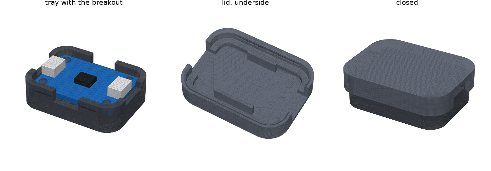

# Key CAD

The plug handle is not started: the one that rigidly joins a ¼″ stereo plug and a 3.5 mm plug (one of them
with slight float so it self-aligns in the console's bracket), so the key only goes in one way,
can't rotate, and keeps its label facing up. Also the end cap, the label band, and an optional
translucent window for the glow LED. See [System overview](../../docs/KICKOFF.md#system-overview)
and [Key connector](../../docs/KICKOFF.md#key-connector-draft-pinout) in the kickoff. The dev
console's case is in [../console](../console/README.md).

## Breakout case

A case for the Adafruit ATECC608 STEMMA QT breakout (Adafruit 4314). It gives each chip a durable
home, so we stop handling bare boards as we swap them between test setups. Generator:
[`tray.py`](tray.py) (CadQuery). It also checks that the tray, the lid and the board don't
overlap.

```sh
uv run --python 3.11 --with cadquery python cad/key/tray.py
```

**The board,** from Adafruit's Eagle file
([Adafruit-ATECC608-PCB](https://github.com/adafruit/Adafruit-ATECC608-PCB), `Adafruit_ATECC608.brd`),
not yet checked with calipers:
- 25.4 × 17.78 mm (1.0 × 0.7 in), corners r 2.54.
- Four 2.5 mm plated holes on a 20.32 × 12.7 mm pattern, 2.54 mm in from each edge, with a 4 mm
  silkscreen ring around each.
- A JST SH (STEMMA QT) port on each short end, centred, about 6.1 mm wide and 2.9 mm tall.
- The unused 4-pin header row along one long edge.
- Nothing on the underside.

### v3 (2026-10-07): clip-in tray

`out/key_tray_v3.stl` is the v2 tray with a clip in each grip notch, so a test key stays in its
tray without the lid. Each tray is a holder you can mark with what its key is for.
- The grip notch now goes down to the floor. A 5 mm wide, 1.0 mm thick finger stands in it,
  rooted in the floor, 0.15 mm off the board edge.
- A hook on the finger reaches 0.35 mm over the board, 0.1 mm above it, on the silkscreen strip
  along each long edge. Its top is a 1.2 mm ramp, so the board snaps in when pressed straight
  down onto the pegs.
- To take the board out, pull a finger outward through the notch and lift that edge.
- The v2 lid still fits. The generator checks that it and the board don't overlap the clips.

Not printed yet. If the board won't go in or the clips are loose, change `CLIP_HOOK` or `CLIP_T`.

### v2 (2026-10-02): snap lid



| file | what |
|---|---|
| `out/key_case_v2.stl` | tray and lid on one plate, in print orientation |
| `out/key_tray_v2.stl` | the tray alone |
| `out/key_lid_v2.stl` | the lid alone, top face down |

**The tray** keeps v1's board clearance, bosses and notches.
- The pegs are now 2.40 mm, the winner of the v1 fit check.
- Four bumps on the outside of the long walls hold the lid. Each is a 5 mm half-round ridge,
  0.35 mm proud, 1.4 mm below the wall top, between a grip notch and a corner.

**The lid** sits on the tray's wall top.
- Its skirt reaches 3 mm down the outside of the walls, with 0.15 mm clearance. That makes about
  0.2 mm of click over the bumps.
- A groove inside the skirt catches the bumps.
- The skirt mouth has a 0.5 mm lead-in chamfer.
- Inside, there is 3.5 mm of headroom over the board.
- The port openings continue up through the lid, so either end takes a STEMMA QT plug with the lid
  closed. They are also where you get a fingernail in to pry the lid off.
- Two ribs stop 0.2 mm above the board, on its silkscreen strips along the top edge and below the
  header pads, so the board can't lift off its pegs.
- The closed case is 32.7 × 25.1 × 10.9 mm.

**Print:** use the case plate. The tray goes floor down, the lid top down, no supports. If the
click is too stiff or too soft, change `SNAP_PROUD` (0.35) in steps of 0.05 and reprint the tray
only. The lid stays the same.

### v1 (2026-10-02): open tray


The first version was an open-top tray with no lid.
- The board sits on four 4 mm bosses, 3 mm above the floor. That leaves room for header solder
  tails and the wires of a soldered key.
- Each boss carries a peg that stands 0.8 mm above the board and has a 0.4 mm lead-in chamfer.
- 1.8 mm walls rise 2 mm above the board, with 0.5 mm clearance around it.
- **Port notches:** each short wall has a 9 mm notch from the top down to the board top, so a
  STEMMA QT plug drops into either port and the wall still guards the board edge.
- **Grip notches:** each long wall has an 8 mm notch down to the board underside, so a fingernail
  can get under the board to lift it out.

`out/key_tray_v1_pegfit_x3.stl` was the fit check: pegs of 2.20, 2.30 and 2.40 mm, with the size
engraved underneath. 2.40 won. `out/key_tray_v1.stl` has 2.30 mm pegs. The current generator no
longer builds either file.

Next:
- Screw bosses (M2.5) in place of the pegs.
- A label window on the lid.
- Maybe a version shaped around the plug handle.
