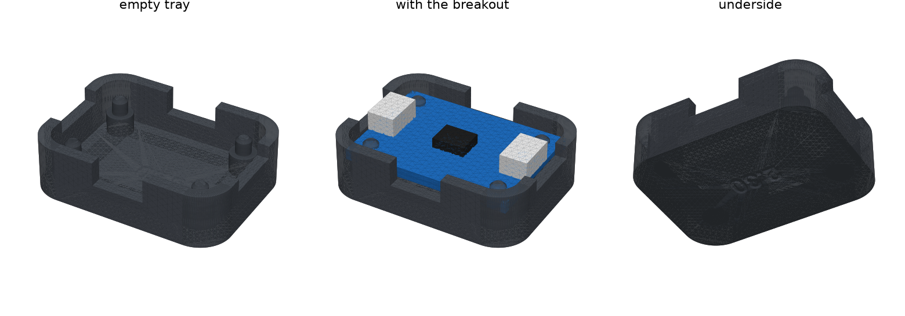

# Key CAD

The plug handle is not started: the one that rigidly joins a ¼″ stereo plug and a 3.5 mm plug (one of them
with slight float so it self-aligns in the console's bracket), so the key only goes in one way,
can't rotate, and keeps its label facing up. Also the end cap, the label band, and an optional
translucent window for the glow LED. See [System overview](../../docs/KICKOFF.md#system-overview)
and [Key connector](../../docs/KICKOFF.md#key-connector-draft-pinout) in the kickoff. The dev
console's case is in [../console](../console/README.md).

## Breakout tray v1 (2026-10-02)

A first case for the Adafruit ATECC608 STEMMA QT breakout (Adafruit 4314). It gives each chip a
durable home, so we stop handling bare boards as we swap them between test setups. It is an
open-top tray. The board drops onto four pegs, one through each mounting hole. Nothing holds it
down yet; a lid, snaps or screws come later.



Generator: [`tray.py`](tray.py) (CadQuery).

```sh
uv run --python 3.11 --with cadquery python cad/key/tray.py
```

| file | what |
|---|---|
| `out/key_tray_v1.stl` | one tray, 2.30 mm pegs |
| `out/key_tray_v1_pegfit_x3.stl` | fit check: three trays with 2.20, 2.30 and 2.40 mm pegs, the size engraved underneath |

**The board,** from Adafruit's Eagle file
([Adafruit-ATECC608-PCB](https://github.com/adafruit/Adafruit-ATECC608-PCB), `Adafruit_ATECC608.brd`),
not yet checked with calipers:
- 25.4 × 17.78 mm (1.0 × 0.7 in), corners r 2.54.
- Four 2.5 mm plated holes on a 20.32 × 12.7 mm pattern, 2.54 mm in from each edge, with a 4 mm
  silkscreen ring around each.
- A JST SH (STEMMA QT) port on each short end, centred, about 6.1 mm wide and 2.9 mm tall.
- The unused 4-pin header row along one long edge.
- Nothing on the underside.

**The tray:**
- 30.0 × 22.4 × 8.2 mm, with 1.8 mm walls and a 1.6 mm floor. There is 0.5 mm of clearance
  around the board.
- The board sits on 4 mm bosses, 3 mm above the floor. That leaves room for header solder tails
  and the wires of a soldered key.
- The pegs stand 0.8 mm above the board and have a 0.4 mm lead-in chamfer.
- The walls rise 2 mm above the board top.
- **Port notches:** each short wall has a 9 mm notch from the top down to the board top, so a
  STEMMA QT plug drops into either port and the wall still guards the board edge.
- **Grip notches:** each long wall has an 8 mm notch down to the board underside, so a fingernail
  can get under the board to lift it out. One of them sits over the header row, which is also
  where wires soldered there leave. Set `GRIP = False` to drop the grip notches.

**To print:**
- Floor down, no supports.
- Print the peg-fit plate first. Keep the size that seats the board without forcing it, then set
  `PEG_D` to that size.
- If the board rocks, measure `PCB_T` and the finished hole size.

Next:
- A lid or snap-on cover.
- Screw bosses (M2.5) in place of the pegs.
- A label window.
- Maybe a version shaped around the plug handle.
