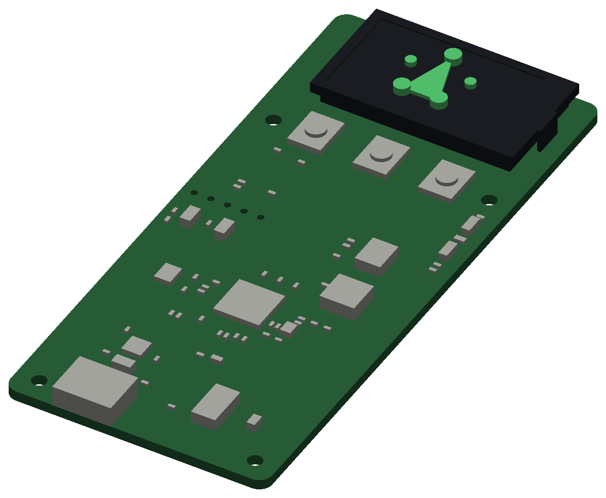

# Mono, as a print

A rough model of [Mono](../../hardware/mono/README.md)'s board to print and hold: the 40 × 89.5 mm bar, its
holes, a block for each part JLCPCB fits, to its height, and the panel on top with the Picoquorum mark
raised on its picture. It is for a sense of the
board's size and what stands on it, not a fit check (`tools/keypcb jlc mono` does that).



```sh
uv run --python 3.11 --with cadquery --with matplotlib python cad/mono/board.py
```

It writes `out/`:
- `mono_board.stl`: everything as one solid, 40 × 89.5 × 6.2 mm, the back down, as it prints.
- `mono_board_pcb.stl`, `mono_board_parts.stl`, `mono_board_panel.stl`, `mono_board_mark.stl`: the same
  in four pieces that don't overlap, for a print in colours. Load all three at once so they keep their places.
- `mono_board.png`: the picture above.

[`board.py`](board.py) reads the routed board, `hardware/mono/mono/mono.kicad_pcb`: the outline, the
holes, and each part's place, turn and body (its footprint's F.Fab outline, or its courtyard). The
heights and the panel are the generator's (`gen_mono.py`: `HEIGHT`, `PANEL`), datasheet figures and
guesses. 67 parts, as the census on the board's back counts them. What the model draws differently:
- **The foam under the glass is one block,** 1 mm in from the glass's edges, not four 2 mm pads. So
  the glass prints without support, and hides J2 and its two capacitors as the real glass does.
- **The ribbon's fold** is a 0.5 mm strip at the glass's right end.
- **The picture's area** is cut 0.2 mm into the glass.
- **The mark** stands on the picture, embossed: [BRAND.md](../../docs/BRAND.md#geometry)'s geometry on a
  4.8 mm circle, 11.1 mm tall and 10.7 wide, the top dot toward the board's top edge. Over the glass's
  top, the signed dots stand 1.0 mm, the waiting dots 0.6 and the triangle 0.4. It is not on the real
  panel: it is there for fun, and makes the print 1 mm taller than the board (6.2 mm, not 5.2).
- **Each switch** is its body to 0.9 mm and a 3 mm round plunger to 1.5 mm.
- **Not fitted, not drawn:** U7, U8, D2 and J4. J4's five holes are drilled. The jig's pads, the
  fiducials and the mark are copper, so they aren't drawn.

The 0402 parts are 0.5 × 1.0 mm and about 0.5 mm tall: two or three layers at 0.2 mm, so they print as
dots. A 0.12 mm layer shows them better, or scale the print 2:1. The M2 holes are 2.2 mm, as drawn; a
printer may close them a little.

Not printed yet.
