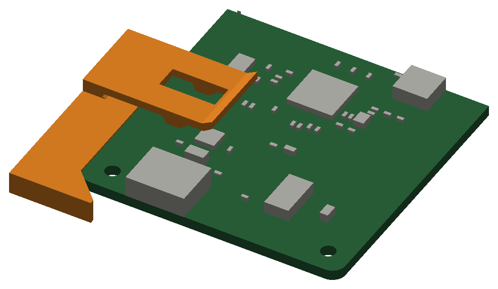
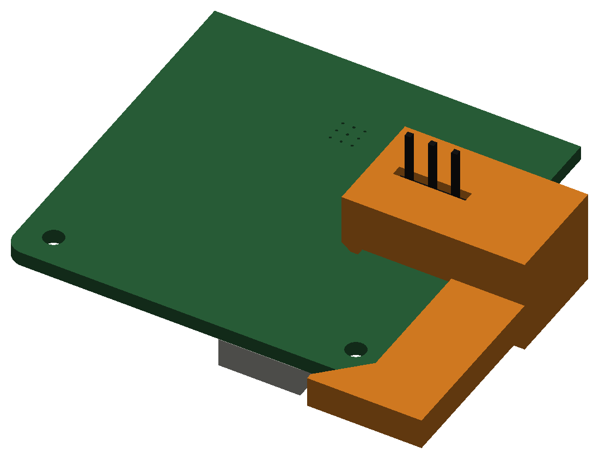
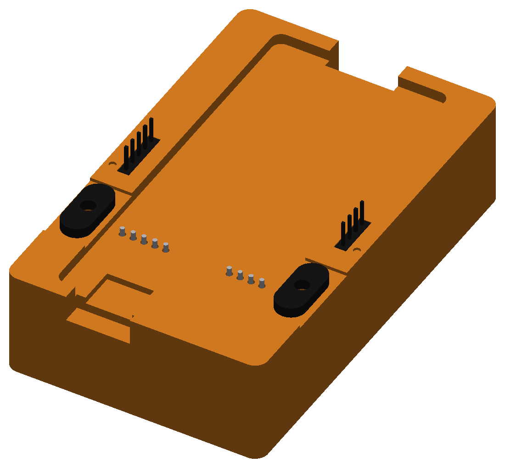
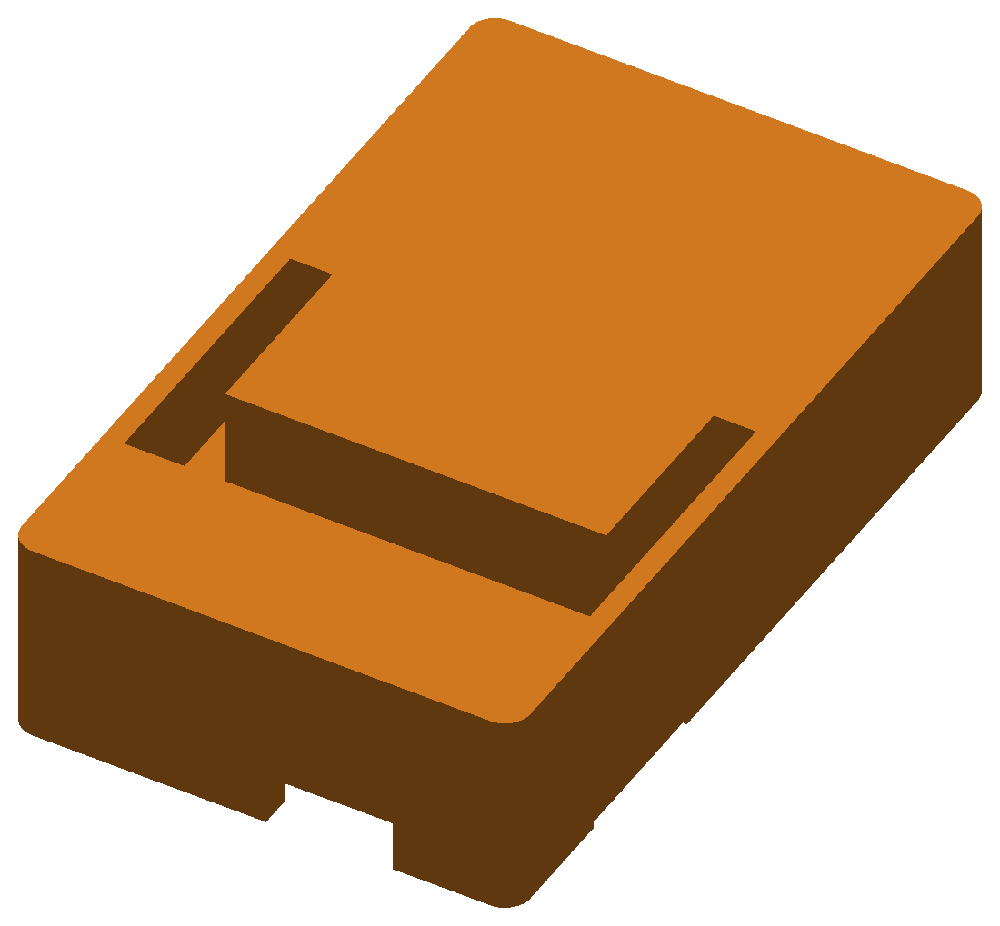
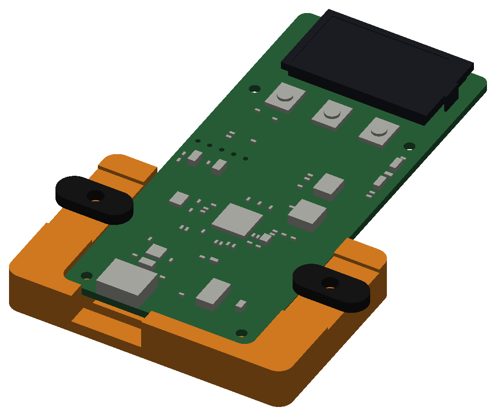
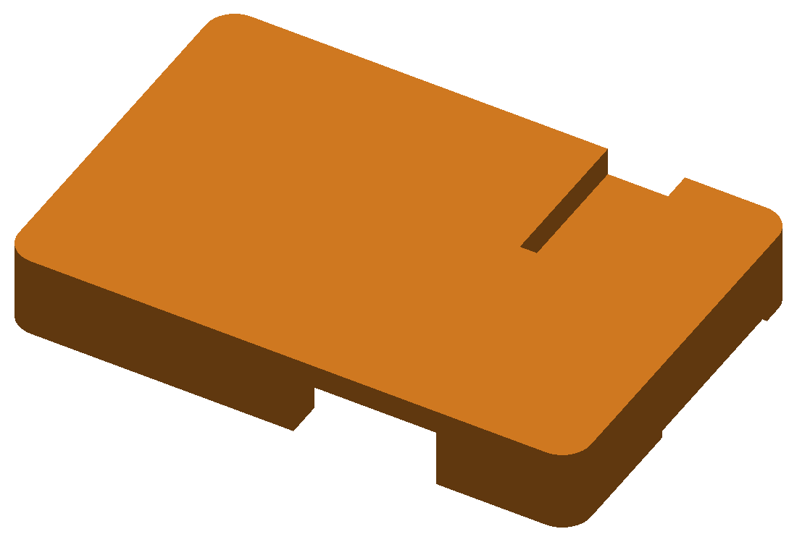

# Mono, as a print

**Looking for Mono's case?** It is in [`../consoles/`](../consoles/README.md#mono):
[`mono.py`](../consoles/mono.py), and the industrial variant, [`mono_ind.py`](../consoles/mono_ind.py)
(`tools/case build mono-industrial`). This folder is the board alone.

A rough model of [Mono](../../hardware/mono/README.md)'s board to print and hold: the 40 × 89.5 mm bar, its
holes, a block for each part JLCPCB fits, to its height, and the panel on top. It is for a sense of the
board's size and what stands on it, not a fit check (`tools/keypcb jlc mono` does that).


```sh
uv run --python 3.11 --with cadquery --with matplotlib python cad/mono/board.py
```

It writes `out/`:
- `mono_board.stl`: everything as one solid, 40 × 89.5 × 5.2 mm, the back down, as it prints.
- `mono_board_pcb.stl`, `mono_board_parts.stl`, `mono_board_panel.stl`: the same in three pieces that
  don't overlap, for a print in colours. Load all three at once so they keep their places.
- `mono_board.png`: the picture above.

[`board.py`](board.py) reads the routed board, `hardware/mono/mono/mono.kicad_pcb`: the outline, the
holes, and each part's place, turn and body (its footprint's F.Fab outline, or its courtyard). The
heights and the panel are the generator's (`gen_mono.py`: `HEIGHT`, `PANEL`), datasheet figures and
guesses. 67 parts, as the census on the board's back counts them. What the model draws differently:
- **The foam under the glass is one block,** 1 mm in from the glass's edges, not four 2 mm pads. So
  the glass prints without support, and hides J2 and its two capacitors as the real glass does.
- **The ribbon's fold** is a 0.5 mm strip at the glass's right end.
- **The picture's area** is cut 0.2 mm into the glass.
- **Each switch** is its body to 0.9 mm and a 3 mm round plunger to 1.5 mm.
- **Not fitted, not drawn:** U7, U8, D2 and J4. J4's five holes are drilled. The jig's pads, the
  fiducials and the mark are copper, so they aren't drawn.

The 0402 parts are 0.5 × 1.0 mm and about 0.5 mm tall: two or three layers at 0.2 mm, so they print as
dots. A 0.12 mm layer shows them better, or scale the print 2:1. The M2 holes are 2.2 mm, as drawn; a
printer may close them a little.

Not printed yet.

## A clip for the SWD pads

[`clip.py`](clip.py) draws a clip that holds a 3-pin strip of 2.54 mm header on TP1, TP2 and TP3 (SWCLK,
GND, SWDIO), for [the bring-up](../../hardware/mono/bench/BRINGUP.md) when there are no pogo pins.




```sh
uv run --python 3.11 --with cadquery --with matplotlib python cad/mono/clip.py
```

It writes `out/mono_clip.stl`, 20 × 11.3 × 31.5 mm as it prints: on its side, the jaws on the bed, the
leg up, no support. The two roofs it bridges are 8 mm and 8.5 mm long.

- **The header** goes in through the window in the front arm, long pins first. Its plastic sits on a
  ledge in the back jaw. The long pins stand 5 mm out of the back for jumper wires; the short ones
  touch the pads. Nothing else touches the board's back.
- **To fit it:** the front facing you, slide it onto the left edge, 21.5 mm up from the USB-C's end,
  lifting the arm's tip with a nail so the pins don't drag. Push it in to the edge and up until the leg's
  slanted face meets the bottom-left corner.
- **The wires:** the pin nearest the clip's spine is SWCLK, the middle one GND, the far one SWDIO.
- **The spring** is the front arm: its two bumps press the front 0.6 mm further than a 1.6 mm board
  leaves room for. By the beam formula that is about 2 N a pin in PLA, a rough figure.

`clip.py` reads the pads' places from the routed board, and checks that they are one row 2.54 mm apart
and that the parts under the arm (R15, C22, U4) are lower than it and none is under a bump. The header's
sizes are the usual strip's: plastic 2.54 mm square, 3.0 mm of pin below it and 6.0 above. Measure yours.

Printed once, 2026-11-17, from the first drawing, which left the bump's bar across the window: it was
cut out by hand. The drawing here has the window cut through and has not been printed. On one board the
clip's pins got no answer over SWD: 0 of 20 reads on the last try. The same pins held by hand on that
board answer a read, so it is the contact, but they drop during a load. Board 1 was loaded through
soldered wires. So the clip has not yet worked on a board. Three stiff pins on three pads: if one doesn't touch, push
the pins level in their plastic against a table. Check each with a meter before a load.

## A jig for the nine pads

[`jig.py`](jig.py) draws a block that holds the board face up on nine spring probes, one under each
pad, with two latches and two headers. [The bench's page](../../hardware/mono/bench/JIG.md) says what
it is for, how the headers are wired, how a batch could be loaded, and what to buy.





```sh
uv run --python 3.11 --with cadquery --with matplotlib python cad/mono/jig.py
```

It writes `out/`:
- `mono_jig_base.stl`, 60 × 97.5 × 24.6 mm, as it prints: the open bottom on the bed, no support. The
  room's roof is a 12 mm bridge, and each arm's a 5 mm one.
- `mono_jig_latch.stl`: print two, flat.
- `mono_jig_gauge.stl`: a bar with a groove 1.7 mm deep. It prints the groove up.

To build one:
1. **Drill the nine bores** by hand, a pin vise and a bit the receptacle's size, until a receptacle
   pushes in and stays. They are drawn 1.5 mm and print smaller.
2. **Set the inserts** in the two landings with an iron.
3. **Solder a wire to each receptacle's tail** before it goes in, 12 cm, and push each receptacle up
   its bore from underneath. Put a probe in each.
4. **Set the height.** Lay the gauge on the deck, its groove over the row. Push each receptacle up
   until its probe's tip just touches the groove's roof, the spring not pressed. Then a drop of thin
   glue where each receptacle leaves the plastic underneath.
5. **The headers.** Bring each wire along the room, up its arm and out through the header's slot.
   Solder it to its short pin, in [the page's order](../../hardware/mono/bench/JIG.md#the-headers),
   then let the wires back down and press the strip into its pocket, onto the ledge. A drop of glue.
6. **The latches:** a screw and a washer each, tight enough that the latch stays where it is put.
7. **Meter it** with a bare board in and the latches shut: each header pin to its pad's net, and
   none to its neighbour.

`jig.py` reads the pads' places and the USB-C's body from the routed board. It checks that the pads
are one row in two groups at 2.54 mm, that nothing is fitted on the back, that no part is under a
latch (the nearest, C22, is 5.8 mm from the tip), that the base touches neither the board's model
nor its parts, and that a latch turned a quarter is off the board and inside its landing.

Not printed.

## A cradle for three wires, until the probes come

[`cradle.py`](cradle.py) draws the jig's bottom end alone, shallow: the same pocket, the same opening
for the USB-C's plug and the same latches, with a hole under each of TP1, TP2 and TP3 (SWCLK, GND,
SWDIO) for a jumper wire. The stripped end of the wire, spread over the hole's mouth, is the contact.




```sh
uv run --python 3.11 --with cadquery --with matplotlib python cad/mono/cradle.py
```

It writes `out/mono_cradle.stl`, 60 × 40 × 8.6 mm, as it prints, no support. The latches are the
jig's: `mono_jig_latch.stl`, two.

To build one:
1. **Clear the three holes** with a 1.5 to 2 mm bit if a wire won't pass. They are drawn 1.9 mm, and
   the walls between them are 0.64 mm: go gently.
2. **Cut one end off three jumper wires** and strip 2 to 3 mm. Keep the socket or pin on the other
   end for the probe.
3. **Push each wire up its hole** from underneath until the insulation is level with the deck. Spread
   the strands flat over the hole's mouth and trim them to about 1 mm round it: a pad is 1.5 mm
   across and the next one is 2.54 mm away, so no strand may reach a neighbour's.
4. **Lay the wires in the channel** underneath, out of the top end, and fix them there with tape or a
   drop of glue, so a pull on a wire doesn't drag its end down the hole.
5. **The latches:** an M3 × 8 screw and a washer each, straight into the printed holes, which the
   screw threads. With no screws, a rubber band round the cradle and the board, lying in the two
   landings, holds the board down.
6. **Meter it** with a board in: each wire's far end to its pad's net (SWCLK and SWDIO read 100 Ω
   to the RP2350's side of R15 and R16; GND to the USB-C's shell), and no wire to the next.

From the left edge in, the wires are SWCLK, GND, SWDIO. The board stands 53.5 mm out past the cradle,
with nothing under the screen or the buttons: put a finger under it before pressing one.

Not printed. Whether squashed strands hold a contact for a three-minute load isn't known.
