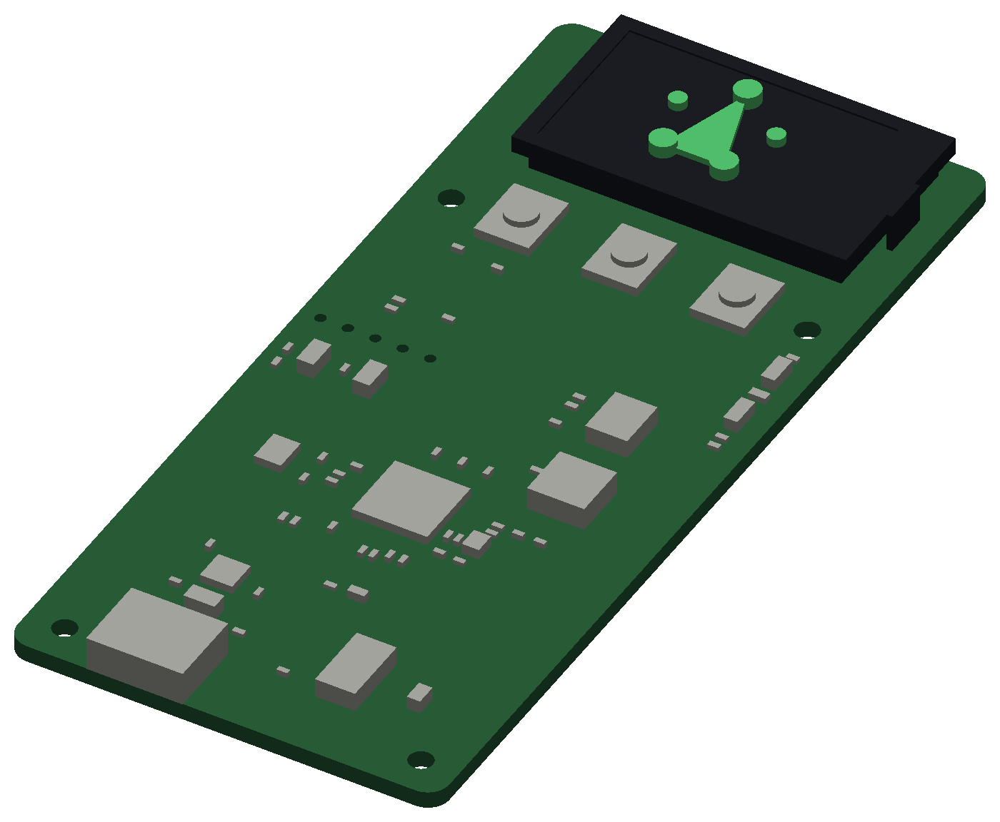

# Mono, as a print

**Looking for Mono's case?** It is in [`../consoles/`](../consoles/README.md#mono):
[`mono.py`](../consoles/mono.py), and the industrial variant, [`mono_ind.py`](../consoles/mono_ind.py)
(`tools/case build mono-industrial`). This folder is the board alone.

A rough model of [Mono](../../hardware/mono/README.md)'s board to print and hold: the 40 × 89.5 mm bar, its
holes, a block for each part JLCPCB fits, to its height, and the panel on top. It is for a sense of the
board's size and what stands on it, not a fit check (`tools/keypcb jlc mono` does that).



```sh
uv run --python 3.11 --with cadquery --with matplotlib python cad/mono/board.py
```

It writes `out/`:
- `mono_board.stl`: everything as one solid, 40 × 89.5 × 5.2 mm, the back down, as it prints.
- `mono_board_pcb.stl`, `mono_board_parts.stl`, `mono_board_panel.stl`: the same in three pieces that
  don't overlap, for a print in colours. Load all three at once so they keep their places.
- `mono_board.png`: the picture above.

[`board.py`](board.py) reads the routed board, `hardware/mono/mono/mono.kicad_pcb`: the outline, the
holes, and each part's place, turn and body (its footprint's F.Fab outline, or its courtyard). The
heights and the panel are the generator's (`gen_mono.py`: `HEIGHT`, `PANEL`), datasheet figures and
guesses. 67 parts, as the census on the board's back counts them. What the model draws differently:
- **The foam under the glass is one block,** 1 mm in from the glass's edges, not four 2 mm pads. So
  the glass prints without support, and hides J2 and its two capacitors as the real glass does.
- **The ribbon's fold** is a 0.5 mm strip at the glass's right end.
- **The picture's area** is cut 0.2 mm into the glass.
- **Each switch** is its body to 0.9 mm and a 3 mm round plunger to 1.5 mm.
- **Not fitted, not drawn:** U7, U8, D2 and J4. J4's five holes are drilled. The jig's pads, the
  fiducials and the mark are copper, so they aren't drawn.

The 0402 parts are 0.5 × 1.0 mm and about 0.5 mm tall: two or three layers at 0.2 mm, so they print as
dots. A 0.12 mm layer shows them better, or scale the print 2:1. The M2 holes are 2.2 mm, as drawn; a
printer may close them a little.

Not printed yet.

## A clip for the SWD pads

[`clip.py`](clip.py) draws a clip that holds a 3-pin strip of 2.54 mm header on TP1, TP2 and TP3 (SWCLK,
GND, SWDIO), for [the bring-up](../../hardware/mono/bench/BRINGUP.md) when there are no pogo pins.


```sh
uv run --python 3.11 --with cadquery --with matplotlib python cad/mono/clip.py
```

It writes `out/mono_clip.stl`, 20 × 11.3 × 31.5 mm as it prints: on its side, the jaws on the bed, the
leg up, no support. The two roofs it bridges are 8 mm and 8.5 mm long.

- **The header** goes in through the window in the front arm, long pins first. Its plastic sits on a
  ledge in the back jaw. The long pins stand 5 mm out of the back for jumper wires; the short ones
  touch the pads. Nothing else touches the board's back.
- **To fit it:** the front facing you, slide it onto the left edge, 21.5 mm up from the USB-C's end,
  lifting the arm's tip with a nail so the pins don't drag. Push it in to the edge and up until the leg's
  slanted face meets the bottom-left corner.
- **The wires:** the pin nearest the clip's spine is SWCLK, the middle one GND, the far one SWDIO.
- **The spring** is the front arm: its two bumps press the front 0.6 mm further than a 1.6 mm board
  leaves room for. By the beam formula that is about 2 N a pin in PLA, a rough figure.

`clip.py` reads the pads' places from the routed board, and checks that they are one row 2.54 mm apart
and that the parts under the arm (R15, C22, U4) are lower than it and none is under a bump. The header's
sizes are the usual strip's: plastic 2.54 mm square, 3.0 mm of pin below it and 6.0 above. Measure yours.

Printed once, 2026-11-17, from the first drawing, which left the bump's bar across the window: it was
cut out by hand. The drawing here has the window cut through and has not been printed. On one board the
clip's pins, and the same pins held by hand, got no answer over SWD, and the cause isn't known; board 1
was loaded through soldered wires. So the clip has not yet worked on a board. Three stiff pins on three pads: if one doesn't touch, push
the pins level in their plastic against a table. Check each with a meter before a load.
