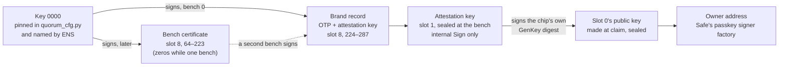
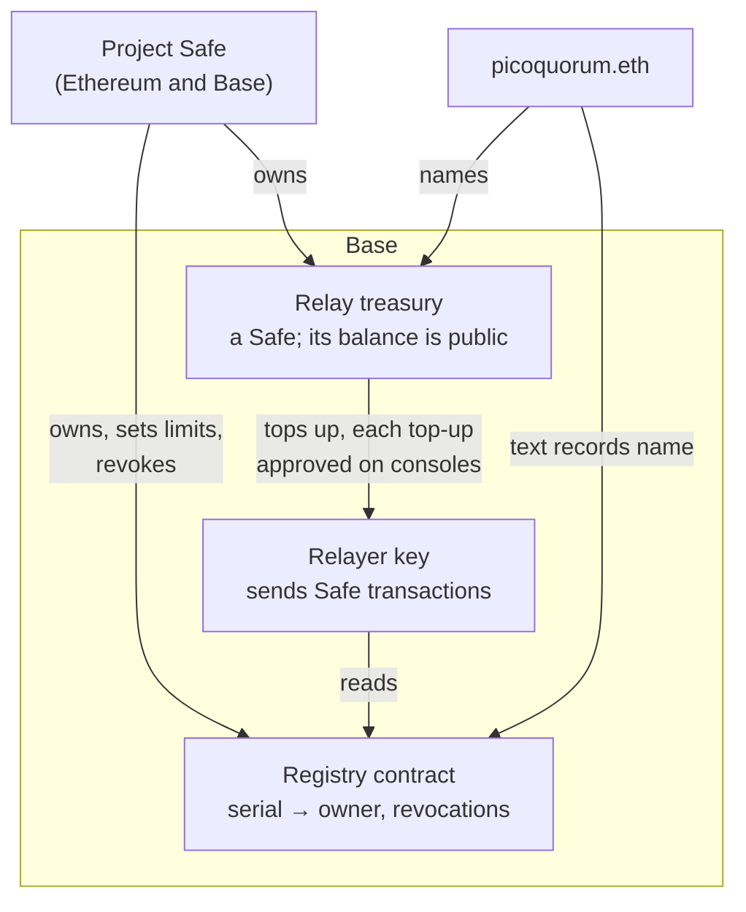

# Attested keys: the brand vouches for the key, and a gas relay trusts the brand

> **A proposal (2026-10-19). Nothing here is built.** It extends [BRANDED-KEYS.md](BRANDED-KEYS.md)
> so that a key made at claim can prove it lives in a branded chip. That proof is what a gas relay,
> paid from a public treasury, would check before it pays for a key's transactions. The chip half
> is frozen at the bench's locks (B3, B6), so it has to be decided **before the first real branded
> chip**, not after. Locks are permanent ([LOCKING.md](LOCKING.md)): every new step goes on a spare
> chip first.

## The idea in one paragraph

A branded key would get two things the project pays for: a chip the bench vouches for, and gas from
a relay. The relay spends real money, so people will try to get it without a real key. Today's brand
can't stop that. It proves key 0000 signed a serial's record. It doesn't prove that an owner address
belongs to the chip with that serial. This proposal adds an **attestation key** to each chip, made
and sealed by the bench and named in the brand. After the user makes their key, the chip signs a
statement about it with the attestation key. Anyone can then check, with no trust in a server:
key 0000 → this chip's brand → this chip's attestation key → this owner key → this owner address.
The relay, the treasury and the sales split all sit on top of that, onchain, and none of their
rules live on the chip.

## The gap in the brand as proposed

[BRANDED-KEYS.md](BRANDED-KEYS.md), point 7, says what the brand doesn't prove:
- An ATECC608 has no factory certificate.
- Anyone who holds the chip can read its OTP record and slot 8. A fake chip could carry a copy.
- So "one claim per serial" is the only guard. Whoever claims a serial first wins it, and the
  chip passes through a warehouse and the post before its owner sees it.

That is fine for a badge. It is not enough for a relay: a copied brand plus a software P-256 key
would look like a branded key to anything that only reads the registry.

The Trust M already has the shape that closes this gap. Its factory key E0F0 signs a binding between
the chip's Infineon certificate and the new key ([TRUSTM.md](TRUSTM.md)). The ATECC608 has no
factory key, so the bench makes one, and the brand plays Infineon's certificate.

## The chain

Each link is a P-256 signature or a pure function:
- **Key 0000 → brand:** as in BRANDED-KEYS.md, with the attestation key added to what it signs.
- **Brand → attestation key:** the key's public half is in the signed bytes.
- **Attestation key → slot 0's key:** a signature over a message the chip builds itself (below).
- **Slot 0's key → owner address:** `SafeWebAuthnSignerFactory.getSigner`, as today
  (`firmware/webauthn.py`).

The console can check the first two links with no network at U1, as it already plans to. The app,
the relay and a contract can check all of them, onchain with the P-256 precompile at 0x100 that
Safe's passkey signer already uses.

## On the chip: what changes from BRANDED-KEYS.md

### A new table, quorum v3

quorum v2 is in `firmware/chipcfg.py` and has run on chip 5, a spare. So the new table gets a new
name rather than changing v2 under a chip that already has it. quorum v3 is quorum v2 with one more
change: **slot 1 becomes the attestation key.**

| Slot 1 | quorum v1/v2 | quorum v3 (proposed) |
|---|---|---|
| Kind | dead | P-256 private key |
| Made by | — | GenKey, at the bench, once |
| External Sign | — | **off**: it never signs a digest a host hands it |
| Internal Sign | — | **on**: it signs only messages the chip builds from its own state |
| ECDH | — | off |
| PubInfo | — | on, so its public half can be read |
| LimitedUse | — | off |
| Lockable | — | yes, and slot-locked at the bench |

- The ReadKey nibble for "internal Sign only" should be `0010` (slot 0's `0001` is "external Sign
  only"). That is from the datasheet's bit list as remembered, not checked: `tools/check_config` must
  decode the whole row independently, from the datasheet, before the table is fixed.
- Slot 0 stays exactly as in quorum v1 and v2. Its KeyConfig `0x0033` already has PubInfo set,
  which the digest step below needs.
- Slots 2–7 and 9–15 stay dead. Slot 8 stays readable and never written after B6.

**Why external Sign must be off.** With it on, anyone holding the chip could have slot 1 sign
anything, including a statement about a software key. The attestation would prove nothing.
AGENTS.md rule 3 says the same thing for every key: no command signs an arbitrary digest.

### The brand record, version 3

The OTP record is BRANDED-KEYS.md's version 2 with two bytes changed:

| Offset | Size | v2 | v3 |
|---|---|---|---|
| 2 | 1 | Version 2 | **Version 3** |
| 3 | 1 | Profile 2 (quorum v2) | **Profile 3 (quorum v3)** |
| 49 | 15 | Zeros | Zeros, still kept |

The serial, number, batch, bench, date, bench build and brand key id stay where they are.

### Slot 8, version 3

| Bytes | v2 | v3 |
|---|---|---|
| 0–63 | Brand signature (r, s), low s | the same |
| 64–223 | Bench certificate, zeros while one bench | the same |
| 224–287 | Zeros | **The attestation key's public half, qx‖qy** |
| 288–415 | Zeros | Zeros |

**The digest the brand key signs:**
`SHA-256("PicoQuorum brand v2" ‖ OTP record ‖ slot 8 bytes 224–287)`.
The new prefix keeps a v3 brand from ever verifying as a v2 one.

The public half is also readable from the chip itself (PubInfo). It is in slot 8 too so a verifier
with no chip, such as the relay or a contract, has it from the brand alone. The console checks the
two match at U1.

### The bench steps, revised

| Step | What changes |
|---|---|
| B2 | Writes quorum v3, not v2. |
| B4 | Zeros into slots 2–15 except 8 (not 1–15). The v3 record into OTP. Still no key in slot 0. |
| **B4a** Make the attestation key | GenKey on slot 1. Read its public half. Replaceable until B4b. |
| **B4b** Seal it | Slot-lock slot 1. **Permanent.** Read the public half again: unchanged. |
| B5 | Key 0000 signs the v3 digest. Signature and public half go into slot 8. |
| B6 | Lock the data zone with the CRC, as before. Slot 1 is a private key, so it is not in the CRC. |
| B7 | Also checks: slot 1 sealed, its public half matches slot 8, slot 0 still empty. |

The bench must still not read slot 0's public key. On chip 5, a read of the empty slot 0 after the
data lock counted against counter 0 (BRANDED-KEYS.md).

**What this asks the user to trust that they didn't before:** nothing new. A dishonest bench could
plant a known attestation key before B6, but a dishonest bench can already brand fakes with key
0000. The user's own key is still made by the user's console.

### The claim, with one more step

After U4 (seal) and before U5 (owner address):

**U4a Attest.** Not permanent, and it writes nothing.
1. A Nonce, so TempKey is valid. It can carry a challenge, such as a recent block hash, so the
   attestation shows it was made after that block.
2. GenKey on slot 0 in its digest mode: the chip works out slot 0's public key again, makes no new
   key, and puts a digest of that public key (with the serial and the command's own bytes) into
   TempKey.
3. Sign, internal, with slot 1: the chip signs a message built from TempKey, slot 0's SlotConfig
   and KeyConfig, TempKey's flags, the serial, and (as remembered from the datasheet) whether slot 0
   is slot-locked.

The verifier rebuilds that message itself from slot 0's public key, the serial, the quorum v3 rows
and the challenge. It accepts it only if the flags say TempKey came from GenKey over slot 0, and,
if the datasheet confirms the bit is there, that slot 0 is sealed.

**Why it matters that the message says "sealed".** Before U4, someone holding the chip in transit
could make a key in slot 0 and attest it. The real owner's GenKey would replace that key, but the
old attestation would still verify, and could be used to squat the serial in a registry. If only
sealed keys can be attested, the squatter would have to seal the chip, and the real owner's claim
refuses a sealed slot 0, so they would know at once.

**Getting it off the console.** The attestation is public bytes, about 300 with the record. The
console already draws QR codes (`firmware/qrcode.py`), so U5 can show it as a QR for the app to
scan, with no new network call. Posting it from the console is a new network call: ask first.

**Which image does it.** The claim image, in `dual`. GenKey's digest mode changes no key, but it is
still a GenKey command. The console image keeps no GenKey of any mode, so `test-vectors/manifest.mjs`
stays a simple check (AGENTS.md rule 2). To attest again later, boot the dual image.

### The attestation bundle

What the console hands the app, and the app hands the registry:

| Field | From |
|---|---|
| Serial | the chip |
| OTP record (64) | the chip |
| Slot 8 bytes 0–287 | the chip: brand signature, bench certificate, attestation public key |
| Slot 0's public key (64) | the chip |
| The challenge, and GenKey's own parameter bytes | the console |
| The attestation signature (64) | the chip |

The check, in order, by the app, the relay, or a contract:
1. The brand signature under key 0000 (or a bench key that key 0000 certified, once a second bench
   exists), over the v3 digest.
2. The record's profile is 3, and its serial is the bundle's serial.
3. The attestation signature under slot 8's attestation key, over the message rebuilt from slot 0's
   key, the serial, the quorum v3 rows and the challenge.
4. The owner address from slot 0's key, through the pinned signer factory.
5. The brand key and bench are not revoked (the registry, below).

## Off the chip: the registry, the relay and the treasury

The chip carries identity only: serial, number, batch, brand, attestation key. **Nothing about
access, tiers or money goes on the chip.** All of that changes over time, and the chip is frozen at
B6. It lives onchain instead, and the project Safe governs it ([GOVERNANCE.md](GOVERNANCE.md)).

### The registry contract

- **On Base,** where the relay works and gas is cheap.
- **Registering is a Safe transaction** from a Safe that the attested key owns. The contract checks
  the bundle (all five checks above, on chain), and that `msg.sender` is a Safe with that owner.
  - The chip still signs only a Safe hash (AGENTS.md rule 1). There is no "log in to the relay"
    message for it to sign.
  - The console shows the call as red and unread until it has a decoder for it. A decoder,
    "Register key 0042 for the relay", is a firmware change and a new release fingerprint.
- **One owner per serial.** A second registration of a serial is refused and logged: it means a
  copied brand, or a bug.
- **Registering is optional.** A key works as a Safe owner without it. Registering links its serial
  to its owner address in public, which is the price of the relay.
- **The project Safe can:** revoke a bench key, retire a brand key, and set the relay's limits.
  It can't register or unregister a key for someone.
- This would be PicoQuorum's first contract (`contracts/README.md`). It needs review before
  anything is deployed.

### The relay

- **What it pays for:** a Safe transaction on Base, when one of its confirmations is from a
  registered owner. The relay checks the signatures as the Safe will, then sends `execTransaction`
  from the relayer key.
- **Limits, per serial, not per Safe.** One key can own many Safes. A cap per serial per day, and a
  cap on gas per transaction, keep one key from draining the treasury.
- **Two ways to build it:**
  - **A plain relayer** that reads the registry. Small, and the treasury's top-ups and the relayer's
    transactions are all public, so anyone can add them up.
  - **ERC-4337** (Safe4337Module, a bundler, a paymaster contract that reads the registry). The
    rules are then enforced on chain, but it is a new dependency and a new module on every Safe
    (LAUNCH.md section 4).
  - **Proposed:** the plain relayer first. Its spending is checkable even if its rules aren't
    enforced on chain.
- Either one is a new service and a new network call. AGENTS.md says ask before building.

### The treasury

- **A Safe on Base, owned by the project Safe.** Keeping it separate from the project Safe keeps the
  relay's money ring-fenced, and its balance is the relay's budget, readable by anyone.
- **It tops up the relayer key** in small amounts, each top-up a Safe transaction approved on
  consoles, as BRANDED-KEYS.md already plans for the test-ETH faucet.
- **What anyone can check:** the treasury's balance, every top-up, every relayed transaction, and
  the registry's count of keys.

### Sales and the treasury share

The chip can't prove a sale. So the split is checkable only where the money moves on chain.

- **Per batch, proposed.** For each batch, the project sends the treasury its share of that batch's
  sales, in one transaction whose note names the batch. Anyone can compare it with the batch file
  in `docs/registry/brands/` and the price.
- **Per key, on chain, possible but not proposed.** A sale contract that records an order and
  splits the payment. Linking the buyer's paying wallet to a serial would, after claim, link it to
  the owner address and so to their Safe. That gives away who owns which Safe. If it is ever built,
  the order must not name the serial in public.
- **The share itself** is a project Safe decision. It can be stated in an ENS text record (below)
  so it is public and changing it takes the Safe's quorum.
- Promising buyers a share of money, or a say in how it is spent, can raise legal questions. Get
  advice before saying either on a product page.

## Tying it to picoquorum.eth

**Yes, but the name points at the chain of trust. It is not part of it.**

- **The console trusts what is pinned in its firmware,** not the name. U1 runs with no network, the
  console can't read ENS, and the release fingerprint already covers `quorum_cfg.py`. Key 0000's
  public half is pinned there (BRANDED-KEYS.md point 3).
- **Everything else can cross-check against the name.** Once the project Safe owns picoquorum.eth
  ([GOVERNANCE.md](GOVERNANCE.md#ens)), these text records name each piece. Changing any of them is
  then a project Safe transaction, approved on consoles:

  | Record | Value |
  |---|---|
  | `org.picoquorum.brand` | Key 0000's id and public half; later, retired brand keys |
  | `org.picoquorum.registry` | The registry contract: chain id 8453, address |
  | `org.picoquorum.treasury` | The relay treasury Safe: chain id 8453, address |
  | `org.picoquorum.relay` | The relay's limits and the sales share, or a link to where they are stated |

  The app and the relay check that the name agrees with what they were built with, and stop on a
  difference. A difference means either a release that is out of date or a name that was changed.
- **Not in the chip.** The brand record has 15 spare bytes, enough for part of the name's namehash,
  but the name can expire or change hands. The chip's root is key 0000. The name points at key
  0000, not the other way round.
- **Later, maybe: a name per key.** `0042.keys.picoquorum.eth` resolving to the owner address.
  ENS resolves on Ethereum and the registry would be on Base. Reading Base from Ethereum means
  CCIP-read or a state proof, and the app keeps `ccipRead: false` (AGENTS.md rule 5). So it would
  need a registry on Ethereum, or a reviewed change to that rule. Not proposed.

## What only silicon can settle (a spare 608C, before chip #3)

Add these to BRANDED-KEYS.md's list:
- **That a host can't steer an internal Sign.** Nonce in pass-through mode and GenDig can both set
  TempKey. The internal-sign message must show, in its flags, which command made TempKey, so a
  verifier can refuse anything but GenKey. If any path lets a host make TempKey look like a GenKey
  digest of a key it chose, slot 1 is an arbitrary-digest signer and this proposal is out.
- **The internal-sign message, byte for byte,** from the datasheet, checked by verifying a real
  signature from a spare chip in `p256.py` and in the app.
- **Whether it carries slot 0's slot-locked bit.** If not, the registry needs another way to refuse
  a key attested before the seal.
- **GenKey's digest mode on a sealed slot 0:** it should still work, since it makes no new key.
- **Slot 1 refuses external Sign, PrivWrite and a second GenKey** after B4b.
- **The driver commands:** GenKey's digest mode and the internal Sign. `firmware/atecc.py` has
  neither today.
- **How long U4a takes** on the Pico. The chip does the signing; the console verifies the result
  once, about 2.5 s on chip 5's numbers.

## Decide before the first real branded chip

These are frozen at B3 or B6, so they can't wait:
- [ ] Attestation key in slot 1, or no attestation at all. Without it, the relay can only trust
      "first claim per serial".
- [ ] The quorum v3 rows, decoded by `tools/check_config`.
- [ ] The v3 record and slot 8 layout above, including the `"PicoQuorum brand v2"` prefix.
- [ ] Bytes 288–415 of slot 8 and 49–63 of OTP stay zeros, kept for what isn't known yet.

These can wait, because they live off the chip:
- [ ] The registry contract, the relay and the treasury, and whether the relay is plain or ERC-4337.
- [ ] The relay's limits and the sales share.
- [ ] The ENS records.
- [ ] Whether the console decodes the registry call.

## What it would take

In order. Each item that changes firmware is a new release fingerprint.

1. **A spare 608C** for BRANDED-KEYS.md's list and the one above. The driver commands first.
2. **quorum v3** in `chipcfg.py`, decoded by `tools/check_config`.
3. **The bench:** B4a, B4b and the v3 brand in `firmware/brand.py`, walked by
   `test-vectors/run-brand.mjs` on the virtual chip, which needs GenKey's digest mode and internal
   Sign too.
4. **The claim:** U4a and the QR, with the refusals, on the virtual chip with a reboot after every
   step.
5. **The bundle check** in one place shared by the app and `tools/quorum verify`, as the Trust M
   check is (`tools/mock-tx-service/attest.mjs`).
6. **Then, each asked for first:** the registry contract, the treasury Safe, the relay, and the ENS
   records.
