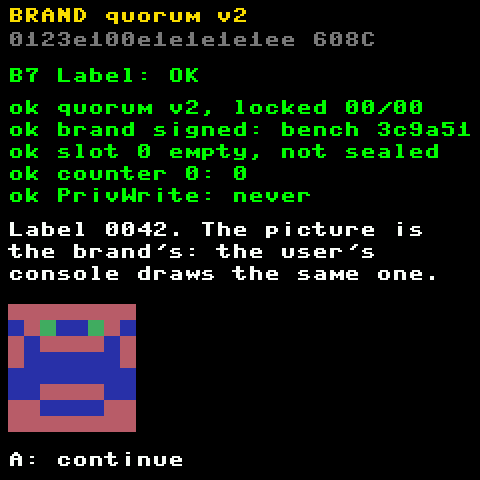

# Branded keys: the bench brands the chip, the user makes the key

> **A proposal (2026-10-07). Nothing here is built.** It answers LAUNCH.md section 6, "decide the
> brand and quorum record before sealing chip #3", and says what a user does with a branded key.
> The screens below are mockups, drawn by the real ceremony screen (`firmware/provision.py`) on the
> emulator with new words. No firmware has these steps yet. Locks are permanent
> ([LOCKING.md](LOCKING.md)), so every new step goes on a spare chip first.

## The idea in one paragraph

Today the bench runs the whole ceremony, C1–C10 ([PROVISIONING.md](PROVISIONING.md)). The chip
leaves with its key made, sealed and recorded. The user has to take the bench's word that nobody
chose that key.

This proposal splits the ceremony in two:
- **The bench brands the chip.** It writes PicoQuorum's config and a signed brand record, then locks
  the config and data zones. It makes no key.
- **The user's console makes the key.** It checks the brand, makes the key inside the chip, and
  seals it.

After the bench's data lock, the only thing that can put a key into slot 0 is the chip's own
GenKey. So nobody chose the user's key, the bench included.

```mermaid
flowchart LR
  subgraph Bench["The bench (the project)"]
    B1[B1 pre-flight] --> B2[B2 write quorum v2] --> B3[B3 lock config<br/>PERMANENT]
    B3 --> B4[B4 brand record<br/>OTP + slot 8] --> B5[B5 brand key signs] --> B6[B6 lock data<br/>PERMANENT] --> B7[B7 check + label]
  end
  B7 -- "key-c in a bag:<br/>label + card" --> U1
  subgraph Console["The user's console"]
    U1[U1 check the brand] --> U2[U2 make your key] --> U3[U3 test signatures] --> U4[U4 seal it<br/>PERMANENT] --> U5[U5 owner address]
  end
  U5 --> A[The app: deploy the signer,<br/>starter Safe, test ETH]
```

## Why split it

| Who makes the key | What the user must trust | What can go wrong |
|---|---|---|
| **The bench, as today** | The bench didn't plant a key. While the data zone is open, a plaintext PrivWrite can put a known key into slot 0 before the slot lock, and nothing on the chip shows it afterwards (LOCKING.md). | A dishonest or compromised bench keeps a copy of every key. |
| **The user, from a factory chip** | Nothing. | The user runs every permanent step, with CRCs and silicon unknowns. A slip bricks a chip. 608C bring-up isn't done (LAUNCH.md section 6). |
| **Split (proposed)** | The brand says the bench locked the config and data zones. The user's console checks both locks itself. | After B6, PrivWrite on slot 0 is refused by the config (WriteConfig `0010`: GenKey only). The user's GenKey replaces anything that was there. |

The split keeps the risky steps on the bench, where they are practised. It gives the user the
one thing that matters: a key that only their console asked for.

## On the bench

### The rig

- **One Pico with two chips on its I2C bus:**
  - **The brand key**, a Trust M at 0x30, wired in for good. It is made with the Trust M ceremony as
    it stands (T1–T10, [TRUSTM.md](TRUSTM.md)). It is never a Safe owner.
  - **The chip being branded**, an ATECC608C on a key-c board, in a USB-C receptacle at 0x60.
  - The board already handles both chips on one bus (`signer.load`, TRUSTM.md "Which chip is in").
- **A new `brand` image.** It holds B1–B7 and the brand signature. Like the ceremony image, it
  never goes on a user's console. It would be a fourth image in `firmware/manifest.json`, beside
  console, ceremony and dual, checked by `test-vectors/manifest.mjs`.
- **A label printer** on the laptop. It prints from what B7 reports.
- **The local inventory** (gitignored `chips/`), as for the Trust M chips (mainnet/RUNBOOK.md).

### The steps

B1–B3 are C1–C3 today, with a new table. B6 is C9. The new parts are B4, B5 and B7.

| Step | What | Permanent? |
|---|---|---|
| B1 Pre-flight | As C1. It also accepts the 608C revision, which `chipcfg.REVISIONS` lacks today. | no |
| B2 Write quorum v2 | quorum v1 with one change: slot 8 can be read in the clear (below). | no, rewritable |
| B3 Lock the config | With the CRC of the reviewed v2 table, as C3. | **yes** |
| B4 Brand | Zeros into slots 1–15 except 8. The brand record goes into OTP. No key is made. | until B6 |
| B5 Countersign | The brand key signs the record. The signature goes into slot 8. | until B6 |
| B6 Lock the data zone | With the CRC of every slot that is not a private key, plus OTP, so the brand is in the CRC. | **yes** |
| B7 Check + label | Read everything back, verify the signature, slot 0 empty, counter 0 = 0. Print the label. | read-only |

| B4: write the brand | B6: lock the data zone | B7: what leaves the bench |
|---|---|---|
|  |  |  |

The other bench screens look like today's ceremony ([firmware-production/shots](firmware-production/shots/)):
[C1 pre-flight](firmware-production/shots/60-ceremony-C1.png),
[C3 lock the config](firmware-production/shots/64-ceremony-C3.png),
[C9 lock the data zone](firmware-production/shots/76-ceremony-C9.png).

### The technical decisions

**1. Where the brand lives: OTP and slot 8.**
- **Why not OTP alone:** the 64-byte OTP zone is full with today's record, and a signature alone is
  64 bytes.
- **The two options from LAUNCH.md:**
  - **A.** A v2 OTP record with the signature kept off-chip, in the registry. The config table stays
    quorum v1. But only the app could check the brand, over the network, and the console couldn't.
  - **B.** A quorum v2 table with slot 8 (416 bytes) readable in the clear and never writable. The
    signature lives on the chip, and the console checks it at plug-in with no network.
- **Proposed: B.** U1 is the console checking the brand before the user does anything permanent.
  - Slot 8's row would be the dead slots' row with IsSecret cleared (SlotConfig about `0x8F1F`,
    KeyConfig `0x001C`).
  - `tools/check_config` must decode it independently before the table is fixed.
  - Every other slot stays as in quorum v1.

**2. What the brand says.** The OTP record, version 2. It has no key fields, because there is no key
yet:

| Offset | Size | Content |
|---|---|---|
| 0 | 2 | `PQ` |
| 2 | 1 | Version 2 |
| 3 | 1 | Profile (2 = quorum v2) |
| 4 | 9 | Serial |
| 13 | 4 | Revision (608A, B or C) |
| 17 | 2 | Config CRC (the one B3 locked with) |
| 19 | 2 | Batch |
| 21 | 4 | Label number (0042) |
| 25 | 4 | Date |
| 29 | 4 | Bench build (the `brand` image's fingerprint, first 4 bytes) |
| 33 | 16 | Brand key id: SHA-256(qx‖qy)[:16] of the brand key |
| 49 | 15 | Zeros |

Slot 8 holds the brand signature:
- **Bytes 0–63:** the brand key's (r, s), low s.
- **The digest it signs:** `SHA-256("PicoQuorum brand v1" ‖ OTP record)`.
- **Bytes 64–415:** zeros.

The console checks three things:
- the signature, under the pinned brand key
- that the record's serial, revision and config CRC match the chip in front of it
- that both zones read locked

**3. The brand key: a Trust M on the bench.**
- **Not a laptop key.** A brand key in a file can leak, and a leaked brand key brands fakes.
- **A Trust M.** It is sealed by the project's own ceremony, and Infineon's certificate shows it is
  genuine silicon. Anyone can check it with `tools/quorum verify`, as for TM1.
- **Never a Safe owner, and the brand image signs only brand digests.** Its fixed prefix keeps it
  apart from a WebAuthn digest.
- **Its public half is pinned in `quorum_cfg.py`.** That is a firmware change and a new release
  fingerprint. It is also published in `docs/registry/`. Once the project Safe holds picoquorum.eth, a
  text record such as `org.picoquorum.brand` could name it, so changing the brand key would need the
  project Safe's quorum.
- **Rotating it:** the firmware lists brand keys by id. A retired key stays listed for the batches
  it branded.

**4. The label number and the brand picture.**
- **The number:** each chip gets the next one across all batches (0042). It goes on the label, in
  the record, and on the console's U1 screen.
- **The picture:** the blockie of the brand digest's first 20 bytes. B7 and U1 both draw it, so the user
  matches the label to the chip by eye, as they already do for the verify code.

**5. The list.**
- The registry ([registry/README.md](registry/README.md)) covers Trust M only today, and `tools/fw
  attest` refuses an ATECC608.
- Each batch would add `docs/registry/brands/batch-<n>.json`: serial, number, OTP record and
  signature. All of it is public.
- A claim (below) adds the owner address to that serial's entry.
- One owner per serial: a second claim on the same serial is the sign of a copied brand.
- An onchain Merkle root (LAUNCH.md) can come later. It would be PicoQuorum's first contract.

**6. What the brand proves, and what it doesn't.**
- **It proves** the project's brand key signed this serial's record, with this config CRC, and that
  the chip in the console has that serial and that config, locked.
- **It doesn't prove** the physical chip is the one the bench branded.
  - An ATECC608 has no factory certificate. A fake chip, or a microcontroller pretending to be one,
    could copy a real chip's serial, OTP and slot 8.
  - What limits that: one claim per serial in the registry, and the label number in the user's
    hands.
  - **A stronger option, not proposed yet:** an attestation key in slot 1. The bench would make it
    and seal it, and the brand would certify it. At U2, the chip would sign a statement about slot 0's
    new key with it (GenKey's digest mode, then an internal Sign). That would prove slot 0's key was
    made in a branded chip. It needs driver commands that don't exist, and the internal message format
    must be confirmed against the datasheet and a spare chip. It is a later profile.
- **It says nothing about the user's key.** The user's console made that.

**7. The images.**
- **On the bench:** `brand` (B1–B7, the brand signature, both data locks).
- **On the user's console:** today's `dual` image routes a fresh chip to the ceremony. It would
  route a quorum v2 chip with both zones locked and slot 0 unsealed to **claim** (U1–U5).
  - Claim can only make slot 0's key and seal it. It can't write config, OTP or slot 8, and it can't
    lock a zone.
  - The console image still carries none of it (AGENTS.md rule 2).
- **The console image gets read-only brand lines** on its Chip page: "PicoQuorum key 0042, batch 3,
  brand checked".

**8. The user's gates.** Today a permanent step needs `ALLOW_*` set from the laptop, the B+Y arm,
and A held for 3 s.
- **Proposed for claim:** keep the arm and the hold, and drop `ALLOW_*`. The state check is the gate:
  claim offers its two writes only on a chip that is branded, locked 00/00 and unsealed. A user
  without a laptop can't edit `secrets.py`.
- **This loosens a guard, so it is for review, not assumed.**
- **After U5, claim writes the pin** (`QUORUM_EXPECT`) itself, as `tools/fw pin` does from the laptop
  today.

### What only silicon can settle (a spare 608C, before chip #3)

- GenKey on slot 0 after the data lock, on a slot that never had a key. LOCKING.md says the data
  lock doesn't stop GenKey, but no chip here has run it in that order.
- PrivWrite on slot 0 after the data lock: refused. Try it only on the spare.
- Slot 8 reads back in the clear after the lock, and its bytes are in the data CRC.
- The 608C's revision bytes and factory table (C1 knows 608A and B only).
- How long U1 takes on the Pico: one P-256 verify, about 1.4 s on the Trust M certificate check.

## The user

### What arrives

- **A key-c board** (USB-C, ATECC608C) with the PicoQuorum mark on its back.
- **A bag label:**

  

  The picture is the same blockie the bench drew at B7 and the console draws at U1. The QR code
  opens the app's check page for this serial. That page doesn't exist yet: `#/brand/<serial>` is a
  proposed route.
- **A card** with the five steps below and one warning: if the console says the brand doesn't
  verify, stop.

### The claim, on the console

The user needs a PicoQuorum console, built or bought, on a release that carries claim. The Device
screen shows the release fingerprint, to compare with the README's build table.

1. **Plug the key in.** The console sees a branded, unclaimed chip and opens CLAIM.
2. **U1 Check the brand.** The console checks it with no network. Check that the label's number
   and picture match the screen.
3. **U2 Make your key.** B+Y to arm, then hold A for 3 s. You can make it again until U4.
4. **U3 Test signatures.** Two digests, signed and checked on the console.
5. **U4 Seal your key.** Arm, hold. Permanent.
6. **U5 Your owner address**, with its blockie. The console pins the chip and restarts into the
   console.

| U1: the brand checks | U2: make your key | U4: seal it | U5: your owner address |
|---|---|---|---|
|  |  |  |  |

**When the brand doesn't check out**, claim stops before anything is written:

Claim also refuses:
- a chip whose slot 0 is already sealed (claimed before)
- a chip whose zones aren't both locked
- a chip whose config CRC isn't the one in its record

### After the claim, in the app

The onboarding idea: a 1-of-1 starter Safe on Base Sepolia, with the project paying the gas.

1. **Deploy the signer.** The owner address is a `SafeWebAuthnSignerProxy` that isn't deployed
   yet. Any wallet can deploy it. A project relayer could too.
2. **A starter Safe**, 1 of 1, on Base Sepolia (LAUNCH.md section 4, "A new passkey gets a starter
   Safe"). Its address is the user's address for receiving funds.
3. **Test ETH from the project.** The project's own Safe tops up a faucet key, each top-up approved on
   consoles. The faucet funds a starter Safe once per claimed serial, so the brand doubles as the
   faucet's guard.
4. **Each send:** propose, check it on the console, hold Sign, and a wallet or the relayer sends it.
   The chip can't send a transaction itself: its key is P-256, and it signs only the Safe hash.
5. **Next:** add a second owner and raise the threshold to 2. A 1-of-1 is where you start, not where
   you stay.

The relayer and the faucet are each a new service and a new network call. AGENTS.md says to ask
before building either.

### The browser console

A passkey user has no chip, so there is no brand and no claim. They go straight to the starter
Safe. The brand only ever shows on hardware keys.

## What it would take

In order. Each item that changes firmware is a new release fingerprint.

1. **A spare 608C:** settle the silicon questions above.
2. **The quorum v2 table** in `chipcfg.py`, decoded by `tools/check_config`.
3. **`provision.py` split** into bench steps (B) and claim steps (U). Extend
   `test-vectors/run-ceremony.mjs` to walk both halves on the virtual chip, with a reboot after every
   step, plus the claim refusals above.
4. **The brand key:** a Trust M through T1–T10, its bundle in the registry, its key in
   `quorum_cfg.py`.
5. **The `brand` image** and the claim route in `dual`. Update `manifest.mjs` for both.
6. **The registry:** batch files, the ATECC entries, and `tools/fw attest` for a 608.
7. **The label:** `tools/board/brand_label.py` draws it today from fixed values. It would take them
   from B7's output.
8. **The app:** the check page behind the label's QR code, and the claim badge.

## How these pictures were made

- `node tools/board/shots_brand.mjs` draws the B and U screens. It runs a virtual ATECC608 through
  C1–C4 for a real key and owner, then gives the ceremony screen new titles and words. The key is new
  on every run, so U4 and U5 change each time.
- `python3 tools/board/brand_label.py` draws the label with the firmware's `blockies.py` and
  `qrcode.py`.
- The serial `0123e100e1e1e1e1ee` is the emulator's virtual chip. Batch 3, key 0042 and bench key
  `3c9a51…` are made up.
