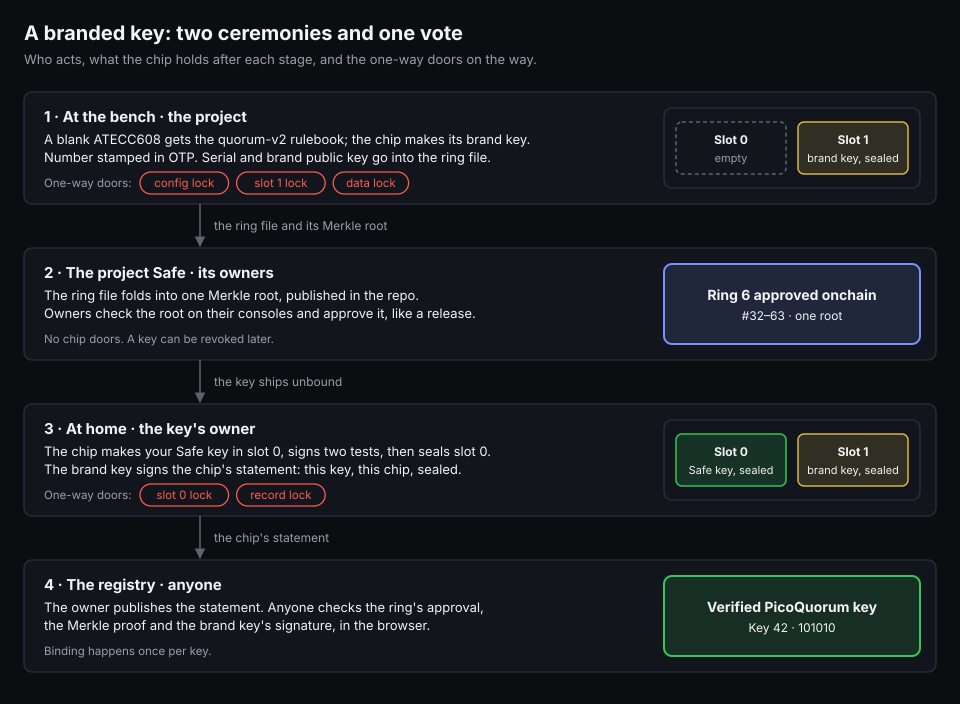
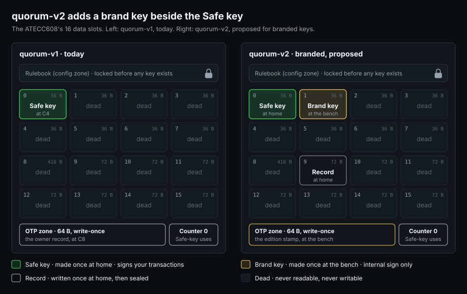
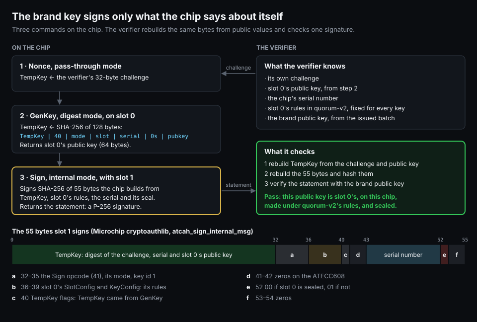
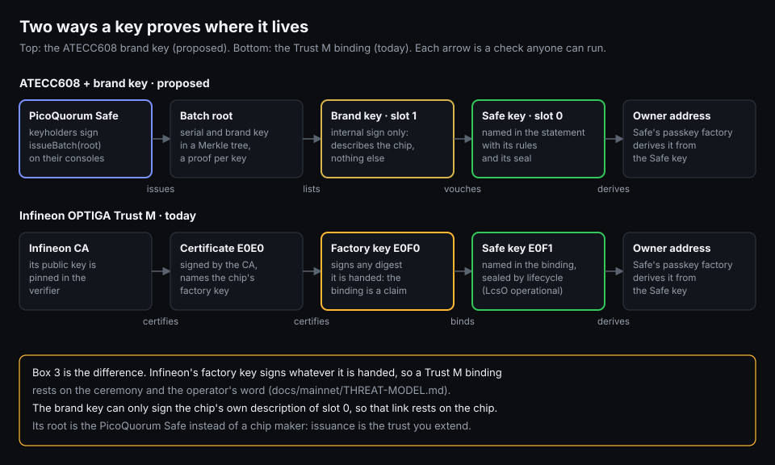
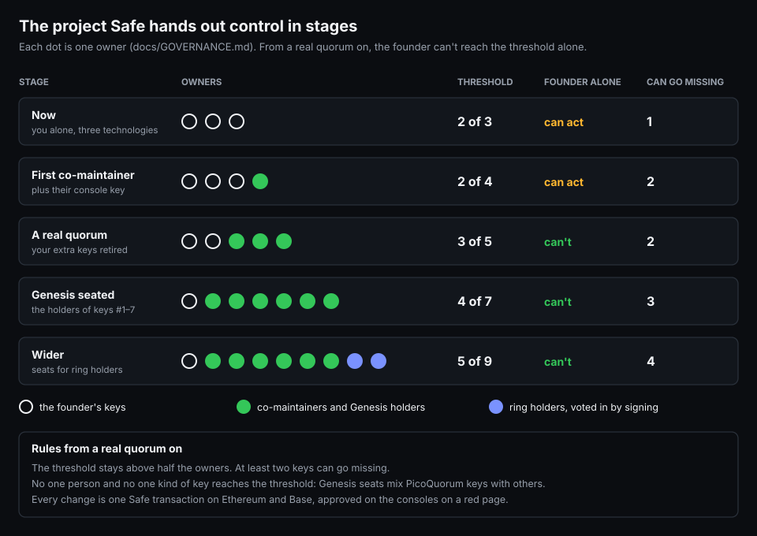

# Branded keys: the brand key and quorum-v2

> **A design, 2026-10-05. Nothing here runs yet.** The first step is the virtual chip in the
> emulator ([the plan](#the-plan)). Irreversible steps go on a sacrificial chip first, as always.

A branded PicoQuorum key carries two keys on one ATECC608:
- **The Safe key (slot 0)** is made by the owner, at home. It signs Safe transactions, as in quorum v1.
- **The brand key (slot 1)** is made at our bench before the key ships. It can sign only messages the
  chip composes about itself.

When the owner makes the Safe key, the brand key signs the chip's statement: this public key is slot
0's, on this chip, under these rules, and sealed. Anyone can check that statement against the ring
the project Safe approved, and the key gets a badge.



## Why

- **ATECC608 keys have no factory root.** The ATECC608C-SSHDA on key-c is a blank part with no
  certificate. Today only Trust M keys can earn a Verified badge ([registry](registry/README.md)).
- **A stricter link than the Trust M binding.** The Trust M's factory key E0F0 signs whatever it is
  handed, so its binding rests on the ceremony ([mainnet/THREAT-MODEL.md](mainnet/THREAT-MODEL.md)).
  The brand key can't sign a statement the chip didn't compose.
- **Keys from a known group.** Keys are issued a ring at a time by the owners of the project Safe
  ([GOVERNANCE.md](GOVERNANCE.md)), not by a company. The rings and the launch: [launch/](launch/README.md).
- **Cheap.** The same chip and the same board: one more slot.

## The chip: quorum-v2



| Where | quorum-v1 (today) | quorum-v2 (proposed) | Made or written | Sealed by |
|---|---|---|---|---|
| Slot 0 | the Safe key: P-256, GenKey, external sign, no PrivWrite, LimitedUse | the same | GenKey at home (H2) | slot lock at home (H4) |
| Slot 1 | dead | the brand key: P-256, GenKey, **internal sign only**, no PrivWrite | GenKey at the bench (B4) | slot lock at the bench (B6) |
| Slot 9 | dead | the owner record: clear writes, lockable | at home (H6) | slot lock at home (H6) |
| Other slots | dead | dead | zero-filled at the bench | the data lock (B8) |
| OTP zone | the owner record (C8) | the key's number, ring and date | at the bench (B7) | the data lock (B8) |
| Counter 0 | Safe-key uses | the same | | |
| Config zone | locked at C3 | locked at B3 | | |

What the bytes must hold, checked by asserts the way `chipcfg.py` checks quorum-v1:
- **Slot 1:** a P-256 private key, GenKey allowed, PrivWrite forbidden, lockable. Its SlotConfig
  allows internal signatures and refuses external ones and ECDH. That one bit pattern is what makes
  it a brand key.
- **Slot 0:** as in quorum-v1, with PubInfo set (quorum-v1 already has it), so GenKey can rebuild
  its public key for the digest.
- **Slot 0 must still accept GenKey after the data lock**, because the owner makes the key after we
  lock the data zone. To confirm on the virtual chip and a sacrificial part.
- **Slot 9:** clear writes, lockable. To confirm that a data slot can be slot-locked after the data
  lock.
- `chipcfg.py` gets `QUORUM_V2` beside `QUORUM_V1`, with its own fingerprint and asserts, and
  `tools/check_config` learns it.

## How the chip vouches for its own key



1. **Nonce, pass-through mode.** The verifier's 32-byte challenge goes into TempKey. At the ceremony
   the console picks it; for a live check, anyone can.
2. **GenKey, digest mode, on slot 0.** The chip recomputes slot 0's public key and replaces TempKey
   with SHA-256 of 128 bytes: TempKey, the GenKey opcode (`40`), the mode, the key id, serial bytes
   8, 0 and 1, zeros, then the 64-byte public key at the end.
3. **Sign, internal mode, with slot 1.** The chip signs SHA-256 of the 55 bytes in the figure.
   They include:
   - slot 0's SlotConfig and KeyConfig;
   - the TempKey flags, which say TempKey came from GenKey;
   - all nine serial bytes, with the mode's include-serial bit;
   - byte 52: `00` if slot 0 is sealed.

The verifier rebuilds both messages from values it already knows and checks one signature with the
brand public key. Nothing secret is needed, so anyone can run it.

**Why slot 1 can't lie.** Its rules allow internal signatures only. Every message it signs starts
with a TempKey the chip made itself and carries the rules of the slot it describes. Nobody can hand
it a digest to sign. A TempKey made some other way (GenDig) shows up in the flags, and the verifier
refuses it.

**Order matters at home.** Seal slot 0 first, then make the statement, so byte 52 proves the seal.

The byte layouts come from Microchip's cryptoauthlib,
[`lib/host/atca_host.c`](https://github.com/MicrochipTech/cryptoauthlib/blob/main/lib/host/atca_host.c)
(`atcah_gen_key_msg`, `atcah_sign_internal_msg`). Check them against the datasheet's GenKey and Sign
sections, and on the virtual chip, before any real one.

## The bench ceremony, per key

| Step | What | Checks | Permanent? |
|---|---|---|---|
| B1 | Pre-flight | As C1: at `0x60`, the revision, zones open, the factory table, self-test. Saves a snapshot | no |
| B2 | Write quorum-v2 | Readback is quorum-v2; shows the config CRC | no |
| B3 | Config lock with CRC | Still quorum-v2, slot 0 and slot 1 decode right | **yes** |
| B4 | GenKey slot 1, the brand key | KeyValid; the public key reads back | replaceable until B6 |
| B5 | Brand-key checks | An external Sign with slot 1 is refused; a statement about slot 1 itself verifies | no |
| B6 | Slot-lock slot 1 | The same public key | **yes** |
| B7 | The key's number into OTP; zero-fill the dead slots | The data CRC it will need | rewritable until B8 |
| B8 | Data lock with CRC | OTP frozen; slot 0 still empty | **yes** |
| B9 | List it | Number, serial and brand public key into the ring file; the screen shows the brand key's fingerprint | no |
| B10 | Label and pack | The card: number in decimal and binary, serial, a QR code to the key's registry page | no |

Until B8, a plaintext PrivWrite could put a known key in slot 0 ([LOCKING.md](LOCKING.md)). It
doesn't matter here: the owner's GenKey at H2 replaces whatever slot 0 holds, and after B8 nothing
can write it.

A tampered laptop could list a brand key it controls, and then forge statements for that serial. So
the console shows each brand key's fingerprint at B9, and a second machine re-reads a sample of
chips before the project Safe approves the ring.

## The owner's ceremony, at home

| Step | What | Checks | Permanent? |
|---|---|---|---|
| H1 | Pre-flight | quorum-v2, config and data locked, slot 1 sealed, slot 0 unsealed; the serial and brand key are in an approved ring (the app, or the ring file offline) | no |
| H2 | GenKey slot 0, the Safe key | KeyValid; the public key | replaceable until H4 |
| H3 | Two test signatures: a digest and a WebAuthn assertion | Both verify on the Pico; counter +2 | no |
| H4 | Slot-lock slot 0 | The same public key, signs and verifies | **yes** |
| H5 | The statement | Nonce, GenKey digest on slot 0, Sign internal with slot 1; it verifies on the Pico under the brand key; byte 52 says sealed | no |
| H6 | The record into slot 9, then slot-lock slot 9 | The record matches the key | **yes** |
| H7 | Owner address | Shown as a QR code; compared with the passkey factory's `getSigner` | no |

A key intercepted in the mail and run through H2–H4 on the way arrives with slot 0 sealed. H1
refuses it, and the owner asks the Safe to revoke it.

## Issuing rings



Keys are issued a ring at a time ([launch/](launch/README.md)): ring n holds the n-bit numbers, so
ring 6 is #32–63. Each ring has a ring file, `docs/registry/rings/ring-N.json`, with one entry per
key: its number, serial and brand public key. A ring file never changes once it is approved.

**First, with no new contract: the project Safe approves the ring the way it approves a release.**
1. The ring's digest D is the EIP-712 `PicoQuorumRing(ring, root, count, file)`: the Merkle root of
   its entries, how many there are, and the SHA-256 of the ring file.
2. The project Safe ([GOVERNANCE.md](GOVERNANCE.md)) approves D as it approves a release
   ([RELEASES.md](RELEASES.md)): a delegatecall to Safe's SignMessageLib, `signMessage(D)`, with a
   short note naming the ring.
3. Each owner's console shows **Approve ring 6 · #32–63 · 32 keys** and the root. As for releases,
   it refuses unless the note gives exactly the calldata's digest: `decode.py` learns one more
   message type, and no looser.
4. Once executed, `isValidSignature(D, "0x")` holds on the Safe for good, even after its owners
   change.

A revocation is one more approval: `PicoQuorumRevoke(number, reason)`.

**Binding.** The owner publishes the statement as a bundle in [registry/](registry/README.md) by
pull request, as Trust M bundles are listed today. The app checks it in the browser:
1. the project Safe approved the ring (`isValidSignature`), and hasn't revoked the key;
2. the key's entry is in the ring's Merkle root;
3. the statement: it rebuilds the GenKey digest and the 55 bytes with quorum-v2's slot 0 config and
   byte 52 = `00`, then checks the signature with the brand public key;
4. the owner address follows from the Safe key through Safe's passkey factory (`getSigner`).

**Later, if other contracts need to read badges: a registry contract** on Base, owned by the
project Safe. It holds no money and runs the same checks on chain, with OpenZeppelin's `P256` as
`TrustMAttest.sol` does (Base and Ethereum both have the P-256 precompile).

```solidity
interface IPicoQuorumRegistry {
    // the project Safe only
    function approveRing(uint8 ring, bytes32 root, uint16 count) external;
    function revoke(uint16 number) external;
    // anyone
    function bind(Entry calldata entry, bytes32[] calldata proof,
                  bytes32 qx, bytes32 qy, bytes32 challenge, bytes32 r, bytes32 s) external;
    function keyOf(address owner) external view returns (Key memory);
}
// entry leaf = keccak256(abi.encode(number, serial, brandX, brandY))
```

- **Binding is optional and public.** It shows which Safe owners are PicoQuorum keys. A holder who
  skips it still has a working key.
- **Each ring file is published before the vote.** The owners compare its root on their consoles
  before they approve.
- **Revoking a badge doesn't remove a key from any Safe.** The Safe it owns still has to swap it out.

## The project Safe



The issuer is the project Safe in [GOVERNANCE.md](GOVERNANCE.md): the same address on Ethereum and
Base, 2 of 3 to start, handed over in stages. Ring approvals and revocations join release approvals
on Ethereum.

- **Now: 2 of 3.** Three technologies, all the founder's.
- **First co-maintainer: 2 of 4.**
- **A real quorum: 3 of 5.** The founder's extra keys are retired.
- **Genesis seated: 4 of 7.** The holders of keys #1–7. GOVERNANCE.md's rule still holds: no
  technology holds a threshold. So at most three seats sit on PicoQuorum keys; the others use a
  Trust M key, a hardware wallet or a passkey.
- **Wider: up to 5 of 9,** with seats for ring holders, voted in by signing.

The Safe holds authority, not money: project funds, if any, go to a separate Safe.

## What it proves, and what it doesn't

- **It proves** the Safe key was made on a chip in a ring the project Safe approved, can't be exported (slot
  0's rules say so), and is sealed.
- **It doesn't prove** who holds the key or who pressed Sign. That is the Safe's threshold.
- **Counterfeit chips.** A blank part has no factory root, so a fake that imitates an ATECC608 would
  pass the bench. Buy through JLCPCB or LCSC, and re-read a sample.
- **The project Safe itself.** A Safe that approves a bad ring can mint badges for software keys.
  The badge is only as good as its owners and the published ring files. That's why control is
  handed out in stages.
- **Physical attacks** on one chip reach that chip's keys only. Every brand key is its own.

| | Trust M binding (today) | ATECC608 brand key (proposed) |
|---|---|---|
| Root | Infineon's CA | the project Safe |
| Key to chip | E0F0 signs a binding; it signs anything, so it rests on the ceremony | slot 1 signs the chip's own statement; it can't sign anything else |
| Live check | E0F0 still signs as its certificate's key | a fresh statement, any time, with the verifier's challenge |
| Certification | Common Criteria EAL6+ | none |
| Board | the Adafruit breakout | key-c, 5 ordered |

## The plan

- [ ] `atecc.py`: Nonce (pass-through), GenKey digest mode, Sign internal mode
- [ ] The emulator's virtual ATECC608: the same three, and slot 1's refusals
- [ ] `chipcfg.py`: `QUORUM_V2` with its fingerprint and asserts; `tools/check_config`
- [ ] A statement verifier in Python and JavaScript, with vectors from the virtual chip (`test-vectors/brandkey.json`)
- [ ] The bench ceremony (B1–B10) and the owner's ceremony (H1–H7) on the emulator, rebooting after every step, with the refusals
- [ ] Every step and refusal on a sacrificial key-c board
- [ ] `PicoQuorumRing` and `PicoQuorumRevoke` digests beside the release digest (firmware, tools, app), and the console's **Approve ring** page, as strict as **Approve release**
- [ ] Ring approvals rehearsed on a fork (`tools/quorum`), then Base Sepolia
- [ ] The app's Keys page: rings, statements, badges
- [ ] The first build: a key-c order of about 72 boards for #1–63 and the sacrificial chips ([launch/](launch/README.md))
- [ ] Later, if needed: the registry contract and its Foundry tests on the Anvil fork (`tools/quorum up`)

## Open decisions

- Which slots: 1 for the brand key and 9 for the record are proposals.
- Whether the record lives on the chip at all, or only in the registry.
- The number stamp's layout in the 64-byte OTP zone.
- Whether Trust M keys can be issued into the registry too, with a badge that says what it rests on.
- The rings, packs and launch phases: [launch/](launch/README.md).

Figures: `tools/brandkey-figures` draws everything in [brandkey/](brandkey/).
