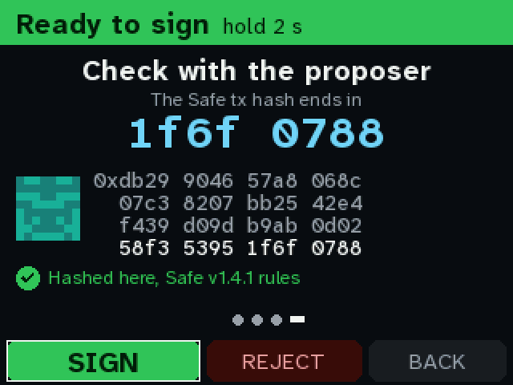
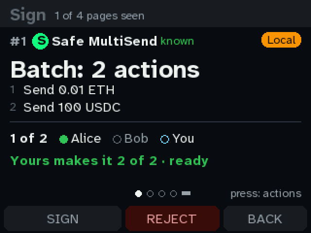
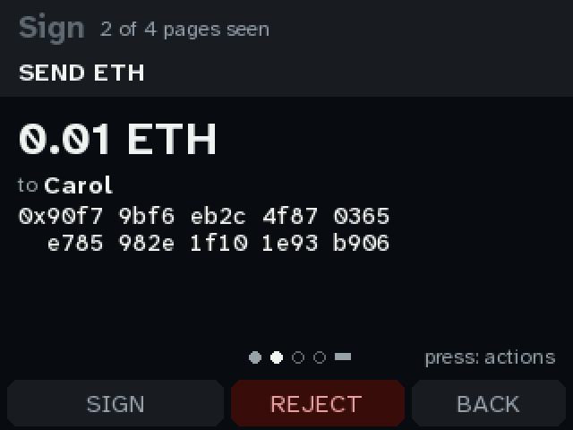
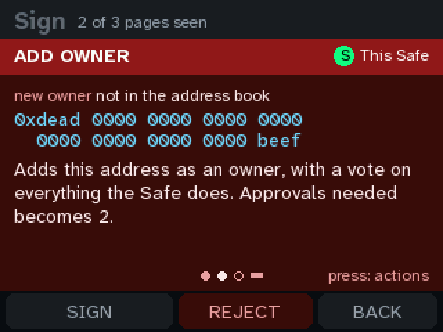
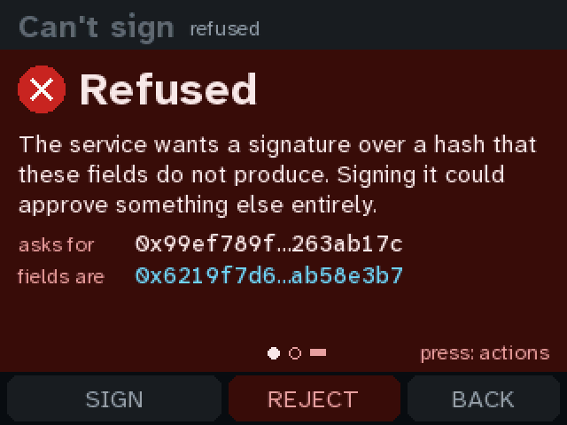
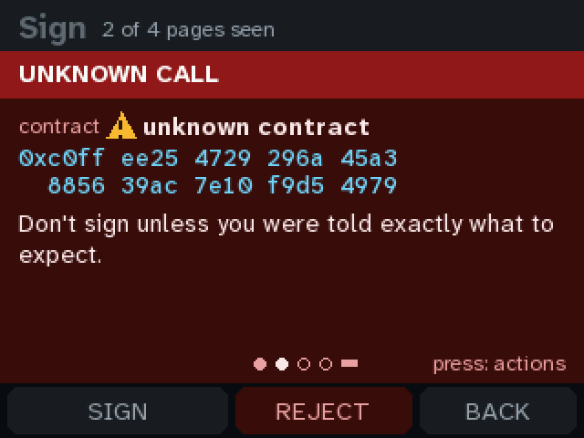
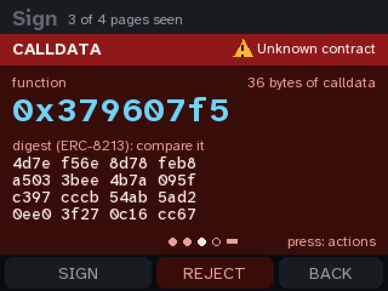
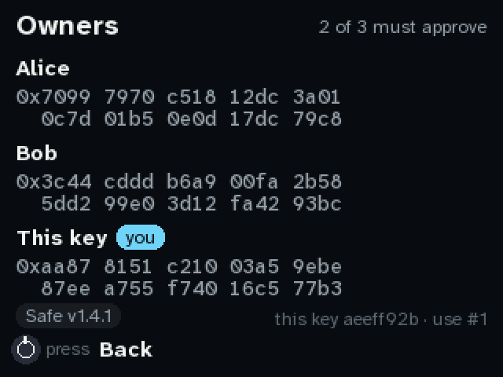

# Build 1's console screens: names, validators, hash checks

Every picture here is the real firmware (`firmware/quorum.py`, `quorum_ui.py`, `decode.py`) on
Build 1's 2.8″ 320×240 screen (drawn in 8 strips, as on the board), shown at 2×. The emulator runs it
against the simulated Safe, driven by the knob: turn to move, press to act, hold to sign.
`tools/quorum shots --board build1` regenerates every image. The same run always gives the same
bytes, so an image that changes in a commit means the screen changed.

**How to review from your phone:** comment on any line or image in the pull request, or edit the
[change requests](#change-requests) checklist at the bottom directly in GitHub. I pull before every
round and work through both.

## The plan

Four rounds. Each one is pushed with its pictures:

0. **Build 1 in the emulator.** The 320×240 screen and the knob, and today's screens as a
   baseline. *(This round.)*
1. **Names.** An address book pinned on the device that can hold ENS names. A laptop tool
   (`tools/quorum book add vitalik.eth`) resolves the name forward and back and asks you to
   confirm it. The recipient line also tells you whether this console has sent here before or
   this is the first time.
2. **Validator operations.** Partial withdrawals and exits (EIP-7002), consolidations and the
   switch to compounding (EIP-7251), and deposits and top-ups, decoded into plain pages. There are
   red pages for anything that can't be undone or that sends funds somewhere other than this Safe.
3. **Hash checks.** The full EIP-712 digest labelled the ERC-8213 way, the Domain and Message
   hashes a co-signer's Ledger shows, and a QR so a phone can check it too.

## Round 0 (2026-09-27): Build 1 in the emulator, today's screens

The emulator now has Build 1's screen and knob (`tools/emu headless quorum --board build1 --knob cw`).
The knob is emulated at the pins: a turn is the EC11's real quadrature sequence on GP3/GP2, and
the press pulls GP1 low. So `firmware/knob.py` runs unchanged, including hold-to-sign.

These are the screens as they are today. The layout is the 240×240 one widened to 320, so there's
room to spare. Rounds 1–3 use it.

| | |
|---|---|
|  |  |
| **Home.** Four waiting, one queued. The knob's hint at the bottom left, and Owners and Device to turn onto. | **Summary.** "to Carol" is the only mention of the recipient: no address and no sign of whether Carol is known. *(Round 1)* |
|  |  |
| **The send page.** The name, then the full address in 4-character groups over two lines. At 320 wide it fits on one line and a half, with room for an identicon and a "pinned" or "first time" badge. *(Round 1)* | **Verify.** The headline is the last 8 characters, `1f6f 0788`. ERC-8213 warns that a prefix or suffix can be ground: an attacker can mine a transaction whose hash ends the same way. The full hash is below it, smaller. *(Round 3)* |
|  |  |
| **Turn past the last page onto the actions.** SIGN is green because every page has been seen. | **Holding the knob** to sign, 1 s in. |
|  |  |
| **Signed.** | **A batch.** A validator UI that batches several withdrawals would look like this, but today each one would be a red unknown call. *(Round 2)* |
|  |  |
| **One page per call** in the batch. | **A red page** (adding an owner). |
|  |  |
| **Refused:** the service's hash isn't what the fields hash to. | **An unknown call.** This is what a withdrawal request to `0x0000…7002` looks like today. *(Round 2)* |
|  |  |
| **Calldata:** the selector and the ERC-8213 calldata digest. | **Owners.** |

## Research: what the standards say

**Validator operations.** Since Pectra (May 2025), the withdrawal address can do these itself, so
a Safe that is a validator's withdrawal address can too. Each one is a plain call to a system
contract. A validator UI builds it and proposes it to the Safe, and the console is one signer:

| What | To | Calldata | Value |
|---|---|---|---|
| Partial withdrawal / full exit ([EIP-7002](https://eips.ethereum.org/EIPS/eip-7002)) | `0x00000961Ef480Eb55e80D19ad83579A64c007002` | 56 bytes: pubkey (48) ‖ amount in Gwei (uint64, big-endian). **Amount 0 is a full exit.** | the fee; **overpaying is not refunded** |
| Consolidation ([EIP-7251](https://eips.ethereum.org/EIPS/eip-7251)) | `0x0000BBdDc7CE488642fb579F8B00f3a590007251` | 96 bytes: source pubkey ‖ target pubkey. **Source = target switches the validator to 0x02 (compounding).** | the fee; not refunded |
| Deposit / top-up | `0x00000000219ab540356cBB839Cbe05303d7705Fa` | `deposit(pubkey, withdrawal_credentials, signature, deposit_data_root)` | the stake |

There's no ABI to trust or fetch, so the console can decode all three exactly. The checks that
matter:
- **Exit** can't be undone.
- **Consolidation** moves the whole balance of one validator to another.
- **Fees** are burned if overpaid.
- **Deposits** must name this Safe in their withdrawal credentials (`0x01`/`0x02` ‖ 11 zero bytes ‖
  address). Otherwise the stake is paid to someone else's withdrawal address.

**Hash checks.**
- [ERC-8213](https://ethereum-magicians.org/t/erc-8213-wallet-signature-and-calldata-digest-display/24295)
  (Cyfrin; [teaching site](https://erc8213.eth.limo/)) standardizes the names. The **EIP-712
  digest** is what Safe calls the safeTxHash. The **Domain hash** and **Message hash** are its two
  parts. The **Calldata digest** is `keccak256(len ‖ calldata)`.
  - It asks wallets to show the digest in full, or the Domain and Message hashes together.
  - It warns against checking only a prefix or suffix.
  - Ledger and Trezor show Domain + Message when signing a Safe transaction. A co-signer on one of
    those can compare directly with this console, if the console shows the same two values.
- [ERC-7730](https://eips.ethereum.org/EIPS/eip-7730) (clear-signing descriptors, the Ethereum
  Foundation's [registry](https://github.com/ethereum/clear-signing-erc7730-registry)) is how
  contracts we don't pin could get plain-language pages later. It is in `docs/CLEARSIGNING.md`'s
  list of gaps. Not in these rounds.
- The Safe ecosystem's independent checkers,
  [safe-tx-hashes-util](https://github.com/pcaversaccio/safe-tx-hashes-util) and OpenZeppelin Safe
  Utils, print the domain, message and safeTx hashes. That's what the QR in round 3 hands to a
  phone.

**ENS.** Ledger shows ENS names only from a signed name → address mapping (its "trusted name"
service), never a lookup it can't verify. Here, the equivalent is a name you pinned yourself at
setup.

**Questions for you:**
1. **Screen:** the 2.8″ (320×240) is the one proven on the bench, so these pictures use it. The
   2.0″ and 2.4″ are the same resolution. Is the 2.8″ the one?
2. **Validators:** do you have the pubkeys (or indices) of the validators this Safe withdraws for?
   A pinned list lets the pages say "node-3 · yours" rather than "not in your list".

## Run it yourself

```sh
tools/quorum shots --board build1            # every picture on this page
tools/quorum shots --board build1 approve    # one story
tools/emu headless quorum --board build1 --knob cw --key push --shot /tmp/x.png
```

## Change requests

Edit this list on GitHub: add a line, tick one off, or write under it. Each round starts here.

- [ ] (add yours)
