# Build 1's console screens: names, validators, hash checks

Every picture here is the real firmware (`firmware/quorum.py`, `quorum_ui.py`, `decode.py`) on
Build 1's 2.8″ 320×240 screen (drawn in 8 strips, as on the board), shown at 2×. The emulator runs it
against the simulated Safe, driven by the knob: turn to move, press to act, hold to sign.
`tools/quorum shots --board build1` regenerates every image. The same run always gives the same
bytes, so an image that changes in a commit means the screen changed.

**How to review from your phone:** comment on any line or image in the pull request, or edit the
[change requests](#change-requests) checklist at the bottom directly in GitHub. I pull before every
round and work through both.

## The plan

Four rounds. Each one is pushed with its pictures:

0. **Build 1 in the emulator.** The 320×240 screen and the knob, and today's screens as a
   baseline. *(Done.)*
1. **Names.** An address book pinned on the device that can hold ENS names. A laptop tool
   (`tools/quorum book add vitalik.eth`) resolves the name forward and back and asks you to
   confirm it. The recipient line also tells you whether this console has sent here before or
   this is the first time. *(Done: round 1 below.)*
2. **Validator operations.** Partial withdrawals and exits (EIP-7002), consolidations and the
   switch to compounding (EIP-7251), and deposits and top-ups, decoded into plain pages. There are
   red pages for anything that can't be undone or that sends funds somewhere other than this Safe.
   *(Done: round 2 below.)*
3. **Hash checks.** The full EIP-712 digest labelled the ERC-8213 way, the Domain and Message
   hashes a co-signer's Ledger shows, and a QR so a phone can check it too.

## Round 2 (2026-09-27): validator operations

You asked: the console should sign validator changes (partial withdrawals, exits, consolidations)
as one step of the Safe's approval, after a validator UI builds the transaction.

When a Safe is a validator's withdrawal address, it manages the validator by calling three
consensus-layer contracts. They are now pinned in `quorum_cfg.py` (`"system"`) for Ethereum,
Sepolia and Hoodi. I checked each address has code on each chain; Base has none. `decode.py`
reads their calldata exactly: it's raw bytes, so there's no ABI to trust.
- **Withdrawal requests (EIP-7002):** 48-byte pubkey + amount in Gwei. **Amount 0 is a full exit.**
- **Consolidations (EIP-7251):** source + target pubkey. **The same key twice switches that
  validator to compounding (0x02).**
- **The deposit contract:** `deposit(pubkey, withdrawal_credentials, signature, root)`. The console
  checks that the credentials are `0x01`/`0x02` + **this Safe's address**.

Your validators are named in a new `QUORUM_VALIDATORS` in `secrets.py`:
`{pubkey: ["node-1", 1234567]}` (label, and index if you like).

| Operation | Page | Why |
|---|---|---|
| Partial withdrawal | green if the validator is yours, else yellow | The ETH goes to the withdrawal address; the validator keeps running |
| Full exit | **red**, 3 s hold | Can't be undone |
| Switch to compounding | yellow | Rewards stop being paid out; one-way |
| Consolidate A into B | **red**, 3 s hold | A's whole balance goes to whoever controls B |
| Deposit, credentials = this Safe | green | |
| Deposit, credentials = anything else | **red** | The stake belongs to someone else |
| Fee above 0.01 ETH (`validatorFeeWarn`) | yellow at least | The fee is normally 1 wei; overpaying is burned |
| Wrong length, or a delegatecall to them | red / refused | |

Each validator also gets a **page of its own** with the full 48-byte key beside its identicon,
counted in "every page seen". Batches from validator UIs work unchanged: each request inside
the MultiSend gets its own pages.

| | |
|---|---|
| 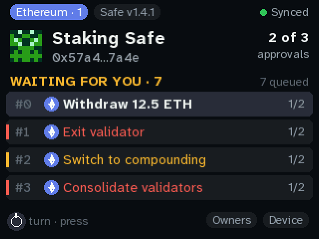 | 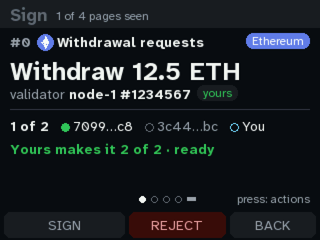 |
| **A Staking Safe on Ethereum,** seven requests queued. Each row has Ethereum's diamond: these are the consensus layer's contracts, known. | **Withdraw 12.5 ETH** from node-1 #1234567, **yours** (pinned). |
| 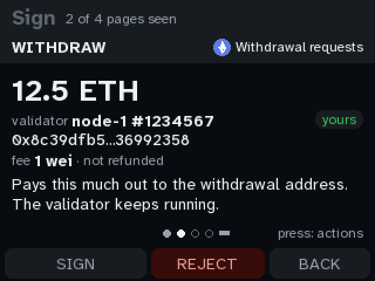 | 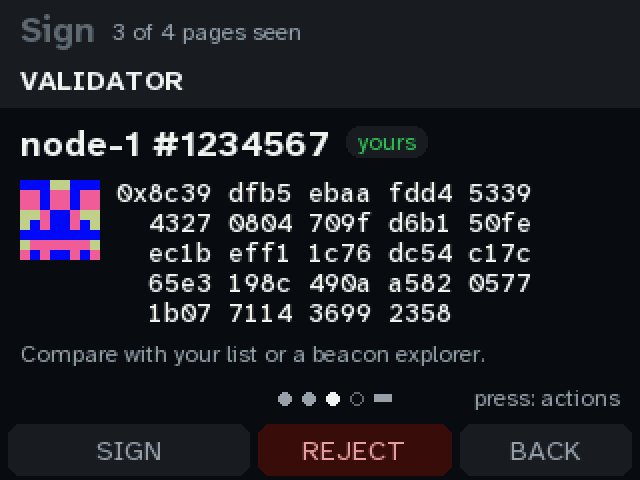 |
| **The request:** the amount, the validator (first and last 8 hex of its key), the fee (1 wei, not refunded). | **The key's own page:** all 48 bytes in groups of 4, to compare with your list or a beacon explorer. |
| 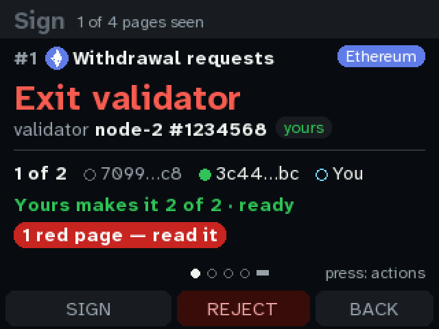 | 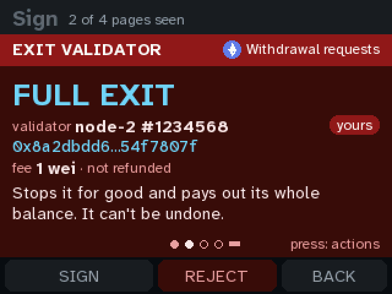 |
| **Exit node-2:** red, "1 red page — read it". | **FULL EXIT**, can't be undone. Held 3 s, not 2. |
| 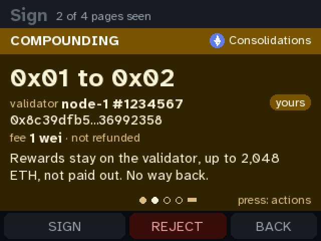 | 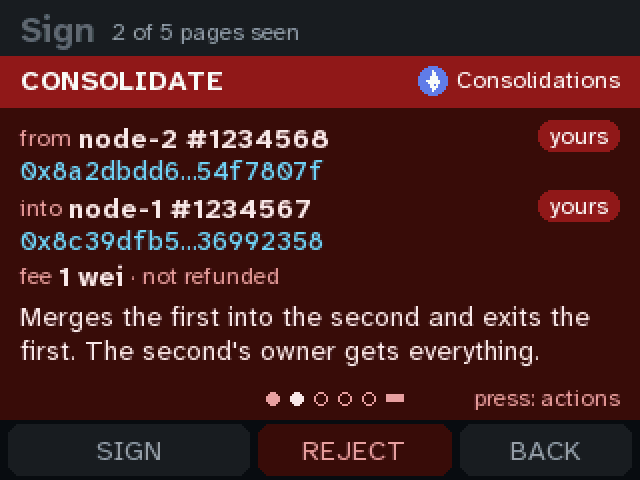 |
| **0x01 to 0x02:** yellow; rewards stay on the validator from now on. | **Consolidate:** from node-2 into node-1, both yours, still red: the second's owner gets everything. |
| 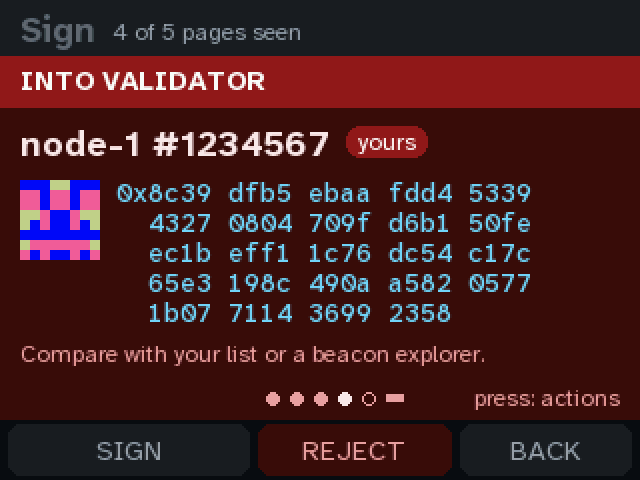 | 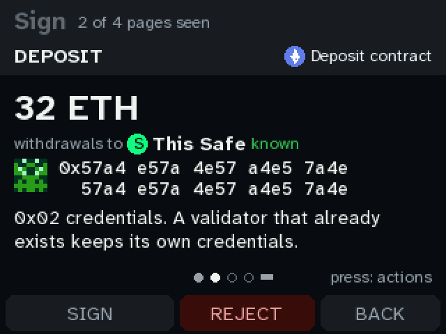 |
| **The target's key,** on its own red page. | **Deposit 32 ETH, withdrawals to This Safe:** the credentials were checked, so green. |
| 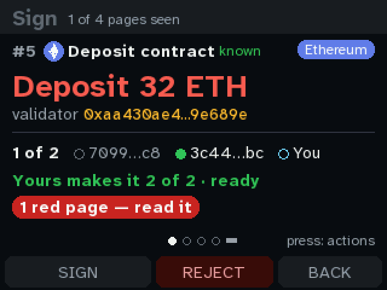 | 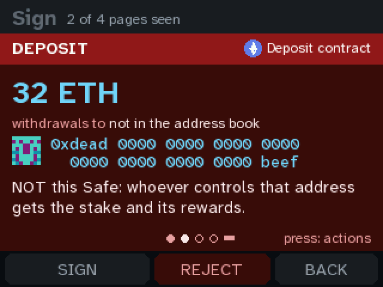 |
| **A deposit that pays a stranger:** the headline is red. | **Withdrawals to** an address that is **not this Safe.** This is the page that stops a front-end swap on a deposit. |
| 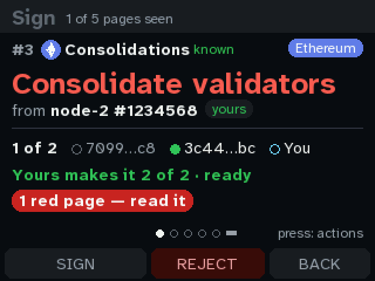 | 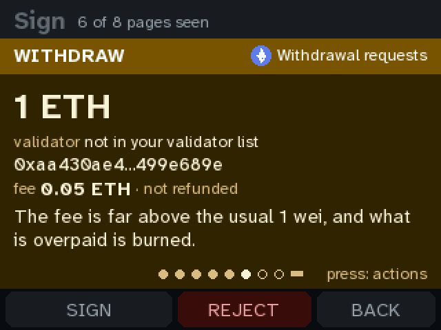 |
| **Consolidation summary.** Alice and Bob have no names on Ethereum (the laptop's names are local only), so they're shortened to fit on one line. | **In a batch,** the third withdrawal pays a **0.05 ETH fee** from a validator **not in your list**: yellow, "far above the usual 1 wei". |

Tested:
- `test-vectors/safe_tx.json` has 9 new vectors, with hashes from viem, for withdraw, exit, a
  malformed request, consolidate, compounding, deposits to this Safe and to someone else, a batch,
  and the same request on Base, which has no such contract (unknown, red).
- The decode checks now use each vector's own chain.
- `console_test.py` checks the validator list, the key pages, and the exit's 3 s hold.

**Questions for you:**
1. **Your validators:** send me (or add to `secrets.py`) the pubkeys and indices, and which Safe is
   their withdrawal address. Should a request for a validator **not** in the list be red rather
   than yellow?
2. **Consolidating between two of your own validators:** red today, even when both are pinned. It's
   irreversible, but it's also the routine Pectra move. Yellow when both are yours?
3. **The fee ceiling:** 0.01 ETH per request is the yellow line. Validator UIs usually overpay a
   little so the request survives a fee spike. Is that the right line?
4. **Which validator UI** will propose these (the Launchpad, a staking provider's dashboard, your own
   script)? If it batches differently, or calls a helper contract instead of the system contracts
   directly, the console will say "unknown contract". I'd pin that helper next.

## Round 1 (2026-09-27): who gets paid

You asked: show ENS names, and keep a list of known addresses, especially for outgoing funds.

Three things are new. Each one is only on the device, never from the service:
- **Your own address book.** `QUORUM_BOOK` in the board's `secrets.py` holds names for addresses,
  either for every chain or for one chain.
  - A name can be an ENS name (`vitalik.eth`), a label (`"Cold storage"`), or both
    (`["Cold storage", "family.eth"]`).
  - `tools/fw book add vitalik.eth` resolves the name on mainnet in both directions (name → address,
    then the address's primary name) and prints what it found. It writes to the board only after
    you type "yes".
  - The console never looks ENS up itself. A name on its screen is one you pinned.
- **What this console has paid before.** After each signature, the console counts every address the
  transaction pays or approves, per chain, in `seen.json` on flash (the 64 most-used are kept). A
  recipient is then **first time** or **paid 3 times before**.
- **Lookalikes.** Address poisoning sends you a dust transfer from an address with the same first
  and last characters as one you use, hoping you copy it from your history. Any recipient that
  shares the first 4 and last 4 hex characters with an address the console knows is marked red. The
  known addresses are the book, the pinned contracts, this Safe, and every address it has paid.
  "Known" counts even the ones it paid without a name.

Every recipient now gets a tag on the right: **pinned** (green), **first time** (amber), **paid N
times before** (grey), or **LOOKALIKE** (red). The full address stays underneath, and on the 320-wide
screen it has an identicon next to it, so a lookalike also looks different.

| | |
|---|---|
| 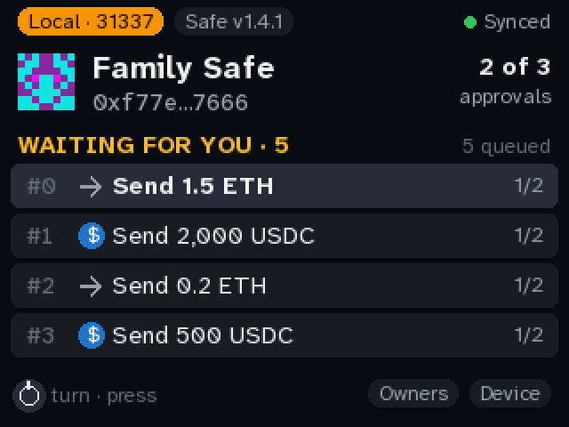 | 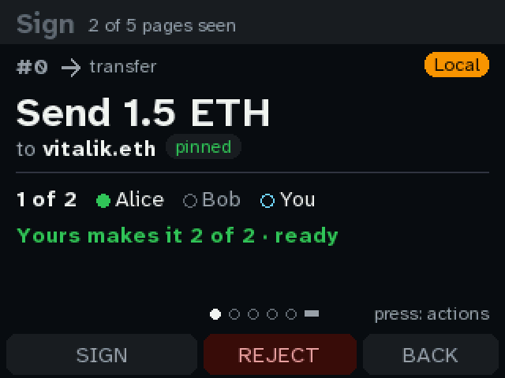 |
| **Five sends queued:** to vitalik.eth, to Cold storage, to a stranger, to an address paid before, and to a lookalike (fifth, below the fold). | **To vitalik.eth, pinned.** The summary names the recipient and tags it. |
| 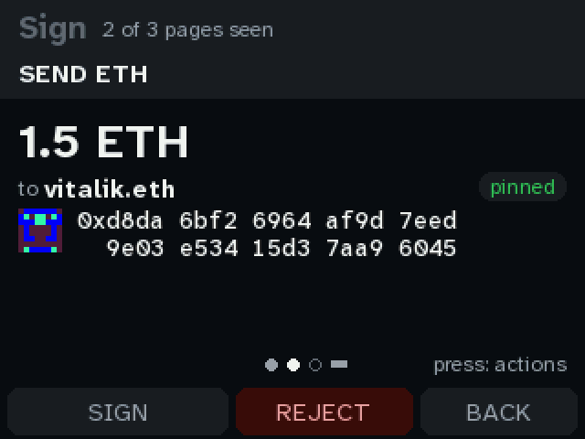 | 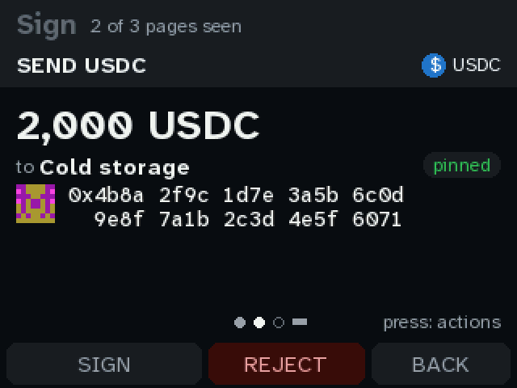 |
| **The send page:** the ENS name, pinned, then the address in full beside its identicon. | **A label with no ENS name:** "Cold storage", pinned, 2,000 USDC. |
| 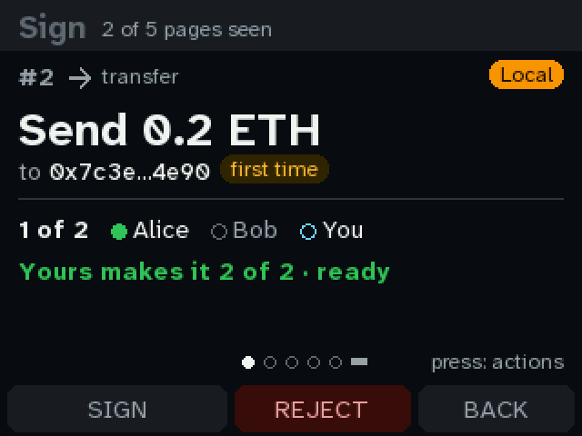 | 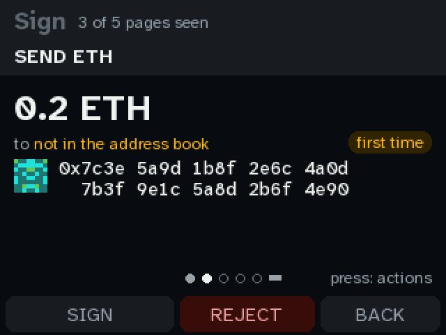 |
| **A stranger:** `0x7c3e…4e90`, **first time**. Not red, since paying someone new is normal, but it's the one to double-check. | **Its page:** "not in the address book", first time, and the full address. |
| 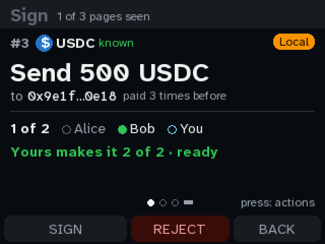 | 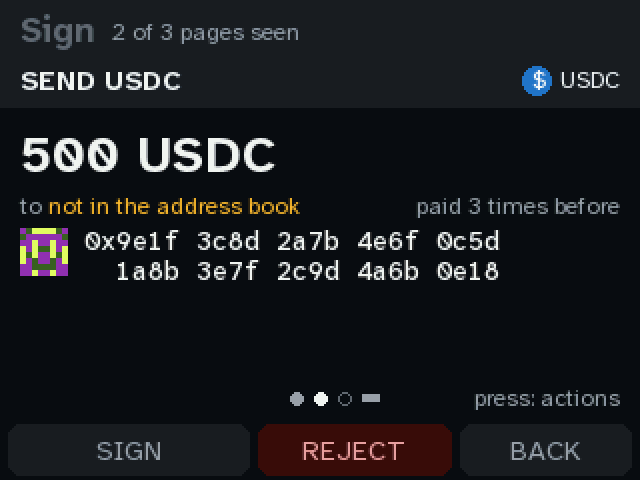 |
| **Paid 3 times before:** an unnamed address this console has signed payments to (an exchange deposit address, say). | **Its page.** Still "not in the address book": being paid before isn't a name. |
| 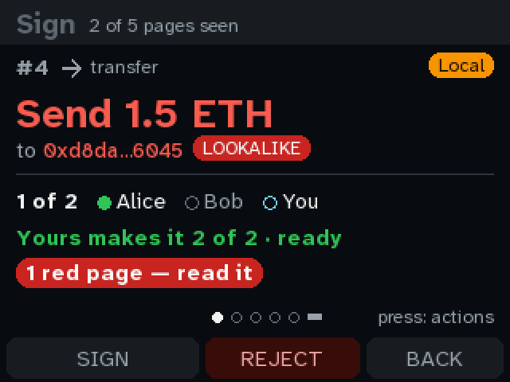 | 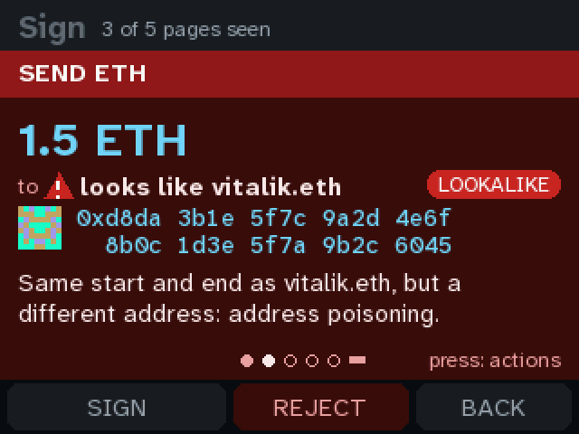 |
| **The lookalike:** `0xd8da…6045`, the same start and end as vitalik.eth, is a different address. The headline goes red, **LOOKALIKE**, and the red page has to be read and held for 3 s. | **Its page** says whose address it imitates, and why that matters. The identicon is visibly not vitalik.eth's. |

Also changed on the 240×240 screen (`docs/quorum-ui/shots`): only the summary pill. An unknown
recipient now says "first time" instead of "unknown".

How to pin names:
```sh
tools/fw book add vitalik.eth                      # every chain
tools/fw book add 0x4b8a…6071 --label "Cold storage" --chain 8453
tools/fw book                                      # list them
tools/fw book rm 0x4b8a…6071
```

**Questions for you:**
1. **First time: amber pill, or a yellow page?** Today a first-time recipient is only a pill; the
   page stays green. Should a first payment above some amount turn the page yellow (warn)?
2. **Which addresses count as "paid"?** Today it's the ones this console signed for. Should
   executed transactions from other owners count too? That needs the service's history, which is a
   claim the console can't check.
3. **Pinning on the device:** a "Save this recipient" action after signing would be convenient, but
   it lets whoever proposed the payment choose a name you'll trust later. I left it out. Agree?

## Round 0 (2026-09-27): Build 1 in the emulator, today's screens

The emulator now has Build 1's screen and knob (`tools/emu headless quorum --board build1 --knob cw`).
The knob is emulated at the pins: a turn is the EC11's real quadrature sequence on GP3/GP2, and
the press pulls GP1 low. So `firmware/knob.py` runs unchanged, including hold-to-sign.

These are the screens as they are today. The layout is the 240×240 one widened to 320, so there's
room to spare. Rounds 1–3 use it.

| | |
|---|---|
| 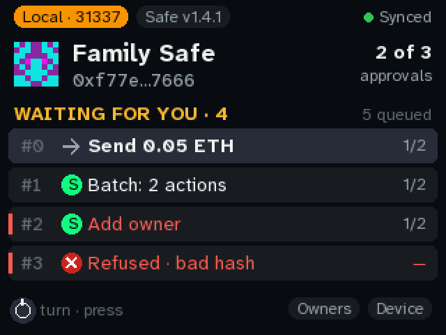 | 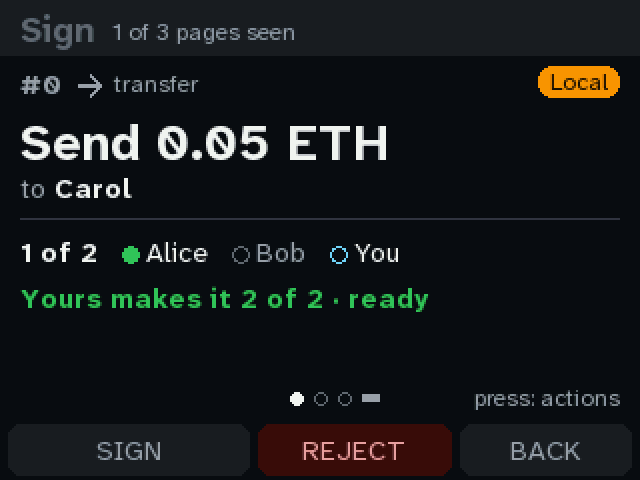 |
| **Home.** Four waiting, one queued. The knob's hint at the bottom left, and Owners and Device to turn onto. | **Summary.** "to Carol" is the only mention of the recipient: no address and no sign of whether Carol is known. *(Round 1)* |
|  | 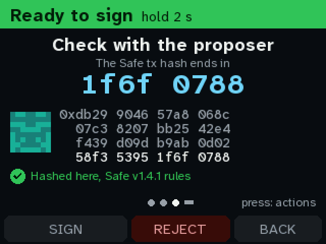 |
| **The send page.** The name, then the full address in 4-character groups over two lines. At 320 wide it fits on one line and a half, with room for an identicon and a "pinned" or "first time" badge. *(Round 1)* | **Verify.** The headline is the last 8 characters, `1f6f 0788`. ERC-8213 warns that a prefix or suffix can be ground: an attacker can mine a transaction whose hash ends the same way. The full hash is below it, smaller. *(Round 3)* |
| 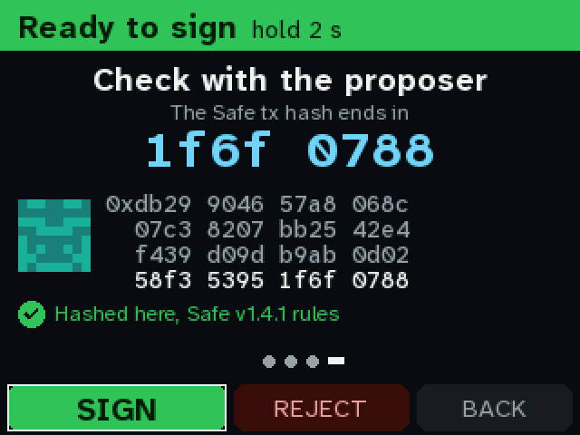 | 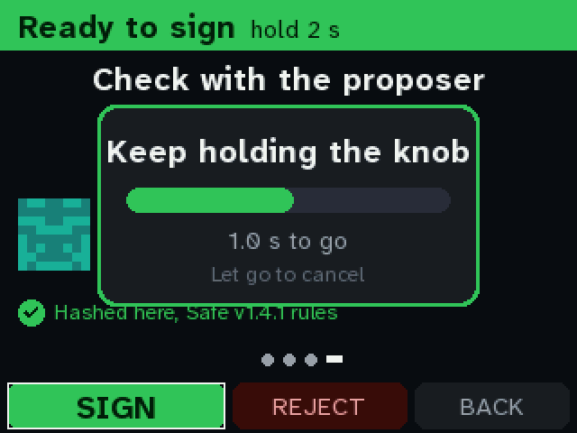 |
| **Turn past the last page onto the actions.** SIGN is green because every page has been seen. | **Holding the knob** to sign, 1 s in. |
| 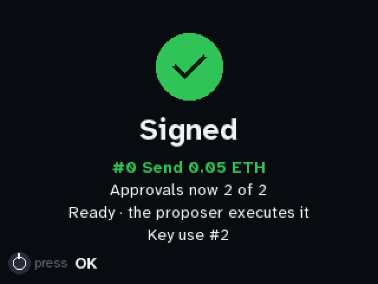 |  |
| **Signed.** | **A batch.** A validator UI that batches several withdrawals would look like this, but today each one would be a red unknown call. *(Round 2)* |
| 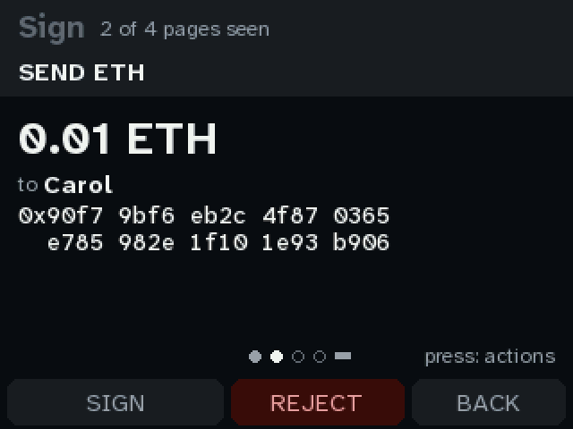 |  |
| **One page per call** in the batch. | **A red page** (adding an owner). |
|  | 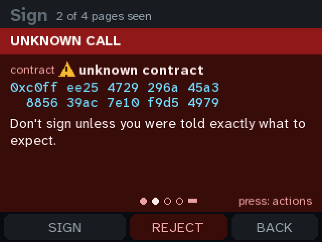 |
| **Refused:** the service's hash isn't what the fields hash to. | **An unknown call.** This is what a withdrawal request to `0x0000…7002` looks like today. *(Round 2)* |
|  |  |
| **Calldata:** the selector and the ERC-8213 calldata digest. | **Owners.** |

## Research: what the standards say

**Validator operations.** Since Pectra (May 2025), the withdrawal address can do these itself, so
a Safe that is a validator's withdrawal address can too. Each one is a plain call to a system
contract. A validator UI builds it and proposes it to the Safe, and the console is one signer:

| What | To | Calldata | Value |
|---|---|---|---|
| Partial withdrawal / full exit ([EIP-7002](https://eips.ethereum.org/EIPS/eip-7002)) | `0x00000961Ef480Eb55e80D19ad83579A64c007002` | 56 bytes: pubkey (48) ‖ amount in Gwei (uint64, big-endian). **Amount 0 is a full exit.** | the fee; **overpaying is not refunded** |
| Consolidation ([EIP-7251](https://eips.ethereum.org/EIPS/eip-7251)) | `0x0000BBdDc7CE488642fb579F8B00f3a590007251` | 96 bytes: source pubkey ‖ target pubkey. **Source = target switches the validator to 0x02 (compounding).** | the fee; not refunded |
| Deposit / top-up | `0x00000000219ab540356cBB839Cbe05303d7705Fa` | `deposit(pubkey, withdrawal_credentials, signature, deposit_data_root)` | the stake |

There's no ABI to trust or fetch, so the console can decode all three exactly. The checks that
matter:
- **Exit** can't be undone.
- **Consolidation** moves the whole balance of one validator to another.
- **Fees** are burned if overpaid.
- **Deposits** must name this Safe in their withdrawal credentials (`0x01`/`0x02` ‖ 11 zero bytes ‖
  address). Otherwise the stake is paid to someone else's withdrawal address.

**Hash checks.**
- [ERC-8213](https://ethereum-magicians.org/t/erc-8213-wallet-signature-and-calldata-digest-display/24295)
  (Cyfrin; [teaching site](https://erc8213.eth.limo/)) standardizes the names. The **EIP-712
  digest** is what Safe calls the safeTxHash. The **Domain hash** and **Message hash** are its two
  parts. The **Calldata digest** is `keccak256(len ‖ calldata)`.
  - It asks wallets to show the digest in full, or the Domain and Message hashes together.
  - It warns against checking only a prefix or suffix.
  - Ledger and Trezor show Domain + Message when signing a Safe transaction. A co-signer on one of
    those can compare directly with this console, if the console shows the same two values.
- [ERC-7730](https://eips.ethereum.org/EIPS/eip-7730) (clear-signing descriptors, the Ethereum
  Foundation's [registry](https://github.com/ethereum/clear-signing-erc7730-registry)) is how
  contracts we don't pin could get plain-language pages later. It is in `docs/CLEARSIGNING.md`'s
  list of gaps. Not in these rounds.
- The Safe ecosystem's independent checkers,
  [safe-tx-hashes-util](https://github.com/pcaversaccio/safe-tx-hashes-util) and OpenZeppelin Safe
  Utils, print the domain, message and safeTx hashes. That's what the QR in round 3 hands to a
  phone.

**ENS.** Ledger shows ENS names only from a signed name → address mapping (its "trusted name"
service), never a lookup it can't verify. Here, the equivalent is a name you pinned yourself at
setup.

**Questions for you:**
1. **Screen:** the 2.8″ (320×240) is the one proven on the bench, so these pictures use it. The
   2.0″ and 2.4″ are the same resolution. Is the 2.8″ the one?
2. **Validators:** do you have the pubkeys (or indices) of the validators this Safe withdraws for?
   A pinned list lets the pages say "node-3 · yours" rather than "not in your list".

## Run it yourself

```sh
tools/quorum shots --board build1            # every picture on this page
tools/quorum shots --board build1 approve    # one story
tools/emu headless quorum --board build1 --knob cw --key push --shot /tmp/x.png
```

## Change requests

Edit this list on GitHub: add a line, tick one off, or write under it. Each round starts here.

- [ ] (add yours)
