# Ceremony themes: three story skins for the Trust M signing ceremony

> **Mockups, not firmware.** Every screen below was drawn by one emulator sketch,
> [`emu/sketches/gatescenes.py`](../../emu/sketches/gatescenes.py), and captured from the
> emulator's 240×240 screen. Nothing here is wired to the real ceremony (`firmware/provision_tm.py`)
> and no chip was touched. The point is to look at the idea before anyone builds it.

The real ceremony for an OPTIGA Trust M is **T1 to T8** ([TRUSTM.md](../TRUSTM.md)). It is a good fit
for a story: some steps only look, some can be redone, and one is a door that shuts for good. Each
theme below re-tells the same eight steps with a different set of analogies.

```sh
tools/emu run gatescenes     # left/right = step, up/down = theme, X = facts, B = quit
```

## The rule every screen follows

Each screen has the same three layers, so the story can never hide what the chip is doing:

1. **Header.** The real step code (`T4`) and a step counter. It turns red for the seal.
2. **The scene and the story.** White text, two lines, spoken by a character.
3. **The real values.** Blue-grey text under a rule: what the chip is actually doing, in the
   ceremony's own words (`E0F0 signs the binding`).

Pressing **X** on any screen swaps the story for a plain **facts page** with no art:

| T1 pre-flight | T7 seal | T7 sealed |
|---|---|---|
| 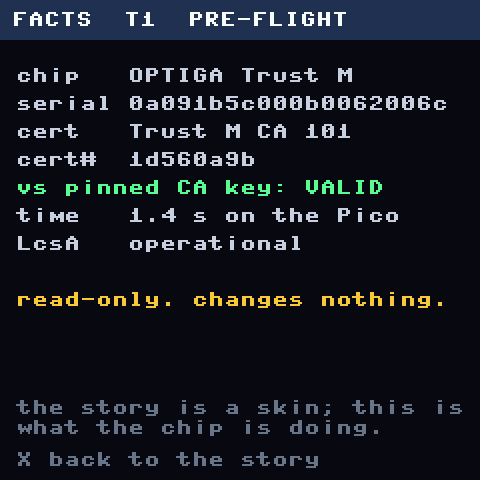 | 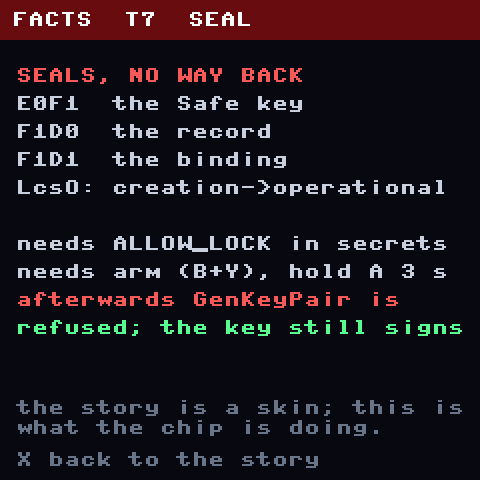 | 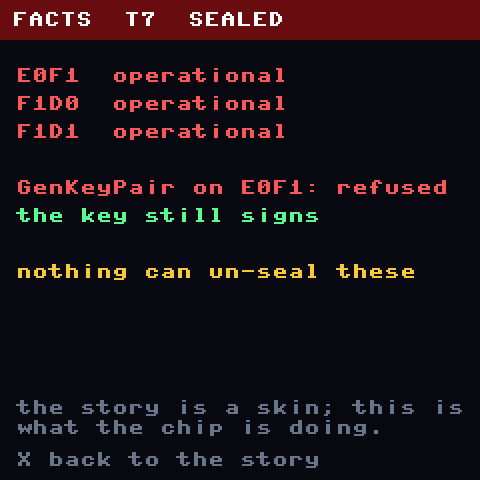 |

The other six are `img/facts-2.png` to `facts-6.png` and `facts-9.png`. The facts pages use only
values the docs give for the real chip (serial, CA 101, object names, sizes).

## The eight steps and what each one really does

| Step | What happens | Reversible? | The shape of the story |
|---|---|---|---|
| **T1** Pre-flight | Reads the chip. Checks its Infineon certificate against the pinned CA key. | read-only | someone checks your papers |
| **T2** Make the key | `GenKeyPair` puts a new P-256 key in `E0F1`. It never leaves the chip. | yes, until T7 | making something that can't be copied |
| **T3** Test | Two test signatures, checked on the Pico. | read-only | proving it works |
| **T4** Bind | The factory key `E0F0` signs "this chip holds this key". | read-only | an authority vouches for it |
| **T5** Owner | The Safe owner address, to compare on the laptop. | read-only | your identity mark |
| **T6** Record | Writes `F1D0` (record) and `F1D1` (binding) and reads them back. | yes, until T7 | writing it into the books |
| **T7** Seal | `E0F1`, `F1D0`, `F1D1` go to operational. Needs `ALLOW_LOCK`, the B+Y arm, and A held for 3 s. | **no** | the door that shuts behind you |
| **T8** Done | Checks everything is sealed and the key still signs. | read-only | arrival |

Because T7 is the only permanent step, it gets **two screens** in every theme: the moment before
(with the hold-to-confirm bar) and the moment after.

---

## Theme 1: The Gatehouse (castle, fantasy RPG)

*Destroy the drawbridge.* You are a traveller arriving at a keep. Infineon is the gatekeeper whose
crown seal vouches for the chip.

<table>
<tr><td width="250">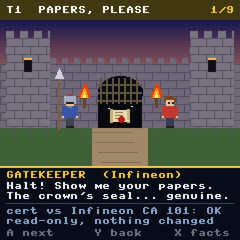</td><td>

**T1 · Papers, please.** The gatekeeper is Infineon's voice. Your "papers" are the certificate
chain the Pico checks against Infineon's CA 101 key. The scroll with the red seal is the
certificate. A forged one would mean the gate stays shut. *Why it fits:* a border check is exactly
what T1 is: read-only, and it can turn you away.

</td></tr>
<tr><td>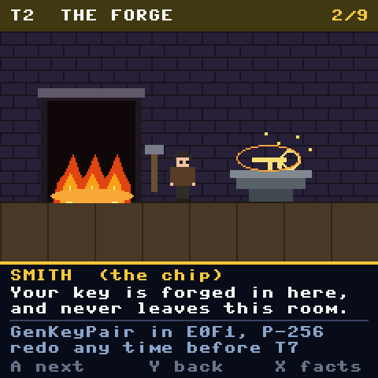</td><td>

**T2 · The forge.** The smith is the chip itself. The key is made in the fire and never leaves the
room. *Why it fits:* "made inside, can't be carried out" is the whole point of a secure element, and
a forge can be lit again until the doors are sealed, like T2 before T7.

</td></tr>
<tr><td>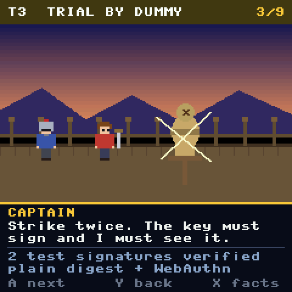</td><td>

**T3 · Trial by dummy.** Strike twice. The captain must see the key sign. *Why it fits:* two test
signatures, and the two slash marks are the two signatures.

</td></tr>
<tr><td>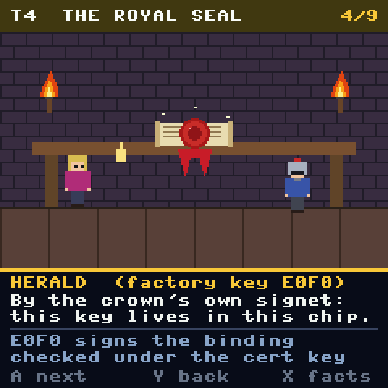</td><td>

**T4 · The royal seal.** The herald presses the crown's signet: "this key lives in this chip". The
herald is the factory key `E0F0`. *Why it fits:* a wax seal is a signature by an authority you
already trust, on a statement about something else.

</td></tr>
<tr><td>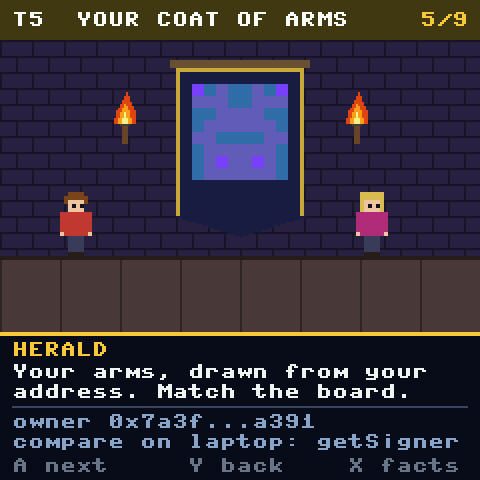</td><td>

**T5 · Your coat of arms.** The banner is a **real blockie** drawn from the owner address, the same
picture the ceremony already shows. Compare it with the town board (the laptop). *Why it fits:*
heraldry is a picture you recognise faster than a string of hex.

</td></tr>
<tr><td>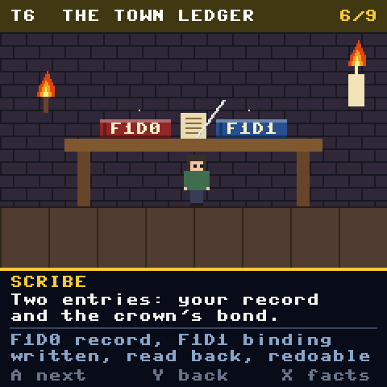</td><td>

**T6 · The town ledger.** Two books, labelled with the real object names: `F1D0` (your record) and
`F1D1` (the crown's bond). *Why it fits:* two entries, written and read back, and still changeable
until the ledger is closed.

</td></tr>
<tr><td>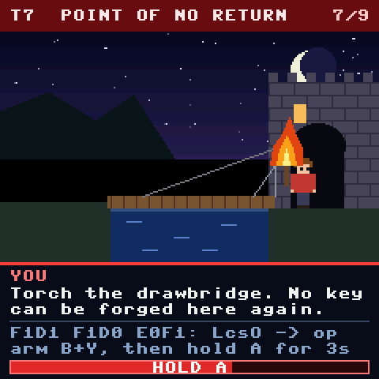</td><td>

**T7 · Point of no return.** The bridge you crossed is still whole. Your torch is lit. The red
header, the red rule and the **HOLD A** bar are the real guards on the seal. The bar is painted at
62% in this mockup. *Why it fits:* a burned bridge is the picture of "no going back", and holding a
torch to it is an act you do on purpose.

</td></tr>
<tr><td>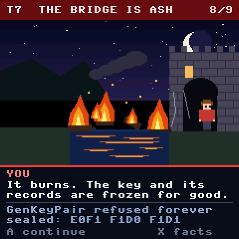</td><td>

**T7 · The bridge is ash.** Planks in the moat, chains dangling, smoke. The text says the key and its
records are frozen for good and the facts line says `GenKeyPair refused forever`. *Why it fits:* the
picture should be hard to un-see. That is the feeling of a lock that cannot be undone.

</td></tr>
<tr><td>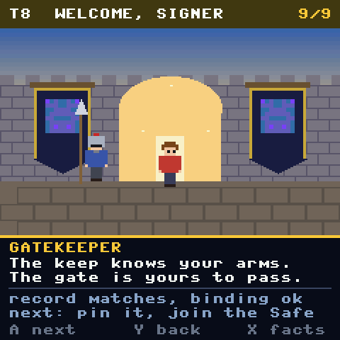</td><td>

**T8 · Welcome, signer.** The gate stands open, the banners show your arms. *Why it fits:* the
ceremony's last check ("everything sealed, key still signs") reads as being let in.

</td></tr>
</table>

---

## Theme 2: Burn the Boats (harbor, explorer)

*Burn the boats.* You have landed on a new shore. Infineon is the harbormaster and the shipwright.
The seal is the old story of burning your ships so nobody can sail home.

<table>
<tr><td width="250">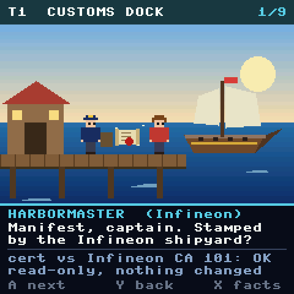</td><td>

**T1 · Customs dock.** The harbormaster asks for the ship's manifest, stamped by the Infineon
shipyard. *Why it fits:* customs is a credentials check with an authority behind it.

</td></tr>
<tr><td>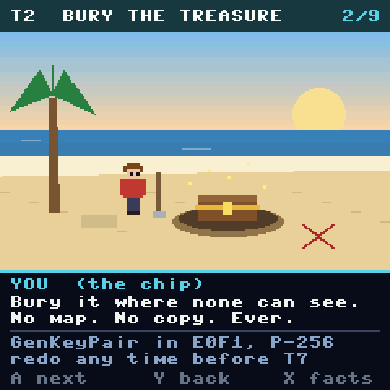</td><td>

**T2 · Bury the treasure.** No map, no copy. The chest goes into the sand. *Why it fits:* the
strongest match for "the private key is generated inside and never leaves". It is also easy to dig
up and do again, as T2 is until the seal.

</td></tr>
<tr><td>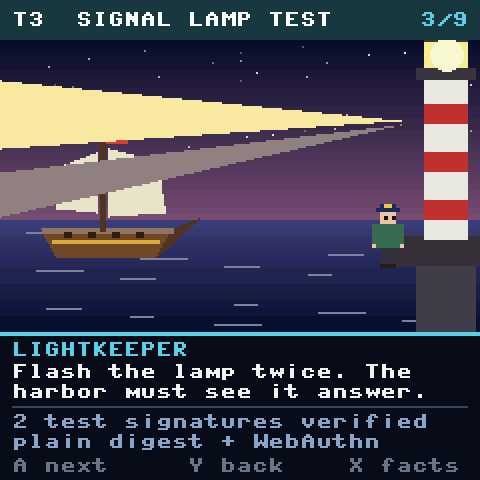</td><td>

**T3 · Signal lamp test.** Flash the lamp twice and see the ship answer. *Why it fits:* two flashes
are two test signatures, and a signal lamp is a signature you can verify from far away.

</td></tr>
<tr><td>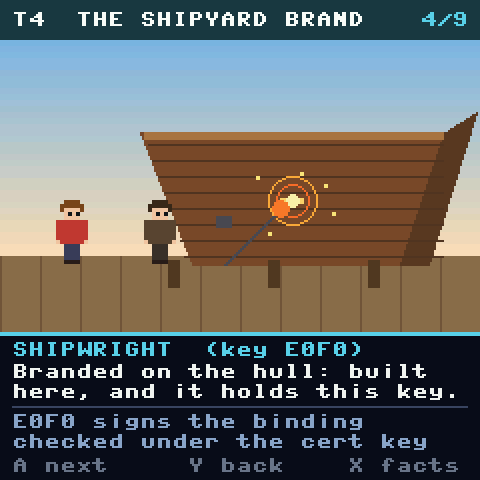</td><td>

**T4 · The shipyard brand.** A hot iron marks the hull: "built here, and it holds this key".
*Why it fits:* a maker's brand is a mark from a trusted source that cannot be moved to another ship.

</td></tr>
<tr><td>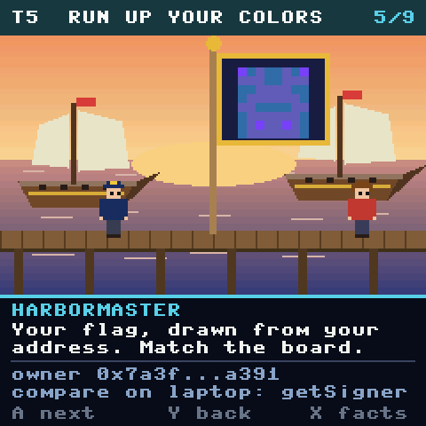</td><td>

**T5 · Run up your colors.** The flag is a **real blockie** of the owner address. *Why it fits:*
a flag is a picture you match on sight, and ships are told apart by their flags.

</td></tr>
<tr><td>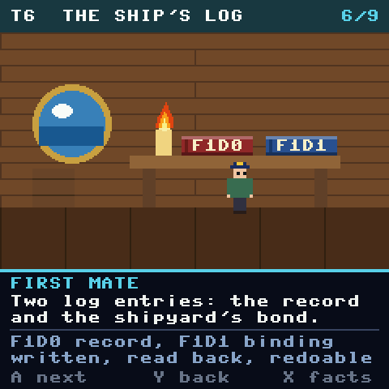</td><td>

**T6 · The ship's log.** Two logbooks, `F1D0` and `F1D1`, in the captain's cabin. *Why it fits:* a
log is a record you write, read back, and eventually stop editing.

</td></tr>
<tr><td>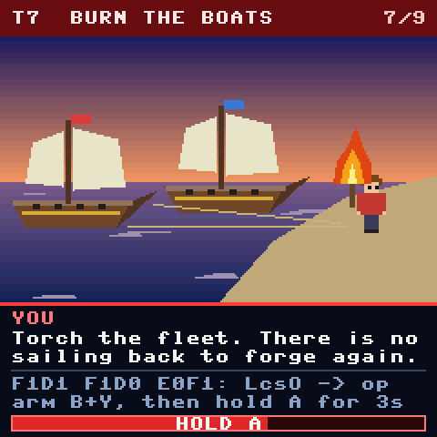</td><td>

**T7 · Burn the boats.** Your torch is lit and the fleet is at anchor. *Why it fits:* the best
analogy for T7 of the three, because it is a known story about choosing a permanent commitment. The
cost is that it reads as dramatic, so the facts line matters even more here.

</td></tr>
<tr><td>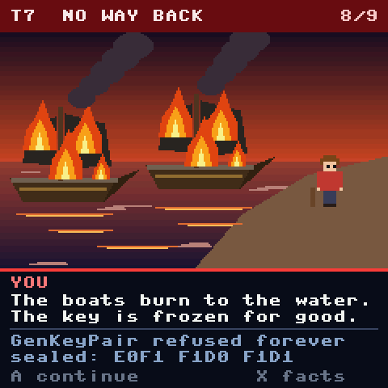</td><td>

**T7 · No way back.** Both ships burn to the waterline. The header stays red. *Why it fits:* nothing
in the picture suggests an undo.

</td></tr>
<tr><td>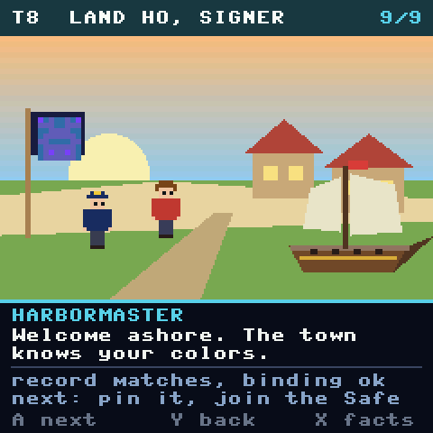</td><td>

**T8 · Land ho, signer.** A village, a path inland, your flag on a pole. *Why it fits:* arrival.

</td></tr>
</table>

---

## Theme 3: The Docking Bay (space station, sci-fi)

*Cut the tether.* You are docking at a station. Infineon is the dock AI and Fleet Command. The seal
is blowing the docking tube behind you.

<table>
<tr><td width="250">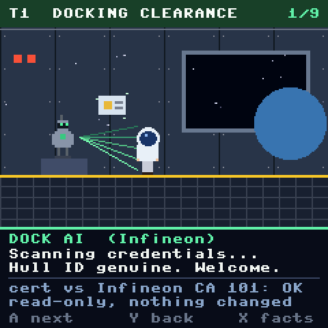</td><td>

**T1 · Docking clearance.** The dock AI scans your ID chit. *Why it fits:* automated credential
checking is what a machine reading a certificate looks like.

</td></tr>
<tr><td>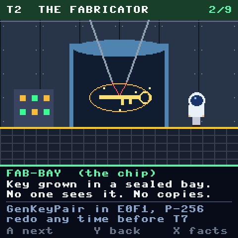</td><td>

**T2 · The fabricator.** The key is grown inside a sealed glass bay by lasers, and nobody sees it.
*Why it fits:* the closest picture to "made inside the chip", because the chamber is visibly closed.

</td></tr>
<tr><td>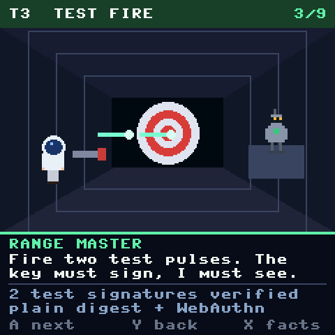</td><td>

**T3 · Test fire.** Two pulses at a target in a range. *Why it fits:* a test shot is a test
signature.

</td></tr>
<tr><td>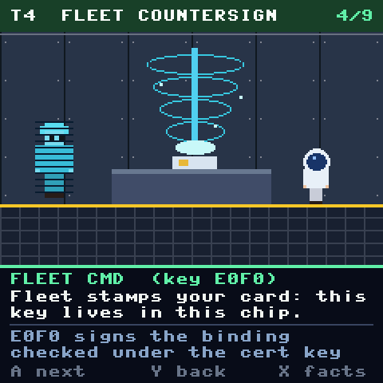</td><td>

**T4 · Fleet countersign.** A hologram of Fleet Command stamps your card. *Why it fits:* a remote
authority signing a statement about a local object is what `E0F0` does.

</td></tr>
<tr><td>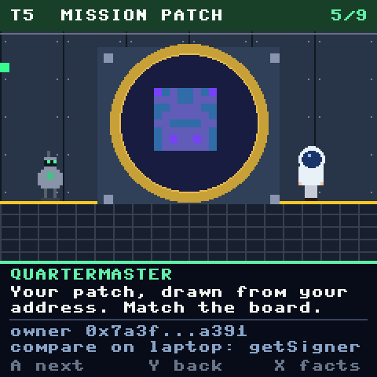</td><td>

**T5 · Mission patch.** The patch holds the **real blockie**. *Why it fits:* mission patches are
how crews are recognised.

</td></tr>
<tr><td>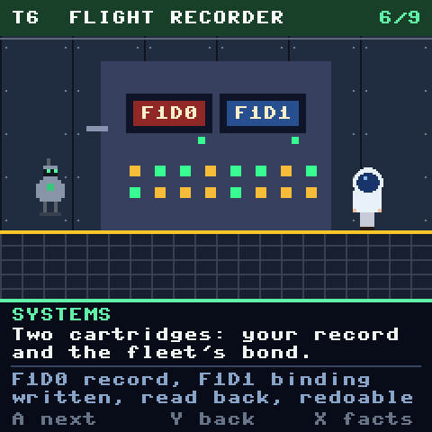</td><td>

**T6 · Flight recorder.** Two cartridge bays, `F1D0` and `F1D1`. *Why it fits:* a flight recorder is
a record that is written and later read by someone else.

</td></tr>
<tr><td>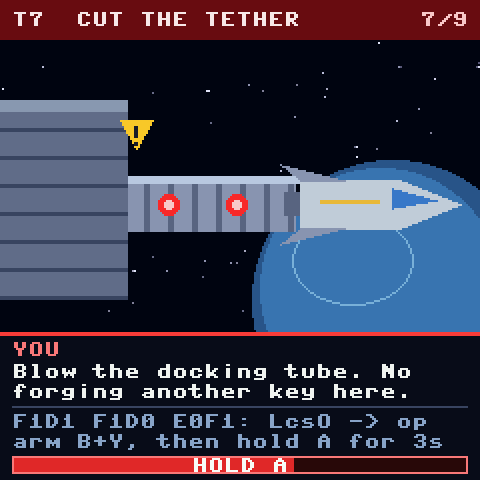</td><td>

**T7 · Cut the tether.** The tube is rigged, with a hazard sign on it. The ship is still attached.
*Why it fits:* physically the most literal "cannot reconnect".

</td></tr>
<tr><td>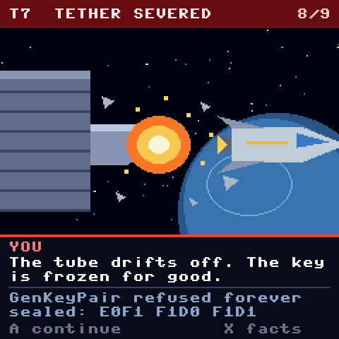</td><td>

**T7 · Tether severed.** A fireball where the tube was, debris, and the ship drifting off.
*Why it fits:* same as above, with the strongest before/after contrast of the three.

</td></tr>
<tr><td>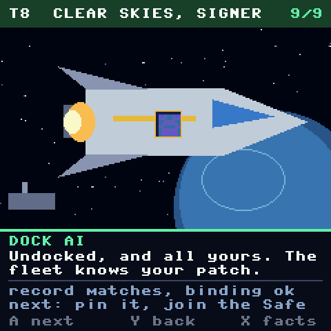</td><td>

**T8 · Clear skies, signer.** The ship is away with your patch on the hull. *Why it fits:* arrival
and departure at once.

</td></tr>
</table>

---

## Which one?

| | Gatehouse | Burn the Boats | Docking Bay |
|---|---|---|---|
| Best step | T1, T4, T5 (papers, seal, arms) | T2, T7 (bury it, burn them) | T2, T7 (sealed bay, cut tether) |
| Weakest step | T3 (a dummy isn't very like a signature) | T4 (a brand is a stretch) | T6 (a recorder is abstract) |
| Tone | warm, familiar | dramatic | cool, clinical |
| Risk | reads as a game | the drama can crowd the facts | looks like every other sci-fi UI |

My pick: the **Gatehouse** for the ceremony's first half and **Burn the Boats** for the seal. The
gate and the seal are the clearest ways to show a chip vouching for itself, and burning the boats is the
clearest way to show a step you cannot take back. Nothing stops mixing themes screen by screen,
because every screen has the same layout.

## Rules to keep if any of this gets built

- **The skin is not the truth.** Every screen keeps its real-values lines, and X opens a plain
  facts page on every step. The story text is never the only place a value appears.
- **The seal stays hard.** The red header, the arm (B+Y) and the 3 second hold are the real gates.
  Don't add an animation that makes A feel like a quick tap.
- **No random encounters, no XP.** Nothing that delays signing, nothing that rewards going faster.
- **A plain mode.** One switch that turns the whole skin off, for anyone who finds it silly or who
  is doing a ceremony they need to read closely.
- **Skins are cosmetic.** The theme is chosen by a setting and can never change what is signed.

## What the sketch does and doesn't do

- It draws each scene from rectangles, ellipses, polygons and text. There are no bitmap assets, so
  it adds no image files to the firmware.
- The two blockies (T5, T8) come from the real `firmware/blockies.py` with an example owner address.
- The Waveshare board's 240×240 screen is drawn in strips (`lcd.frames()`), so every scene is
  redrawn once per strip. They render in the emulator, which is much faster than the Pico. **They
  have not been timed on a real Pico**, and redrawing a full scene in strips is the part to check
  first.
- The Trust M values on the facts pages are the ones in [TRUSTM.md](../TRUSTM.md). That doc says the
  ceremony steps up to the seal have run on a real chip and the seal itself has not.
- The Build 1 screen (320×240) and the ATECC608 ceremony (different steps) are not covered here.
