# Ceremony themes, round 2: the futuristic ones

> **Mockups, not firmware.** Drawn by [`emu/sketches/keyjourney.py`](../../emu/sketches/keyjourney.py)
> in the emulator and captured from its 240×240 screen. Nothing is wired to the real ceremony
> (`firmware/provision_tm.py`) and no chip was touched. Round 1 (castle, harbor, station) is in the
> [first doc](README.md).

```sh
tools/emu run keyjourney     # left/right = screen, up/down = theme, X = facts, B = quit
```

Round 1 narrowed to two futuristic directions, each with an invented company that runs the whole
procedure. Both are meant to be friendly officials, not villains: the tone is a well-run institution
whose job is to keep your key safe.

| | **Vesper** | **Sable Lantern** |
|---|---|---|
| Look | a bright retro-futurist starliner: cream panels, teal, coral, round white bots | a rainy neon district: night skyline, wet streets, magenta and cyan signs |
| The company | Vesper Assurance Line, *"we keep what matters"* | Sable Lantern Registry & Notary, *"every key gets a witness"* |
| Feel | the cheerful giant-corporation cruise ship | noir city with a civic notary |
| The pod is called | a **keypod** | a **vial** |

Both names are invented for this project. They borrow a tone (a friendly all-running company, a neon
noir city) and none of the names, logos or designs of any film. **I have not checked either name for
trademarks**, so do that before it goes on a product.

## Two changes from round 1

**1. The seal is a press, not an explosion.** In round 1 the seal blew up a tube or burned a bridge.
That shows destruction, but sealing on the Trust M doesn't destroy anything: `E0F1`, `F1D0` and `F1D1`
go to operational, so the key can never be re-made and the records are frozen, **and the key still
signs** (`docs/TRUSTM.md`). So in both themes the pod goes under a **sealing press** and comes out with
a hardened silver shell and a lock. Nothing is lost. It just can't be redone.

**2. One pod, the same on every screen.** A pill-shaped pod stands for the key, and one function
(`pod()`) draws it everywhere. Its shell records what has been done to it, and each mark is added at
the step that does it, never removed:

| Mark | Added at | Meaning |
|---|---|---|
| dashed outline | T1 | the pod doesn't exist yet; the chip is only checked |
| solid teal shell | T2 | `GenKeyPair` made the key in the chip |
| green pip | T3 | two test signatures passed |
| gold band | T4 | `E0F0` bound it to the Infineon-certified chip (the maker's hallmark) |
| ID badge (your blockie) | T5 | the owner address it will have on the Safe |
| two paper tags | T6 | `F1D0` (record) and `F1D1` (binding) written and read back |
| **silver shell + lock** | T7 | sealed: permanent |
| green halo | T8 | checked and delivered |

Under the header there is also a **journey rail**: eight nodes for T1 to T8 with a small copy of the
pod sitting on the current one. So you can always see where the pod is and what it looks like now.
The two ends of every run are cards: a **title card** that names the company, and a **journey card**
that lays out all eight pods in a row:

| Vesper title | Vesper journey | Sable Lantern title | Sable Lantern journey |
|---|---|---|---|
| 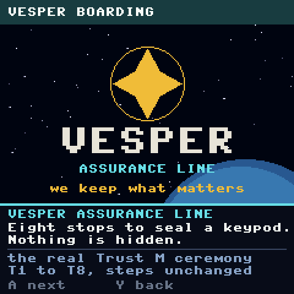 | 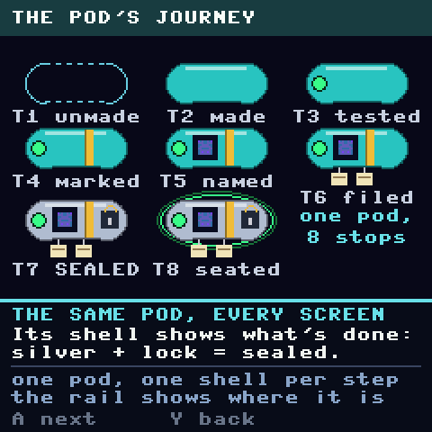 | 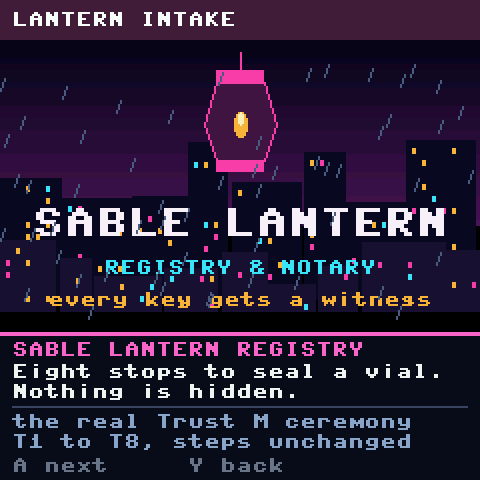 | 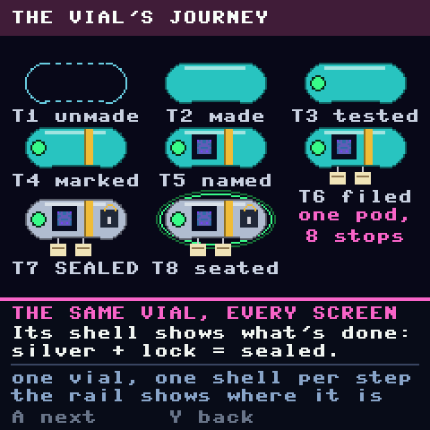 |

The same rule as round 1 holds on every screen: real step code in the header, the story in white, the
**real values** in blue-grey beneath it, and X opens a plain facts page (the ones in
[`img/facts-*.png`](README.md#the-rule-every-screen-follows) are reused unchanged).

## Theme A: Vesper (starliner)

You are boarding a liner run by a cheerful, careful company. The pod is boarded, grown, tested,
hallmarked, named, filed and finally pressed shut.

<table>
<tr><td width="250">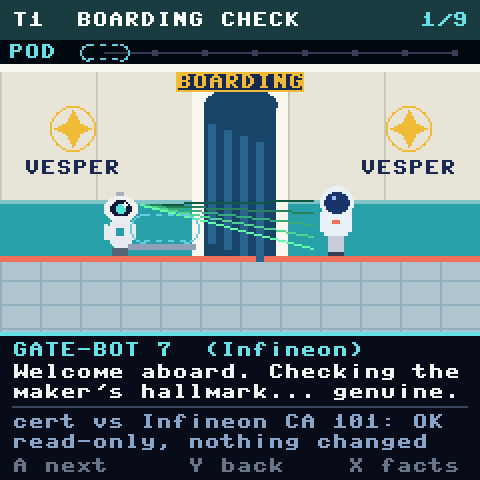</td><td>

**T1 · Boarding check.** Gate-Bot 7 reads the maker's hallmark: the Infineon certificate chain
checked against CA 101. The pod is only a dashed outline on its tray, because nothing has been made.
*Fits:* a boarding gate checks who you are before letting you in, and reading doesn't change anything.

</td></tr>
<tr><td>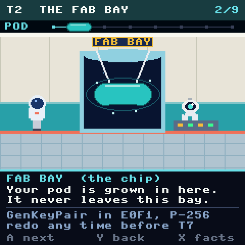</td><td>

**T2 · The fab bay.** The pod is grown in a sealed glass tank; lasers work on it. *Fits:* the tank is
visibly closed, which is the "made inside the chip, never leaves" idea.

</td></tr>
<tr><td>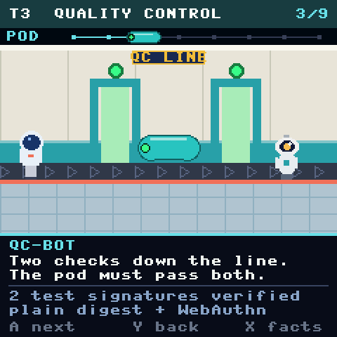</td><td>

**T3 · Quality control.** The pod rides a conveyor through two inspection gates, each with a lamp.
It picks up its green pip. *Fits:* two gates, two test signatures.

</td></tr>
<tr><td>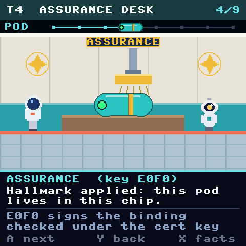</td><td>

**T4 · Assurance desk.** A robot arm brings a gold stamp down on the pod: the band appears. The
speaker is the factory key `E0F0`. *Fits:* the maker's own mark, applied to this pod, vouching that it
lives in this chip.

</td></tr>
<tr><td>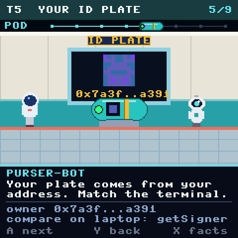</td><td>

**T5 · ID plate.** A wall screen shows a **real blockie** of the owner address; the pod now wears the
same badge. Compare with the terminal (the laptop's `getSigner`). *Fits:* a picture you match by eye.

</td></tr>
<tr><td>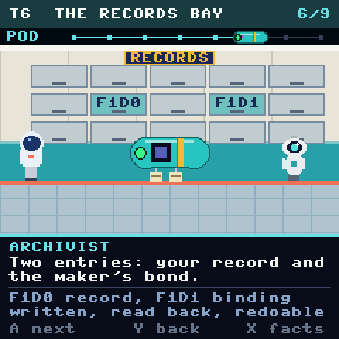</td><td>

**T6 · The records bay.** Two drawers light up, `F1D0` and `F1D1`, and the pod gets two paper tags.
*Fits:* filed, and still amendable until the bay is closed.

</td></tr>
<tr><td>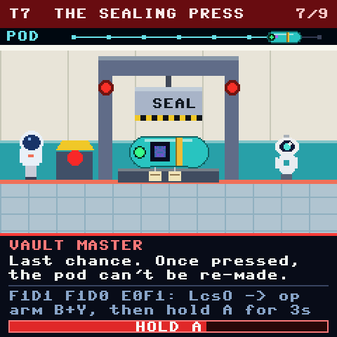</td><td>

**T7 · The sealing press (before).** The ram hangs over the pod, the beacons are red, and the **HOLD A**
bar is the real 3 second hold. The vault master says it is the last chance. *Fits:* a press is a clear
"this is the moment", and it doesn't suggest the key is destroyed.

</td></tr>
<tr><td>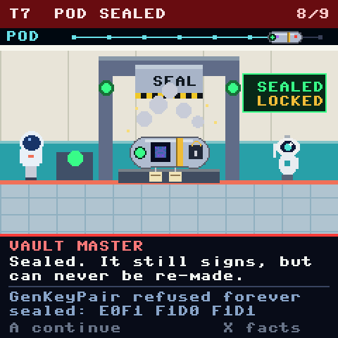</td><td>

**T7 · Pod sealed (after).** The ram lifts, steam clears, the beacons go green. The pod is silver with
a lock on it, and the rail's pod has changed to match. *Fits:* the visible before and after is the
whole message: same pod, now permanent.

</td></tr>
<tr><td>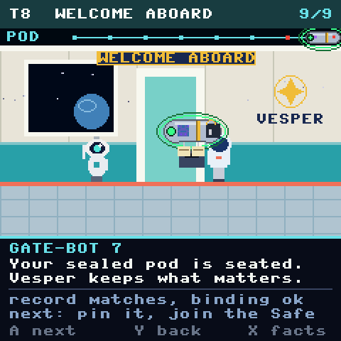</td><td>

**T8 · Welcome aboard.** The sealed pod is seated, with a green halo. *Fits:* the final check
("everything sealed, key still signs") reads as being welcomed on board.

</td></tr>
</table>

## Theme B: Sable Lantern (neon noir)

Same eight steps, in a city where the registry is the one honest institution.

<table>
<tr><td width="250">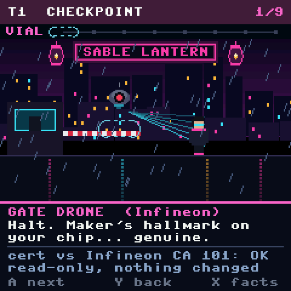</td><td>

**T1 · Checkpoint.** A gate drone scans your chip's hallmark; the vial is a dashed hologram on its
tray. *Fits:* a street checkpoint, read-only, and it can turn you away.

</td></tr>
<tr><td>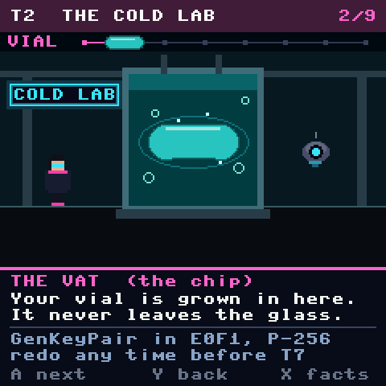</td><td>

**T2 · The cold lab.** The vial is cultured in a glass vat and never leaves it. *Fits:* the closest
picture to "generated inside the chip".

</td></tr>
<tr><td>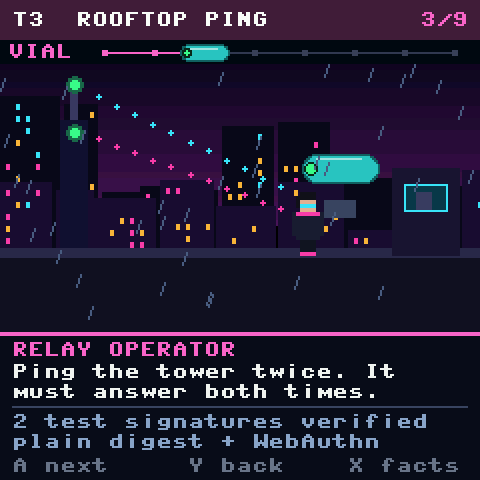</td><td>

**T3 · Rooftop ping.** Two pings go out to a distant tower and it answers both times; the vial has its
green pip. *Fits:* a ping you can verify from far away is a signature you can verify.

</td></tr>
<tr><td>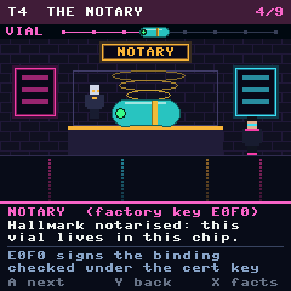</td><td>

**T4 · The notary.** An android notary brings a golden hologram stamp down over the vial: the band.
Speaker is `E0F0`. *Fits:* a notary is exactly a trusted witness to a statement about a thing.

</td></tr>
<tr><td>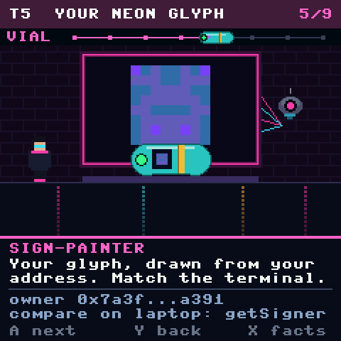</td><td>

**T5 · Your neon glyph.** The sign-painter drone lights up your **real blockie** in a neon frame; the
vial wears the same glyph. *Fits:* a neon sign is a picture you recognise from across the street.

</td></tr>
<tr><td>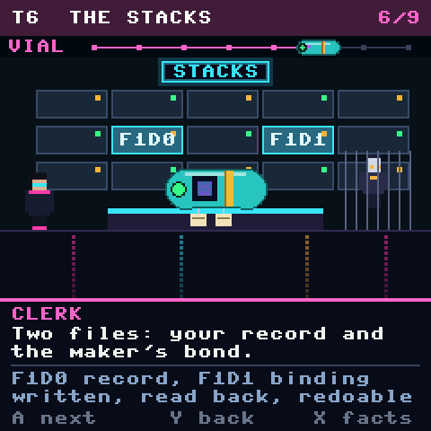</td><td>

**T6 · The stacks.** Two lockers glow, `F1D0` and `F1D1`, and the clerk waits behind the cage.
*Fits:* two files, checked, and still amendable until the stacks close.

</td></tr>
<tr><td>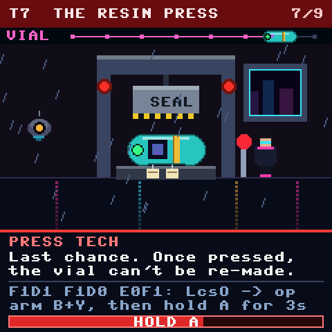</td><td>

**T7 · The resin press (before).** Same press, same red beacons, same **HOLD A**. A red lever stands
beside the operator. *Fits:* the same "one deliberate act" as Vesper, in a rain-lit
workshop.

</td></tr>
<tr><td>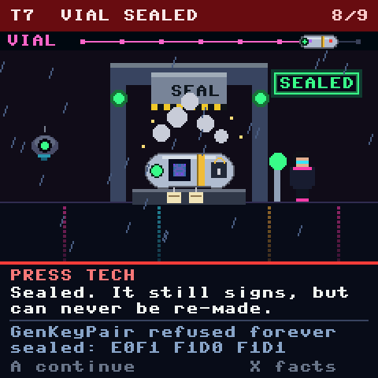</td><td>

**T7 · Vial sealed (after).** A neon SEALED sign, green beacons, and the silver vial with its lock.
*Fits:* the sign is a clear confirmation that also works from across the room.

</td></tr>
<tr><td>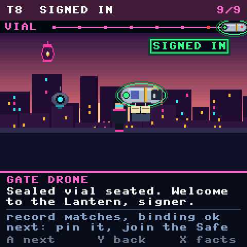</td><td>

**T8 · Signed in.** Dawn over the city, the sealed vial seated in the key with a green halo, and a
SIGNED IN sign. *Fits:* arrival, with a light change from night to morning.

</td></tr>
</table>

## Which one?

Both work, and they are the same procedure with a different mood. Vesper is friendlier and reads well
at a glance in its bright panels. Sable Lantern has more atmosphere, but its dark, rainy scenes hide
the pod more, and the pod is the point. If only one gets built, I'd pick **Vesper** first and make
Sable Lantern a second skin, since every screen already has the same layout and a theme is only a
different set of drawing functions.

## What changed in the sketch, and what didn't

- **New:** `keyjourney.py` (22 screens, both themes, the pod, the rail, the title and journey cards).
  `gatescenes.py` (round 1) is unchanged.
- **Same drawing approach:** rectangles, ellipses, polygons and text only, no bitmap assets, drawn in
  strips for the 240×240 board with `lcd.frames()`. The only image-like thing on screen is the blockie
  from `firmware/blockies.py`, with an example owner address.
- **Not timed on a real Pico.** The emulator is much faster than the board, and every scene is
  redrawn once per strip. That is the first thing to check on hardware.
- **Not covered:** the Build 1 screen (320×240), the ATECC608 ceremony (different steps), or a
  "plain mode" switch that turns the skin off. The rule from round 1 stands: any real skin needs one.
- **The facts** on the X pages are the Trust M values in `docs/TRUSTM.md`. That doc says the steps up
  to the seal have run on a real chip, and the seal has not.
