# The production console and the fresh-chip ceremony: a walkthrough

Every picture here is the real firmware running on the emulator with its virtual ATECC608, shown
at 2×. `node tools/board/shots.mjs` regenerates them all. They were made against the console's test
harness (`test-vectors/console_test.py`), so the Safe is a stand-in (`0x5a5a…`) on Base Sepolia.

**How to review from your phone:** comment on any image in the pull request, or tick and edit the
[change requests](#change-requests) at the bottom.

## What changed on the device

- **It boots straight into the Safe console** (`main_console.py`). It can do nothing else:
  - The legacy wallet, the USB wallet and the demos are no longer on the board.
  - The chip map is gone too; it lives in a separate ceremony image.
  - `firmware/manifest.json` lists every file the image holds, and a test checks that nothing else
    on the board can sign or change the chip.
- **It signs only with the pinned chip.** `QUORUM_EXPECT` in the board's `secrets.py` names:
  - the chip's serial
  - the slot, which must be locked
  - the owner address the key must produce

  This is checked at start and again right before every signature. `tools/fw pin` writes it.
- **Every signature is counted by the chip** (counter 0, LimitedUse). The console shows the count
  and flags signatures that did not come from it.
- **A delegatecall to a contract that isn't pinned is refused**, whatever the hold. Pinned MultiSend
  batches still work.
- **HTTPS checks the server's certificate** against three pinned roots, and the API key is written
  only after the handshake.
- **Robustness:**
  - One malformed transaction no longer blanks the queue.
  - No `/sim` calls go to the real service.
  - Polls are quota-sized.
  - There is a log that survives power cycles (`log.txt`) and a watchdog.
  - After 20 failures in a row the console stops on a crashed screen and signs nothing.
- **Maintenance:** hold B while plugging in. Nothing starts except the USB REPL.

## The console

| | |
|---|---|
| 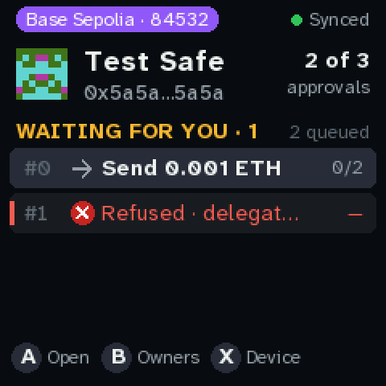 | 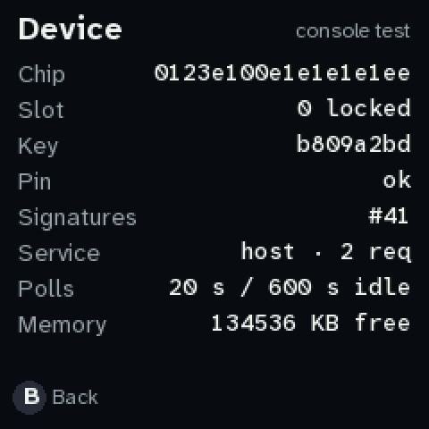 |
| **Home.** X now opens **Device** instead of the chip map. The refused row says why in two words. | **Device (X).** Build, chip serial, slot and lock, key fingerprint, pin, the chip's signature count, the service and whether its certificate was checked, poll periods, memory. Read-only. |
| 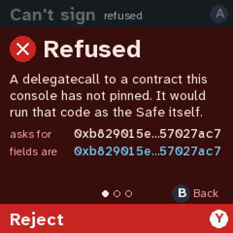 | 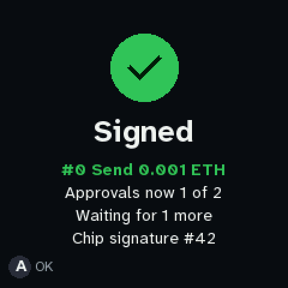 |
| **A delegatecall to an unpinned contract: refused.** Before, this was a red page you could sign with a 3 s hold. | **Signed.** The last line is the chip's own count, which the chip raised itself. |
| 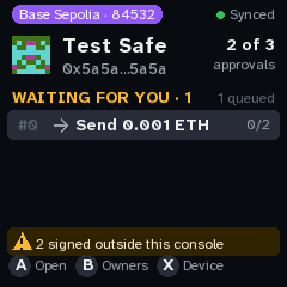 | 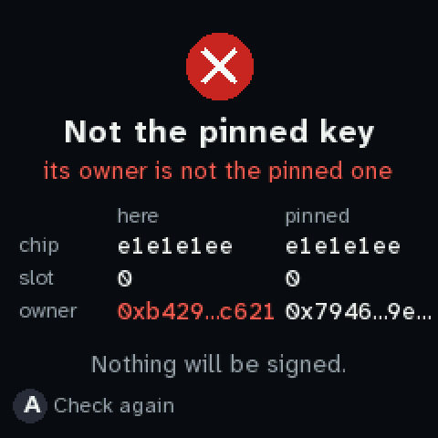 |
| **Signatures made while the console wasn't looking** (the chip's count moved while the console was off). Any key clears the banner; `log.txt` keeps it. | **Not the pinned key.** The chip, slot or owner doesn't match `QUORUM_EXPECT`. It shows what it found next to what is pinned (serials by their last 8). Nothing signs. |
| 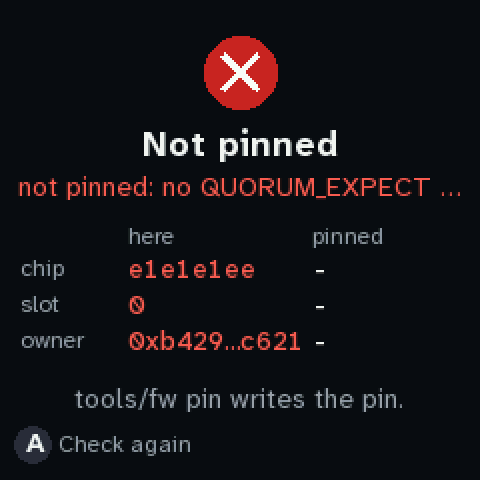 | 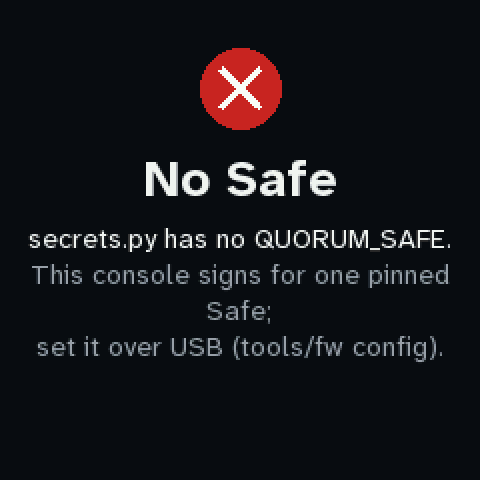 |
| **Not pinned.** The production image with no `QUORUM_EXPECT`. `tools/fw pin` reads the chip, computes the owner on the laptop, compares it with the enrolled one, and writes the pin. | **No Safe.** The production image never falls back to the laptop's simulated Family Safe. |
| 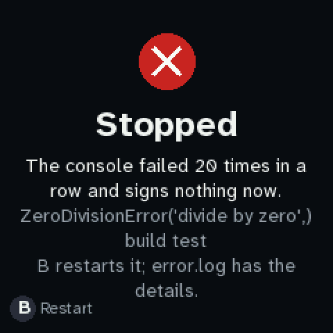 | 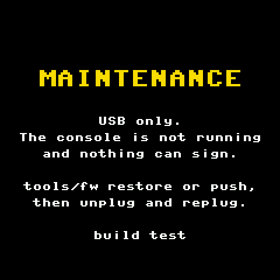 |
| **Stopped.** After 20 failed ticks in a row. `error.log` has the traceback. B restarts. | **Maintenance.** Hold B at power-up. Plain text that draws even when nothing else does. |

## The ceremony for a fresh chip (quorum v1)

The ceremony image (`tools/fw push ceremony`) opens on a banner that says it is not a signing
console. A starts PROVISION. [PROVISIONING.md](../PROVISIONING.md) has the table byte by byte, the
reasoning, and the runbook.

| | |
|---|---|
| 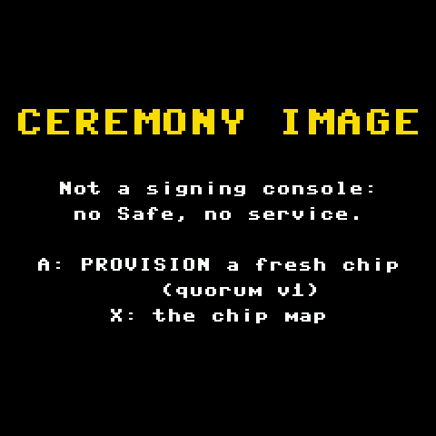 | 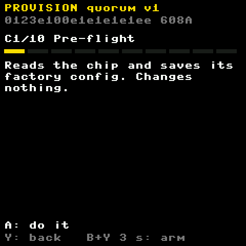 |
| **The ceremony image's banner.** | **C1 pre-flight.** Every step is worked out from the chip itself, so a reboot resumes. |
| 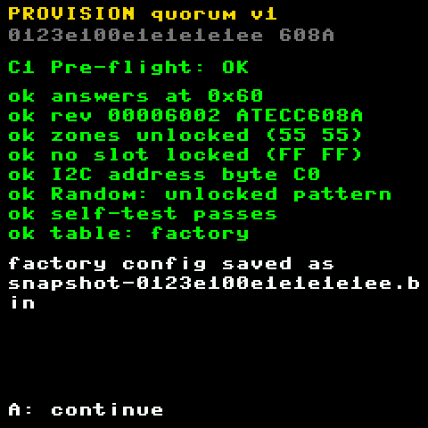 | 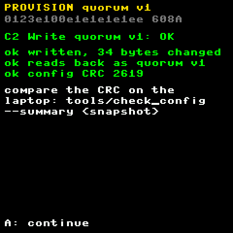 |
| **C1's checks.** Address, revision (608A or 608B), both zones open, no slot locked, the factory table. The factory config is saved. | **C2: quorum v1 written and read back**, and the config CRC to compare on the laptop (`tools/check_config --summary`). |
| 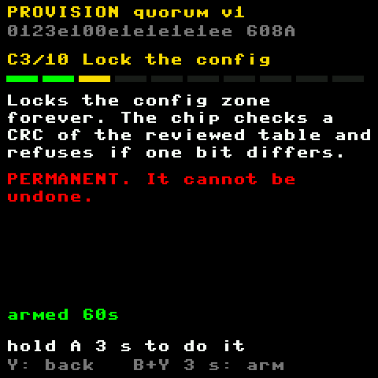 | 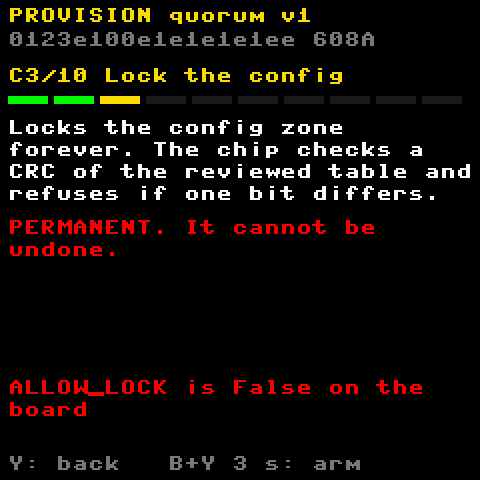 |
| **C3, permanent.** Arm with B+Y for 3 s, then hold A for 3 s. The chip checks the CRC itself and refuses to lock a table one bit off. | **C3 without `ALLOW_LOCK`:** it says why and does nothing. |
| 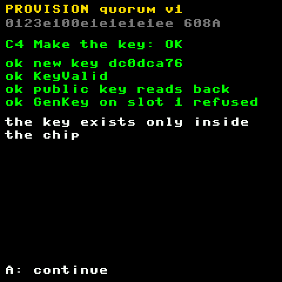 | 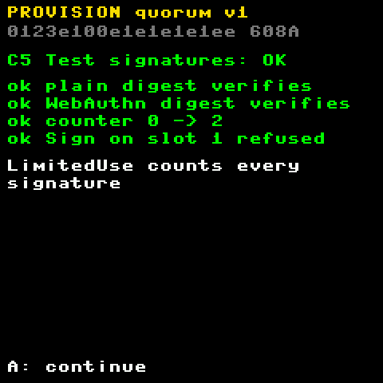 |
| **C4: the key**, made inside the chip. GenKey on any other slot is refused. | **C5: two test signatures** verified on the Pico. The counter goes up by 2. |
| 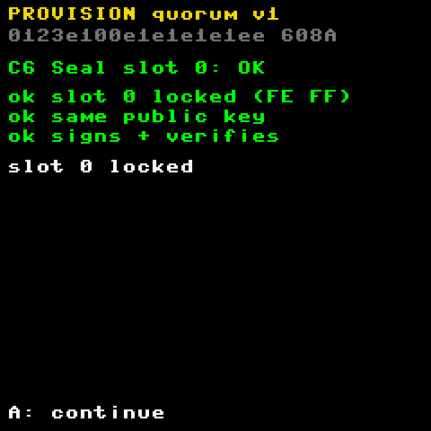 | 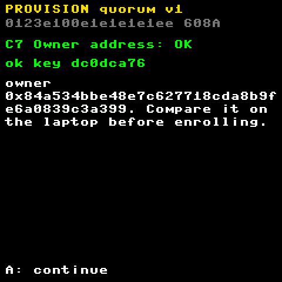 |
| **C6: slot 0 sealed.** Same key, still signs. | **C7: the owner address**, in full, to compare on the laptop before anything is enrolled. |
| 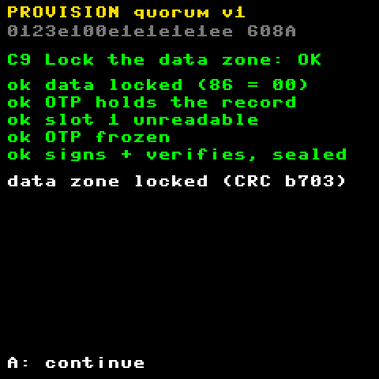 | 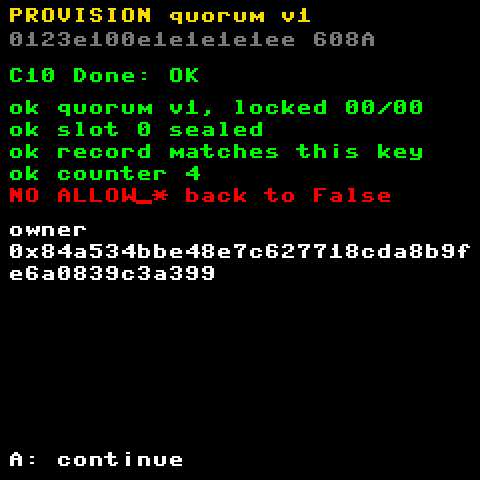 |
| **C9: the data zone locked**, checked by its CRC. The OTP record reads back, slot 1 is unreadable, OTP is frozen, and it signs under the final rules. | **C10: the summary.** The one red line is the reminder to set `ALLOW_*` back to False. |

The steps not shown (C2, C4 to C10 before they run, C8's result) are in [shots/](shots/).

## Tests behind these screens

| Suite | Checks |
|---|---|
| `node test-vectors/run-console.mjs` | 64: every refusal, pin mismatches, hold timing, the signature verified against the chip's key, counter, request counts, production guards, crash state, watchdog cap |
| `node test-vectors/run-ceremony.mjs` | 62: C1-C10 on a fresh 608A and 608B with a reboot after every step, the refusals, then the console signing with the sealed chip |
| `node test-vectors/manifest.mjs` | Each image is exactly its imports. In the console image only `quorum.sign_it` signs, and nothing can change the chip |
| `python3 tools/check_config` | Both tables, with every quorum v1 slot decoded independently from the datasheet's bit tables |
| `tools/quorum e2e` | One approval on an Anvil fork of Base, executed onchain |

## Change requests

- [ ] (add yours here)
