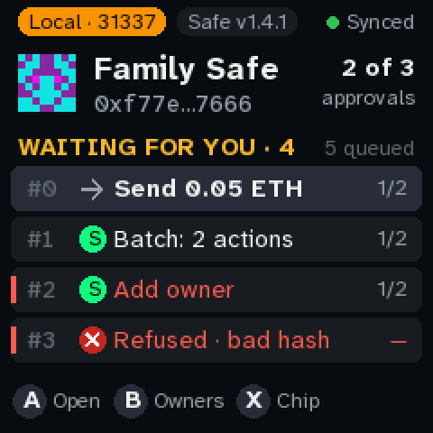
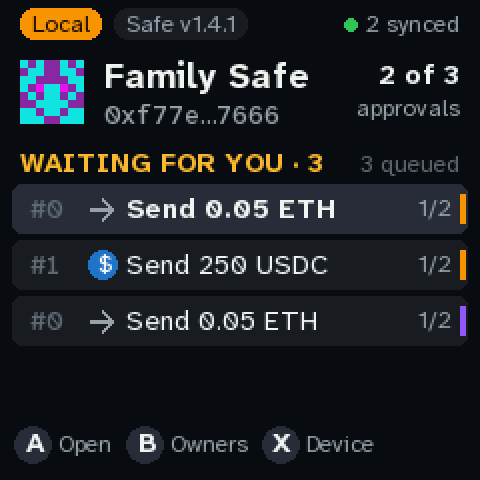

# Using the console

**Buttons.** A (top, green) opens and signs · B goes back, and shows the owners from home ·
X shows the device · Y (bottom, red) rejects · the stick pages and moves the highlight.

## Home

| | |
|---|---|
|  |  |
| **One Safe.** The chain pill, the Safe's name and address, how many approvals it needs, and the queue. **Waiting for you** counts the transactions this key hasn't signed yet. The LED blinks while something is waiting. | **Several Safes.** One queue across all of them. The stripe on the right of each row is its chain's colour. The header shows the highlighted row's Safe, and the top right says how many Safes answered (`2 synced`, or `1 offline`). |

Each row shows the Safe's nonce (`#0`), what the transaction does, and its approvals (`1/2`).
**Signed** means this key has signed it, and **Rejected** means you rejected it on this console. A
red bar on the left marks a transaction that deserves a hard look. **Refused** means the console
won't sign it at all.

## Approving

1. Highlight the transaction and press A. The summary says what it does, on which chain, and
   what your signature would do (`Yours makes it 2 of 2 · ready`).
2. Page through with the stick. **Every page has to be seen.** A before that jumps to the first
   page you haven't seen.
3. Hold A: 2 seconds, or 3 when any page is red. Let go early and nothing is signed.
4. The console signs the hash it computed itself, then sends the signature to the service.
   **Signed** shows the new count, and the chip's own use count as its last line.

If the service doesn't take the signature (a network error, say), the console keeps it. A on the
result screen tries again, and it's sent after a restart too.

**The console never executes.** When a transaction has enough approvals, someone executes it:
today that's `tools/quorum live exec --chain C NONCE`.

## Red pages and refusals

**Red** is signable with the long hold, after a hard look. Examples: a call to a contract the
console doesn't recognise, an owner or threshold change, or a transaction that pays a gas refund
to someone.

**Refused** can't be signed:
- the service's hash doesn't match the fields (it's asking you to sign something else);
- it's for another Safe;
- a delegatecall to anything except a pinned batcher, or an unknown operation;
- the service sent something that isn't a transaction.

Names like **USDC · known** come only from the list built into the console, and only for that
chain. Every screen that shows a name shows the full address too.

## Rejecting

Y hides the transaction **on this console only**. It doesn't reject it on the Safe. The Safe's
queue stays blocked at that nonce until someone replaces it, for example with a rejection
transaction proposed in the web app at the same nonce.

## Device (X)

The build, the chip, whether its pin matches, the key's use count, the service (and whether its
certificate was checked), the poll periods, and free memory. If the chip's use count went up
while the console wasn't looking, home shows a yellow banner. Any key clears it, and `log.txt`
keeps a record.
