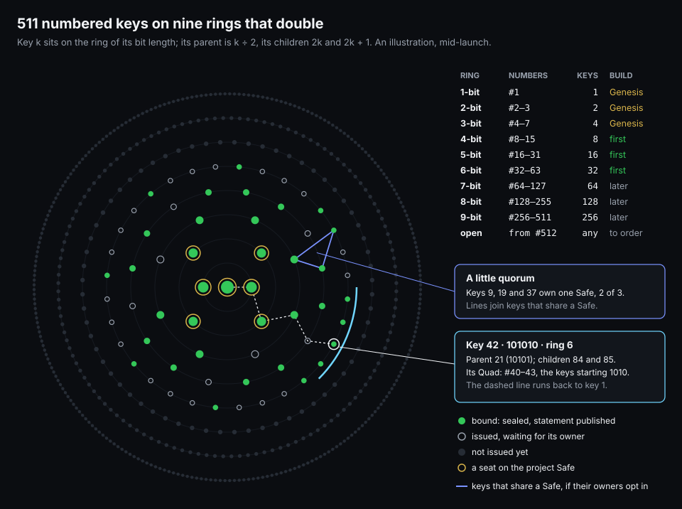
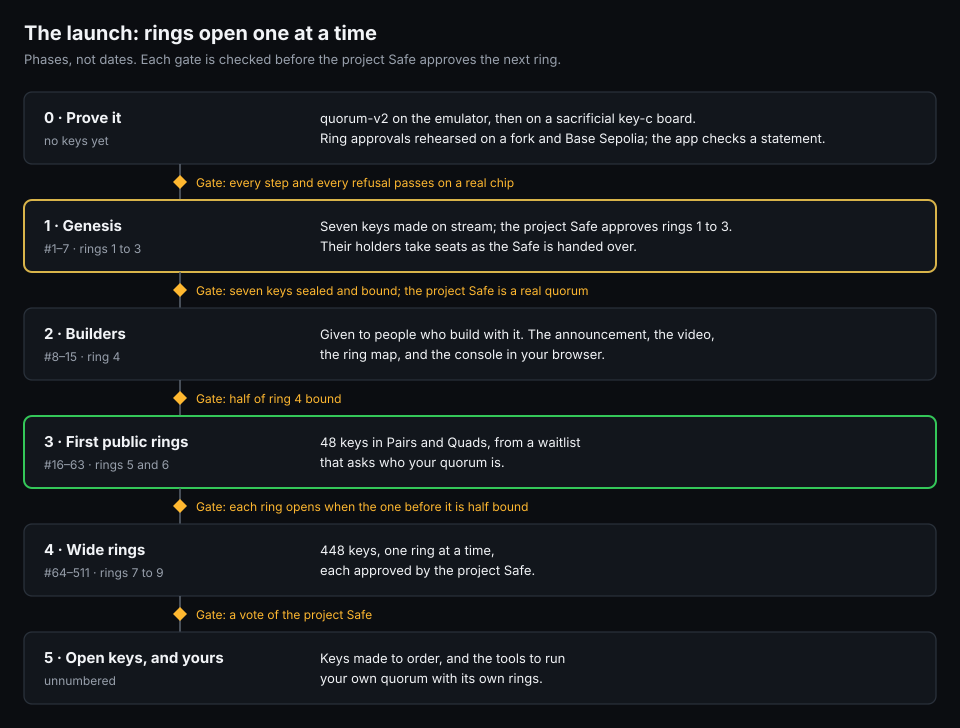

# Launch: rings of keys

> **Plan only, 2026-10-05.** Builds on [the brand key](../BRANDKEY.md) and [the project
> Safe](../GOVERNANCE.md). Nothing here exists yet, and every number is a proposal.

PicoQuorum launches as numbered keys on rings that double: 1, 2, 4, 8 and so on up to 256, 511 keys
in all. After them come open keys for anyone.
- **A key's number is its place.** Written in binary, its length is its ring, and dropping the last
  bit gives the key's parent.
- **The project Safe approves each ring** the way it approves a release, and a ring opens only when
  the one before it is half in use.
- **The code stays MIT,** so anyone can run their own little quorum under their own name.

## The rings

| Ring | Numbers | Keys | In binary | Who they're for |
|---|---|---|---|---|
| 1 | #1 | 1 | `1` | the founder's key, the first seat |
| 2 | #2–3 | 2 | `1x` | the first co-maintainers |
| 3 | #4–7 | 4 | `1xx` | the rest of the Genesis seats |
| 4 | #8–15 | 8 | `1xxx` | builders: given, not sold |
| 5 | #16–31 | 16 | `1xxxx` | the first public ring |
| 6 | #32–63 | 32 | `1xxxxx` | |
| 7 | #64–127 | 64 | 7 bits | |
| 8 | #128–255 | 128 | 8 bits | |
| 9 | #256–511 | 256 | 9 bits | the last numbered ring |
| open | from #512 | any | | open keys, made to order |

Why powers of two:
- **Each ring is one bigger than all the rings before it.** Ring n holds 2^(n−1) keys, and the rings
  before it hold 2^(n−1) − 1 together. Each ring doubles the network, and the early holders are
  never lost in it.
- **The numbers are a family tree.** Key k's parent is k ÷ 2, rounded down; its children are 2k and
  2k + 1. In binary a child is its parent with one more bit:
  - 42 is `101010`, ring 6;
  - its parent 21 is `10101`;
  - its children 84 and 85 are `1010100` and `1010101`.
- **A group shares a prefix.**
  - Two keys that differ only in the last bit are a **Pair**.
  - Four that differ only in the last two bits are a **Quad**: #40–43 are the Quad `1010xx`.
  - A family or a team buys a Pair or a Quad, so its keys sit side by side on the map, and the
    prefix is its name.
- **Rings count bits, not worth.** A 9-bit key joined later; it isn't lesser. Numbers are places,
  not prices.

## The first build

**Build #1–63 first: rings 1 to 6, 63 keys.** That's well under 500, and a size one person can make,
test and ship. All nine numbered rings would be 511 keys; stopping at ring 8 would be 255.

- **Order about 72 key-c boards:** 63 numbered, and the rest for sacrificial chips and spares.
  - Boards are identical until the bench stamps a number, so a spare becomes a later key.
  - The first five cost $38.96 assembled; get quotes at 64, 128 and 256.
- **Bench time:** one to two minutes a key ([BRANDKEY.md](../BRANDKEY.md), B1–B10). 63 keys is an
  afternoon or two; ring 9's 256 are several sessions.
- **Rings 7 to 9** are later orders, one ring at a time, as the gates below open.
- **The case files:** the borrowed console cases are CC BY-NC ([NOTICE](../../NOTICE)). Anything
  sold needs our own designs first.

## How a ring gets signed

| Who | Signs | With | When |
|---|---|---|---|
| Each chip | its brand key's statement about its own Safe key | slot 1, internal sign only | at the owner's ceremony |
| The project Safe's owners | the ring: one approval for all its keys | their console keys, a held green button | once per ring, before the keys ship |
| The key's owner | nothing new at first; later, their own Safe's transactions | slot 0, the Safe key | from then on |
| The founder | the card, by hand | a pen | when the key is packed |

1. **At the bench,** each chip makes its brand key, and its number goes into its OTP zone. The ring
   file `docs/registry/rings/ring-N.json` lists every key's number, serial and brand public key.
2. **The ring's digest** is the EIP-712 `PicoQuorumRing(ring, root, count, file)`.
3. **The project Safe approves it like a release** ([RELEASES.md](../RELEASES.md)): a delegatecall
   to SignMessageLib, with a note naming the ring.
   - Each owner's console shows **Approve ring 6 · #32–63 · 32 keys**, with the root.
   - It refuses anything that doesn't match the note.
4. **The approval holds for good:** `isValidSignature(D, "0x")` on the Safe, even after its owners
   change.
5. **At home,** the owner's chip makes the Safe key and seals it, and then the brand key signs the
   statement ([BRANDKEY.md](../BRANDKEY.md), H1–H7).
6. **Binding:** the owner adds the statement to the registry by pull request. The app checks the
   ring's approval, the Merkle proof and the statement in the browser, then shows **Verified
   PicoQuorum key · #42**.

None of this needs a new contract. The registry contract in BRANDKEY.md comes later, if other
contracts need to read badges on chain.

Each ring's approval is worth streaming: the ring file on screen, the root on each console, the
green holds, and the transaction landing.

## Packs

| Pack | Keys | Numbers share | Makes |
|---|---|---|---|
| Single | 1 | | one owner in a Safe you already have |
| Pair | 2 | all but the last bit | with a wallet you already have, a 2-of-3 Safe |
| Quad | 4 | all but the last two bits | a family or team Safe: 3 of 4, or 2 of 4 |
| Supporter Pair | 2 | all but the last bit | one for you; the project Safe gives the other to a builder |
| Lab | 1 or more | | blank chips, for running your own quorum (below) |

Prices and payment are open.

## Showing what's interesting

1. **The ring map** (above): 511 dots on nine rings, live.
   - Filled: bound. Hollow: issued, waiting for its owner. Dim: not issued yet.
   - A gold ring marks a seat on the project Safe.
   - Lines join keys that own the same Safe, when their owners opt in. Little quorums show up as
     small constellations, and the map fills in as groups form.
2. **A page per key:**
   - its number in decimal and binary, its ring, parent, children and Pair or Quad;
   - its owner address's blockie;
   - the statement, checked live in the browser, and when it was bound;
   - if the owner opts in, the quorums it belongs to.
3. **Ring progress:** "Ring 6 · 32 issued · 21 bound".
4. **The project Safe's log:** every approval (releases, rings, revocations, brand versions) and
   which owners signed it.
5. **Quorum stories,** opt-in: a family's 2 of 3, a hackerspace's 3 of 5, a club's treasury.
6. **On the key itself:**
   - the console shows **Key 42 · 101010 · ring 6** on its key screen;
   - the next board revision gets a binary band: nine dots in the silkscreen, with the 1 bits
     filled at the bench with a paint pen;
   - a 3D-printed sleeve can carry the same nine dots, generated from the number.

The map uses dots on rings, not the mark: the five-dot mark never reports live status
([BRAND.md](../BRAND.md)).

## Who decides the brand

The people holding seats on the project Safe decide how the brand grows, the same way they approve
releases.

- **The brand has versions.** The brand guide ([BRAND.md](../BRAND.md)) and its files in
  `docs/brand/` get a manifest, and the project Safe approves it as the EIP-712
  `PicoQuorumBrand(version, manifest)`. The official brand is the last version the Safe approved.
- **What needs an approval:**
  - opening a ring, or a new pack;
  - a board colour, case, card or sleeve that carries the mark;
  - a change to the mark or the naming rules;
  - a revocation.
- **Anyone can propose.** A pull request with the files and a note. The seats discuss it, and the
  Safe approves it or doesn't.
- **What the guide fixes:**
  - the mark is always three of five;
  - the name is one word;
  - compatibility wording for Raspberry Pi and Safe.
- **Ring holders can earn seats:** nominated, then voted in by signing, as GOVERNANCE.md hands the
  Safe over.

## Anyone can start a quorum

PicoQuorum is meant to be little quorums all over the internet. The branded ones are one family of
them.

- **The code is MIT.** Fork it, build keys, run your own bench with your own brand key, and approve
  your own rings from your own Safe. That's a quorum with its own issuer.
- **The name means one issuer.** "PicoQuorum key" and the mark on a key mean the project Safe
  approved its ring.
  - Your own quorum takes its own name, with "built with PicoQuorum" if you like.
  - A plain-language name policy goes into BRAND.md before launch. We're not lawyers.
- **The app can check anyone's keys.** Point it at an issuer Safe and its ring files, and the checks
  are the same. The project Safe is the first issuer, not the only one.
- **A map of quorums.** Issuers who opt in appear on a wider map. Every issuer is itself a quorum
  that issues keys: quorums all the way down.
- **Lab keys** are blank chips for exactly this.

## The launch

0. **Prove it.**
   - quorum-v2 on the emulator, then on a sacrificial key-c board.
   - Ring approvals rehearsed on a fork and Base Sepolia, and the app checks a statement.
   - *Gate: every step and every refusal passes on a real chip.*
1. **Genesis: #1–7.**
   - Seven keys made on stream; the project Safe approves rings 1 to 3.
   - #1 becomes one of the founder's owner keys; #2–7 go to the people who will hold seats.
   - *Gate: seven keys sealed and bound, and the project Safe is a real quorum (3 of 5).*
2. **Builders: #8–15.**
   - Given to people who build with it.
   - The public launch: the repository goes public (GOVERNANCE.md), with the announcement, the
     video, the ring map and the console in your browser ([EMU-WEB.md](../EMU-WEB.md)).
   - *Gate: half of ring 4 bound.*
3. **First public rings: #16–63.**
   - 48 keys in Pairs and Quads, from a waitlist that asks who your quorum is.
   - *Gate: each ring opens when the one before it is half bound.*
4. **Wide rings: #64–511.** One ring at a time, each approved by the project Safe.
5. **Open keys, and yours.**
   - Keys made to order, and the tools and docs to run your own quorum.
   - *Gate: a vote of the project Safe.*

The announcement copy and the explainer video are in [EXPLAINER.md](EXPLAINER.md).

## Guardrails

- **Experimental: small amounts only,** until it has a track record.
- **Numbers are places, not prices.** No tokens, no royalties, no airdrops, no promises of value.
  Don't say "rare" or "floor".
- **Opt-in visibility.** Binding, quorum lines and stories are each the owner's choice.
- **#1 is not for sale,** and neither is any Genesis key.
- **Before selling hardware:** our own case designs, and the rules for selling electronics kits
  where they ship.

## Open decisions

- Stop at ring 9 (511 keys), or ring 8 (255)?
- Who holds keys #2–7, and which technologies their seats use (no technology may hold a threshold).
- How numbers inside a public ring are given out: in waitlist order with Pairs and Quads reserved as
  blocks, or the buyer's pick.
- Prices, payment, and whether Supporter Pairs exist.
- Whether lineage means anything beyond the numbers.
- The ring file's format, and the brand manifest's.
- The binary band on the next key-c revision.

Figures: `tools/brandkey-figures` draws [rings.svg](rings.svg) and [phases.svg](phases.svg).
