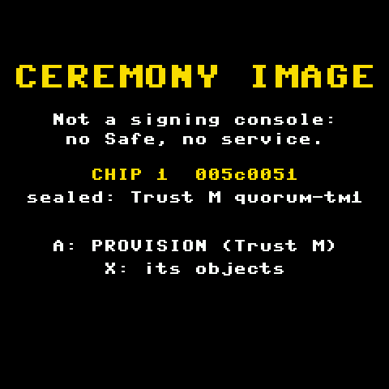
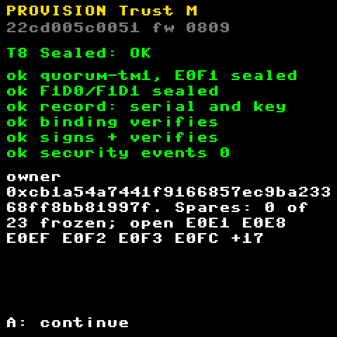
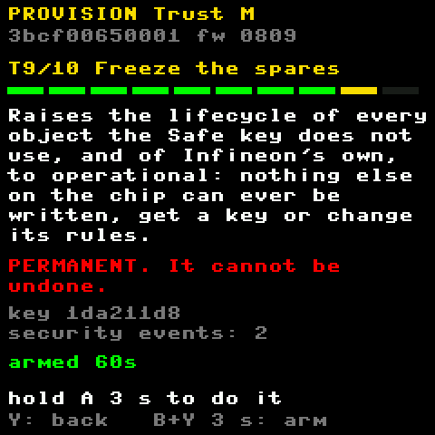
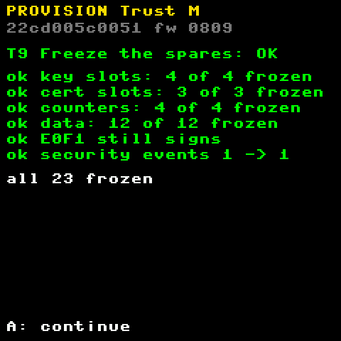
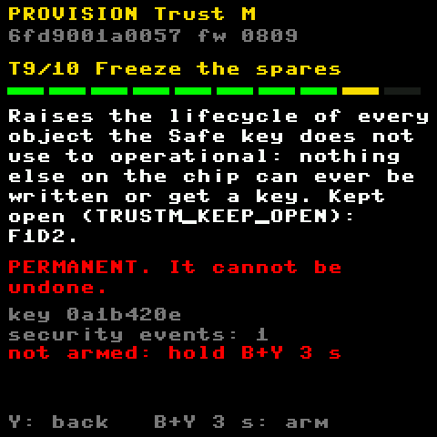
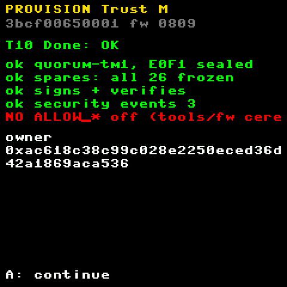
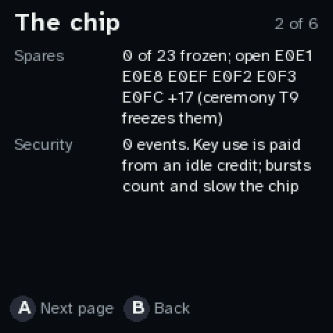
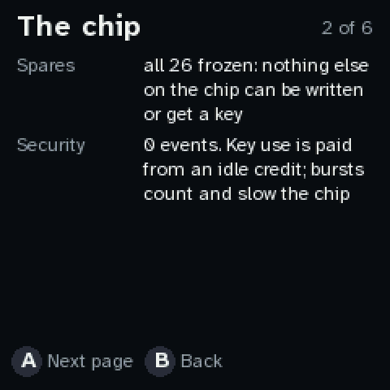

# A Trust M signer for a mainnet Safe

PicoQuorum's OPTIGA Trust M signer is one owner of a 3-of-5 Safe on Ethereum. These pages are
the shareable part. The chip profile and its ceremony are in [../TRUSTM.md](../TRUSTM.md).

| Page | For |
|---|---|
| [COSIGNERS.md](COSIGNERS.md) | the other owners: check the signer, day to day, execution, a lost device |
| [THREAT-MODEL.md](THREAT-MODEL.md) | everyone, once: what you can rely on, and what you can't |
| [CONFIGURATION.md](CONFIGURATION.md) | the recommended setup, and the address lock-down options **still to decide** |
| [RUNBOOK.md](RUNBOOK.md) | the operator: a chip from the bag to an owner, and what to do when things go wrong |
| [attest/](attest/) | each chip's ceremony record, checked with `tools/quorum verify` |

**For people outside the repo:** a shareable co-signer guide condenses these pages:
[PicoQuorum Trust M signer: guide for co-signers](https://claude.ai/code/artifact/f5ef9f4d-aab4-4925-bf3b-c384c3001822).

## Where it stands (2026-10-01)

**TM1, the first Trust M** (serial `0a091b5c000b0062006c`, owner `0x47c0998C6a7A1955794071b9f4058e7814178f35`):
- **Sealed.** The key, record and binding were frozen on 2026-09-29.
- **The other 23 objects** are still at factory state. T9 will freeze them, after a sacrificial
  chip has shown T9 on silicon.
- **Base Sepolia:** an owner of the rehearsal 3-of-5 Safe `0x5617…DC41`. Its signer is deployed
  there, and its first approval executed onchain on 2026-09-30.
- **Base and Ethereum:** `getSigner` agrees on both chains. The signer is not deployed on either.
- **Its record** [attest/attest-0a091b5c000b0062006c.json](attest/attest-0a091b5c000b0062006c.json)
  passes `tools/quorum verify --chain basesep,base,eth`.

**The mainnet chip** will be a fresh one (TM3). The steps before it:
- [ ] TM2, sacrificial: T1–T7 headless, then T9, plus the refusals that a sealed or frozen object
      should give. These are the first real-silicon results for T9.
- [ ] TM1: T9 on the device (`tools/fw ceremony start --unpin`), with an explicit yes.
- [ ] Decide whether T9 freezes the spare key slots E0F2/E0F3 ([CONFIGURATION.md](CONFIGURATION.md)).
- [ ] TM3: the full ceremony on the device, `tools/fw attest`, and every co-signer runs `verify`.
- [ ] **Gas, after an explicit yes:** `live enroll --chain eth`, and the mainnet Safe.

## The ceremony's last steps on the screen

Drawn by the real firmware on the emulator's virtual Trust M (`node tools/board/shots_tm.mjs`).
The chip in the shots is one that was sealed before T9 existed, as TM1 is.

| | |
|---|---|
|  |  |
| **The ceremony image** on a sealed chip. PROVISION goes to T8. | **T8, the seal checked.** The record, the binding, and a test signature. Changes nothing. |
|  |  |
| **T9, freeze the spares.** PERMANENT: the arm, then a 3 s hold. Only the lifecycle is written, to operational, never termination. | **T9 done.** Each group frozen, the key still signs, the security counter before and after. |
|  |  |
| **With `--keep-open`** (here F1D2), the screen says what stays open: for example the spare key slots, if a chip should hold a second key later. | **T10.** Its last line stays red until `tools/fw ceremony finish` turns `ALLOW_*` off. |
|  |  |
| **The console's Chip page** before T9: what is still writable. | **And after:** nothing else on the chip can be written or get a key. |
