# The console's Safe approval screens: a walkthrough

Every picture here is the real firmware (`firmware/quorum.py`, `quorum_ui.py`, `decode.py`) running
in the emulator against a simulated Safe on the laptop (`tools/quorum`). The emulator's screen is
pixel-for-pixel the Pico's 240×240 panel, shown here at 2×. `tools/quorum shots` regenerates every
image. Run it twice and you get the same bytes, so a changed image in a commit means the screen
changed.

**How to review from your phone:** comment on any line or image in the pull request, or edit the
[change requests](#change-requests) checklist at the bottom straight in GitHub. I pull before every
iteration and work through both.

**v2, a redo of the look:** a new boot screen (a 3-of-5 star that becomes a spinning Ethereum
diamond) and the plan for type and graphics. See [v2/README.md](v2/README.md).

**Next: other screen sizes.** A plan for the six screens on order (0.96″ to 3.5″): the same flow
reflowed per size, the code it needs, and questions for you. See [SCREENS.md](SCREENS.md).

## Boot screen options

Four ideas for what the console shows while it starts. Each one is the real firmware drawing code
(`emu/sketches/bootfx.py`), captured frame by frame at the firmware's 50 ms tick
(`tools/bootgifs`). Try them in the emulator with `tools/emu run bootfx`; A cycles through them.

| | |
|---|---|
| 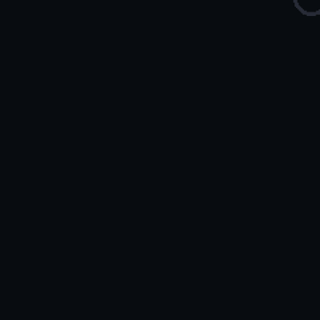 | 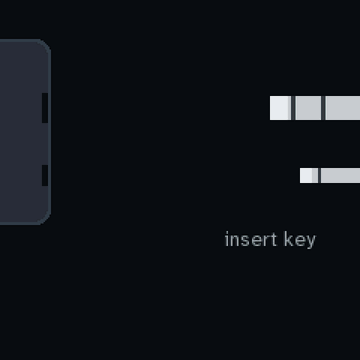 |
| **1. Quorum.** Three owners swirl in and link up. Two vote, the check pops in: 2 of 3, ready. The end frame is the logo: three nodes, two filled. On the device each boot step (screen, WiFi, chip, the Safe) could light a node, so the animation *is* the progress. | **2. Plug in.** The dual-plug key slides into the console's jack, there's a spark, and its light turns green. It shows the key's fingerprint. It could play for real whenever a key is inserted, not only at boot. |
| 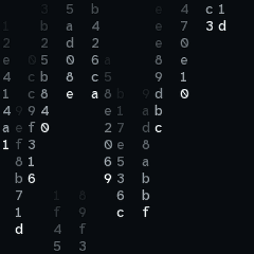 | 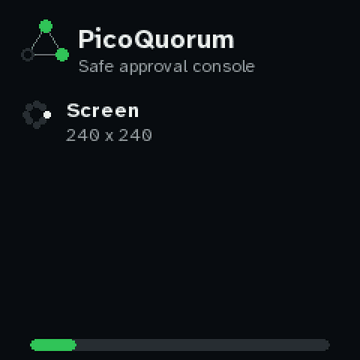 |
| **3. Hash rain.** Falling hex settles into the name, then the Safe and its quorum. The most "crypto", and the least about what the device does. | **4. Checklist.** The practical one: each real boot step ticks off (screen, WiFi, the chip and its key, the Safe) with a progress bar. It's today's boot screen, redone in the new style. |

They can be combined: **1 or 2 as the first second, then 4 while WiFi joins.** Which do you like?

## Iteration log

### Iteration 3 (2026-09-25): the signature and the owner are real

No new screens. What the chip signs, and who it signs as, are now what a real Safe checks:
- **This key's owner address** is its **signer proxy**: Safe's audited passkey signer
  (safe-modules passkey v0.2.1), which the factory deploys at an address fixed by the key. The
  console computes it itself (`firmware/webauthn.py`), and the deployed factory agrees
  (`test-vectors/webauthn.json`).
- **The signature** is a WebAuthn assertion over the safeTxHash computed on the console, packed as
  the Safe's contract signature. The chip signs `sha256(authenticatorData ‖ sha256(clientDataJSON))`,
  all of it built on the device. No blind signing.
- **The Family Safe** now sits at `0xf77e…7666`: the address Safe's factory gives it on a fork of
  Base. The same console runs against a real Safe 1.4.1 there (`tools/quorum up`, see
  [`tools/mock-tx-service/README.md`](../../tools/mock-tx-service/README.md)), and
  `tools/quorum e2e` has the emulator's chip approve a transaction that then executes for real.

Screens that changed, only where an address shows: the Safe's identicon and address on the queue,
and "This key" on the owners page.

| Before (iteration 2) | After |
|---|---|
| 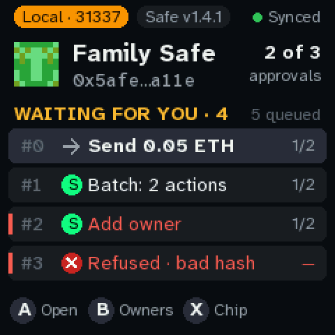 |  |
| 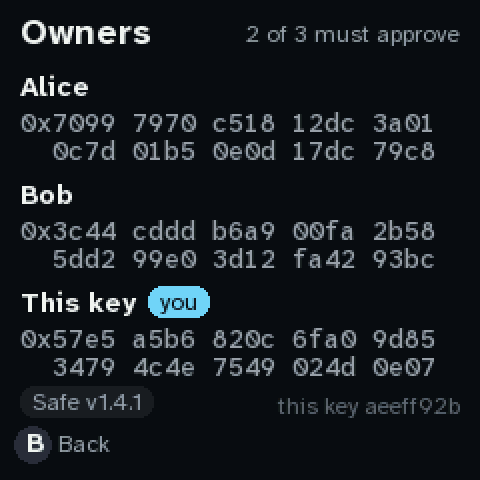 | 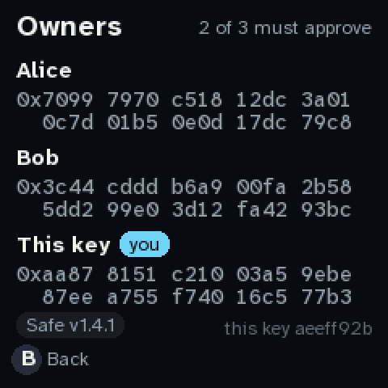 |

### Iteration 2 (2026-09-25): real type, a new theme, who's being called, the Safe version

You asked:
- Is the blocky text necessary? **It isn't a choice we made.** MicroPython's framebuffer only has
  an 8×8 font, and everything bigger was those pixels drawn 2, 3 or 4 times larger.
- Try a clearer theme that uses the resolution.
- Show a Safe or Uniswap icon for verified contracts, and an alert for custom ones.
- Show the Safe version.

What changed:
- **Real, anti-aliased type.** The font is
  [Atkinson Hyperlegible](https://www.brailleinstitute.org/freefont/) from the Braille Institute,
  made so that 0/O, 1/l/I and similar pairs can't be confused. That matters on a device whose
  whole job is getting people to compare addresses.
  - A sans for words, a mono for addresses and hashes, seven sizes.
  - They're rendered on the laptop (`tools/fonts/gen.py`) into 34 KB of glyph files, and the Pico
    draws them in C with 16 shades of anti-aliasing (`firmware/fonts.py`).
  - SIL Open Font License, credited in `NOTICE`.
- **A new theme.** Near-black and neutral instead of navy and neon, with colour kept for meaning:
  green = sign, red = danger, amber = caution, blue = what's at stake.
  - Rounded cards, sentence case, and small uppercase labels over big headlines.
  - Buttons are shown as **key badges** (Ⓐ Ⓑ Ⓧ Ⓨ) next to what they do, instead of arrows.
  - There's also a **light theme**, set with `QUORUM_THEME = "light"` in `secrets.py`. Compare
    them in [section 11](#11-the-light-theme).
- **Who's being called** ([section 10](#10-whos-being-called)):
  - A contract the console knows shows its logo and "known": Safe's own contracts, USDC, Uniswap's
    router and Permit2.
  - Any other contract gets a ⚠ "Unknown contract" alert, in the header and on the page.
  - This shows in the queue rows, on the summary header, and in each page's header.
  - "Known" means pinned on the console in `quorum_cfg.py`, never what the service or a block
    explorer claims.
  - The logos are coloured monograms drawn on the device, not copies of anyone's artwork.
- **The Safe version** ([section 12](#12-the-safe-version)):
  - A pill on the home screen and the owners page, and the verify page names the hash rules it used.
  - The console's hash is right for Safe 1.3.0 and later (1.3.0, 1.4.1, 1.5.0 all share it). An
    older Safe turns the pill red, and the console refuses to sign.
- **Smaller fixes:**
  - Calls nobody decoded get a second page, **Calldata**: the function selector, its size, and the
    digest to compare.
  - The refused page compares the two hashes on two short lines.
  - The approvals line is one row: `1 of 2 ● Alice ○ Bob ○ You`.

| Before (iteration 1) | After |
|---|---|
| 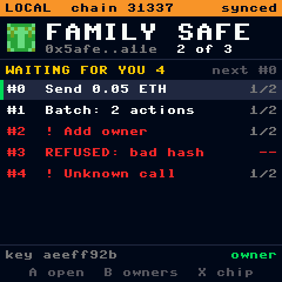 |  |
| 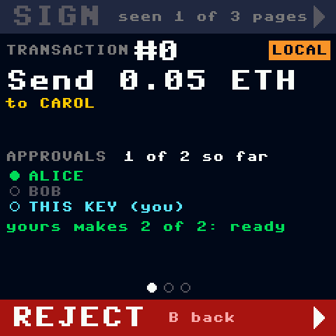 |  |
| 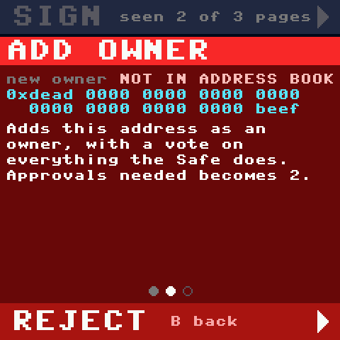 |  |
| 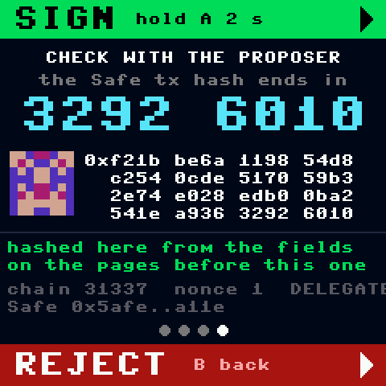 |  |
| 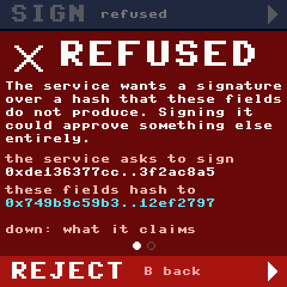 | 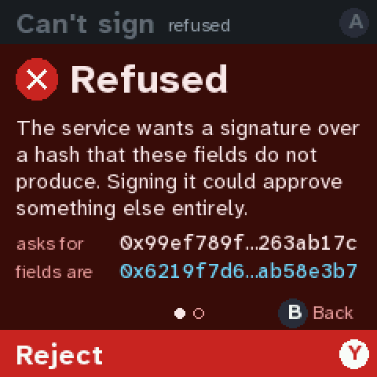 |

**Questions for you:**
1. **Dark or light?** Dark is the default.
2. **Which contracts should be known?** Today: Safe MultiSend, USDC, Uniswap Router and Permit2.
   The list lives in `quorum_cfg.py` and is easy to extend: Aave, Cowswap, ENS, the tokens you
   hold…
3. **Real logos?** The monograms are a stand-in. Real logos would be small bitmaps pinned the same
   way, but their licences need checking first.
4. **Uniswap swaps are yellow.** The router is known, but its `execute` call isn't decoded yet
   (the swap's path and amounts). Worth decoding next, or is yellow plus "confirm with the
   proposer" enough for now?

### Iteration 1 (2026-09-24): the first pass

- **The queue**, a **summary** page, one page per thing the transaction does, **red pages**, the
  **verify** page, and **hold A to sign** after seeing every page.
- The console **refuses outright** when the service lies about the hash or the Safe.
- A simulated 2-of-3 Safe on the laptop checks the chip's P-256 signature independently.
- Open questions from then:
  - Y rejects on this console only. Should it also offer the Safe's on-chain rejection?
  - Hold times: 2 s normally, 3 s for red.
  - The 8-character verify code.
  - B = back.
  - Unknown tokens are yellow.

**Not yet (iterations 1 and 2):** no chain and no Safe contracts, the chip's raw r‖s as the
signature, and a stand-in owner address. Iteration 3 made all three real.

## The setup

| | |
|---|---|
| **Safe** | Family Safe, `0xf77e…7666`, v1.4.1, on chain 31337 (Local: nothing signed here is valid on a real chain) |
| **Owners** | Alice and Bob (simulated, on the laptop) and This key (the chip, through its signer proxy), 2 of 3 must approve |
| **Buttons** | A (top, green) sign · B back / owners · X chip map · Y (bottom, red) reject · stick: pages |
| **Pinned** | the Safe, the chain, the names, the known contracts and tokens live on the console (`firmware/quorum_cfg.py`); the transaction service is not trusted for any of it |

The demo queue: Alice sends ETH, a batch, Bob adds a stranger as an owner, a transaction the
service lies about, and a call nobody can decode.

## 1. The queue


- **Top row:** the chain, the Safe's version, and whether the console reached the service.
- **Each row:**
  - An icon for who it calls: → for a plain transfer, a logo for a known contract, ⚠ for an
    unknown one, ✕ when refused.
  - `1/2` is the approvals so far.
  - A red or amber edge marks a row with red or yellow pages.
- The Pico's LED blinks while anything waits for this key.

## 2. A first approval: Alice sends Carol 0.05 ETH

| | |
|---|---|
|  | 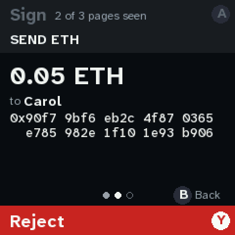 |
| **A on the row: the summary.** What it does and who has approved: filled dot = signed, blue = you. It also says what your approval would do. SIGN is grey: 1 of 3 pages seen. | **Down: what it does.** The amount, the name from the address book, and the full address in 4-character chunks. The name is a hint; the address is what's signed. |
| 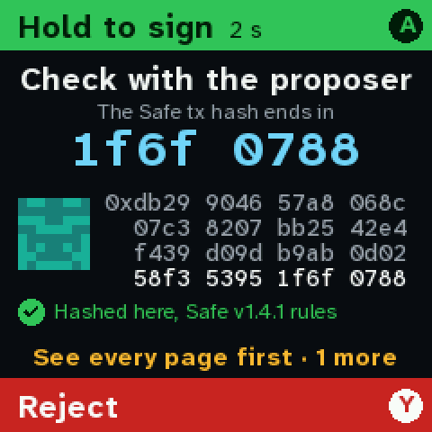 |  |
| **A before the last page** jumps to the page you haven't seen and says why. This is the verify page: the hash was computed *here* from the fields on the pages before. Its last 8 characters are what you'd read to the proposer on a call. | **Hold A.** The bar fills over 2 s. Let go and nothing is signed. |
| 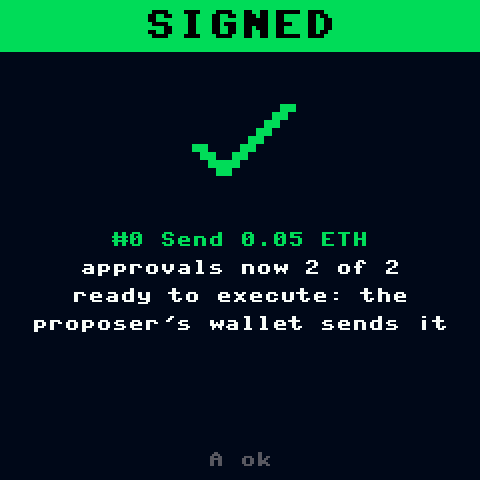 | 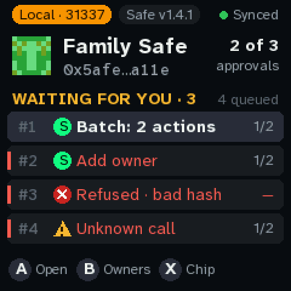 |
| **Signed.** The chip signed the hash, and the laptop checked the P-256 signature against this key. 2 of 2, so the simulated Safe executes it. | **Back home:** #0 is gone and the queue moves on. |

## 3. A batch: two payments in one transaction

| | |
|---|---|
| 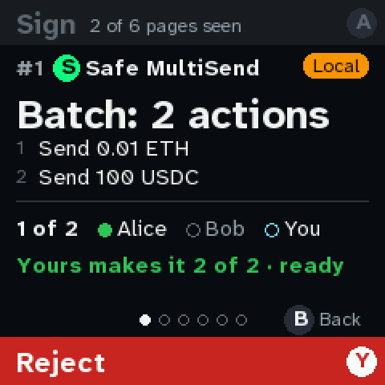 | 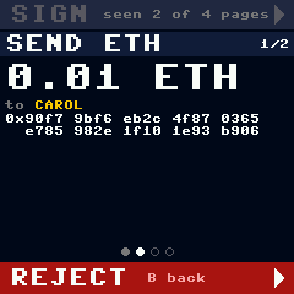 |
| The header shows it goes through **Safe MultiSend**, a known contract, so its delegatecall isn't a red flag. The summary lists every call. | Each call gets its own page… |
| 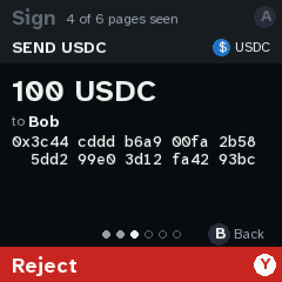 |  |
| …with token amounts in the token's real decimals, and the token contract in the header. | One hash covers the whole batch. |

## 4. A red screen: Bob adds a stranger as an owner

| | |
|---|---|
| 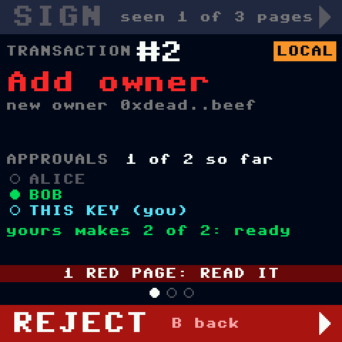 |  |
| The Safe is calling **itself** (its settings). The new owner is flagged unknown, and there's a banner: 1 red page, read it. | **The red page** is red all over. The thing at stake (the address that would get a vote) is in blue. |
| 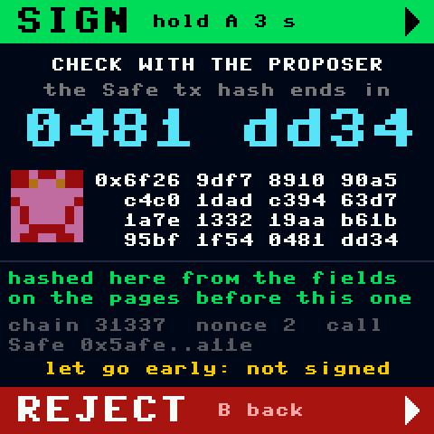 | 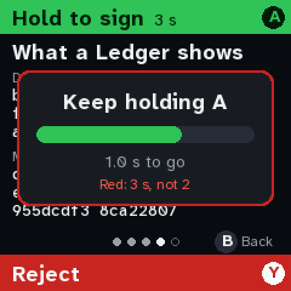 |
| A red transaction needs **3 s**. Letting go at 2.3 s signs nothing. | The hold card says why it's longer. |

## 5. The service lies

The service shows "0.05 ETH to Carol" but asks for a signature over the hash of *5 ETH to a
stranger*. A console that signed the hash it was handed would approve the theft.

| | |
|---|---|
|  | 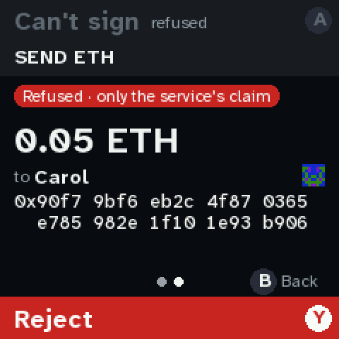 |
| **Refused.** The console hashed the fields itself and got a different hash. Both are shown. | Down shows what the service *claims*, marked as a claim. |
| 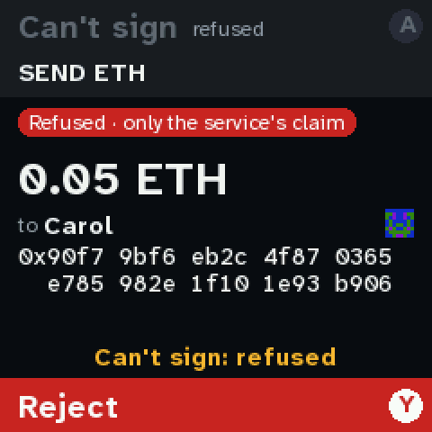 | |
| A does nothing but say why. Y (reject) still works. | |

## 6. A call nobody described

| | |
|---|---|
| 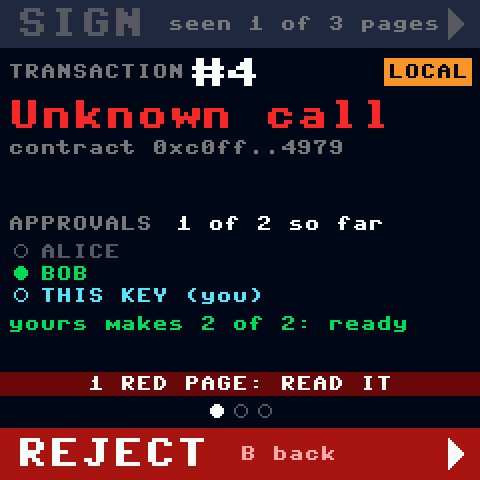 | 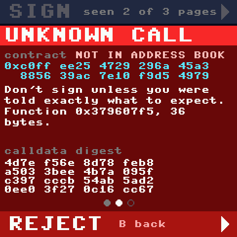 |
| **⚠ Unknown contract** in the header, and the headline in red. | The contract, flagged, in full. |
| 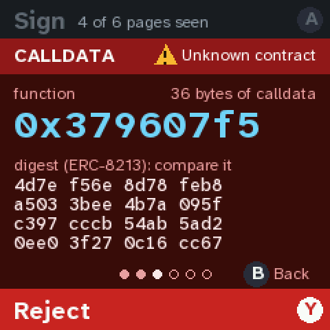 | |
| **Calldata:** the function selector, the size, and the calldata digest (ERC-8213), to compare with what the proposer says they sent. | |

## 7. Rejecting

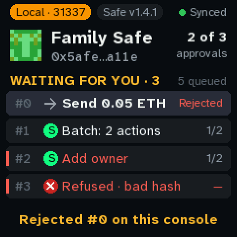

Y on any review page: instant, no hold. The row shows `Rejected`, and the laptop's log says who
rejected it. It isn't sent to the Safe (iteration 1's question 1).

## 8. More red screens

| | |
|---|---|
| 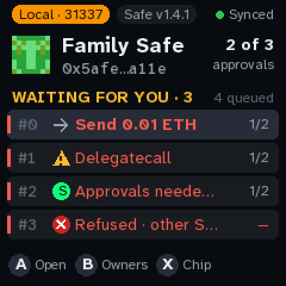 | 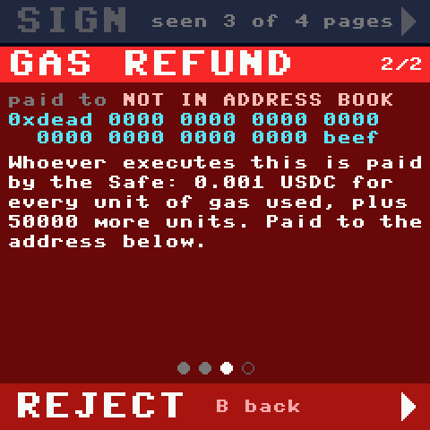 |
| A queue of the other red cases. | **A gas refund:** the Safe would pay whoever executes it, in USDC here, to an unknown address. |
| 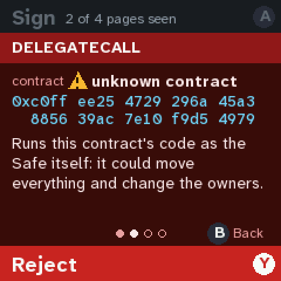 | 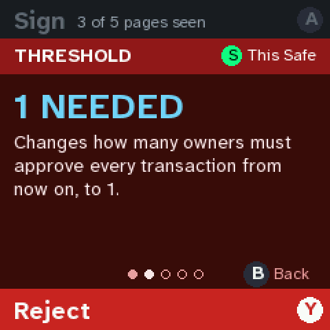 |
| **Delegatecall** to an unknown contract: it would run as the Safe. | **Threshold change** to 1: any one owner could then move everything. |
| 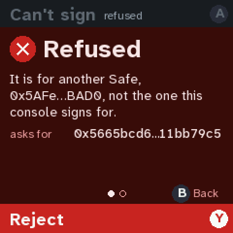 | |
| A transaction for a **different Safe** slipped into this one's queue: refused. | |

## 9. Two proposals for one number

| | |
|---|---|
| 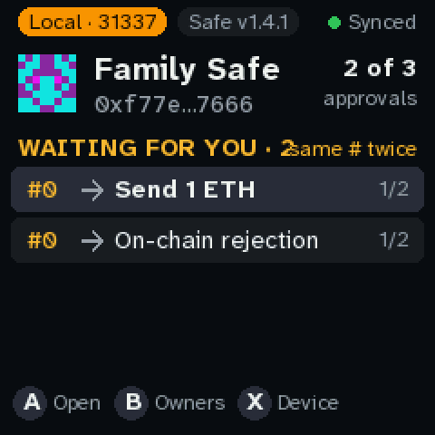 | 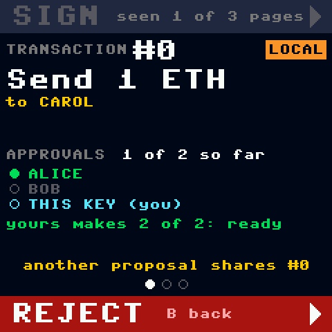 |
| Alice proposes 1 ETH to Carol, and Bob proposes to reject it at the same number. Only one can run. | The summary says so. |
| 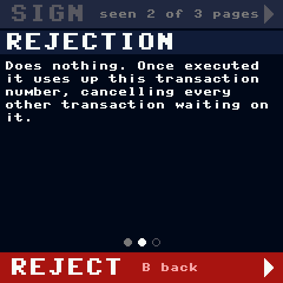 | |
| The Safe's on-chain rejection, explained. | |

## 10. Who's being called

A queue of known contracts: a USDC transfer, a USDC approval for Uniswap, a Uniswap swap, and a
Safe batch.

| | |
|---|---|
| 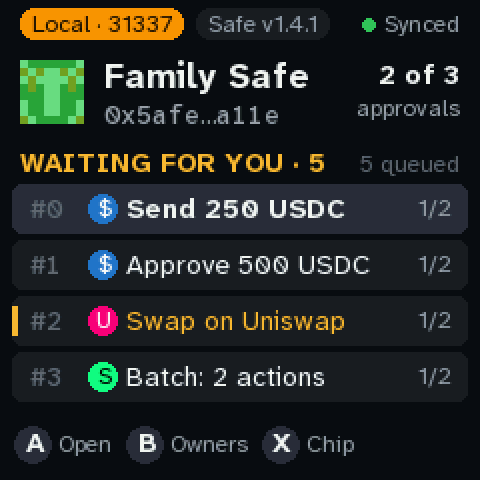 | 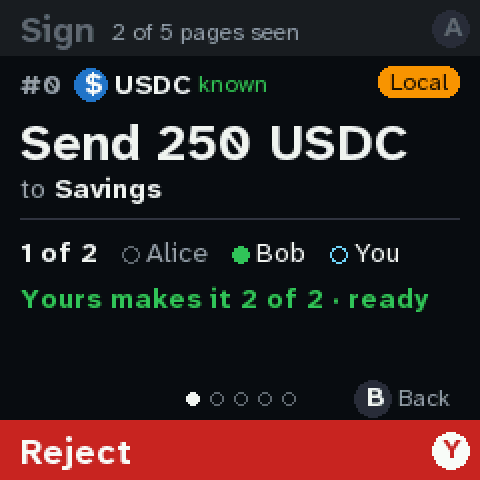 |
| Each row's logo says which contract it calls. | **Header:** $ USDC, known. The recipient comes from the address book. |
| 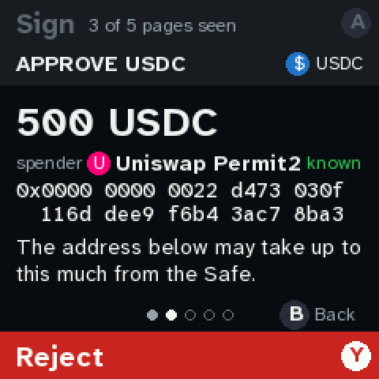 | 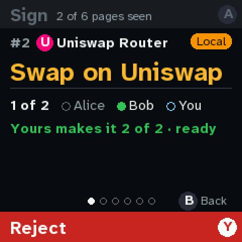 |
| An approval where the **spender** is a known contract (Uniswap Permit2): its logo and "known" next to the full address. | **A known contract, a call not decoded yet:** Uniswap's router. Yellow, not red: the contract is known, but the console can't show the swap's amounts. |
| 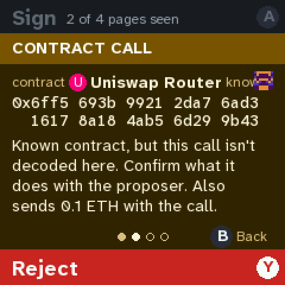 |  |
| It says so, and asks you to confirm with the proposer. It also sends 0.1 ETH. | **Safe's own MultiSend** in the header of a batch. Compare the ⚠ **Unknown contract** in [section 6](#6-a-call-nobody-described). |

## 11. The light theme

The same screens with `QUORUM_THEME = "light"`.

| | |
|---|---|
| 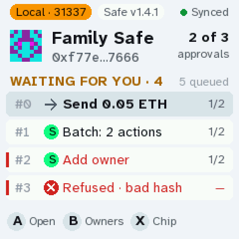 | 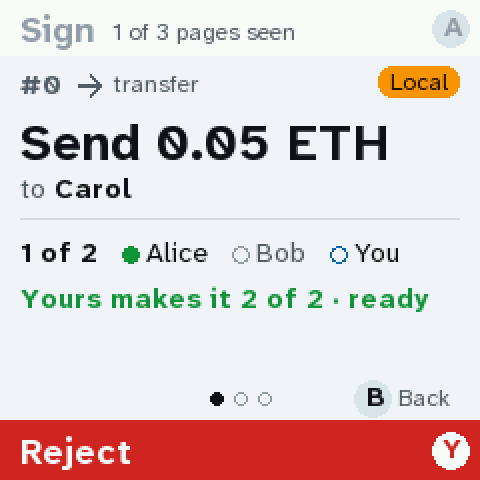 |
| 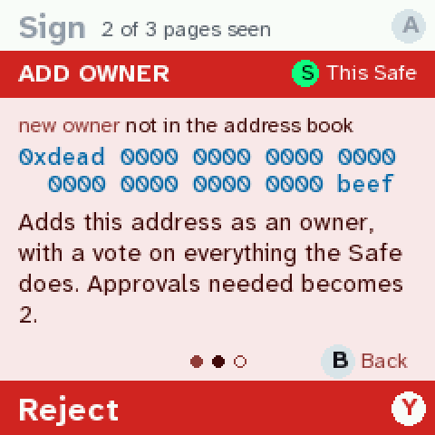 | 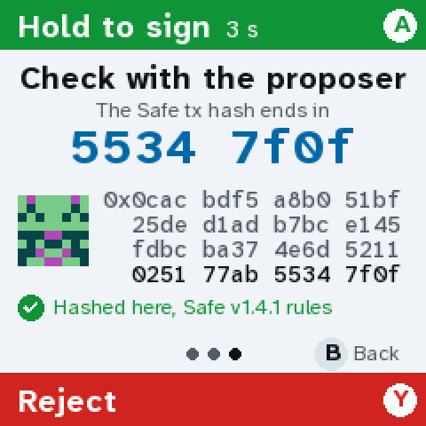 |

## 12. The Safe version

| | |
|---|---|
| 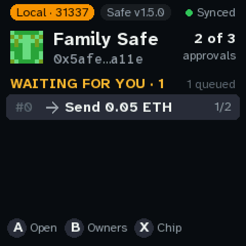 | 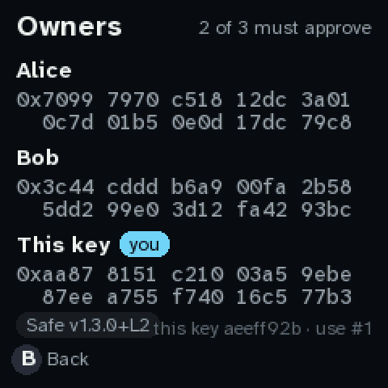 |
| **Safe v1.5.0** on the home screen. | **v1.3.0+L2** (how the service reports an L2 Safe) on the owners page. |
| 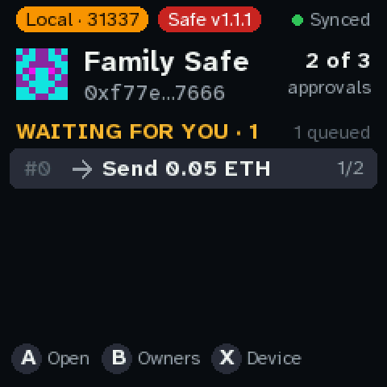 | 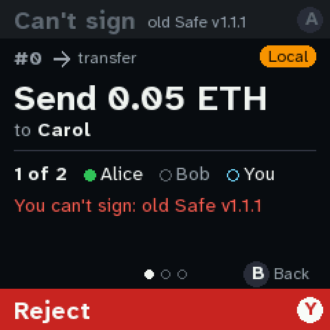 |
| **An old Safe (v1.1.1)** turns the pill red… | …and the console won't sign: before 1.3.0 the hash covered different fields. |

## 13. The rest

| | |
|---|---|
|  |  |
| **B from home:** the owners in full, the Safe's version, and this key. | **X from home:** the chip map, as before, with LAB and snake inside. Y comes back. It keeps its own look for now. |
|  | |
| **No service:** the error and the URL it tried. Everything local still works. | |

## Run it yourself

```sh
tools/quorum serve                 # the simulated Safe + a dashboard at http://localhost:8787
tools/quorum demo                  # the demo queue
tools/quorum reset uniswap-swap batch --version 1.5.0
EMU_APP=http://localhost:8787 tools/emu run quorum    # the console in the emulator, talking to it
tools/quorum confirm 1 --as bob    # a co-signer approves #1
tools/quorum status                # who has signed what
tools/quorum shots                 # regenerate every picture on this page
```

On the Pico, `secrets.py` gets `QUORUM_URL = "http://<this Mac's LAN IP>:8787"` (`tools/quorum ip`
prints the line) and, if you like, `QUORUM_THEME = "light"`.

## Change requests

Edit this list on GitHub: add a line, tick one off, or write under it. Each iteration starts here.

- [x] Is the blocky text necessary? No: real anti-aliased type now (iteration 2)
- [x] A clearer theme that uses the resolution (iteration 2: dark, plus a light option)
- [x] Show Safe or Uniswap icons for known contracts, an alert for unknown ones (iteration 2)
- [x] Show the Safe version (iteration 2)
- [ ] (add yours)
