# The console on console-rp

Written by `node tools/board/shots_rp.mjs`: the real firmware on the emulator, 240 × 135, its three
buttons under the screen (the grey caps below it: D0 ■, D1 ●, D2 ▲, as on the case). The screens
are `quorum_ui_s`'s pages in the CRT look (`firmware/quorum_ui_crt.py`, `firmware/crt.py`). Each shot
is the page once its effect has played. The effects are on the board only:
- **tear** (FX1): something arrives or changes. Opening a transaction, a new one on home, a tab.
  Strong for a red page, short for a page turn.
- **lock** (FX3): worked out here and checked. The verify code, the key's code, Signed.
- None on a redraw, and none while Sign is held. Any press stops an effect and still counts.

The board is [hardware/console-rp](../../../hardware/console-rp/). Its way out is the relay on the
computer ([tools/relay](../../../tools/relay/README.md)).

### home

Home: four tabs, the Queue first. The footer names what each button under the screen does here: D0 ■ the next tab, D1 ● down the list, D2 ▲ what the bar above it says. A tab arrives with a short tear.

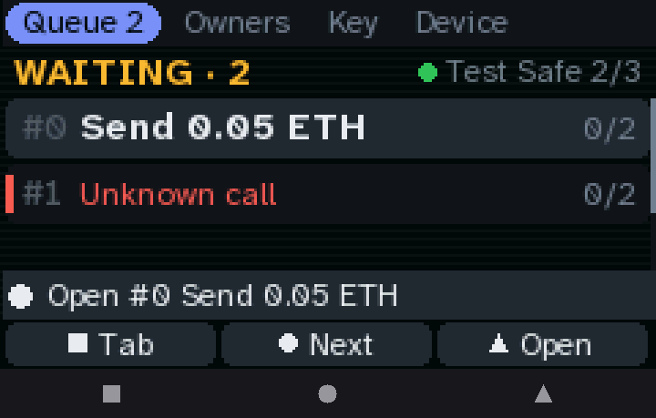

### home owners

The Owners tab.

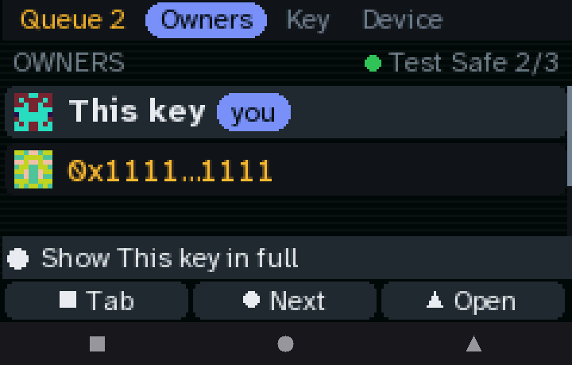

### home key

The Key tab: this key's picture, fingerprint and owner address.

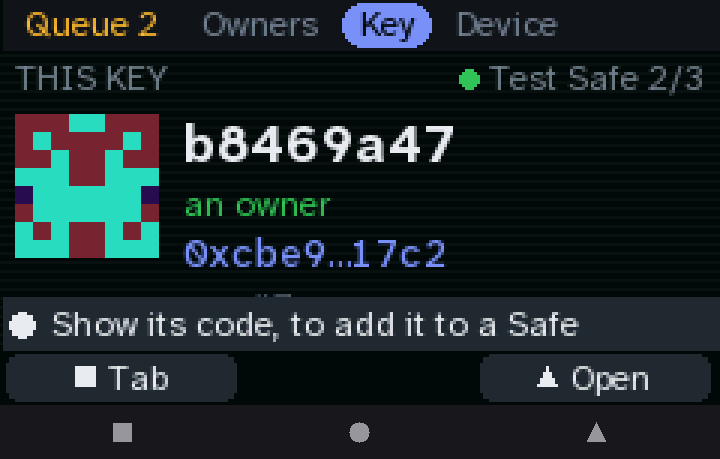

### home device

The Device tab. No Wi-Fi row: console-rp has no radio; the computer on its USB-C relays.

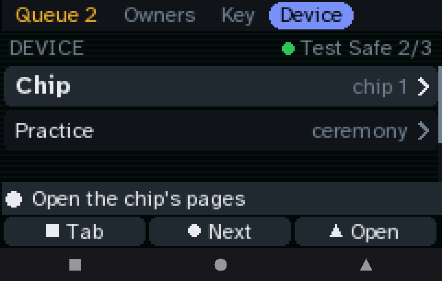

### review head

A transaction opens with a tear. D0 ■ rejects with one press on any page, D1 ● is the next page, D2 ▲ shows the next one not yet seen.

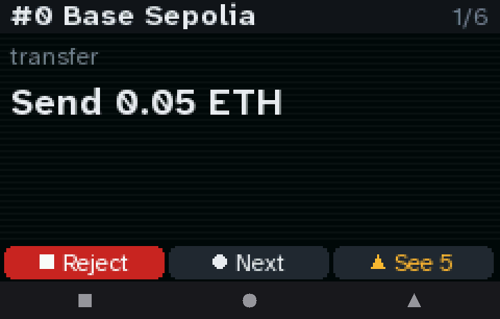

### review item

What it does. A page turn is a short tear.

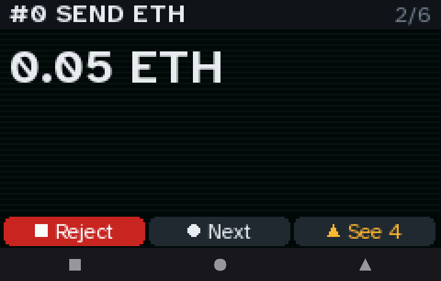

### review to

Who it goes to, in full, and its blockie.

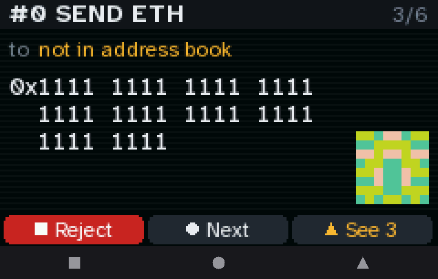

### review approvals

Who has approved.

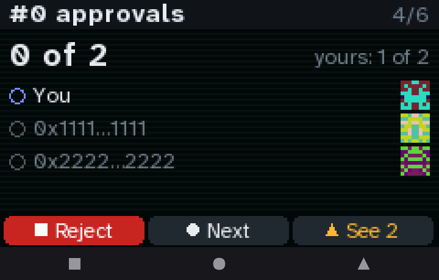

### review verify

The code to compare with the proposer. It was worked out here, so it locks in (FX3).

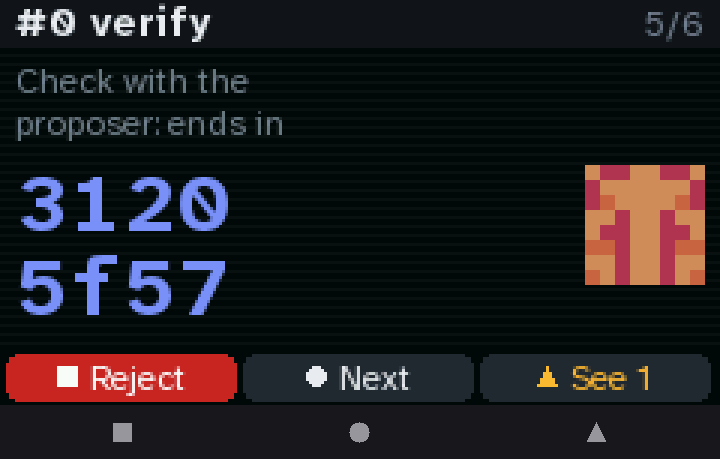

### review hash

The whole Safe transaction hash. Every page seen: D2 ▲ says Sign.

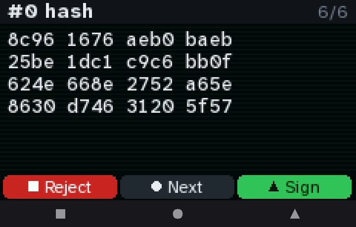

### hold

D2 ▲ held: its slot fills, 2 s. No effect while it fills. D0 ■ still rejects.

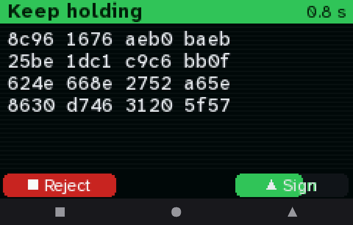

### red head

An unknown call: red. It arrives with a strong tear, then stays red and still. Sign takes 3 s.

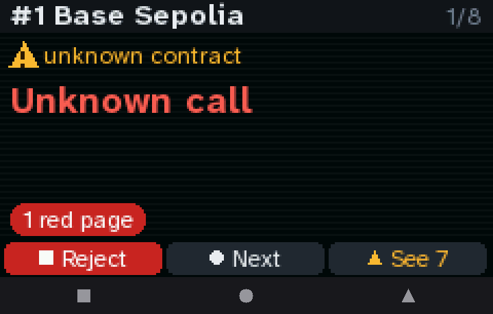

### red calldata

Its function selector and calldata size, on a red page.

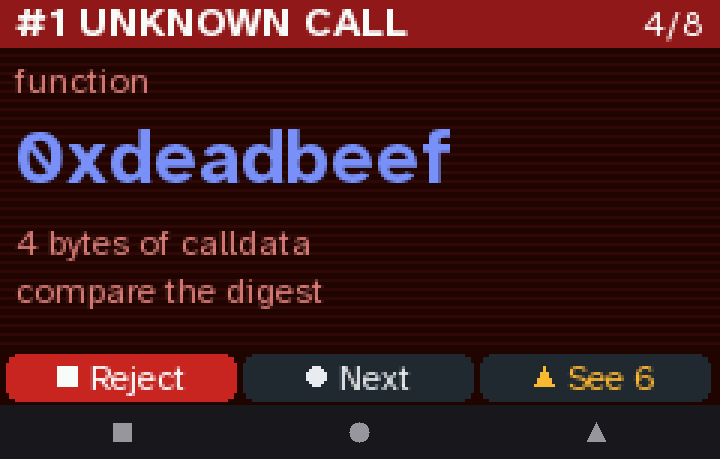

### refused

A hash the fields don't produce: refused, from the relay as from the service.

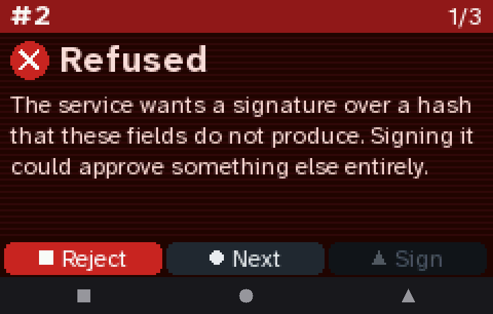

### result signed

Signed and posted: it locks in. D2 ▲ OK.

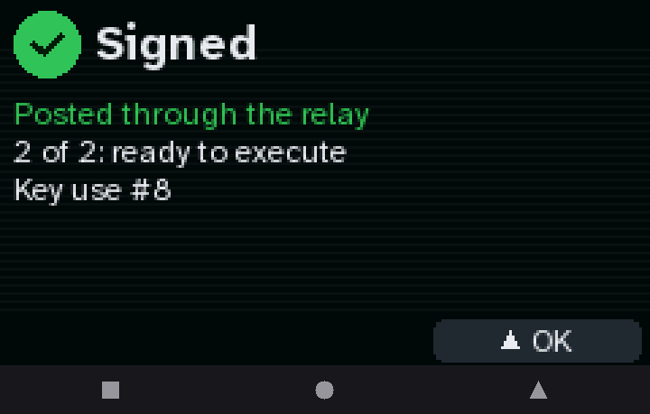

### result unsent

Signed but not sent (the relay stopped): D2 ▲ sends it again, D0 ■ goes back.

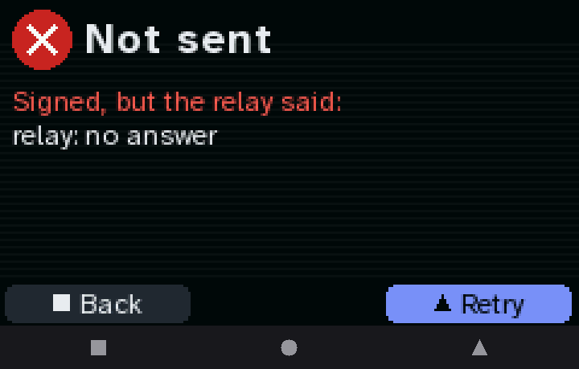

### device

Device: the chip, its slot and key, the pin, uses, memory.

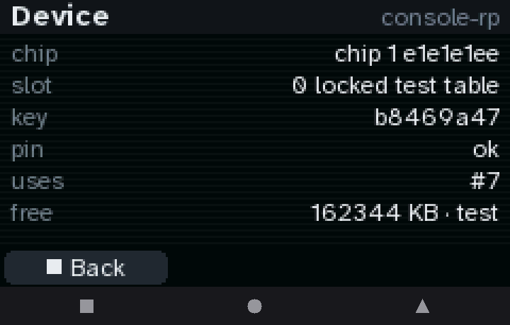

### key code

Key: the app's set-up link as a QR code, over the footer's left. It locks in.

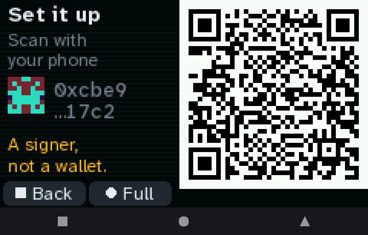

### key full

The owner address in full.

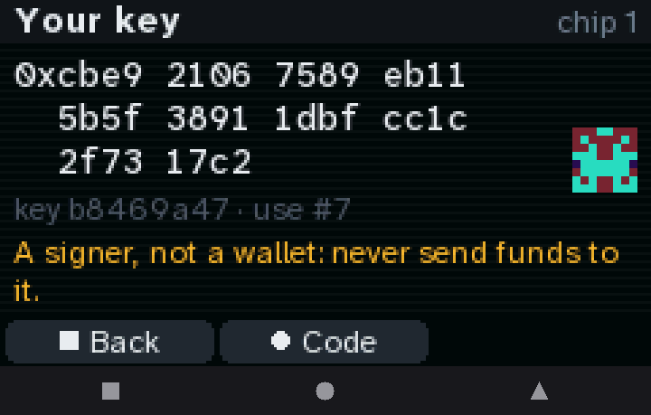
