# The ceremony on the Feather ESP32-S3 Reverse TFT

Written by `node tools/board/shots_feather_setup.mjs`: `setup_s.py` on the emulator, C1-C10 on a
virtual 608C, 240 × 135, three buttons down the left edge (the grey dots: D0, D1, D2).

- **D0**: back; on a result, OK.
- **D0 + D1 held 3 s**: the arm, for 60 s (the Pico's B+Y). D2 is never part of it.
- **D2**: do a step; on a permanent or GenKey step, held 3 s once armed. On a result, OK.

ALLOW_LOCK and ALLOW_GENKEY in the board's `secrets.py` still gate every permanent step.

### banner

The banner: a fresh chip on the dual image. Not a signing console. D2 opens PROVISION.

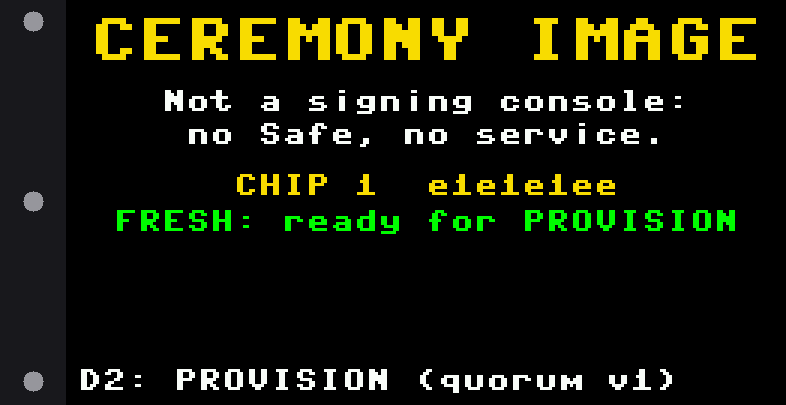

### c1

C1, the pre-flight: reads only. D0 back, D2 does it.

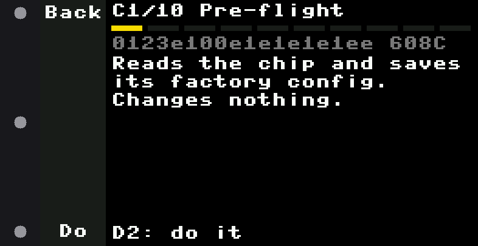

### c1 result

C1's checks: the 608C, both zones open, the factory table, saved as a snapshot. D2: OK.

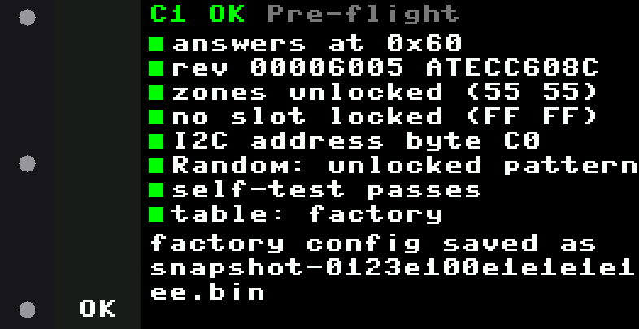

### c2 result

C2 wrote quorum v1 and read it back. Compare the CRC with tools/check_config --summary on the laptop.

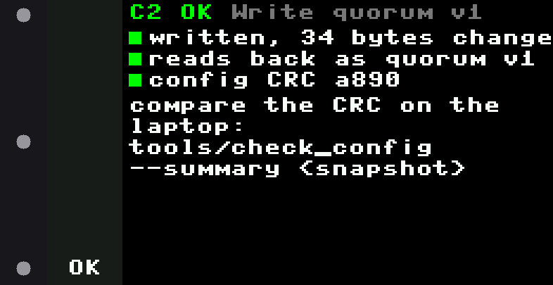

### c3

C3, permanent: red. Not armed: D0+D1 held 3 s arms it (D2 does nothing until then).

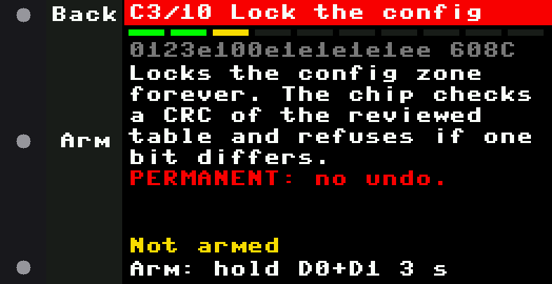

### c3 arming

D0+D1 held: the rail fills; 3 s to arm. Let go early and it isn't armed.

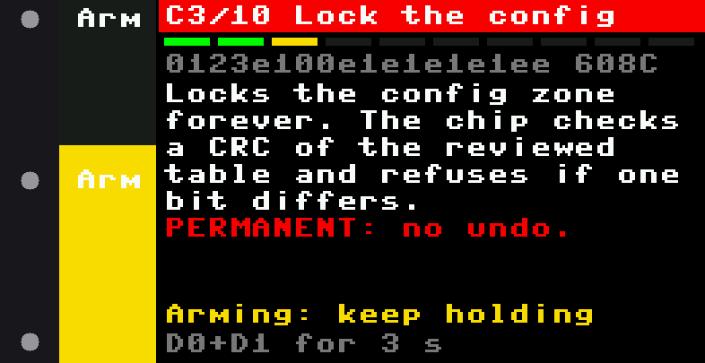

### c3 armed letgo

The arm took: let go of both.

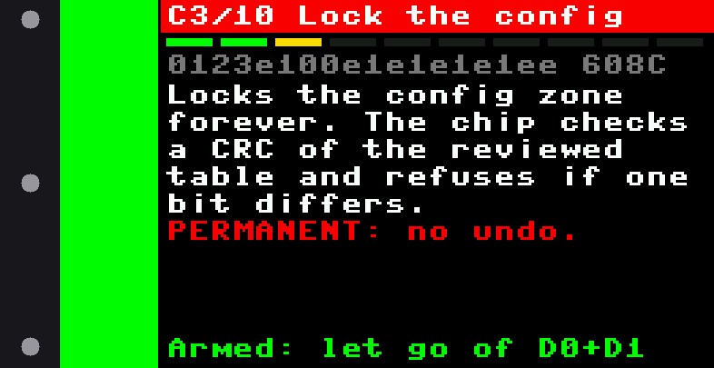

### c3 armed

Armed for 60 s: hold D2 3 s to lock.

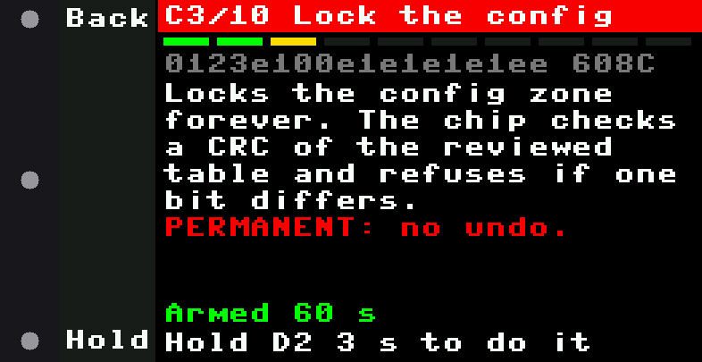

### c3 hold

D2 held: the rail fills red. Let go before 3 s and nothing happens.

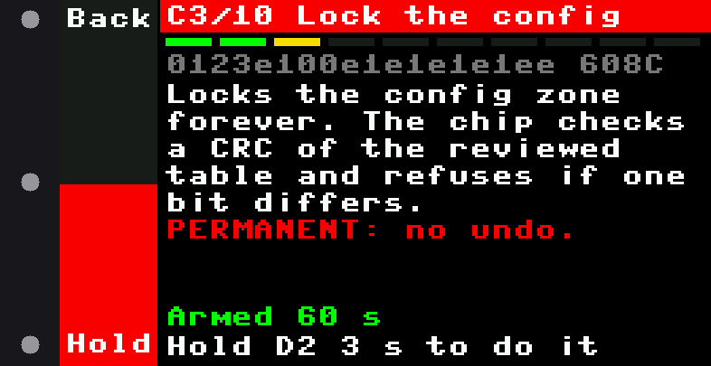

### c3 result

C3 done: the config is locked, still quorum v1.

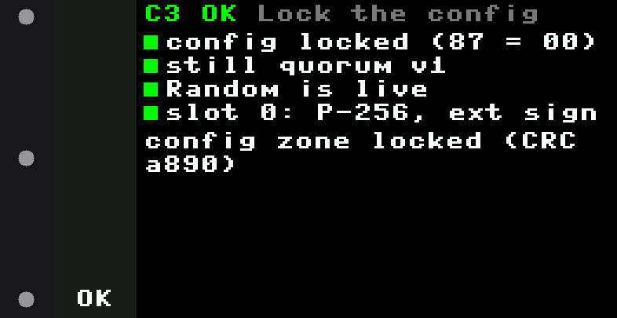

### c4

C4: GenKey, armed and held like a permanent step.

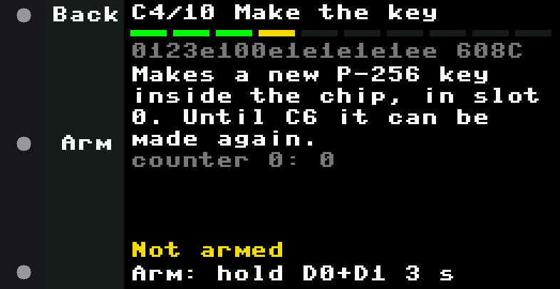

### c4 result

The new key, made inside the chip.

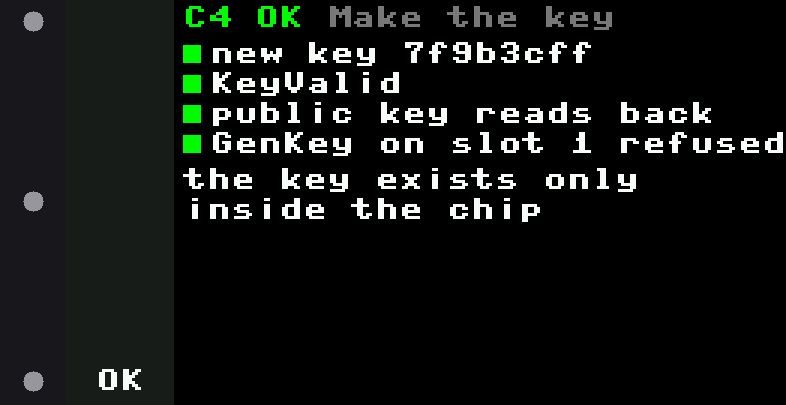

### c5 result

C5: two test signatures checked here; counter 0 up by 2.

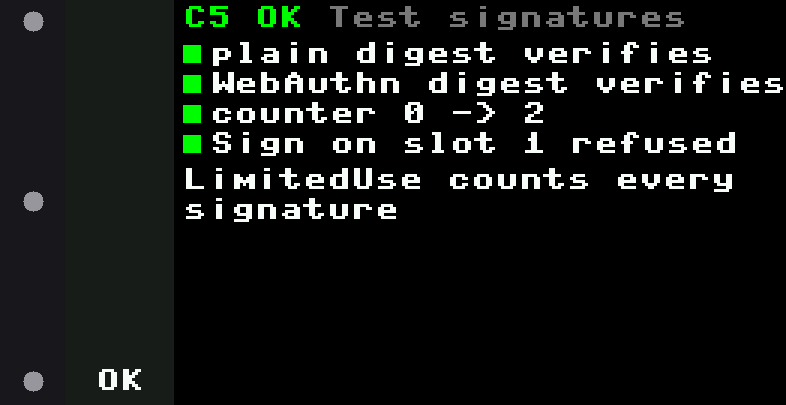

### c6

C6, permanent: seal slot 0 so the key can never be replaced.

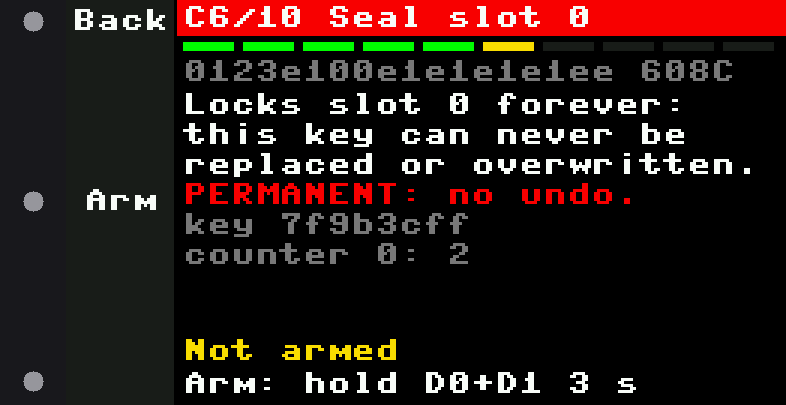

### c6 arm again

Under 10 s of the arm left: no hold starts, arm again. Chip 3's first C6 ran out partway.

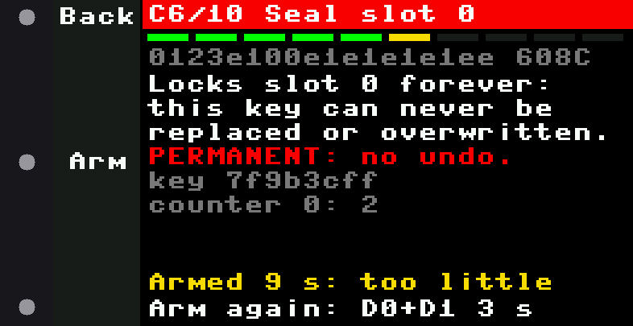

### c6 result

Slot 0 sealed: FE FF, the same key, it signs and verifies.

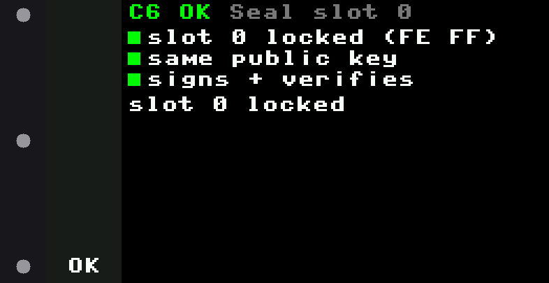

### c7 result

C7: the owner address, to compare on the laptop with tools/fw verify --baseline.

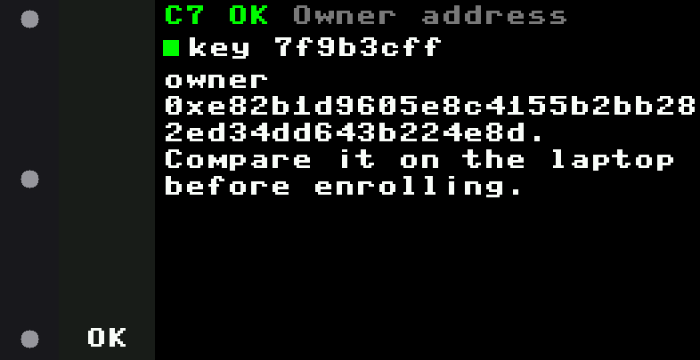

### c8 result

C8: zeros into slots 1-15, the record into OTP; the data CRC.

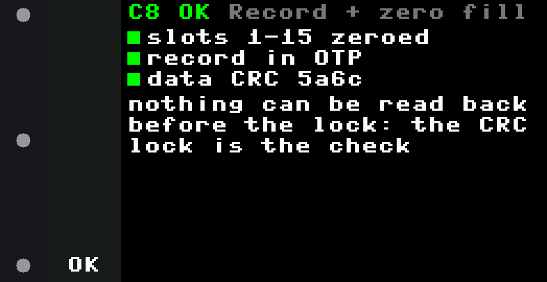

### c9

C9, permanent: lock the data and OTP zones.

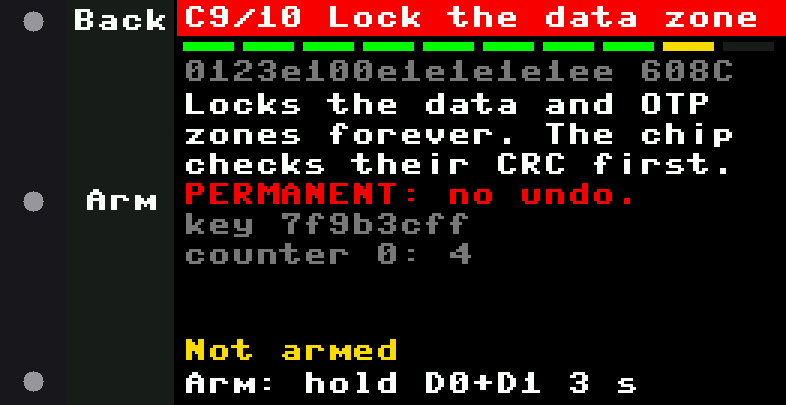

### c9 result

C9 done.

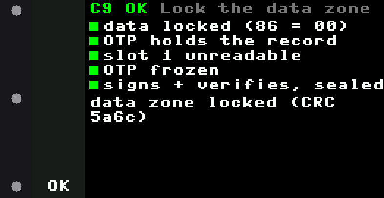

### c10

C10: the summary.

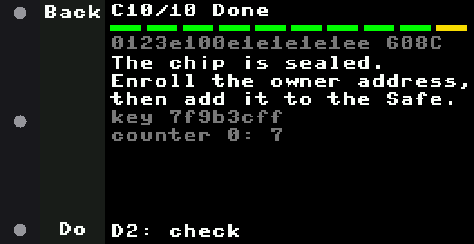

### c10 result

Sealed: quorum v1 locked 00/00, slot 0 sealed, the record matches; set ALLOW_* back to False.

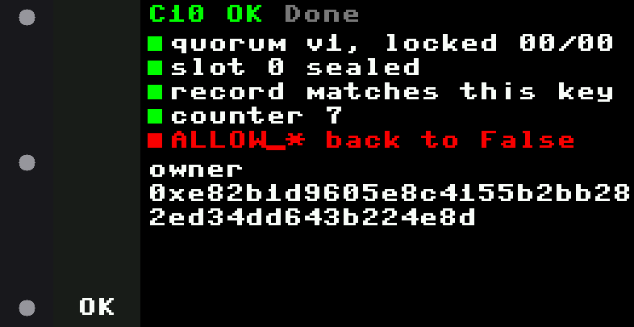

### c3 allow off

With ALLOW_LOCK False on the board, a permanent step says so and nothing arms it.

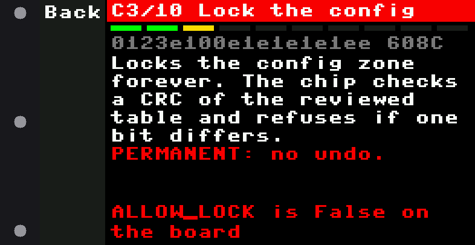
