# The console on the Feather ESP32-S3 Reverse TFT

Written by `node tools/board/shots_feather.mjs`: the real firmware on the emulator, 240 × 135, three
buttons down the left edge (the grey dots: D0, D1, D2). The rail beside them says what each does here.

- **D0**: Reject on a review (one press, any page, even while Sign is held); Back anywhere else.
- **D1**: next page or row; held 1 s, the one before. On a review's first page, held: out without rejecting.
- **D2**: open; on a review, the next page not yet seen, then Sign: held 2 s, 3 s when a page is red.

Key shows the key's owner address as a QR code (docs/ONBOARDING.md). The status home and the claim on three buttons come next.

### home

Home: the queue. D1 moves down it, D2 opens the one in focus. Past the list, D1 reaches Owners and Device.

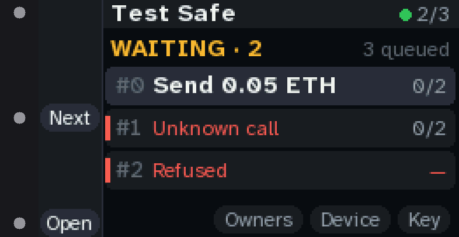

### home device

D1 past the last row: the Owners and Device choices. D0 goes back onto the list.

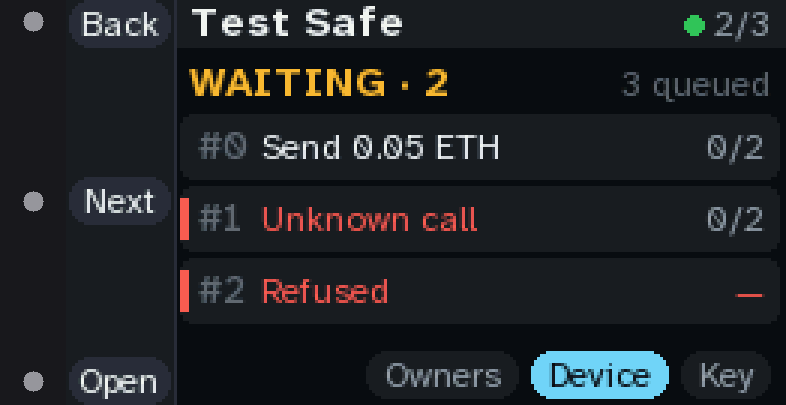

### review head

A review opens on what it does. Rail: Reject (one press, any page), Next, and "See 5": D2 shows the next page not yet seen.

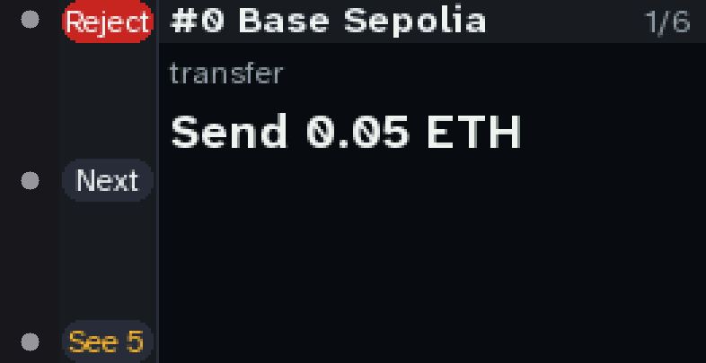

### review item

The send: the amount, big.

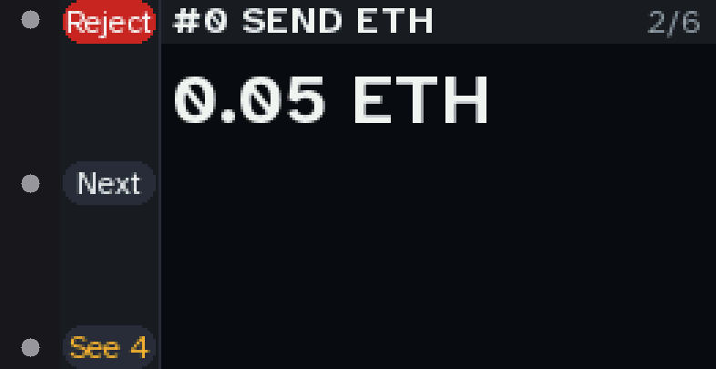

### review to

Who it goes to, and the whole address in four-character chunks.

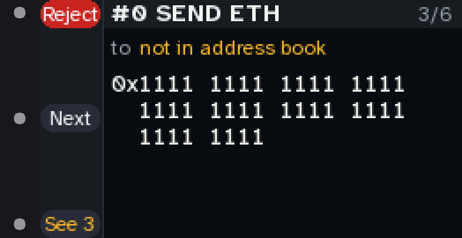

### review approvals

Who has approved, and what this key's signature would make it.

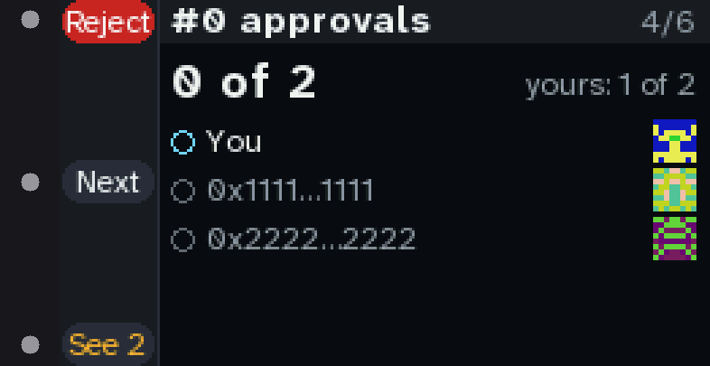

### review verify

The code to compare with the proposer: the hash's last 8, and its blockie.

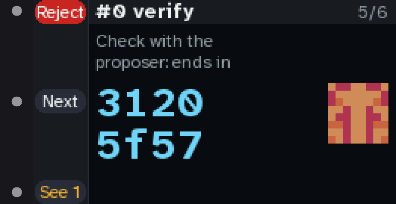

### review hash

The whole Safe transaction hash, worked out here. Every page seen: D2 says Sign.

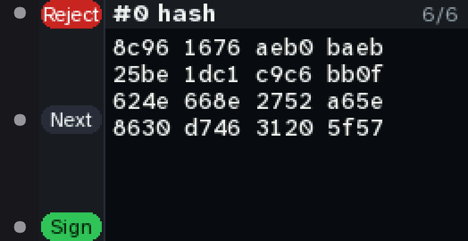

### hold

D2 held: the rail fills from the bottom. 2 s to sign; let go early and nothing is signed.

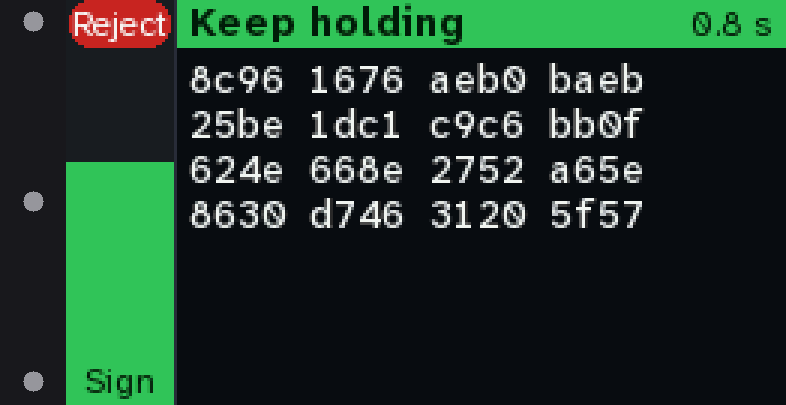

### red head

An unknown call: red. Sign takes a 3 s hold.

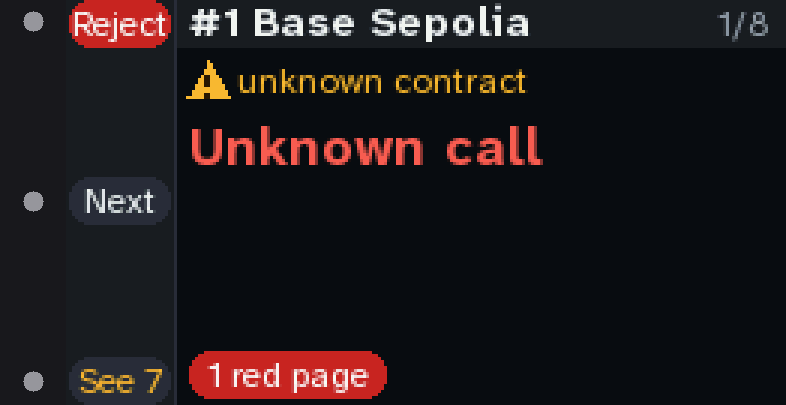

### red calldata

Its function selector and calldata size, on a red page.

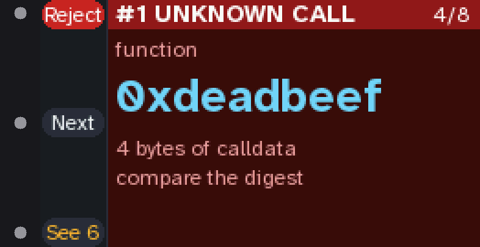

### red digest

The calldata's digest to compare.

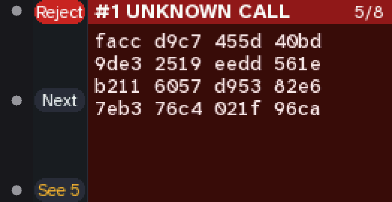

### red hold

Holding Sign on a red transaction: the rail fills in red, 3 s.

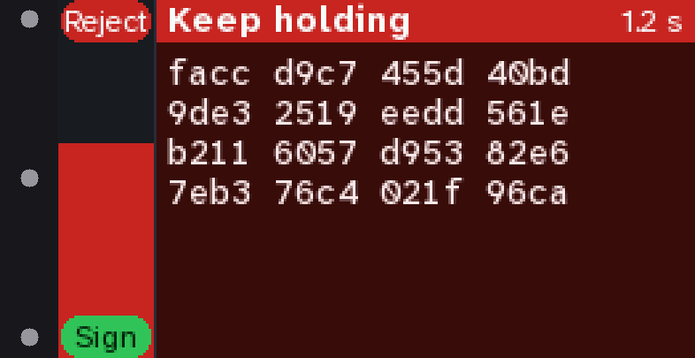

### refused

A hash the fields don't produce: refused. Sign stays grey; D0 rejects.

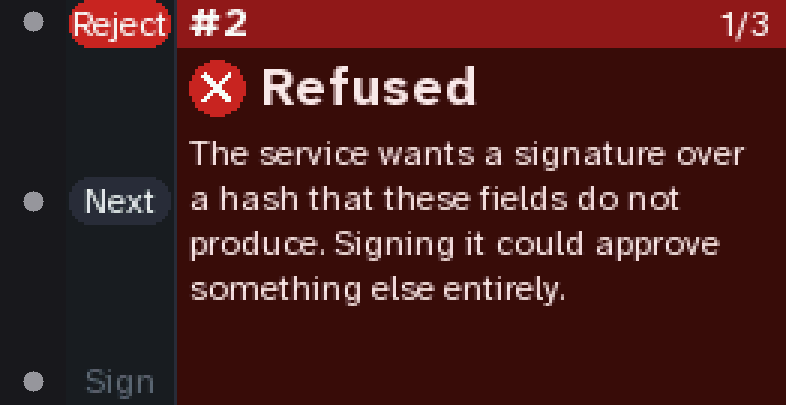

### see every page

D2 before every page is seen: it shows the next one and says how many are left.

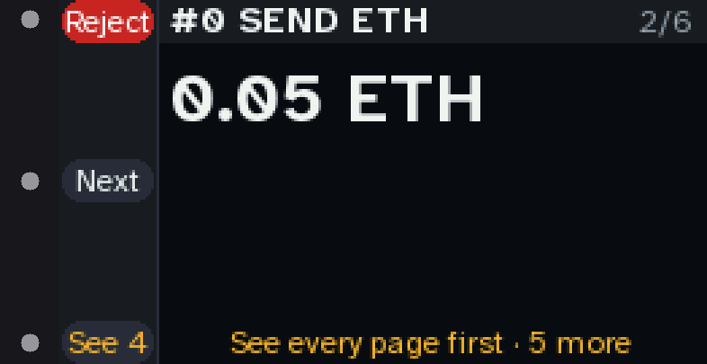

### result signed

Signed and posted. D2: OK.

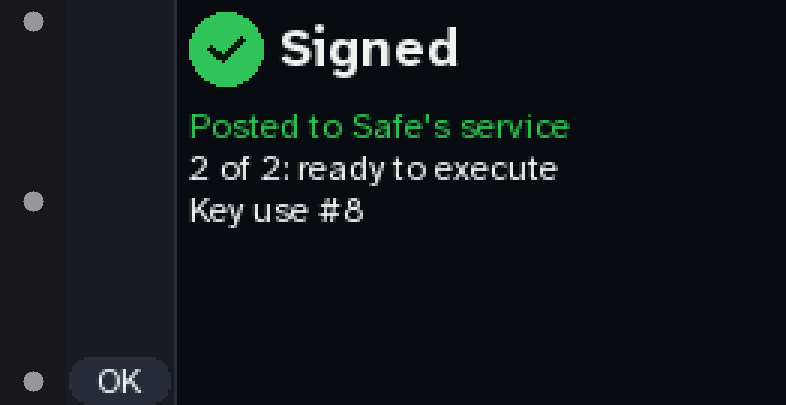

### result unsent

Signed but not sent: D2 sends it again, D0 goes back.

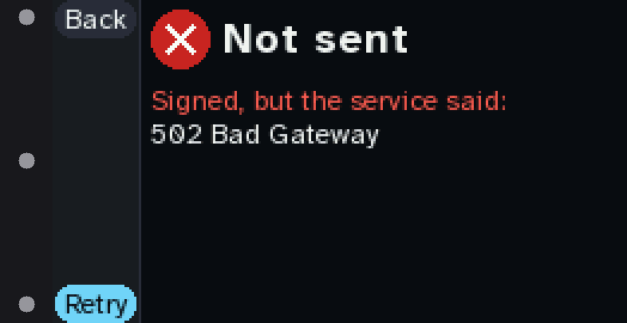

### owners

Owners: who can approve. D0 back.

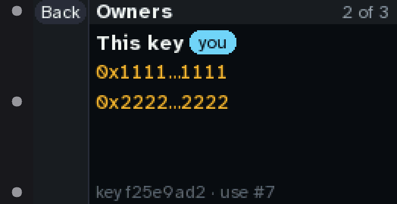

### device

Device: the chip, its slot and key, the pin, uses, memory. D1 moves along Chip, Wi-Fi, Back; D2 opens.

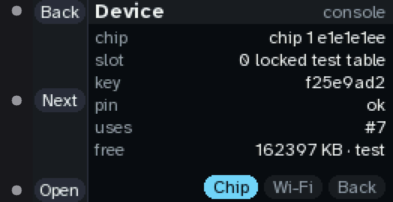

### chip

The chip's own pages. D1 pages, D0 back.

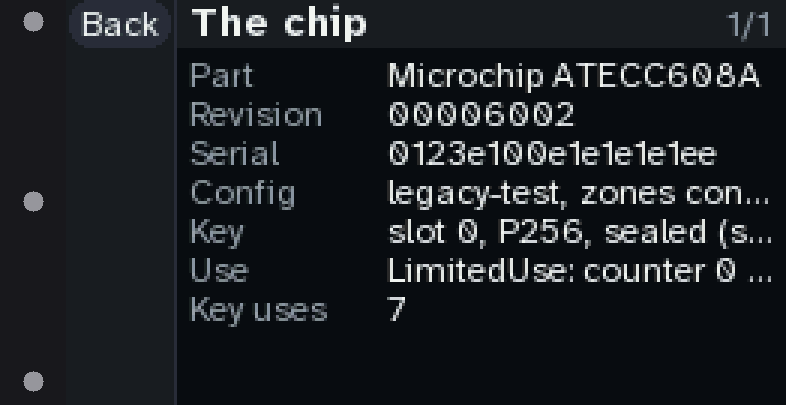

### nochip

No chip on the bus: D2 checks again.

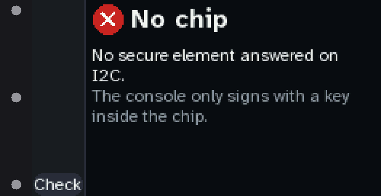

### pinfail

A chip that isn't pinned: nothing will be signed until tools/fw pin adds it. D2 checks again.

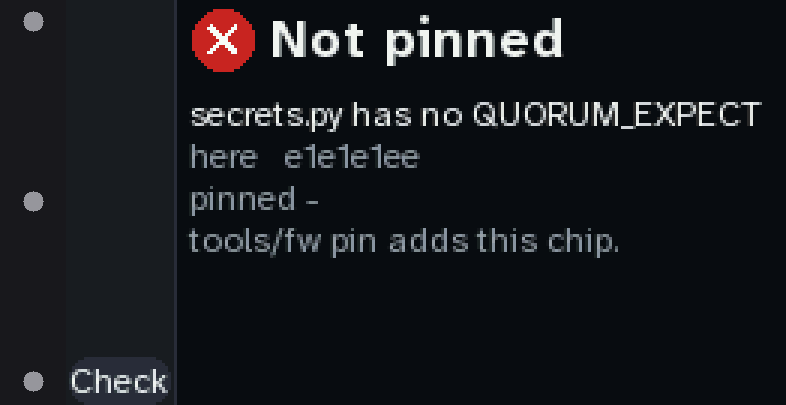

### home key

Past Owners and Device, D1 reaches Key: this key's QR code.

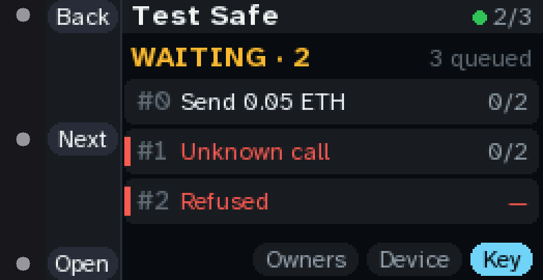

### key code

Key: the owner address as a QR code, beside its start, end and picture. A signer, not a wallet. D1 shows it in full, D0 goes back.

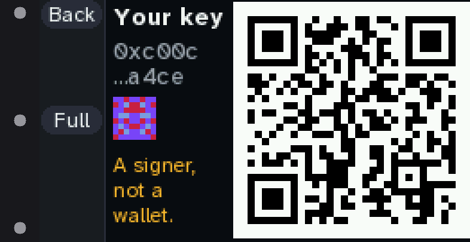

### key full

The owner address in full, the key's fingerprint and use count.

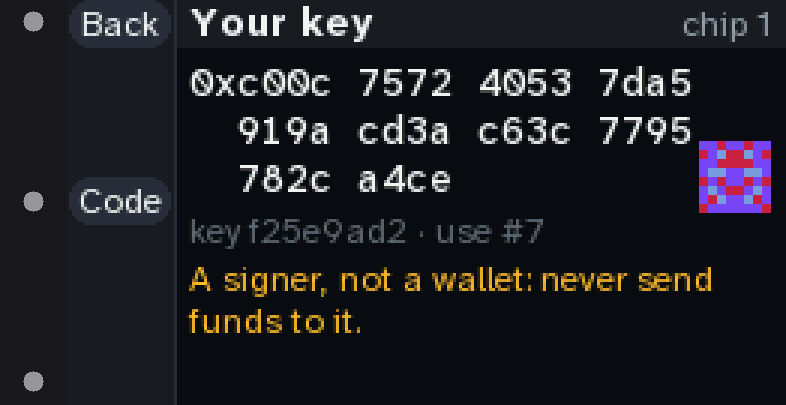

### home not owner

A Safe that doesn't list this key yet: Not an owner yet, and where its code is.

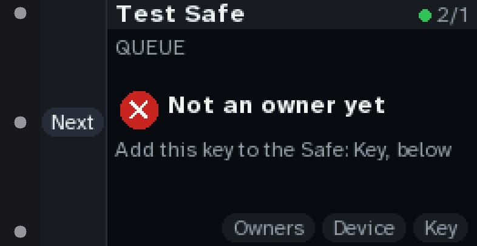

### ready

No Safe set yet, on a console being set up: the key is ready, D2 shows its code.

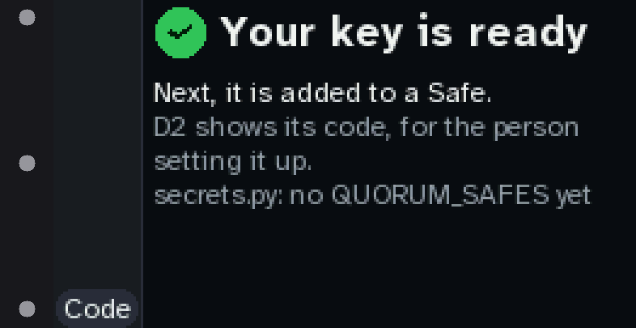
