# The three-button console: every screen, and every way between them

Written by `node tools/uilab/build.mjs`; don't edit it by hand. It pressed each flow in
[`tools/uilab/flows.mjs`](../../../tools/uilab/flows.mjs) on the real firmware in the emulator and wrote down what the
screen showed. Walk the same flows yourself in [the explorer](https://picoquorum.app/quorum-ui/lab/explore/).

A screen is named by its state in `firmware/quorum.py` and, where a state has several, its tab or kind
of page: `home/queue`, `review/verify`. The inputs are the ones `quorum.three` takes: D0, D1, D1 held
1 s, D2, and D2 held.

## Feather ESP32-S3 Reverse TFT (`feather-s3`)

240 × 135, three buttons down the left edge, a rail naming each. Its screens are drawn by `firmware/quorum_ui_s.py`.
Its look has no effects: every screen arrives whole.

### Screens

| screen | as first reached | flows |
|---|---|---|
| `home/queue` | 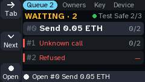 | tabs, queue, approve, read, reject, let-go, reject-held, red, refused, owners, key, device, not-sent, ask, no-chip, pin |
| `home/owners` | 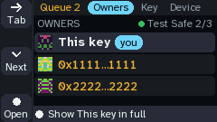 | tabs, owners, key, device |
| `home/key` | 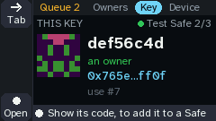 | tabs, key, device |
| `home/device` | 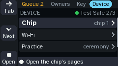 | tabs, device |
| `review/head` | 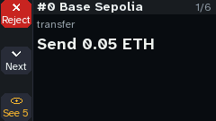 | approve, read, reject, let-go, reject-held, red, not-sent |
| `review/item` | 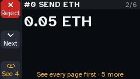 | approve, read, reject, let-go, reject-held, red, refused, not-sent |
| `review/to` | 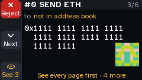 | approve, read, let-go, reject-held, red, not-sent |
| `review/approvals` | 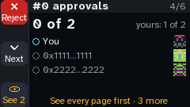 | approve, let-go, reject-held, red, not-sent |
| `review/verify` | 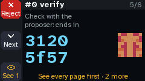 | approve, let-go, reject-held, red, not-sent |
| `review/hash` | 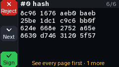 | approve, let-go, reject-held, red, not-sent |
| `hold/hash` | 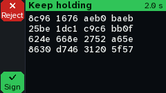 | approve, let-go, reject-held, red, not-sent |
| `result/signed` | 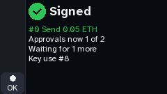 | approve, red |
| `review/frm` (red) | 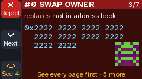 | red |
| `review/refused` (red) | 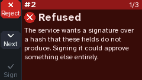 | refused |
| `who` | 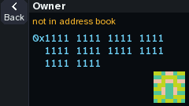 | owners |
| `key/code` | 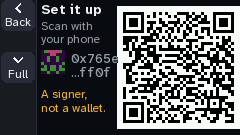 | key, set-up |
| `key/full` | 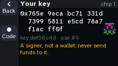 | key |
| `chip` | 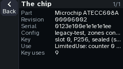 | device |
| `device` | 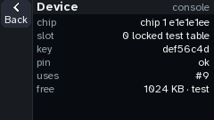 | device |
| `result/not-sent` | 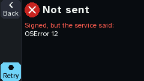 | not-sent |
| `ask/safes` | 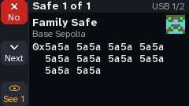 | ask |
| `nochip` | 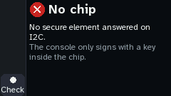 | no-chip |
| `pinfail` | 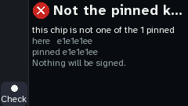 | pin |
| `unconfigured` | 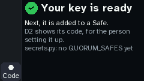 | set-up |
| `crashed` | 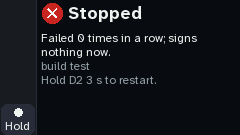 | crashed |

### What each button does

From the flows. *stays* means the same screen, drawn again (a row moved, a message); *nothing* means no new frame.

| on | D0 | D1 | D1 held | D2 | D2 held |
|---|---|---|---|---|---|
| `home/queue` | `home/owners` | stays | stays | `review/head`, `review/refused` |  |
| `home/owners` | `home/key` | stays |  | `who` |  |
| `home/key` | `home/device` |  |  | `key/code` |  |
| `home/device` | `home/queue` | stays |  | `chip`, `device` |  |
| `review/head` |  | `review/item` | `home/queue` | `review/item` |  |
| `review/item` | `home/queue` | `review/to` | `review/head` | `review/to`, `review/frm` |  |
| `review/to` |  |  | `review/item` | `review/approvals` |  |
| `review/approvals` |  |  |  | `review/verify` |  |
| `review/verify` |  |  |  | `review/hash` |  |
| `review/hash` |  |  |  |  | `hold/hash` |
| `hold/hash` | `home/queue` |  |  |  |  |
| `result/signed` |  |  |  | `home/queue` |  |
| `review/frm` |  |  |  | `review/to` |  |
| `review/refused` |  | `review/item` |  | stays |  |
| `who` | `home/owners` | nothing |  |  |  |
| `key/code` | `home/key`, `unconfigured` | `key/full` |  |  |  |
| `key/full` |  | `key/code` |  |  |  |
| `chip` | `home/device` | stays | stays |  |  |
| `device` | `home/device` |  |  |  |  |
| `result/not-sent` | `home/queue` |  |  | stays |  |
| `ask/safes` | `home/queue` | stays |  | stays |  |
| `nochip` |  |  |  | `home/queue` |  |
| `pinfail` |  |  |  | `home/queue` |  |
| `unconfigured` |  |  |  | `key/code` |  |
| `crashed` | nothing |  |  |  |  |

### Every transition walked

| from | input | to | flows |
|---|---|---|---|
| `home/queue` | D0 | `home/owners` | tabs, owners, key, device |
| `home/owners` | D0 | `home/key` | tabs, key, device |
| `home/key` | D0 | `home/device` | tabs, device |
| `home/device` | D0 | `home/queue` | tabs |
| `home/queue` | D1 | `home/queue` | queue, refused |
| `home/queue` | D1 held | `home/queue` | queue |
| `home/queue` | D2 | `review/head` | approve, read, reject, let-go, reject-held, red, not-sent |
| `review/head` | D2 | `review/item` | approve, let-go, reject-held, red, not-sent |
| `review/item` | D2 | `review/to` | approve, let-go, reject-held, not-sent |
| `review/to` | D2 | `review/approvals` | approve, let-go, reject-held, red, not-sent |
| `review/approvals` | D2 | `review/verify` | approve, let-go, reject-held, red, not-sent |
| `review/verify` | D2 | `review/hash` | approve, let-go, reject-held, red, not-sent |
| `review/hash` | D2 held | `hold/hash` | approve, let-go, reject-held, red, not-sent |
| `hold/hash` | held on | `hold/hash` | approve, let-go, reject-held, red |
| `hold/hash` | held on | `result/signed` | approve, red |
| `result/signed` | D2 | `home/queue` | approve, red |
| `review/head` | D1 | `review/item` | read, reject |
| `review/item` | D1 | `review/to` | read |
| `review/to` | D1 held | `review/item` | read |
| `review/item` | D1 held | `review/head` | read |
| `review/head` | D1 held | `home/queue` | read |
| `review/item` | D0 | `home/queue` | reject, refused |
| `hold/hash` | let go | `review/hash` | let-go |
| `hold/hash` | D0 | `home/queue` | reject-held |
| `home/queue` | let go | `home/queue` | reject-held |
| `review/item` | D2 | `review/frm` | red |
| `review/frm` | D2 | `review/to` | red |
| `home/queue` | D2 | `review/refused` | refused |
| `review/refused` | D2 | `review/refused` | refused |
| `review/refused` | D1 | `review/item` | refused |
| `home/owners` | D1 | `home/owners` | owners |
| `home/owners` | D2 | `who` | owners |
| `who` | D0 | `home/owners` | owners |
| `home/key` | D2 | `key/code` | key |
| `key/code` | D1 | `key/full` | key |
| `key/full` | D1 | `key/code` | key |
| `key/code` | D0 | `home/key` | key |
| `home/device` | D2 | `chip` | device |
| `chip` | D1 | `chip` | device |
| `chip` | D1 held | `chip` | device |
| `chip` | D0 | `home/device` | device |
| `home/device` | D1 | `home/device` | device |
| `home/device` | D2 | `device` | device |
| `device` | D0 | `home/device` | device |
| `hold/hash` | held on | `result/not-sent` | not-sent |
| `result/not-sent` | D2 | `result/not-sent` | not-sent |
| `result/not-sent` | D0 | `home/queue` | not-sent |
| `ask/safes` | D1 | `ask/safes` | ask |
| `ask/safes` | D2 | `ask/safes` | ask |
| `ask/safes` | D0 | `home/queue` | ask |
| `nochip` | D2 | `home/queue` | no-chip |
| `pinfail` | D2 | `home/queue` | pin |
| `unconfigured` | D2 | `key/code` | set-up |
| `key/code` | D0 | `unconfigured` | set-up |

### Not walked yet

A button no flow presses on a state. Most do nothing there; a flow that presses one puts that in the table above.

| state | never pressed |
|---|---|
| `home` | D2 held |
| `hold` | D1, D1 held, D2, D2 held |
| `result` | D1, D1 held, D2 held |
| `who` | D1 held, D2, D2 held |
| `key` | D1 held, D2, D2 held |
| `chip` | D2, D2 held |
| `device` | D1, D1 held, D2, D2 held |
| `ask` | D1 held, D2 held |
| `nochip` | D0, D1, D1 held, D2 held |
| `pinfail` | D0, D1, D1 held, D2 held |
| `unconfigured` | D0, D1, D1 held, D2 held |
| `crashed` | D1, D1 held, D2, D2 held |

Left out on purpose:

- `owners`: the knob boards' Owners screen: on three buttons Owners is a tab on home.
- `recent`: what this key signed lately, opened from the big screens' status home: three buttons have no way to it.
- `working`: Signing and Sending: drawn inside a signature, between two ticks. They are the frames on the way to result/signed.
- Device tab, Wi-Fi: restarts into Wi-Fi setup (wifisetup.py), another program with screens of its own.
- Device tab, Practice: opens the practice ceremony (practice.py), which reads the buttons itself.
- an ask, accepted: D2 held on an ask writes what was asked and restarts the console.
- crashed, D2 held 3 s: restarts the console.
