# The console on the QT Py cosigner

Written by `node tools/board/shots_qtpy.mjs`: the real firmware on the emulator, the 1.8" as 160 × 128,
three buttons named in the footer (the grey dots: D0, D1, D2, left to right). The build is
[hardware/builds/qtpy-cosigner](../../../hardware/builds/qtpy-cosigner/README.md).

- **D0** (Boot): Reject on a review (one press, any page, even while Sign is held); Back anywhere else.
- **D1**: next page or row; held 1 s, the one before.
- **D2**: open; on a review, the next page not yet seen, then Sign: held 2 s, 3 s when a page is red.

### home

Home: the queue, two rows at a time. D1 moves down it, D2 opens the one in focus.

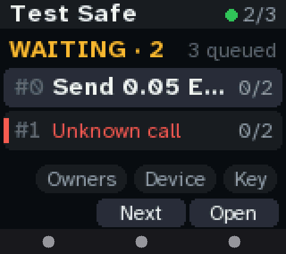

### home device

D1 past the last row: Owners, Device and Key. D0 goes back onto the list.

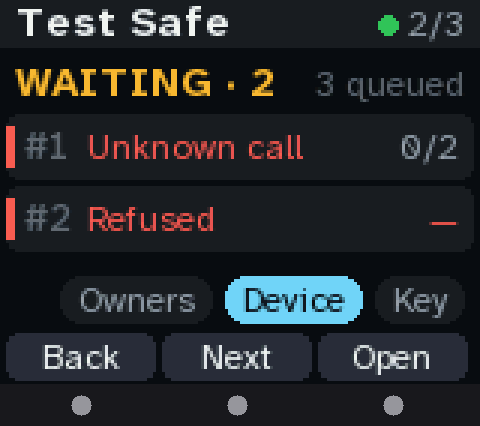

### review head

A review opens on what it does. Footer: Reject (one press, any page), Next, and "See n": D2 shows the next page not yet seen.

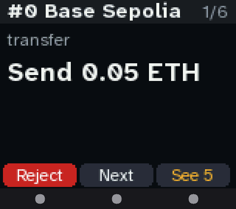

### review item

The send: the amount, big.

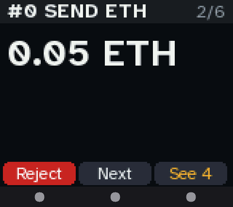

### review to

Who it goes to, the whole address in four-character chunks, and its blockie.

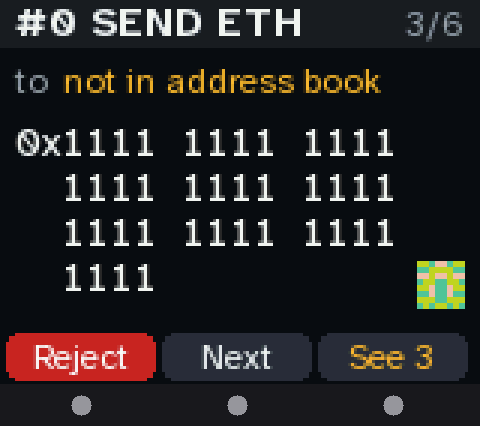

### review approvals

Who has approved, and what this key's signature would make it.

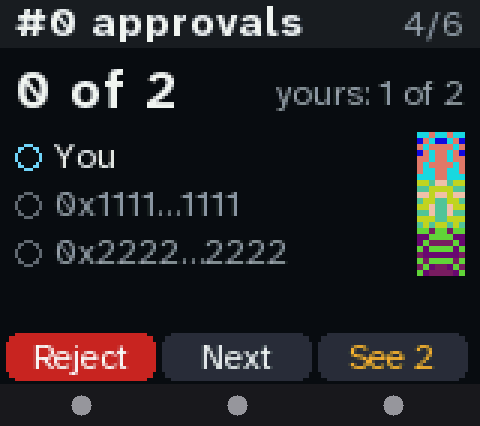

### review verify

The code to compare with the proposer: the hash's last 8, and its blockie.

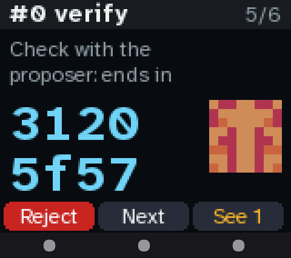

### review hash

The whole Safe transaction hash, worked out here. Every page seen: D2 says Sign.

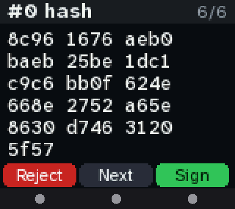

### hold

D2 held: its slot fills. 2 s to sign; let go early and nothing is signed. D0 still rejects.

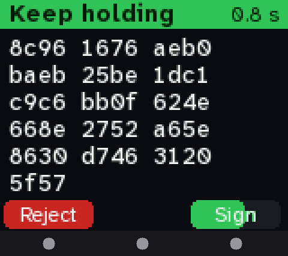

### red head

An unknown call: red. Sign takes a 3 s hold.

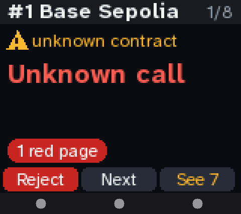

### red calldata

Its function selector and calldata size, on a red page.

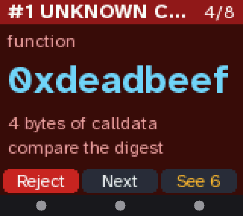

### red hold

Holding Sign on a red transaction: the slot fills in red, 3 s.

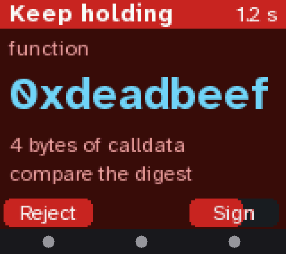

### refused

A hash the fields don't produce: refused. Sign stays grey; D0 rejects.

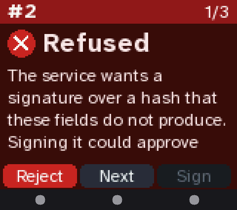

### see every page

D2 before every page is seen: it shows the next one and says how many are left.

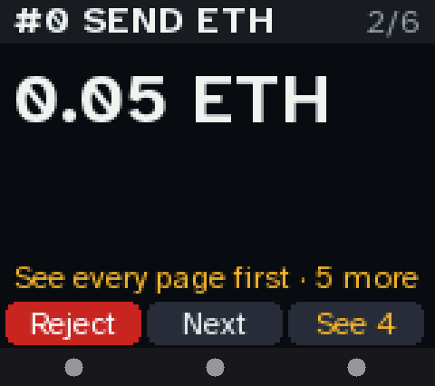

### result signed

Signed and posted. D2: OK.

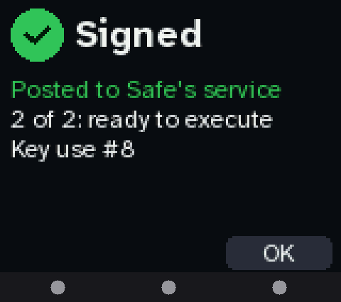

### result unsent

Signed but not sent: D2 sends it again, D0 goes back.

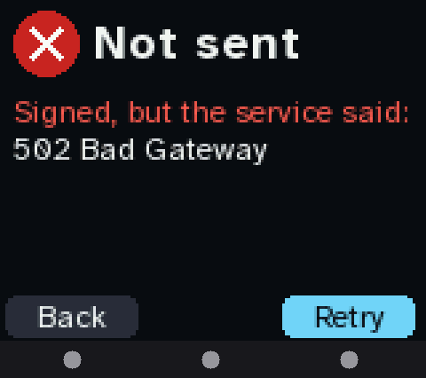

### owners

Owners: who can approve. D0 back.

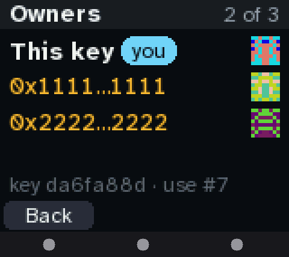

### device

Device: the chip, its slot and key, the pin, uses, memory.

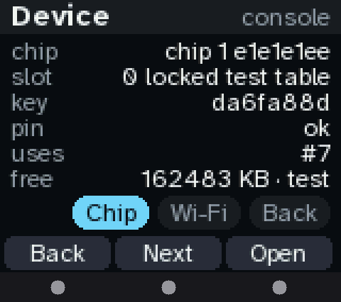

### key code

Key: the owner address as a QR code. A signer, not a wallet. D1 shows it in full.

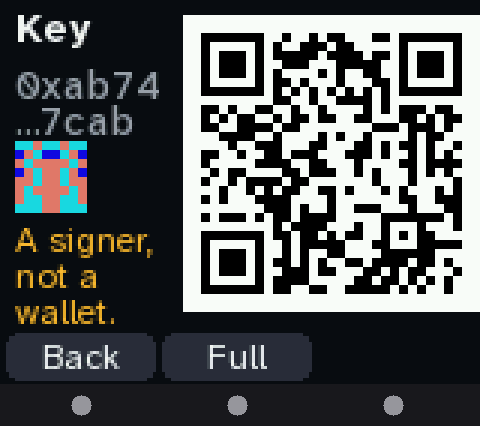

### key full

The owner address in full, the key's fingerprint and use count.

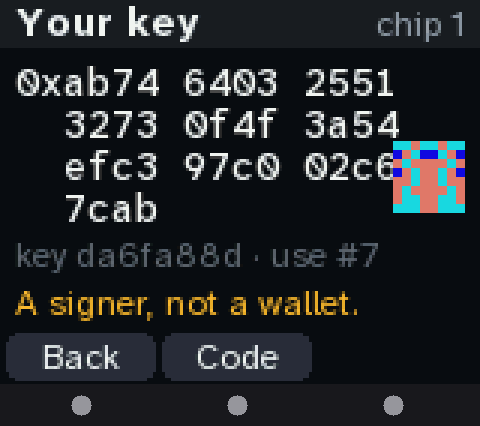

### nochip

No chip on the bus: D2 checks again.

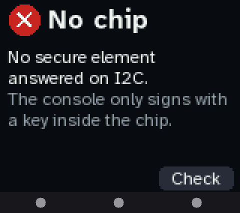
