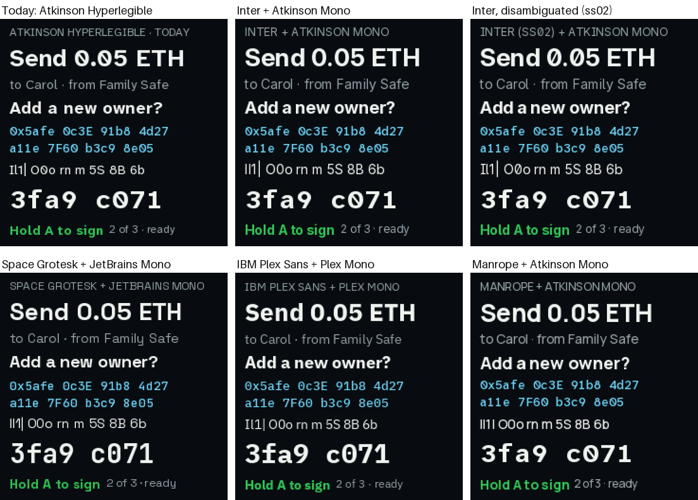
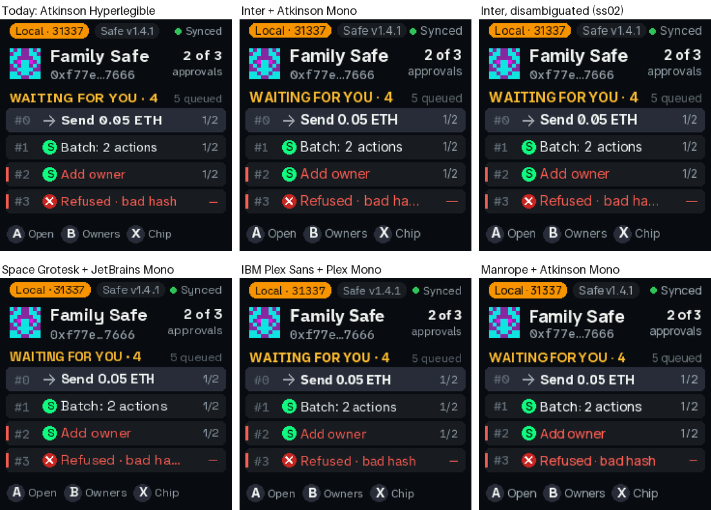
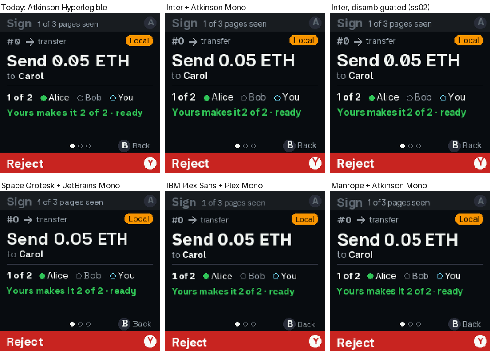
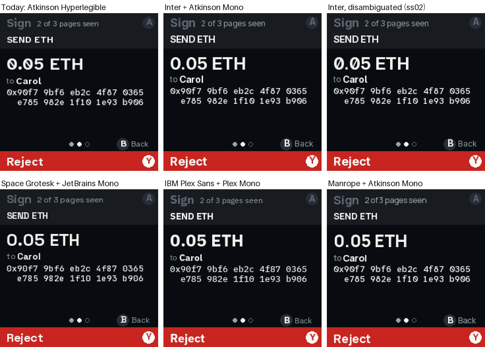
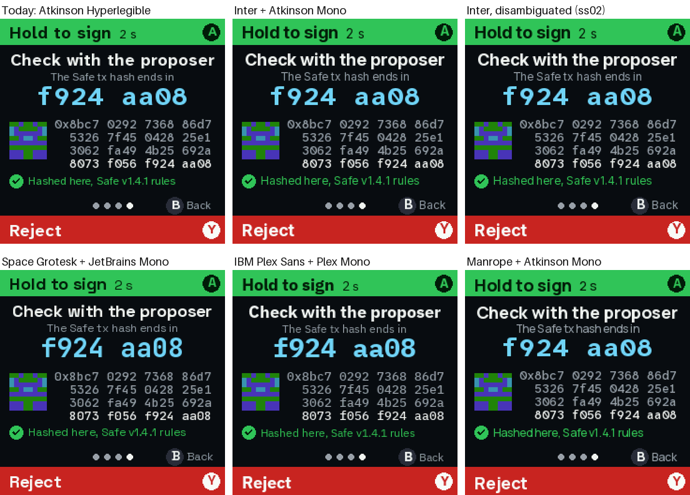
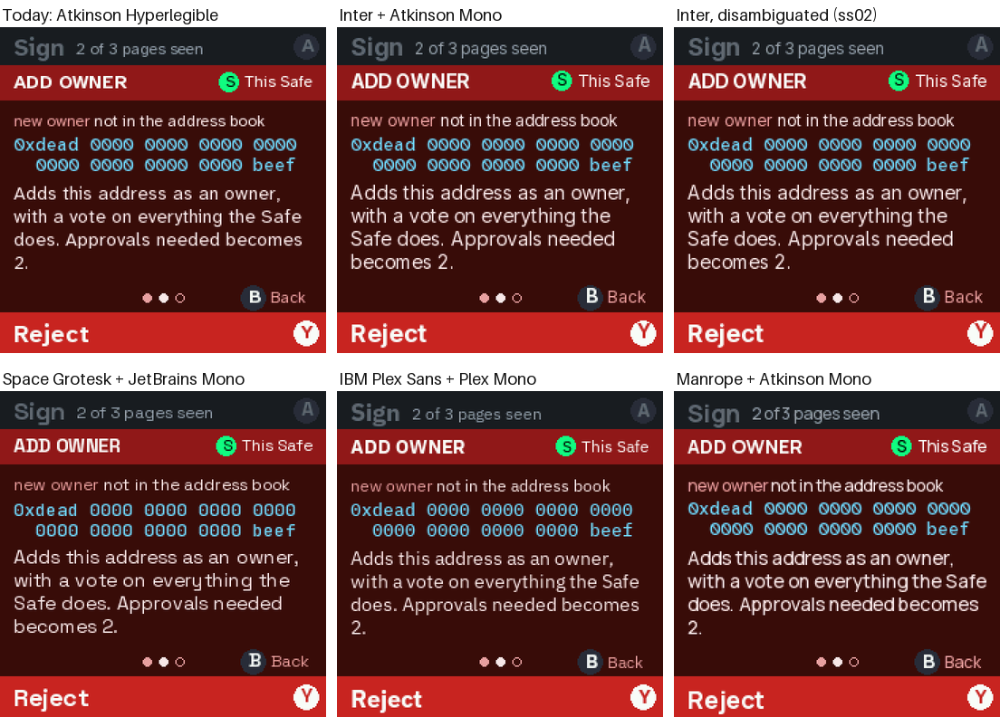
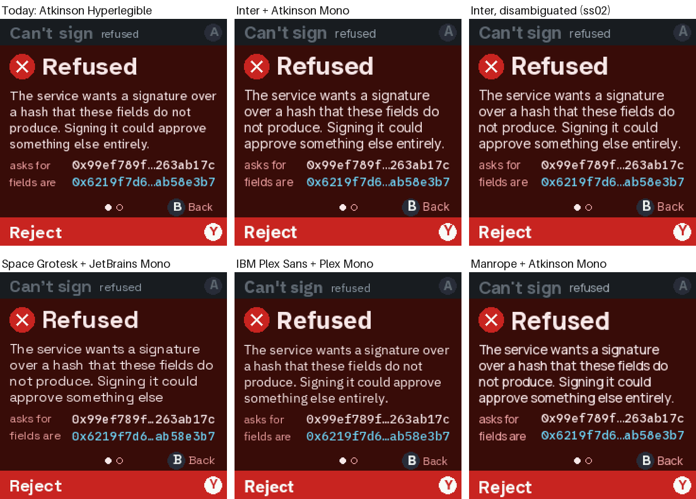

# v2: fonts, side by side

Five candidate font sets against today's, first on a specimen card, then on six real approval
screens. Same screens, same pixels, only the fonts swapped: every picture is the real firmware in
the emulator (the Pico's 240×240 panel, shown here at 1.5×). Back to [the v2 plan](README.md).

**My pick: Inter, disambiguated,** with Atkinson Mono kept for addresses. It needs some layout
fixes, listed [below](#what-choosing-each-one-means). **The safe pick is IBM Plex:** it swaps in
with no layout changes at all. Details and questions at the [end](#questions-for-you).

## The sets

| Set | Words | Addresses and hashes | Why try it |
|---|---|---|---|
| **Today** | Atkinson Hyperlegible Next | Atkinson Hyperlegible Mono | Made for telling look-alike letters apart |
| **Inter** | Inter | Atkinson Mono | The clean, neutral look of most modern apps |
| **Inter, disambiguated** | Inter with its `ss02` alternates | Atkinson Mono | Inter, but I, l and 1 are all different, and 0 is slashed |
| **Space Grotesk** | Space Grotesk | JetBrains Mono | More character, a bit "crypto" |
| **IBM Plex** | IBM Plex Sans | IBM Plex Mono | Engineered and calm; the same widths as today's |
| **Manrope** | Manrope | Atkinson Mono | Round and friendly |

All six are SIL Open Font License, from Google Fonts. Every set keeps today's seven sizes
(12–28 px) and the 16-shade anti-aliasing.

## The specimen



Each card has a headline, body text, a title, an address, a row of **look-alike characters**
(`Il1| O0o rn m 5S 8B 6b`), the verify code and a button line. What the row shows:
- **Inter, Space Grotesk and Manrope** draw capital I and lowercase l identically. On a device
  whose whole job is comparing, that's the one thing a font mustn't do.
- **Inter, disambiguated** fixes that with Inter's own alternate letters: I gets bars, l gets a
  tail, 0 gets a slash.
- **Plex** tells them apart out of the box (I has bars).
- **Manrope** squeezes its spaces at small sizes: "Add anew owner", "2of3".

## The screens

### The queue



Inter and Space Grotesk run wider, so row #3 is cut: "Refused · bad ha…". Plex and Manrope fit.

### The summary



### Send: an address to compare



The address uses the mono in every set. Only Space Grotesk (JetBrains Mono) and Plex (Plex Mono)
change it.

### Verify: the hash and the code



### A red page: text that wraps



The body text wraps differently by width. Every set fits here, but Inter and Space Grotesk carry
more words onto the last line, and Plex breaks exactly like today.

### Refused



**Space Grotesk loses the end of the message:** "entirely." falls off the page. The layout
has room for four lines here, and Space Grotesk needs five.

## What choosing each one means

| Set | Fits today's layouts? | Look-alikes | Work |
|---|---|---|---|
| Today | yes | all apart | none |
| Inter | no: longer rows get cut, and wrapped text runs longer | **I = l** | out, unless disambiguated |
| **Inter, disambiguated** | no, same as Inter | all apart | give the queue rows and the wrapped text more room (part of the v2 redo anyway) |
| Space Grotesk | no: text falls off a page | **I = l** | out |
| **IBM Plex** | **yes** | all apart | none: regenerate the fonts, done |
| Manrope | yes | **I = l** | out, and the tight spaces |

## Questions for you

1. **Inter (disambiguated) or Plex?** Inter looks the most current. Plex is a drop-in. Or say
   "neither" and I'll try more (Geist, DM Sans, Figtree, Public Sans…).
2. **Mono:** keep Atkinson Mono for addresses (today), or try Plex Mono or JetBrains Mono with
   whichever sans wins?
3. **Headlines only?** A middle path: the new face for headlines and titles, Atkinson for body
   text. Say so and I'll shoot that too.

## Run it yourself

```sh
GF_DIR=/path/to/google/fonts uv run --with pillow python tools/fonts/gen.py --try   # the candidates' glyphs
tools/quorum shots --fonts inter,interd,grotesk,plex,manrope                        # the screens in each set
uv run --with pillow python tools/fonts/compare.py                                  # specimens and these grids
tools/emu run fontspec                                                              # the card live; A = next set
```

- `gen.py --try` writes `emu/sketches/qf_SET_NAME.bin`. The emulator loads them, and
  `fonts.use("plex")` swaps them in. They never go to the board, and today's
  `firmware/qf_*.bin` are untouched.
- `GF_DIR` is optional: without it, `gen.py` downloads each typeface. Both ways check it against a
  pinned sha256.
- **Heads-up:** regenerating today's fonts with a different Pillow version gives slightly
  different anti-aliasing. So the "Today" column uses the committed `firmware/qf_*.bin`, not a
  re-render.
