# PicoQuorum UI, v2: the plan, and the new boot screen

A redo of the console's look, starting with the boot screen. Each iteration adds a section here
with screenshots and what changed. Every picture is the real drawing code running in the emulator
(pixel-for-pixel the Pico's 240×240 panel, shown at 2×). Comment on any line in the pull request,
or edit the [change requests](#change-requests) list at the bottom straight in GitHub.

What came before: [the v1 walkthrough](../README.md) (the approval screens, iterations 1–3) and
its four [boot screen options](../README.md#boot-screen-options). The 2-of-3 "Quorum" triangle
there is where this one starts.

## The plan

1. **The boot screen:** a 3-of-5 quorum that becomes the Ethereum diamond. **Picked: the orbit,
   just dots** (iteration 3), with green signatures and a status line (iteration 4).
2. **Wire it to the real boot.** Each signature is a real boot step finishing, and the spin
   covers the slow ones (see [On the device](#on-the-device)).
3. **Type.** Five candidate sets on a specimen card and on six real screens: see
   [FONTS.md](FONTS.md). Waiting on your pick.
4. **Colour and graphics.** Bring the boot screen's palette and shapes into the approval screens:
   the home screen, the approvals row, and the moment of signing.
5. **Every screen, redone,** with before/after pairs like the v1 walkthrough.

## The light mark turns into Ethereum (2026-09-30)

You said the diamond fading in and flying to the corner didn't work. You asked to go back to the
original idea, drawn the light way: the green triangle becomes the top of the Ethereum logo, which
spins until the whole logo is there. Then PicoQuorum, with a small version of the mark to its left,
fades in over the logo, which keeps turning. And no pauses: as quick as it can go.


| | |
|---|---|
| 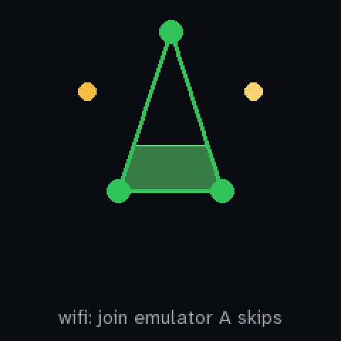 | 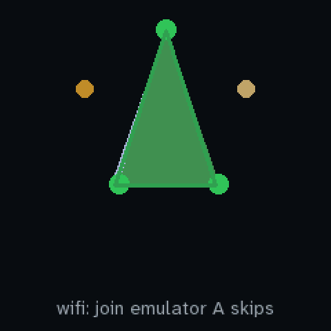 |
| **1.5 s: the quorum.** Three signed, the triangle filling. The signatures now come 0.3 s apart (they were 0.5 s), with no holds. | **1.9 s: no beat.** The filled triangle *is* the diamond's front face seen head-on. It brightens and starts to turn. |
| 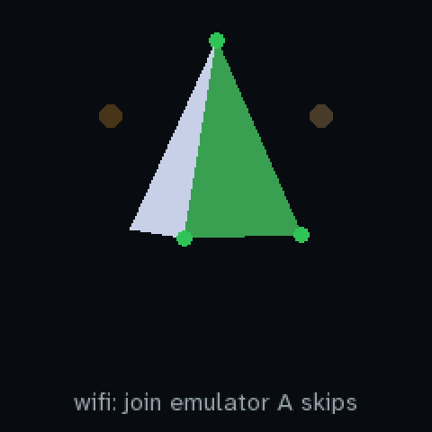 | 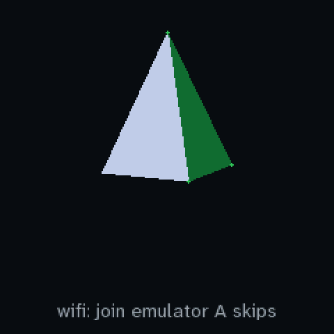 |
| **2.0 s: it turns.** The signers ride its corners and shrink away, and the two who didn't sign fade out. | **2.2 s: the green face goes round the side** as the camera rises to the logo's 30°. |
| 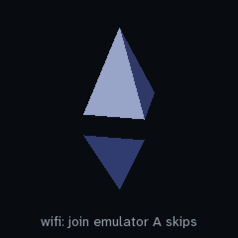 | 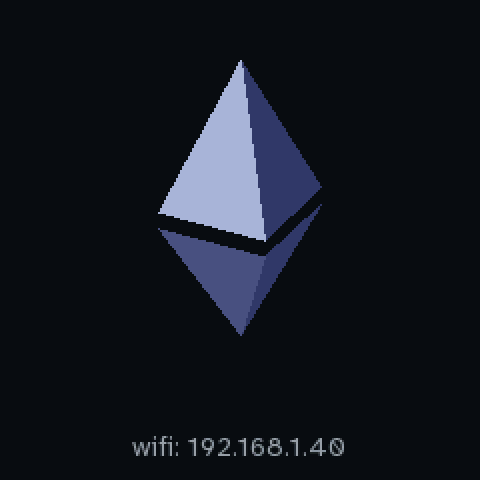 |
| **2.5 s: all Ethereum blue,** and the lower pyramid rises in. | **2.8 s: the logo,** spinning. |
| 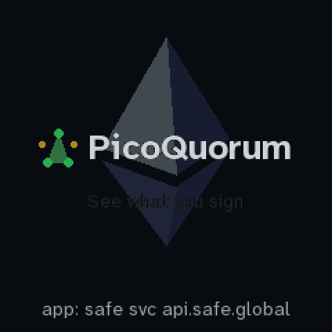 | 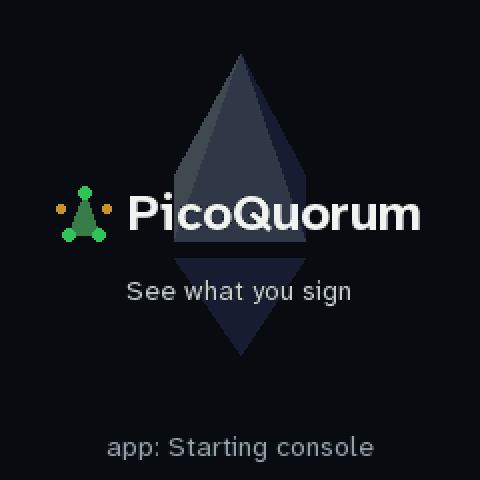 |
| **3.3 s:** it slows, grows and dims, and **the small mark and PicoQuorum fade in over it.** | **4.5 s:** the tagline, and the logo still turning slowly behind. It turns for as long as the boot screen is up. |

The small mark is the boot screen in miniature: five owners, three signed in green, two amber,
their triangle.

On every panel (this is `BOOT_ART = "still"`, the end of it drawn at once):

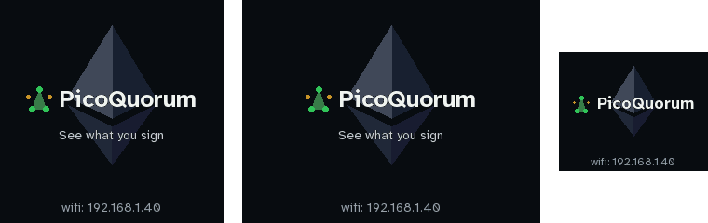

- **Length:** the logo is spinning by 2.8 s and the name is up by 3.4 s. Splash holds 3.7 s after
  the 0.3 s black (the corner version held 5.3 s and the plain mark 3.8 s). Any key still skips.
- **Cost:** each frame repaints the box the diamond was in and the box it's in now. While it's
  big and turning that's up to half the panel (58 KB), so this is heavier than the plain mark: 21%
  of what whole frames would send, against 6%. That's still about 5× lighter than the orbit. Once
  it slows behind the name, a frame only goes out when it has turned another whole degree.
- **The corner version is gone:** its pictures are replaced by these.

**Questions for you:**
1. **The turn:** about two-thirds of a turn while it becomes the logo, then 30° a second behind the
   name. Faster, slower?
2. **Behind the name:** it dims to about a third. Brighter, so the logo reads more, or darker, so
   the name reads more?

## The light mark (2026-09-30): the loading screen the Pico can keep up with

The orbit redraws and sends the whole panel every frame: 100–130 ms a frame on the Pico
(8–10 fps), of which about 50 ms is just the 150 KB going over SPI to the 2.8". The new default
is the orbit's end mark on its own, drawn as flat shapes: five owners pop in, three sign (green,
a ring going out), their triangle closes and fills from the base, the two left out stay amber, and
PicoQuorum fades in under it, then a tagline. The real boot status is the bottom line, as before.

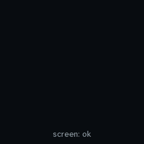

**Why it's smooth:** each frame sends only what changed since the last one: a dot's square, an
edge as far as it has got, the rows the green rose through, the name while it fades, the status
line when it changes. Across the animation that's about 6% of the bytes whole frames would take;
the busiest frame is 26–30 KB and 17 of 131 frames send nothing. The drawing is a dozen framebuf
calls per rectangle, in C. Only the first frame paints the whole panel (about the cost of one orbit
frame). It lasts 3.8 s after a 0.3 s black lead-in (the orbit: 9.6 s after 4 s of black).

| | |
|---|---|
| 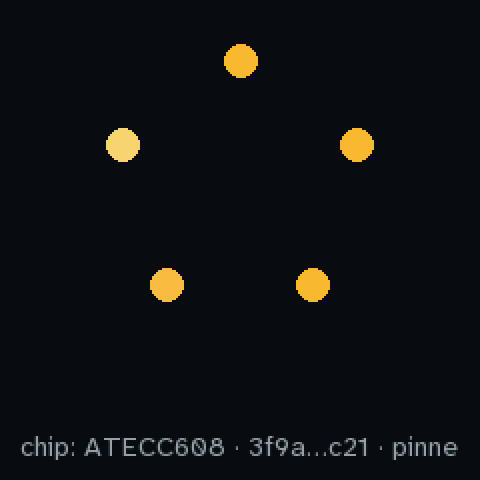 | 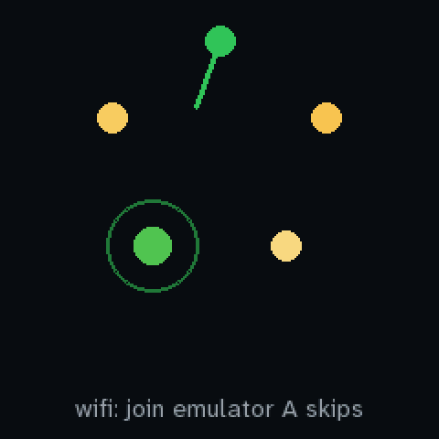 |
| 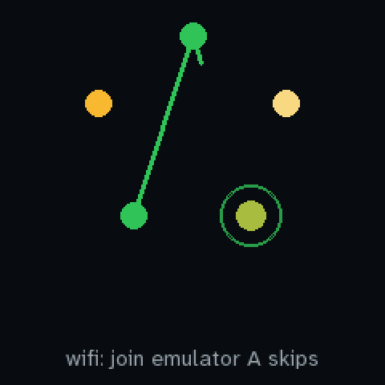 | 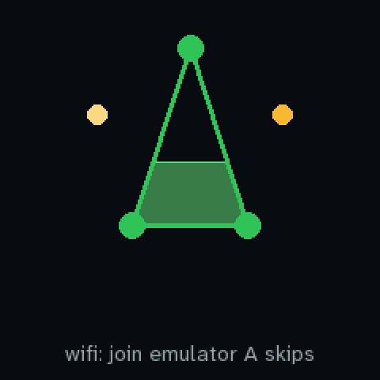 |
| 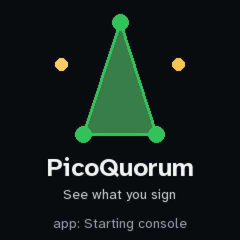 | |

It fits every panel we have, including the 1.8" (which had only the checklist; no room there for
a tagline):

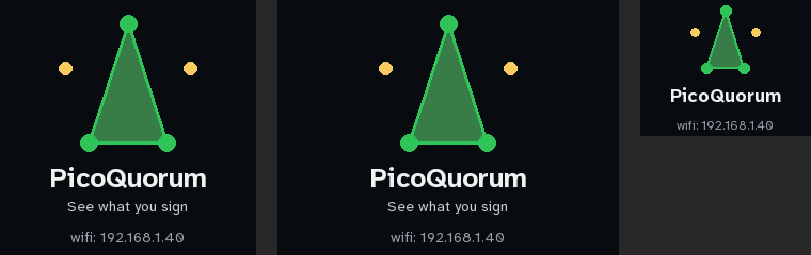

**Taglines** ([`firmware/taglines.py`](../../../firmware/taglines.py)): one per boot on the mark,
cycling on the orbit. `secrets.BOOT_TAGLINES` picks `"serious"` (the default), `"fun"`, `"all"` or
`"none"`. The serious ones are claims about the console, so each has to stay true of the firmware
(the file says which code backs which claim). The fun ones are films and shows, cyberpunk and
the demoscene. Each fits 220 px; the test checks.

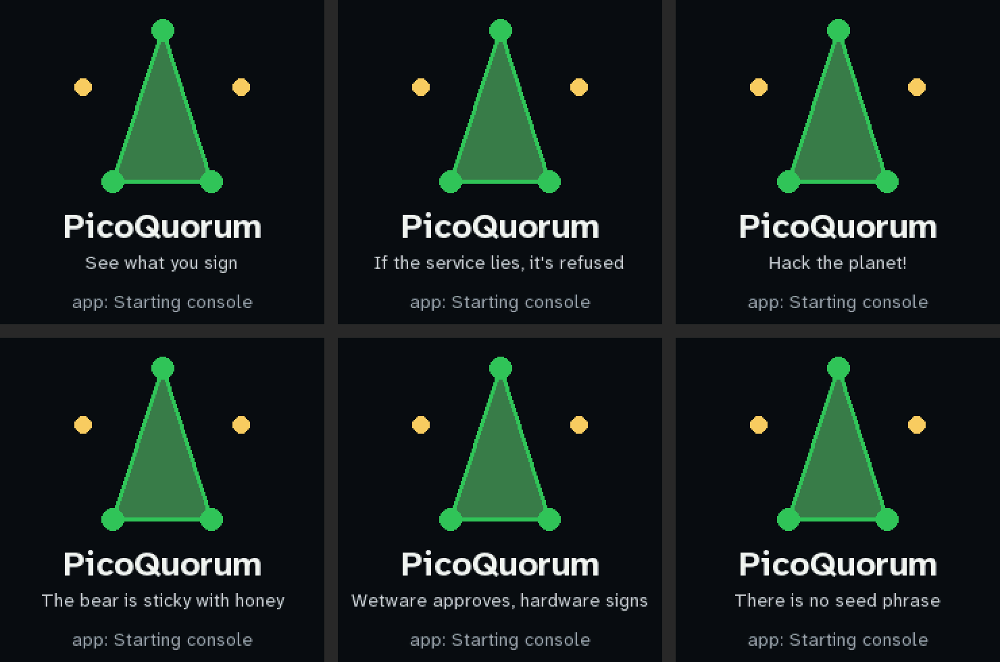

`secrets.BOOT_ART` picks the boot screen: `"mark"` (the default), `"still"` (the finished mark at
once, then only the status line changes), `"orbit"` (the full animation above) or `"checklist"`.
`node test-vectors/run-bootmark.mjs` checks that after every frame the panel equals the whole
scene painted afresh, on all three panels, and prints the bytes sent.

## Iteration 6 (2026-09-27): smooth all the way, filled from the bottom, a name in front

You asked:
- Fill the green from the bottom up, like it's being filled.
- It still felt herky-jerky, pausing at awkward spots. Make it feel like it's booting up
  smoothly.
- Keep the Ethereum diamond spinning. Put PicoQuorum in front, with the diamond behind it, and a
  cycling tagline.

**Why it was jerky:** to give each boot step time on screen, the animation's clock *stopped*
before each signature. Anything mid-motion froze: a signing ring halfway out, a line partway
drawn, the green triangle dead still before it lurched into the turn. The orbit now has its own
clock that never stops. Between steps the waiting owners keep breathing, and every move eases in
and out.


This is the **lite GIF** (2026-09-28): the panel's own 240 px, 10 frames a second and 48
colours, 0.2 MB, for slower viewers. The full one, 360 px at 20 frames a second (1.1 MB), is
[here](boot/orbit.gif).

| | |
|---|---|
| 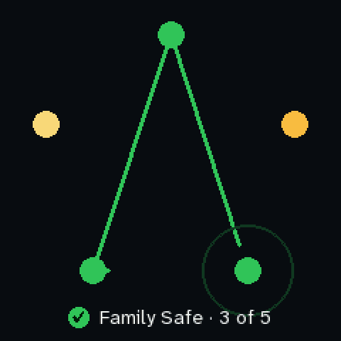 | 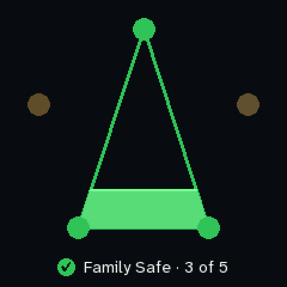 |
| **Signing:** each ring now spreads out and fades smoothly (0.8 s), and each line eases in. | **Green fills from the bottom,** with a bright surface line, as the two who didn't sign fade. |
| 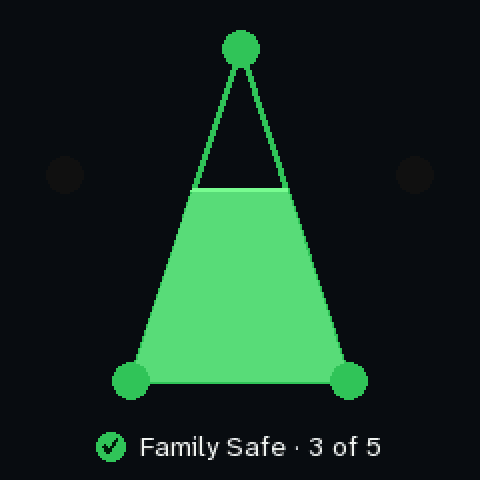 |  |
| **Filling up:** 1.1 s, easing in and out. | **Full,** with a soft glow that swells and fades instead of a flash. |
| 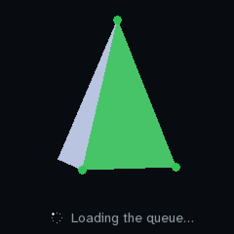 | 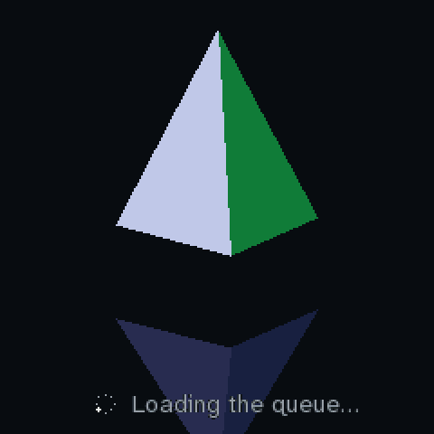 |
| **It turns straight out of the glow:** one face of the pyramid, blue coming round. | **The green face turns away,** the inverted pyramid rises. |
| 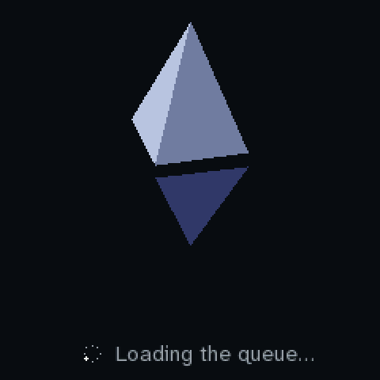 | 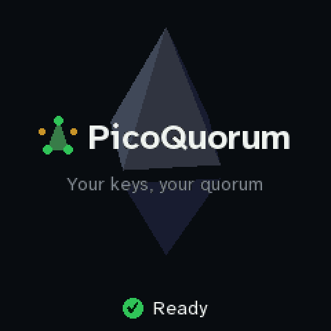 |
| **The Ethereum diamond,** still spinning; it never stops now. | **Behind the name:** it grows, centres and dims, and **PicoQuorum** comes up in front, with the quorum mark (five owners, three signed, their green triangle). |
| 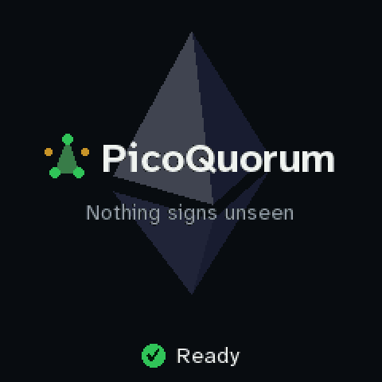 | 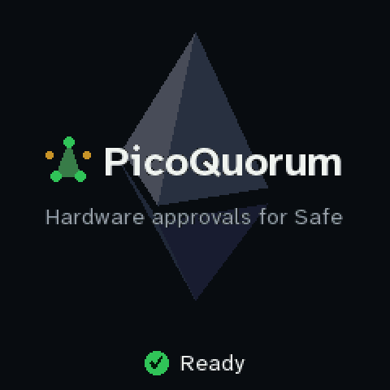 |
| **Taglines cycle** under the name, about 2 s each… | **…and the diamond keeps turning** behind, slowly, for as long as the screen is up. |

- **Taglines** (placeholders, yours to rewrite): "Your keys, your quorum", "Nothing signs unseen",
  "Hardware approvals for Safe", "Every hash checked here".
- **The mark** next to the name is new: the boot screen in miniature. It could become the app
  icon and the home screen's corner mark.
- **Length:** 10.8 s to "Ready", then the name and taglines. The GIF runs 20 s to show all four
  taglines. On the device, the home screen would follow as soon as the queue loads.

**Questions for you:**
1. **The taglines:** keep, cut, or write your own? Cycle them, or pick one?
2. **The mark:** keep it next to the name, or just the word?
3. **On the device:** stay on the name until a button is pressed, or go straight to the queue
   when it's ready?

## Iteration 5 (2026-09-27): the green triangle, redone

You said the green triangle's timing felt awkward. Frame by frame, three things were off:
- **It faded up from black,** so for half a second it was a murky dark triangle, not a green one.
- **There was no beat.** It reached full green and started moving at once.
- **The whole pyramid went a washed-out teal** on the way to blue, because every face blended
  from green to blue at the same time.

Now:

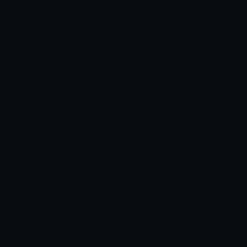

| | |
|---|---|
|  | 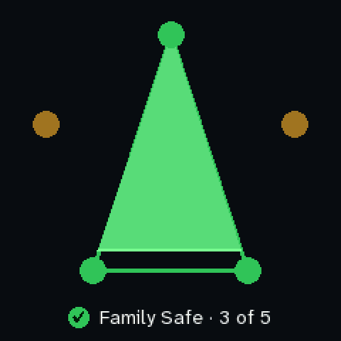 |
| **The quorum closes.** | **Green pours in** from the tip, with a bright surface line, in a third of a second. |
| 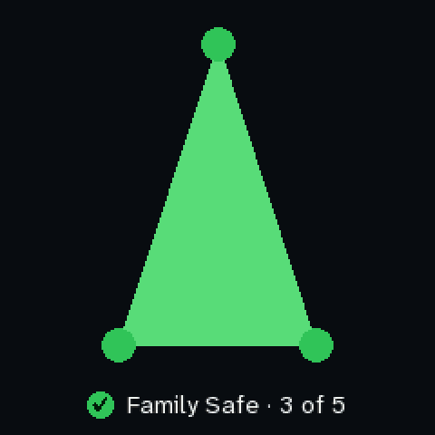 | 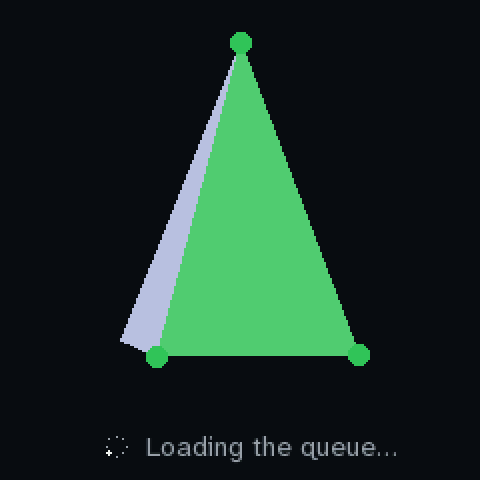 |
| **A flash, then a beat:** it holds, solid green, for about a second. | **It turns, and it's one face of a pyramid.** The face coming round is Ethereum blue. |
| 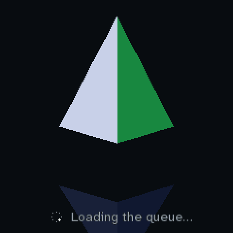 | 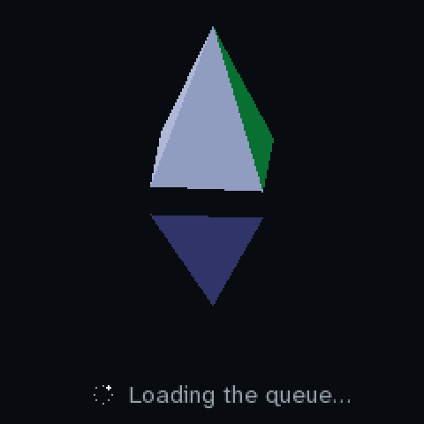 |
| **The green face turns away** as the camera pulls back… | **…and goes out of sight.** Only blue is left, and the diamond settles as before. |

The first half (the orbit, the status line, the signatures) and the ending are iteration 4's.
The loading screen is 0.7 s longer (12.4 s) for the beat.

**Question for you:** is the beat the right length? About 1 s now (the pour, the flash and the
hold).

## Iteration 4 (2026-09-27): more time, a status line, green signatures

You asked:
- Spin the orbit for another cycle; the loading screen could use more time.
- Show what's happening at the bottom as it goes: joining WiFi, verifying the chip…
- Make the three signers green, start the solid triangle green, and blend it into the Ethereum
  logo.


| | |
|---|---|
| 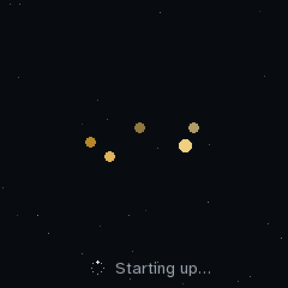 | 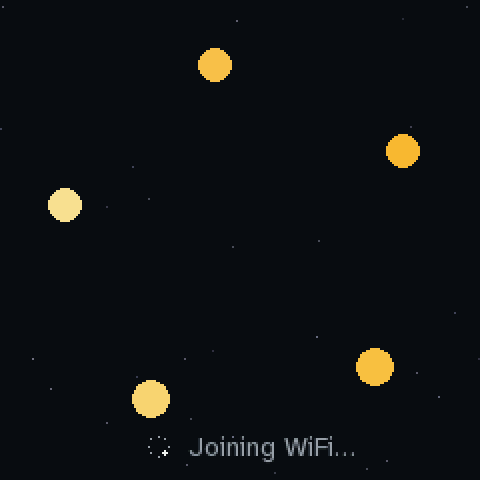 |
| **Starting up.** Five owners far out in space. The orbit now takes 3.2 s and 2.4 turns (was 2.2 s and 1.4). | **Joining WiFi** while they swing round to face you. |
| 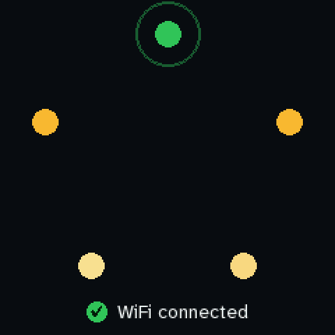 | 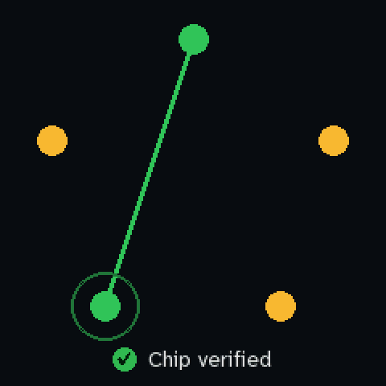 |
| **WiFi connected: the top signs,** and turns green. Each step's line slides up and out as the next slides in. | **Chip verified: the bottom left signs,** with a green line to the top. |
| 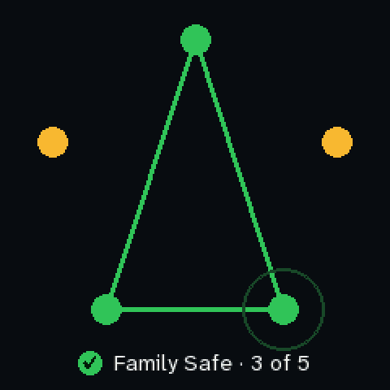 |  |
| **The Safe found: the bottom right signs** and the triangle closes. "Family Safe · 3 of 5". | **The triangle turns solid green.** The two who didn't sign fade away. |
| 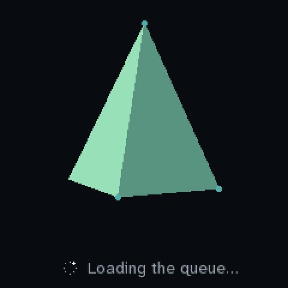 | 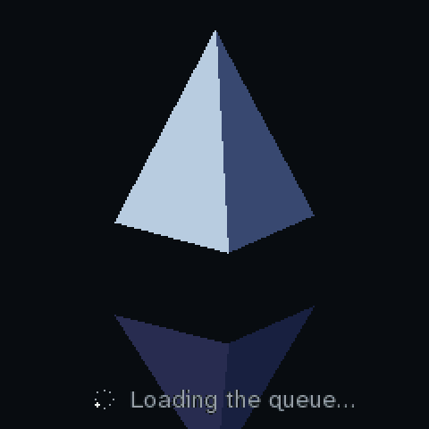 |
| **Loading the queue:** the pyramid turns, and its green blends into Ethereum's blue… | **…and the inverted pyramid rises** underneath. |
| 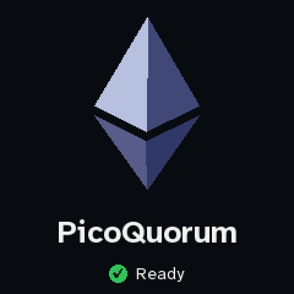 | |
| **Ready.** The diamond lands on the logo's pose, with the name above the last line. | |

- **The status line** is one row at the bottom. A spinner and grey text mean working ("Joining
  WiFi…"); a green check and white text mean done ("WiFi connected").
- **Each signature is a boot step.** The timeline pauses before each one, so each step gets about a
  second. On the device the pauses would last as long as the real step does.
- **Green** is the theme's "signed" green (the SIGN bar, the checks), which also answers iteration
  1's question 1. The diamond is still Ethereum's blue.
- **The name** no longer has "3 of 5 · ready" under it; the status line says "Ready".
- **Length:** 11.7 s, up from 8.7 s. On the device, most of that would be real waiting anyway.

**Questions for you:**
1. **The wording:** "Starting up · Joining WiFi · WiFi connected · Checking the chip · Chip
   verified · Finding the Safe · Family Safe · 3 of 5 · Loading the queue · Ready". Change any of
   them? It could name the network ("Joining HomeNet") or the key ("Chip verified · 9fad2e82").
2. **Pauses:** about 1.2 s per step here. Faster, slower, or let the real boot decide (my
   suggestion)?

## Iteration 3 (2026-09-27): the orbit, just dots

You picked the orbit, without the circle. The orbit's path is gone, and so is the faint circle the
owners landed on. There are only five dots, then only the triangle of the three who sign. The
pictures for this iteration were replaced by iteration 4's, which builds on it.

## Iteration 2 (2026-09-27): no star, two ways in

You asked: the star could read as a pentagram. Drop it, and have the five owners spin in a
circle or in space, then carry on to the top and the two bottom ones and the Ethereum diamond.

There are two options. Both end with the owners exactly where the star had them. From there it's
iteration 1 unchanged, minus the star's lines: the three sign, the triangle closes, and the
diamond spins.

| **A. Ring** | **B. Orbit** |
|---|---|
|  |  |
| Five owners spin round a faint circle, each trailing a comet tail of light. They slow down and stop with one at the top. Flat and simple, like a dial settling. | Five owners orbit in space: the circle starts small and tipped back like a planet's ring, with a few stars drifting behind. It swings round to face you and grows as it slows, and the stars fade out as it lands. |

| | | |
|---|---|---|
| 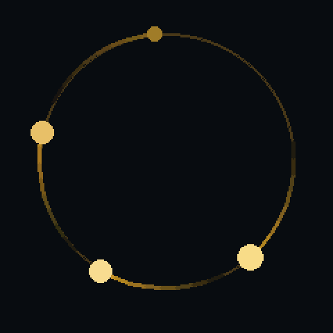 | 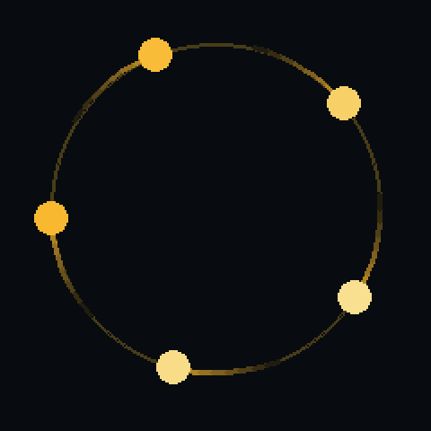 | 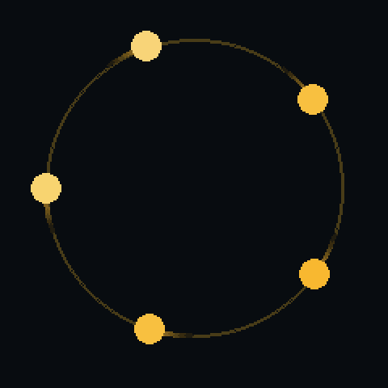 |
| 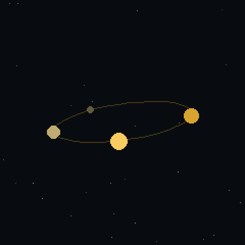 | 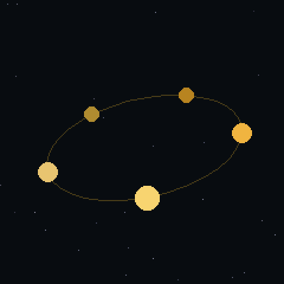 | 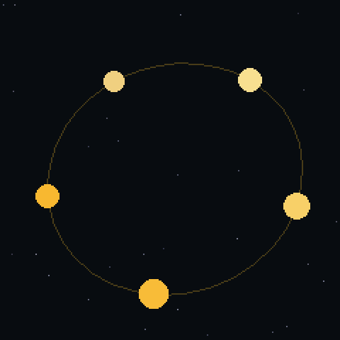 |

Both land here, and the signing starts:

| | |
|---|---|
| 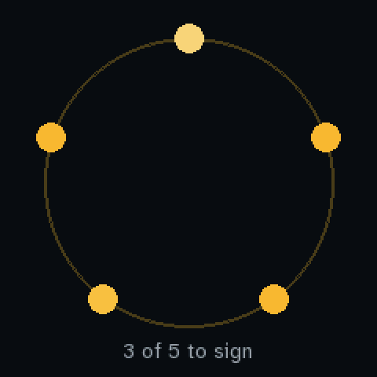 | 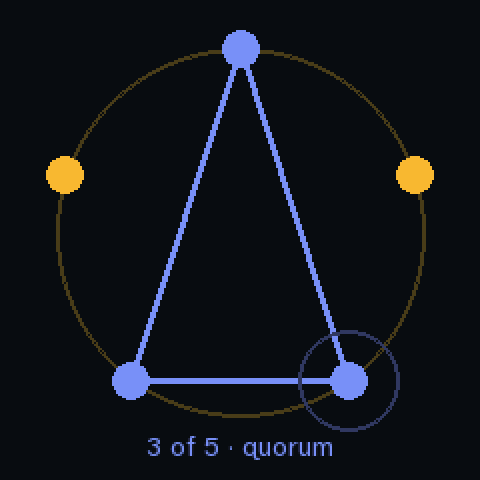 |
| **Landed.** Five amber owners on a faint circle, no lines between them. | **Quorum.** The top and the two bottom ones sign; only their triangle is drawn. The circle fades out with the two who didn't sign. |

- **What stays:** the three signers, the triangle, the pyramid and the spinning diamond are all
  iteration 1's. Only the first 2 seconds change.
- **Length:** the ring takes 2 s to land and the orbit 2.2 s, so each runs about a second longer
  than the star did (8.5 s in all).
- **The star is still in the sketch** as a third option, so iteration 1's GIF below can be
  regenerated.

**Questions for you** (answered: the orbit, just dots):
1. **Ring or orbit?** I lean to the **orbit**: it has more depth and matches the 3D diamond it
   becomes. The ring is calmer and cheaper to draw on the Pico.
2. **The faint circle:** keep it (it says "these five belong together"), or just the five dots?

## Iteration 1 (2026-09-26): star to Ethereum


`emu/sketches/ethboot.py`, 150 frames at the firmware's 50 ms tick (7.5 s, then the last frame
holds). `tools/emu run ethboot` plays it in the emulator; A replays it.

### Frame by frame

| | |
|---|---|
| 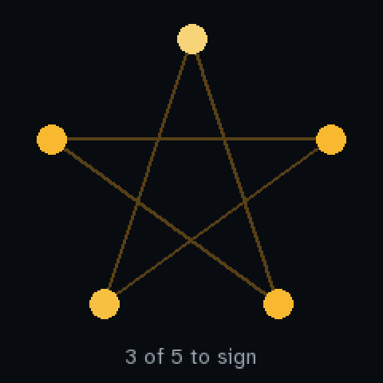 | 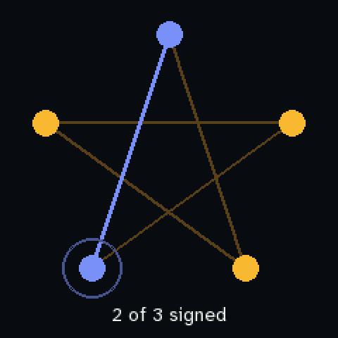 |
| **Five owners, ready.** A pen draws the star in one stroke, and each owner appears as it gets there. All five are amber, which means they can sign but haven't. The ones still waiting breathe slowly. | **Signing.** The top signs, then the left leg. Each one turns Ethereum blue and sends out a ring, and a blue line joins it to the top. |
|  |  |
| **Quorum.** The right leg signs and the base closes. That's the tall triangle made by the star's top and legs (36° at the tip). The two owners who didn't sign start to fade. | **The triangle fills in.** It's about to become a solid face. |
|  |  |
| **It's a pyramid, seen head-on.** The filled triangle is exactly one face of a square pyramid. The three signers sit on its tip and its two front corners. | **The camera pulls back and rises**, and the pyramid starts to turn. The signers ride their corners, then shrink away. |
|  |  |
| **The inverted pyramid rises** underneath, fading in from dark blue. | **The Ethereum diamond,** spinning on its axis. The gap between the two halves stays an even band at every angle. |
|  | |
| **It slows to a stop** with a corner toward you: the logo's own pose. Then the name comes up. | |

### How it's drawn

- **The star** uses lines and filled circles, the same as the v1 option.
- **The diamond** is ten 3D points, turned and projected each frame. It's drawn as flat-shaded
  triangles with `framebuf.poly` (which runs in C), back faces dropped, far faces first. That's at
  most four triangles a frame, so it should cost about what the v1 Quorum option did on the board
  (54 ms a frame, most of it the 46 ms push to the panel). Not timed on the chip yet.
- **It lands on the logo whatever the speed.** A square pyramid looks the same every 90°, so the
  spin can run as long as the boot takes and still stop on a corner (45° + any number of quarter
  turns).
- **The handoff is exact.** The pyramid starts with the star triangle's proportions, so its face
  seen head-on *is* that triangle. It widens a little (0.33 → 0.37 half-base per
  unit of height) as it turns, to match the logo.
- **Colours:** amber (the theme's `warn`) means ready to sign. Signed is Ethereum's periwinkle
  (#627EEA) lifted to `(122, 146, 255)` so it reads on near-black. The diamond is shaded from dark
  indigo to pale lavender, lit from the upper left.
- **The shape is drawn here, not copied.** It's two pyramids built from points, not the
  Ethereum Foundation's artwork. Still, it's meant to read as their mark, so check their brand
  guidance before anything ships.

### What I'd change next (your call)

- **Jagged edges.** `framebuf.poly` doesn't anti-alias. At 2× in the GIF the steps show; on the
  1.3″ screen (about 260 pixels per inch) they're small. A cheap fix is a 1-pixel edge in an
  in-between colour.
- **A glint.** A highlight sweeping across the diamond once it lands.
- **The "not signed" owners** just fade out. They could slide back into the dark instead.
- **Timing.** The whole thing is 7.5 s. On the device, the star part would take as long as the
  real boot steps (see below), and the spin could be shorter once it's ready.

### Questions for you

1. **Blue or green for "signed"?** Ethereum blue ties it to the diamond. Green is what "signed"
   means on every other screen (the SIGN bar, the check marks).
2. **Amber means two things now.** Here it's "ready to sign". On the approval screens amber means
   caution (a yellow page). Keep amber here, or use something neutral (white, grey) for waiting?
3. **3 of 5, always?** The demo Family Safe is 2 of 3. Options:
   - The star is the brand mark and always 3 of 5, and only the line under the name shows the real
     Safe ("2 of 3 · ready").
   - Or draw the real Safe's owners (M points, the first N light up). But only 3 of 5 makes the
     triangle that becomes the diamond.
4. **Ethereum, or the chain it's on?** The Safe might live on Base. Keep the diamond regardless
   (it's all Ethereum), or end on the chain's own mark?

## On the device

This is a proposal; none of it is wired up yet. Today `firmware/splash.py` draws the boot checklist.

| Boot step | What it shows (status line in quotes) |
|---|---|
| Screen up | the five owners spin in and land, all amber: "Starting up", "Joining WiFi" |
| WiFi joined | the top signs: "WiFi connected", then "Checking the chip" |
| The chip answers with its key | the bottom left signs: "Chip verified", then "Finding the Safe" |
| The Safe found, through the service | the bottom right signs, the triangle closes and turns green: "Family Safe · 3 of 5" |
| Loading the queue | the diamond spins, as long as it takes: "Loading the queue" |
| Ready | it lands on the logo: "Ready", and the home screen follows |

- **If a step fails,** that owner turns red and the error goes where the name would be, like the
  checklist's error line today.
- **To try it on the board** without changing `main.py`: `tools/emu ship ethboot`. I haven't
  timed it on the chip yet.

## Type and graphics: where to go next

Today (v1, iteration 2): Atkinson Hyperlegible Next and Mono, seven sizes, rendered on the laptop
by `tools/fonts/gen.py` and drawn by the Pico with 16 levels of anti-aliasing. It was picked for
telling 0/O and 1/l/I apart, which matters on a device for comparing addresses. So:

- **Keep a hyperlegible mono for addresses and hashes,** whatever else changes.
- **A display face for names and headlines** is where the "better fonts" can come from. These are
  all open-licence and `gen.py` can render any of them. I'd put these side by side on the real
  screen:
  - **Inter Display + Inter.** Neutral, very clear at small sizes.
  - **Space Grotesk + JetBrains Mono.** More character, a bit "crypto".
  - **IBM Plex Sans + Plex Mono.** Engineered, calm.
  - **Manrope.** Round and friendly, with Atkinson Mono kept for addresses.
- **Graphics from the boot screen:**
  - The approvals row (`1 of 2 ● Alice ○ Bob ○ You`) becomes a small star or polygon of the
    Safe's owners.
  - Signing plays the ring and the colour change from the boot screen.
  - The home screen's corner carries a small still of the diamond.

## Run it yourself

```sh
tools/emu run ethboot                                   # play it in the emulator; A = next option
tools/bootgifs --sketch ethboot --stills 8,16,26 orbit  # an option's GIF and stills
tools/bootgifs --sketch ethboot --lite orbit            # plus orbit-lite.gif: 240 px, 10 a second
tools/emu ship ethboot                                  # a one-off run on the Pico
```

`tools/bootgifs` now takes `--sketch`, `--out` and `--stills`. It also builds each GIF's palette
from frames across the whole animation instead of only the last one. That kept the amber here, and
it gave the v1 hash-rain GIF back the blue it had lost.

## Change requests

Edit this list on GitHub: add a line, tick one off, or write under it. Each iteration starts here.

- [x] A new boot screen: a 3-of-5 star, the top and legs sign, the triangle becomes the top of a
      rotating Ethereum diamond (iteration 1)
- [x] Fonts: candidates side by side on real screens ([FONTS.md](FONTS.md))
- [x] The star can read as a pentagram: the five owners spin in on a ring or an orbit instead
      (iteration 2)
- [x] Pick the ring or the orbit: the orbit, just dots, no circle (iteration 3)
- [x] Orbit one more turn, more time overall (iteration 4)
- [x] A status line at the bottom: joining WiFi, checking the chip… (iteration 4)
- [x] Signers green, the triangle solid green, blending into the Ethereum logo (iteration 4)
- [x] The green triangle's timing felt awkward: it pours in, holds a beat, and turns away as one
      face of the diamond (iteration 5)
- [x] Fill from the bottom up; smooth, no pauses; the diamond keeps spinning behind the name, with
      cycling taglines (iteration 6)
- [x] A light boot screen: the mark, sending only what changed (the light mark)
- [x] ~~After the mark, the spinning Ethereum diamond fades in and lands in the top-left corner~~
      (didn't work, dropped)
- [x] The light way, the original idea: the green triangle becomes the top of the Ethereum logo,
      which spins; the small mark and PicoQuorum fade in over it; no pauses (the light mark turns
      into Ethereum)
- [ ] Pick a font set (FONTS.md, question 1)
- [ ] (add yours)
