# Four directions for the cosigner's screens

> **A first draft, 2026-10-31, to pick from.** Each direction draws the same four screens:
> - a control change from unknown code (the warning)
> - a routine payment
> - holding to sign
> - home
>
> They are drawn by [`emu/sketches/ui_directions.py`](../../../emu/sketches/ui_directions.py) with the
> console's own drawing code and fonts. `node emu/render-cosigner-ui.mjs ui_directions <out> build1-2.4`
> (or `waveshare`) redraws them. Mock-ups only: no chip, no service, nothing signed, made-up
> transactions.

Two things are the same in all four, and come from the plan ([README.md](README.md)):
- **The controls.** Turn: pages. Push: open, or leave a review, with nothing sent. Footswitch: sign,
  held. **There is no Reject.** A cosigner can only not sign. A Safe transaction is cancelled when the
  owners execute another one at the same nonce, and the warning screens say so.
- **The content.** What it can do first, whether the code is known second, then the facts, all
  worked out on the device.

What changes is how it looks and how it speaks.

## The four at 320 × 240 (the stompbox)

Rows: A, B, C, D. Columns: warning, payment, holding, home.

| | warning | payment | holding | home |
|---|---|---|---|---|
| **A** terminal | 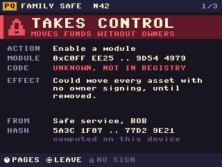 | 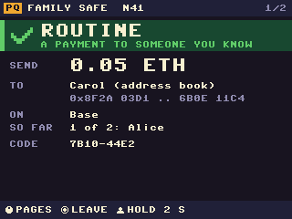 | 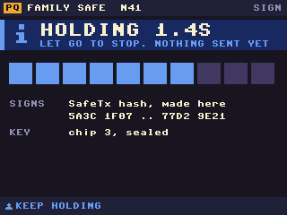 | 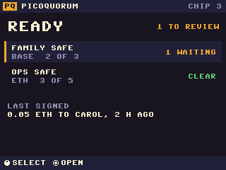 |
| **B** instrument | 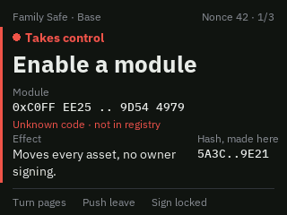 | 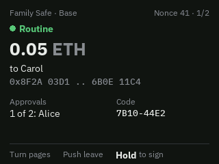 | 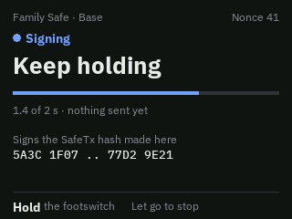 | 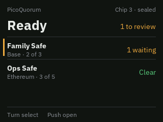 |
| **C** annunciator | 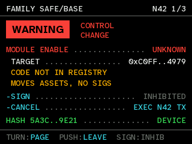 | 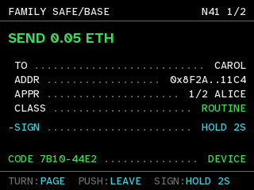 | 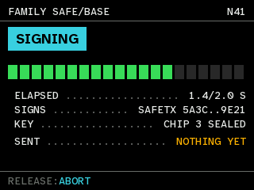 | 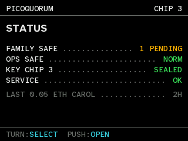 |
| **D** statement | 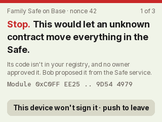 | 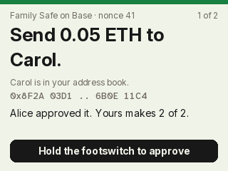 | 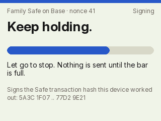 | 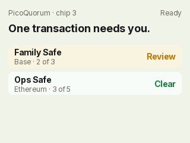 |

The same at 240 × 240 (the Waveshare 1.3″) is in [`directions/240/`](directions/240/).

## A. Terminal

*"This is low-level, and it matters."*

**The idea.** The machine speaks in its own voice: a bitmap font on an 8 px grid, capitals for labels,
pixel icons, and a coloured band that says what the transaction can do. It looks like a serial
console or a 16-bit system screen. It carries on the boot screen, so the whole device feels like one
object.

- **Good:** unmistakable, and serious in a way people read as "close to the metal". It costs
  nothing: the 8 × 8 font is built in, so there are no font files in the image and drawing is fastest.
  Every pixel is deliberate, so it renders the same on every panel.
- **Not so good:** the 8 × 8 font is small: about 1.1 mm tall on the 1.3″ Waveshare. Long lines don't
  fit in 30 columns, so values get cut to their short forms (`0xC0FF..4979`). Capitals everywhere make
  everything shout, so the band has to do the work. It reads as a style, which some people will find
  less professional.
- **Small screens:** works, but tight. It needs a short form of every string.

## B. Instrument

*"Quiet until it matters."*

**The idea.** A well-made measuring instrument, or Swiss typography. Graphite background, IBM Plex
Sans for words and Plex Mono for addresses and hashes. A clear ladder of type:
- a muted context line
- a coloured status dot and word
- one large headline
- labelled facts

No boxes, no bands, hairlines only. Colour is reserved for meaning: a thin red edge and red words
on the warning, nothing else. The amount is the headline on a payment, with the unit in grey.

- **Good:** the most professional of the four. Easy to read at a glance; the hierarchy does the work,
  not decoration. The anti-aliased type looks sharp on the small panels, not blocky. It would sit
  well next to the web app.
- **Not so good:** quiet can mean easy to miss. A warning has less visual weight than A's or C's
  red band, so it relies on the red edge, the status word and the locked Sign. Plex is about 30 KB of
  font files, added to the image (today's Atkinson Hyperlegible would do the same job at no cost).
- **Small screens:** works well at 240. The headline and the two-column facts collapse to one column.

## C. Annunciator

*"A cockpit, not an app."*

**The idea.** Aviation spent decades learning how to tell a crew something has gone wrong. This
borrows its discipline, the way an aircraft's warning display lists faults:
- black background, monospace capitals
- a master WARNING light top left
- each fact as one line with a dotted leader to its value
- a fixed colour grammar: **red** means warning, act; **amber** caution; **cyan** what you can do
  next; **green** normal or verified; **white** information

The actions are lines too: `-SIGN ...... INHIBITED`, `-CANCEL ...... EXEC N42 TX`.

- **Good:** the strongest warnings of the four. The colour grammar is strict, so a person learns it
  once and reads every screen fast. The dotted-leader lines line up like a checklist, so a long
  transaction stays scannable. It uses the console's existing Atkinson Hyperlegible Mono and bold,
  so nothing is added. It is quick to draw.
- **Not so good:** dense and jargon-shaped (`APPR`, `N42`, `EXEC`). It is the least friendly to a
  newcomer, and abbreviations must be chosen with care. It looks like equipment, so it may feel cold.
- **Small screens:** works at 240 once the footer drops to two items; the Sign state is in the body.

## D. Statement

*"Say it in one sentence you could read out loud."*

**The idea.** Each page is one plain sentence: *"Stop. This would let an unknown contract move
everything in the Safe."* or *"Send 0.05 ETH to Carol."* Then one line of why, then the hard facts in
small type, then one rounded bar that says what to do. Light paper background, Inter, a coloured
stripe across the top. The first word carries the page's colour: **Stop.** It is closest to a
well-made payment app, or a printed receipt.

- **Good:** the easiest to understand for someone who doesn't know Safe, modules or nonces. The
  sentence is what a person tells a co-signer on the phone. In daylight a light screen reads best.
  It feels finished and calm.
- **Not so good:** every kind of transaction needs a sentence template, and a wrong template is a
  security bug: the words *are* the review. It fits less per page, so long transactions are more
  pages. Light screens use more backlight and show a cheap TFT's uneven backlight and narrow viewing
  angle; the 2.4″ IPS is fine, the 1.3″ less so. Inter is about 30 KB of font files.
- **Small screens:** works at 240, but the sentences take most of the page.

## Side by side

| | A terminal | B instrument | C annunciator | D statement |
|---|---|---|---|---|
| reads as | a system console | a precision tool | flight equipment | a calm app |
| warning strength | strong (band) | medium (edge, word) | strongest (master light, grammar) | strong (Stop., stripe) |
| for a newcomer | medium | good | hard | best |
| facts per page | many, short | medium | many | few |
| on 240 × 240 | tight | good | good | roomy enough |
| added to the image | nothing | ~30 KB (Plex) or nothing (Atkinson) | nothing | ~30 KB (Inter) |
| drawing cost | lowest | low | low | low |
| main risk | looks like a style | warnings too quiet | jargon | wording is security-critical |

## A recommendation, to argue with

**B's look with C's rules.** Instrument's quiet layout and type for the everyday screens, because
most transactions are routine and should feel calm and clear. When something is red, switch to C's
grammar: the master light, the one-line facts with leaders, cyan for what you can do, the inhibited
Sign. So a warning looks different *in kind* from a routine page, not just in colour.

Keep A's pixel art for the boot screen, as the device's signature. Use D's one-sentence summary as
the first line of the payment page, where its wording comes from a fixed template per decoded call,
the facts table in [STANDARD.md](STANDARD.md).

Atkinson Hyperlegible, which the console already ships, can stand in for Plex: nothing is added to
the image, and it was designed for exactly this kind of reading.

## What it would take to go further with any of them

1. Pick one (or the mix), and draw the rest of the review: multi-call batches, the registry page,
   two transactions at one nonce, the 240 × 135 Feather.
2. Hand it to two or three people who haven't seen the project, on the stompbox, and watch where they
   look first on the warning.
3. Then build it into the console's screens, 320 × 240 first.
