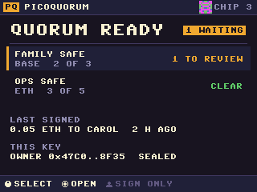
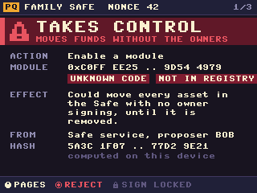
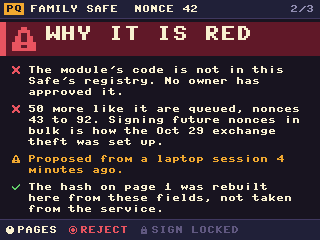
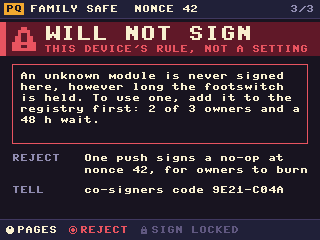
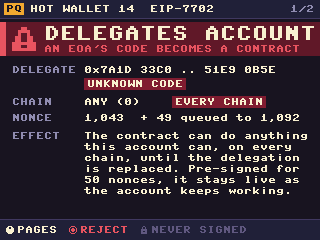
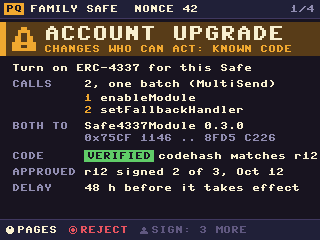
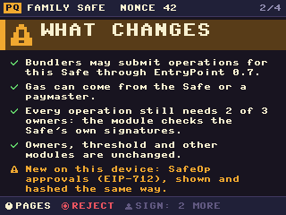
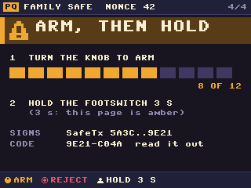
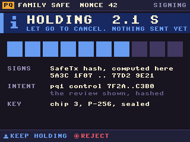
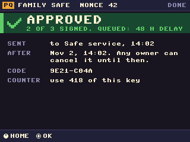

# Quorum UI v3: a sealed cosigner's screen, from the ground up

> **Status: a plan, 2026-10-31.** The screens below are mock-ups drawn by
> [`emu/sketches/cosigner_ui.py`](../../../emu/sketches/cosigner_ui.py) with the console's own
> drawing code, on the stompbox's 320 × 240 panel. They read no chip, ask no service and sign
> nothing. The transactions in them are made up. Nothing in the console has changed except the boot
> screen, which is v3's first piece (`firmware/bootpixel.py`, the default since 2026-10-31).

PicoQuorum is one owner of a Safe. v1 and v2 grew screen by screen around a 240 × 240 joystick
console. v3 starts again from what a sealed cosigner is for. It answers one question on every page:
*what can this transaction do, and does this device know the code it touches?* Then it makes the
safe answer the easy one. The look is a retro screen, but for work: a terminal grid, a small fixed
palette, words, not decoration.

A draft standard goes with it: [STANDARD.md](STANDARD.md), PQ-REVIEW-1. It describes what a
cosigner shows, how that is hashed, and how the hash rides in a Safe passkey signature. It needs no
change to Safe's contracts. It is also written as a worked example of how to start a standard.

- [The theme](#the-theme)
- [Seven rules for every screen](#seven-rules-for-every-screen)
- [The screens](#the-screens)
- [The Oct 29 exchange theft, and what it would look like here](#the-oct-29-exchange-theft-and-what-it-would-look-like-here)
- [Approving account abstraction on purpose](#approving-account-abstraction-on-purpose)
- [Can Safe signing do this, or does it need an extension?](#can-safe-signing-do-this-or-does-it-need-an-extension)
- [Rust](#rust)
- [What's next](#whats-next)

## The theme

The boot screen set it. v3 keeps it everywhere.

| | |
|---|---|
| **Grid** | 8 px. The built-in 8 × 8 font, one cell a letter: 40 columns × 30 rows on 320 × 240, 30 × 30 on 240 × 240. Titles are the same font doubled. Art is drawn in big pixels: 4 px on the 240-row panels, 3 on the Feather, 2 on the 1.8″ |
| **Palette** | night `#181425` · panel `#26203C` · rule `#3A3A64` · ink `#FAF0D7` · muted `#968EB4` · dim `#605A80` · amber `#F7A834` · green `#60CE6C` · blue `#6E9CF0` · red `#EE5464`. Shading picks a tone from a short ramp, never a blend |
| **Bands** | the colour of the band under the top bar says what the transaction can do: **red** takes control or pays out more than it shows, **amber** changes who can act or isn't fully read, **green** is routine, **blue** is this device's own state (holding, signing) |
| **Icons** | 8 × 8 bitmaps on the same grid: warn, ok, no, lock, info, chip, and the three controls (knob, push, footswitch) |
| **Motion** | 8 steps a second. Nothing slides; things change on a step. A frame between steps sends nothing to the panel |
| **Words** | short, plain, upper case only for labels and titles. Numbers as people read them: `1,043`, `48 h`, `0x75CF 1146 .. 8FD5 C226` |

Every review page has the same frame: the top bar (which Safe, which nonce, which page), the band,
the facts as label and value rows, and a footer that names what each control does on this page.

## Seven rules for every screen

1. **What it can do comes first.** The band is the first thing drawn and the biggest. A page's band
   is set by the worst thing in the transaction, not by its first call.
2. **What it can do and whether the code is known are separate.** Impact is the band. Provenance is
   a tag: `VERIFIED` (the code hash is in this Safe's registry) or `UNKNOWN CODE`. Known code never
   makes a control change green. It makes it *possible*.
3. **Every number on the screen was worked out here.** The hash, the code, the amounts, the names.
   The screen says so (`computed on this device`). Nothing the service says is shown as fact.
4. **One control, one meaning.** The knob moves. Its push opens, and on a review it rejects. The
   footswitch signs and does nothing else. Reject is always one push; Sign is never one press.
5. **A refusal is a rule, not a setting.** `WILL NOT SIGN` pages say which rule and how to get past it
   legitimately (usually: the registry, which needs the owners and a wait). No hold is long enough.
6. **The screen says what gets signed.** The hold page names the hash, the review's intent hash
   ([STANDARD.md](STANDARD.md)) and the key. The confirmation code is the hash's last 8 hex
   digits, to read out to a co-signer, as today.
7. **It fits 240 wide.** 320 × 240 is the design size; every page also has to work in 30 columns.

## The screens

From [`emu/sketches/cosigner_ui.py`](../../../emu/sketches/cosigner_ui.py).
`node emu/render-cosigner-ui.mjs` redraws them. On the emulator: `tools/emu run cosigner_ui`,
then turn or press A for the next.

| | |
|---|---|
|  | **Home.** The quorum's state in one line, each Safe with its chain, threshold and what waits. The footswitch is greyed: it only signs. |
|  | **A module from nowhere, page 1.** Red: *takes control*. The module's code is unknown and not in the registry. The effect in one sentence. Where it came from. The hash, rebuilt here. Sign is locked. |
|  | **Page 2: why it is red.** Each reason with its mark. The second is the one Oct 29 was made of: a run of queued requests for consecutive future nonces. |
|  | **Page 3: will not sign.** The rule, and the legitimate way past it. Reject is one push: it signs a rejection, a no-op at the same nonce. Once the other owners sign it too and it executes, that nonce is used up. |
|  | **An EIP-7702 delegation,** as a cosigner that held an EOA key would show it. Chain 0 means every chain. Fifty nonces. This device's key is P-256 and can't sign one at all ([below](#what-this-device-does-today)). |
|  | **Account abstraction, on purpose, page 1.** Amber, not red: it changes who can act, but the code is known. Two calls in one batch, both to Safe4337Module 0.3.0, its code hash in registry r12, which 2 of 3 owners approved. A 48 h delay. |
|  | **Page 2: what changes.** What the module may do, and what stays the same. And that this device will now be asked to sign SafeOps too. |
|  | **Page 4: arm, then hold.** A control change is armed with the knob first (12 detents), then held on the footswitch for 3 s. Turning back disarms. |
|  | **Holding.** What will be signed: the SafeTx hash, the review's intent hash, the key. Let go and nothing is sent. |
|  | **Approved.** Sent, when it takes effect, and that any owner can cancel until then. The key's use counter. |

## The Oct 29 exchange theft, and what it would look like here

### What's known (as of 2026-10-31)

From the news and blockchain-analysis reports. Binance has promised a technical post-mortem and
hasn't published it, so all of this may change.

- About **$6.3 billion** left Binance wallets on ten chains on **Oct 29**, most of it in about 20
  minutes. About $3 billion has been frozen. TRM Labs and Chainalysis attribute it to North Korea's
  **TraderTraitor** group.
- Binance first pointed to **one engineer's compromised laptop**, then called the attack more
  complex. It says it found **no sign that a private key leaked**. Reporting says the attacker
  instead got **Binance's own signing systems to produce valid signatures**.
- On Ethereum, Gizmodo and Blockaid's reconstruction describe **50 EIP-7702 authorizations, signed
  by Binance in advance, one for each of a hot wallet's next 50 nonces.** The wallet was busy with
  withdrawals, so its nonce kept moving; with one authorization per nonce, one would always be
  valid. Used, an authorization makes the wallet's code an attacker contract, which then drained it
  and the funds that kept arriving.
- On the other chains, wallets sent funds to the attacker in ordinary, validly signed transactions.

Not known: how the signing systems were reached, and whether any account abstraction beyond
EIP-7702 was involved. The plan below doesn't depend on those answers.

### What the pattern is

Strip the details and three things made it work:
1. **A signer signed what it was handed.** The signatures were valid. Nothing between the request
   and the key asked what they did.
2. **The thing signed handed over control,** not a payment: the account's code, for good.
3. **It was signed for the future in bulk.** Fifty nonces at once, so it stayed usable while the
   account kept working.

### The same move on a Safe

A Safe has no 7702, but it has the same lever in other forms. Each makes some contract able to act
for the Safe without its owners:
- `enableModule(x)`: x can make the Safe do anything, with no signatures
- `setFallbackHandler(x)` and `setGuard(x)`: x answers or vetoes for the Safe
- a `delegatecall` to x: x's code runs as the Safe itself (how Bybit lost $1.5 billion in Feb 2025)

### What this device does today

- **It works out the hash itself** from the fields it shows (`firmware/safe_tx.py`). If the service
  shows one transaction and asks for a signature on another, the signature is over what was shown.
  `tools/quorum propose tampered` demonstrates it.
- **Module, guard, handler, owner and threshold changes are red,** with a 3 s hold
  (`firmware/decode.py`).
- **A delegatecall to a contract it hasn't pinned is refused** outright, however long Sign is held.
- **It can't sign an EIP-7702 authorization at all.** Its key is P-256, inside an ATECC608 or a Trust
  M. An authorization needs a secp256k1 signature from the account's own key. Through Safe's passkey
  signer, the chip can only approve Safe transactions and Safe messages.
- **The gap:** `enableModule` to an unknown contract is red, but it *is* signable with a 3 s hold.

### What v3 adds

| rule | what it stops |
|---|---|
| **R1. A control change to unknown code is refused.** Module, guard, fallback handler, singleton or a delegatecall target must be in the Safe's registry. | the gap above; the module from nowhere |
| **R2. A run of future nonces is a red flag.** When the queue holds more than 3 transactions for the same Safe with consecutive nonces and the same control-class target, every one of them is refused until the run is cleared. | Oct 29's pre-signing |
| **R3. A control change is armed, then held.** 12 knob detents to arm, then 3 s on the footswitch. Turning back disarms. | a hold made in a hurry |
| **R4. A control change waits.** The registry and the Safe's Delay modifier make a control change take effect only after 48 h; any owner can cancel. The device says when. | a quiet takeover nobody saw in time |
| **R5, for a future EOA cosigner:** never sign a 7702 authorization for chain 0; only for the account's current nonce; one at a time; only to a delegate in the registry. | the 7702 version, if this device ever holds an EOA key |

The mock-ups show R1 and R2 on a module from nowhere (pages 1 to 3), and R5 on a 7702 request.

## Approving account abstraction on purpose

Account abstraction is a legitimate thing to want: a paymaster for gas, bundled operations, session
keys later. For a Safe today that means **Safe4337Module**: enabled as a module and set as the
fallback handler, in one batch. v3 makes that possible without making the attack possible:

1. **The registry first.** The owners approve a registry entry for the module: its name and version,
   its address on each chain, and its runtime code hash. The registry is approved the way releases
   are today, as a Safe message. That is the one moment people check the code with an explorer.
   It happens rarely and slowly.
2. **Then the change.** The device decodes the batch, finds both calls point at the same registry
   entry, and shows them amber with `VERIFIED` (pages 1 and 2).
3. **Arm and hold** (page 4), and the Delay modifier's 48 h (the approved page).
4. **Afterwards, SafeOps.** Once the module is on, owners approve user operations by signing a
   `SafeOp` (EIP-712, the module's own domain). The device builds that hash from its fields and
   decodes its call (`executeUserOp`) the same way it does a SafeTx. One more hash builder, the same
   review.

The address in the mock-up (`0x75cf1146…8fd5c226`) is Safe4337Module 0.3.0's as best I know it.
Check it against Safe's deployments repository before anything depends on it.

**The limit:** the device can't read a code hash off the chain by itself. It trusts the registry,
which the owners approved. Checking code hashes against the chain with a light client is the long
fix ([Rust](#rust)).

## Can Safe signing do this, or does it need an extension?

Safe signing covers all of it. Nothing below needs a change to Safe's contracts.

| what gets signed | how | status |
|---|---|---|
| a Safe transaction (any call, a batch, a module or handler change) | EIP-712 `SafeTx`, the Safe's domain; the chip signs through Safe's passkey signer (WebAuthn, a contract signature) | today |
| a Safe message (a release approval, a registry approval) | `SignMessageLib` by delegatecall, then EIP-1271 | today, for releases |
| a user operation, once 4337 is on | EIP-712 `SafeOp`, Safe4337Module's domain, same signer | new hash builder |
| an EIP-7702 authorization | secp256k1, `keccak256(0x05 ‖ rlp([chain_id, address, nonce]))` | impossible with this key, by design |

Three extensions, smallest first:
1. **Intent binding, inside the signature Safe already checks.** A passkey signature's
   `clientDataJSON` ends with fields the signer chooses; today this device writes
   `"origin":"picoquorum"` (`firmware/webauthn.py`). PQ-REVIEW-1 adds a field carrying the class and a
   hash of exactly what the screen showed. The chip signs it, the Safe verifies the signature as
   before, and anyone can later read what the cosigner saw. No contract change.
2. **A guard that reads it** (optional, later). A Safe transaction guard can find that field in
   the signatures it is given and refuse a control-class transaction whose cosigner signature
   doesn't say `control`. Then a device that displayed a control change as routine can't be part of
   a quorum that executes it.
3. **Delay for control changes**, with the Zodiac Delay modifier, which exists today. A policy, not
   new code.

The details, as a draft standard: [STANDARD.md](STANDARD.md).

## Rust

Worth doing, in steps, starting with the part that can be checked against what exists.

**Why.** The console is about 5,300 lines of MicroPython (`quorum.py` 1,731, `quorum_ui.py` 1,271,
`quorum_ui_s.py` 695, `decode.py` 397, the rest small). It works, but it pays for the interpreter:
the heap runs out in pieces (several `MemoryError` fixes in the buildlog), a frame of the old boot
art took 110 ms, and an image is ~80 files that a manifest has to hold together. In Rust:
- memory is fixed at build time: no garbage collector, no out-of-memory in the middle of a review
- drawing and hashing are 10 to 50 times faster, so every page can redraw whole
- one binary, built reproducibly from a pinned toolchain, is the release fingerprint
- **the same code runs everywhere:** the device, the browser (WebAssembly, in place of
  MicroPython-in-WASM in the console page and the emulator), and the host tests
- and the decoding and hashing become a library other cosigners can use

**What it costs.** Live REPL hacking and `tools/emu run`'s quick loop for screens. A rewrite of the
console's logic. Wi-Fi and TLS on the device are the heaviest part.

**The stack, as it stands today:** `embassy` with `embassy-rp` on the RP2350 (and `esp-hal` on the
S3); `embedded-graphics` and `mipidsi` (ST7789 and ILI9341) for the screen, which keeps this grid
and these bitmaps; `alloy-primitives` and `alloy-sol-types` (no_std) for ABI; `tiny-keccak`;
RustCrypto's `p256` to check, while the chip signs; our own ATECC608 driver (its packets are
small, and `atecc.py` is the spec); `embassy-usb` for the transport.

**A design change that makes it simpler: seal it.** A sealed cosigner doesn't need Wi-Fi or TLS. It
needs the transaction's fields, from anywhere: USB from the app, a QR code, or a relay. It trusts
none of them, because it rebuilds the hash and decodes everything itself, as it does now. Without
a network stack, the device is a screen, three controls, a chip and a parser.

**The steps:**
1. **`pq-review`, a no_std crate:** the Safe hashes (SafeTx, SafeOp, messages), the decoder, the
   registry, the rules R1 to R5, and PQ-REVIEW-1's review model and intent hash. Built to
   WebAssembly too. **Checked against the same test vectors** as the MicroPython firmware
   (`test-vectors/safe_tx.json`, `webauthn.json`, and new `review/*.json`). Two implementations
   agreeing on the vectors is what makes PQ-REVIEW-1 a standard and not one device's habit.
2. **`pq-ui`:** these screens in `embedded-graphics`, rendered to PNG on the host and compared with
   the mock-ups; then in the browser.
3. **Firmware on the RP2350** with embassy: the stompbox first, over USB, sealed.
4. Retire the MicroPython image once (3) passes the console's tests.

Step 1 is useful even if step 3 never happens: the web app can use it to show exactly what the
device will show.

## What's next

1. Write `test-vectors/review/`: transactions, a registry, and the review model each must produce,
   including the module from nowhere, the 50-nonce run and the Safe4337Module batch.
2. Land R1 in the MicroPython console now: an unknown control-class target refused, as an unknown
   delegatecall is.
3. The registry as a Safe message, reusing the release approval path.
4. Port the mock-up's frame (top bar, band, rows, footer) into the console's screens, 320 × 240 first.
5. Start `pq-review` in Rust against the vectors.

## Sources for the Oct 29 section

- [CNBC: $6.3 billion Binance hack is largest crypto theft on record](https://www.cnbc.com/2026/10/29/circle-tether-freeze-funds-impacted-by-potential-binance-security-issue.html)
- [CNBC: what we know and what comes next](https://www.cnbc.com/2026/10/30/billions-in-crypto-frozen-in-binance-hack-heres-what-happens-next-.html)
- [Gizmodo: How hackers stole $6.3 billion from Binance in minutes](https://gizmodo.com/how-hackers-stole-6-3-billion-from-binance-in-minutes-2000833158)
- [crypto.news: what happened and where the $6.3 billion went](https://crypto.news/binance-hack-what-happened-and-where-the-6-3-billion-went/)
- [The Crypto Times: how $6.3 billion was drained in 20 minutes](https://www.cryptotimes.io/insights/binance-hack-explained/)
- [Chainalysis: tracing the theft to North Korea](https://www.chainalysis.com/blog/binance-exploit-latest-findings-and-response/)
- [SecurityWeek: hallmarks of TraderTraitor](https://www.securityweek.com/6-billion-binance-hack-bears-hallmarks-of-north-koreas-tradertraitor/)
- [Forbes: impact confirmed](https://www.forbes.com/sites/daveywinder/2026/10/30/binance-attack-biggest-hack-in-history-as-63-billion-impact-confirmed/)
