# Quo: a face for the review

> **Status: a concept, 2026-11-02.** Mock-ups drawn by
> [`emu/sketches/mascot_ui.py`](../../../../emu/sketches/mascot_ui.py) and
> [`mascot_faces.py`](../../../../emu/sketches/mascot_faces.py) with the console's own drawing code,
> on v3's frame ([../README.md](../README.md)). They read no chip, ask no service and sign nothing. The
> transactions are made up. Nothing in the console image has changed.

Quo is a small pixel-art head that sits in the band of every v3 review and wears the band's verdict.
Money eyes on a payment. Scared when the owners change. Hands over its eyes when the code is something
nobody here can read. It is there so the verdict lands before the words are read, and so a person
learns the classes by feel. It never replaces the band or the words.

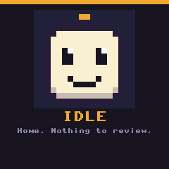

`tools/mascotsheet` draws everything on this page: the face cards, the sheet, the GIF, and the screens
at both sizes. On the emulator: `tools/emu run mascot_ui` (turn or press A for the next screen; home
blinks), or `tools/emu run mascot_faces`.

## The faces

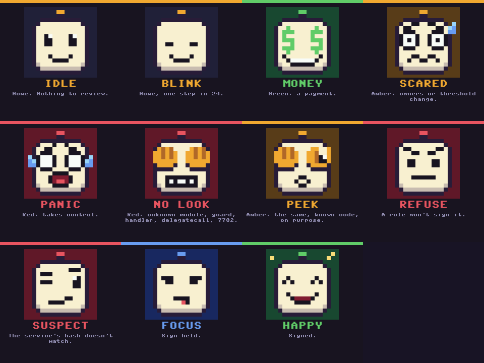

| face | band | when | the class it comes from |
|---|---|---|---|
| **idle** | none | home, nothing being reviewed | |
| **blink** | none | home, one step in 24 (v3's 8 steps a second: a blink every 3 s) | |
| **money** | green | a payment: ETH or a token out | `pays` |
| **scared** | amber | an owner added, removed or swapped; the threshold changed, still safe | `who_can_act` |
| **panic** | red | takes control: one key, or someone new, could move everything | `takes_control` |
| **no look** | red | a module, guard or fallback handler whose code isn't in the registry; a delegatecall; an EIP-7702 delegation | `unknown_control` |
| **peek** | amber | the same kind of change, on purpose: known code, in the registry the owners approved | `known_control` |
| **refuse** | red | a page that says WILL NOT SIGN: a rule, not a setting | a refusal |
| **suspect** | red | the service's hash, or a signature, doesn't match what this device worked out | `mismatch` |
| **focus** | blue | Sign is held | |
| **happy** | green | signed | |

Two changes from the first brief, and why:
- **panic is its own face.** A swapped owner with the threshold unchanged is a change to watch
  (amber). A batch that swaps an owner and drops the threshold to 1 hands one key everything (red).
  One scared face for both would teach that they are the same.
- **peek is for account abstraction on purpose.** v3's account upgrade
  ([../README.md](../README.md#approving-account-abstraction-on-purpose)) is amber because the code is
  known and the owners approved it in the registry. The face still won't look straight at it: it is a
  control change, and it says so. Unknown code is **no look**, with both hands.

## How a face is picked

The same review model that picks the band picks the face (`mascot.classify`, `mascot.face_for`). Each
call in a transaction has a class. The worst one sets both:

1. `mismatch`: the hash or a signature doesn't match: **suspect**, and nothing is signed
2. `unknown_control`: code nobody here can read takes a control role: **no look**
3. `takes_control`: **panic**
4. `known_control`: **peek**
5. `who_can_act`: **scared**
6. `pays`: **money**
7. `routine`: **idle**

So a batch with a payment and a new module never gets money eyes. Nothing Safe's service says, about
the transaction or itself, picks a face: only the fields this device decoded and the hash it rebuilt.

## The screens

At 320 × 240, the pico-sign build's 2.4″. The band is 52 px, not v3's 34, to hold the 48 px face beside
the title. Everything else is v3's frame.

| | | |
|---|---|---|
| 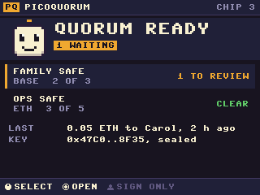 | 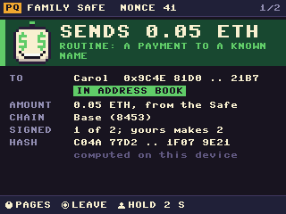 | 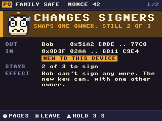 |
| **Home.** Idle; blinks. | **A payment.** Money eyes, green. | **A signer swap.** Scared, amber. Still 2 of 3. |
| 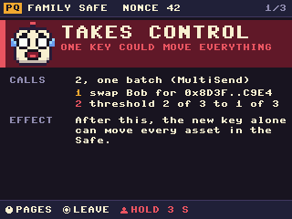 | 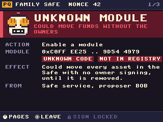 | 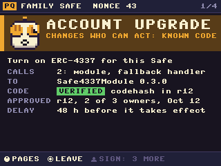 |
| **Takes control.** Panic, red: the swap and a threshold of 1 in one batch. | **A module from nowhere.** No look, red. Sign locked. | **Account upgrade, on purpose.** Peek, amber. Known code, approved. |
| 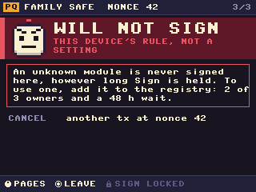 | 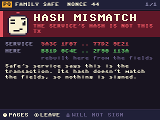 | 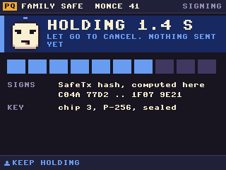 |
| **Will not sign.** Refuse. The rule, and the way past it. | **Hash mismatch.** Suspect. Nothing signed. | **Holding.** Focus, blue. |
| 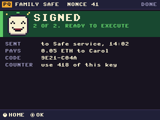 | | |
| **Signed.** Happy, green. | | |

At 240 × 240 (v3 rule 7), long titles take two lines and the facts their short forms:

| | | | |
|---|---|---|---|
| 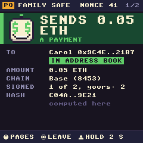 | 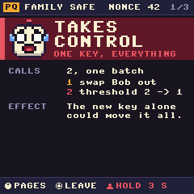 | 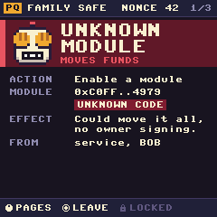 | 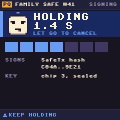 |

All ten are in [240/](240/).

## What it must never do

- **Be the only signal.** Cover the face and every screen still reads the same: the band's colour and
  title, the words, the footer. Someone who can't tell the colours apart, or can't read a pixel face,
  loses nothing.
- **Make danger cute.** Red faces are not jokes: panic, no look, refuse and suspect have no smile, no
  sparkle. Money eyes are only for green.
- **Disagree with the band.** Both come from one classification. A face is never chosen by itself.
- **Move on a review.** Only home blinks. A face that bounced on a red page would pull the eye away from
  the words that say why it is red.
- **Come from the service.** As above.
- **Be bigger than the band.** It sits inside it.

## Open questions

- **Does it ship?** It needs v3's frame and review model in the console first (v3's README, What's next,
  steps 1 and 4). Then it is about 140 lines of MicroPython, the art included: a firmware change, and a
  new release fingerprint.
- **Is it serious enough?** For a family Safe it may make the console friendlier to the people least
  used to Safe. For a company treasury it may read as a toy. A setting, `FACE = False`, would answer
  both, but v3 rule 5 is wary of settings that change what a warning looks like. Off would only remove
  the face; the band and words stay.
- **The 1.3″ and the Feather.** 48 px is a fifth of the Waveshare's height. At 2 px an art pixel (32 px)
  the dollar signs and fingers still read; not drawn yet.
- **Sound or LED.** The face could drive the key's LED colour. Not designed.
- **Its name.** Quo, from quorum. Open to better.
