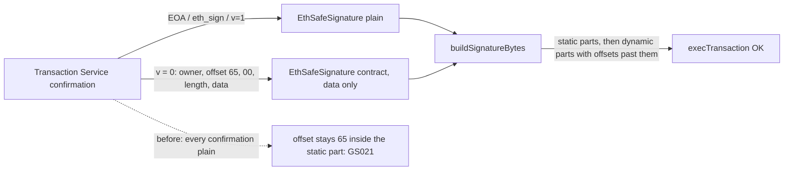

# Safe{Wallet} can't execute a transaction with a contract-owner confirmation (GS021)

> **Drafts only. Nothing has been submitted to Safe.** This is an issue and a pull request for
> [safe-global/safe-wallet-monorepo](https://github.com/safe-global/safe-wallet-monorepo), ready
> for Jason to review. The fix is [safe-wallet-gs021.patch](safe-wallet-gs021.patch), made against
> their `dev` at `5717e3a` (2026-09-24).
>
> Before submitting:
> - Safe requires the [CLA](https://safe.global/cla).
> - The PR needs a fork of the repo.
> - Their guidelines require AI-authored PRs to say so, with a Mermaid diagram (below).

## Why it matters to PicoQuorum

The web app can't execute any transaction a PicoQuorum key has approved once there are two or more
signatures, because the chip's approval is a contract signature. That's why rung 2 executes with
`tools/quorum live exec`. With this fix, the Safe web app's own Execute button would work.

## What we know

- **The failure.** In the Safe web app, "Simulation failed", "Cannot estimate", error code
  **GS021** (Safe 1.5.0 L2 on Base Sepolia, 2026-09-25, owners MetaMask + a passkey signer).
- **What GS021 means.** It's the Safe's `checkNSignatures` saying "contract signature data points
  inside the static part": the signature's offset is below `threshold × 65`.
- **The cause** is in the web app's
  [`createExistingTx`](https://github.com/safe-global/safe-wallet-monorepo/blob/5717e3a/apps/web/src/services/tx/tx-sender/create.ts#L131-L141).
  - It adds every confirmation from the service as a plain signature: `staticPart = data`,
    `dynamicPart = ''`, `isContractSignature: false`.
  - A contract owner's confirmation is stored as `{owner}{offset = 65}{00}{length}{data}`, so it gets
    concatenated whole with its offset still at 65.
  - Mobile has the same code in
    [`addSignaturesToTx`](https://github.com/safe-global/safe-wallet-monorepo/blob/5717e3a/apps/mobile/src/services/tx/tx-sender/create.ts#L40-L50).
- **The earlier report.**
  [#3673](https://github.com/safe-global/safe-wallet-monorepo/issues/3673), "EIP1271 offchain
  signature not merged before simulate/execute", was reported for a nested Safe owner.
  - A maintainer diagnosed it in Aug 2024: *"the bug is likely here: create.ts … The dynamic part is
    always set to `''` which is wrong for nested Safe signatures."*
  - It was closed as "not planned" in Feb 2026 without a fix.
- **Checked against the real Safe,** at Base Sepolia block 47,276,343, the block before it executed:
  - the web app's exact bytes (the stored signatures sorted by signer and concatenated, 450 bytes)
    revert with GS021
  - the fixed layout (450 bytes, the contract signature re-pointed to 130) succeeds, and it is
    byte for byte what executed in
    [0xb8ee…](https://sepolia.basescan.org/tx/0xb8ee9c98c966d24a85b115c1979c060e2cad9fd752d473ba25235df827c88c61)
- **The fix, tested.**
  - A `toSafeSignature` helper in `packages/utils` rebuilds a stored confirmation as an
    `EthSafeSignature`, marked as a contract signature with just its data when v = 0.
  - Web and mobile both use it.
  - 5 unit tests pass (jest, run in a node environment locally). The main one feeds the two real
    stored confirmations through the helper and protocol-kit's `buildSignatureBytes`, and gets the
    executed bytes.

---

## Draft issue

**Title:** Executing a queued tx fails with GS021 when a confirmation is an EIP-1271 contract signature

**Bug description**

The web app can't simulate or execute a queued transaction if one of its confirmations is an EIP-1271
contract signature and there are two or more signatures.
- The contract owner can be a nested Safe, or a passkey signer such as `SafeWebAuthnSignerProxy`.
- The web app shows "Simulation failed" and "Cannot estimate", then *This transaction will most
  likely fail… Error code GS021*.

The Transaction Service accepts the confirmation (it checks it with `isValidSignature`). The same
transaction executes when the signatures are laid out correctly.

This looks like the cause diagnosed in #3673, which was closed as not planned.

**Environment**

- Browser: Chrome
- Wallet: MetaMask
- Chain: Base Sepolia
- Safe: 1.5.0 L2, 2-of-3. Owners are an EOA, a `SafeWebAuthnSignerProxy` (safe-modules passkey
  v0.2.1), and a second EOA.

**Steps to reproduce**

1. Create a Safe whose owners include a contract signer (a passkey `SafeWebAuthnSignerProxy` or
   another Safe) and at least one EOA, with a threshold of 2.
2. Propose a transaction in Safe{Wallet} and sign it with the EOA.
3. Confirm it with the contract owner: `POST /api/v1/multisig-transactions/{safeTxHash}/confirmations/`
   with its contract signature (v = 0). The service answers 201.
4. Open the transaction in Safe{Wallet} and click Execute.

Public example: Safe `0xEDEDC0063B23A309f4cAdA5e1225Ef21D8A30a43` on Base Sepolia, nonce 3
(`safeTxHash 0x8d804e8e…`).
- It was later executed with correctly laid-out signatures in `0xb8ee9c98…`.
- Simulating `execTransaction` at block 47276343 with the bytes Safe{Wallet} builds reverts with
  GS021.
- With the contract signature re-pointed, it succeeds.

**Expected result**

The transaction simulates and executes, as it does with protocol-kit when the confirmation is added
as a contract signature.

**Obtained result**

GS021. `createExistingTx`
([create.ts#L131-L141](https://github.com/safe-global/safe-wallet-monorepo/blob/5717e3a/apps/web/src/services/tx/tx-sender/create.ts#L131-L141))
adds each stored confirmation as `{ staticPart: () => data, dynamicPart: () => '', isContractSignature: false }`.
- A contract owner's confirmation is stored as `{owner}{offset = 65}{00}{length}{data}`, so
  `buildSignatureBytes` concatenates it whole with its offset still at 65.
- With two signatures, the static part is 130 bytes, and `checkNSignatures` requires
  `s >= requiredSignatures * 65`.
- The same code is in mobile's `addSignaturesToTx`.

**Screenshots:** the Execute screen with "Simulation failed" and "Error code GS021".

---

## Draft pull request

**Title:** `fix: keep EIP-1271 contract signatures when rebuilding a queued tx (GS021)`

**What it solves**

Resolves: #3673 (closed as not planned, same cause), and the issue above if it is opened.

When a queued transaction has a confirmation from a contract owner (a nested Safe, or a passkey
signer) plus at least one more signature, simulation and execution fail with GS021.

**How this PR fixes it**

- A new `toSafeSignature(signer, signature)` in `packages/utils/src/utils/safeTransaction.ts`:
  - For a stored signature with v = 0 and a well-formed `{offset}{length}{data}`, it returns
    `new EthSafeSignature(signer, data, true)`.
  - For anything else it returns `new EthSafeSignature(signer, signature)`, the same behaviour as
    today.
- protocol-kit's `buildSignatureBytes` then puts the contract signature's data after all the static
  parts and writes the right offset.
- `createExistingTx` (web) and `addSignaturesToTx` (mobile) use the helper instead of the inline
  plain-signature object.

**How to test it**

- Unit: `packages/utils/src/utils/__tests__/safeTransaction.test.ts`. It uses a real Base Sepolia
  transaction's two stored confirmations (an EOA and a `SafeWebAuthnSignerProxy`) and checks that
  the rebuilt signature bytes equal what the Safe executed (its `SafeMultiSigTransaction` event).
- Manual:
  1. Use a Safe with an EOA and a contract owner, threshold 2.
  2. Propose with the EOA.
  3. Confirm with the contract owner through the Transaction Service.
  4. Execute in Safe{Wallet}. Simulation passes and the transaction executes.

**Affected flows**

- Executing, simulating or speeding up a queued transaction that has a contract-owner confirmation
  (web `createExistingTx`: execute, `QueuedTxSimulation`, `SpeedUpModal`).
- Mobile: the same flows through `addSignaturesToTx` / `createExistingTx`.

**Blast radius**

- `packages/utils` gains one export, used by web and mobile.
- EOA, eth_sign and pre-approved (v = 1) signatures are unchanged: they aren't v = 0 with a
  dynamic part, and `EthSafeSignature`'s plain `staticPart()` returns the data as before.

**Risks / not checked**

- Not tested on mobile devices.
- A nested Safe owner's confirmation wasn't reproduced end to end; the passkey owner was. Both are
  v = 0 contract signatures.
- A v = 0 signature without a well-formed dynamic part is left as it is today.
- Unit tests were run with `--testEnvironment=node` in a focused install. The package's default
  jsdom environment wasn't installed.

**Visual summary**

**Checklist:** unit test written. Not tested on a mobile device. No analytics impact. The CLA
confirmation line from their template goes at the end. The PR should say it was drafted with an
AI assistant.
