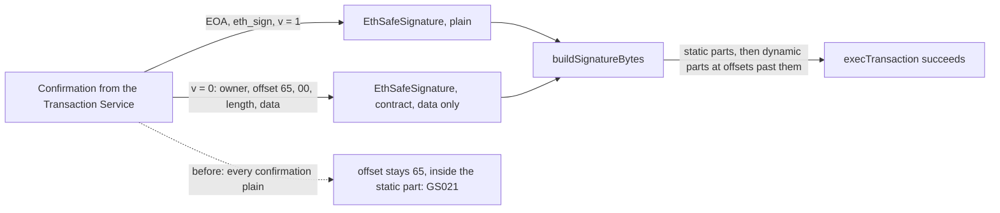

<!--
Paste-ready pull request for safe-global/safe-wallet-monorepo, from the fork's branch
fix/contract-signatures-existing-tx into dev. Follows their .github/PULL_REQUEST_TEMPLATE.md.
Before opening: replace #ISSUE with the issue number, and put "Fixes #ISSUE" in the commit message
too (see README.md, step 4). Their guidelines require AI-authored PRs to say so and to include the
Mermaid visual summary.
-->

**Title:** `fix: keep EIP-1271 contract signatures when rebuilding a queued tx (GS021)`

---

## What it solves

Resolves: #ISSUE (same cause as #3673, which was closed as not planned)

When a queued transaction has a confirmation from a contract owner and at least one more signature, Safe{Wallet} can't simulate or execute it: GS021, "Cannot estimate". The contract owner can be a nested Safe, or a passkey signer such as `SafeWebAuthnSignerProxy`.

## How this PR fixes it

- **The helper.** New `toSafeSignature(signer, signature)` in `packages/utils/src/utils/safeTransaction.ts`:
  - v = 0 with a well-formed `{offset}{length}{data}`: returns `new EthSafeSignature(signer, data, true)`, a contract signature carrying only its data.
  - Anything else: returns `new EthSafeSignature(signer, signature)`, which behaves as today.
- **The layout.** protocol-kit's `buildSignatureBytes` then puts contract signatures' data after all the static parts and writes the right offsets.
- **The callers.** `createExistingTx` (web) and `addSignaturesToTx` (mobile) now use the helper instead of an inline plain-signature object.

## How to test it

- **Unit:** `yarn workspace @safe-global/utils test src/utils/__tests__/safeTransaction.test.ts`.
  - The fixtures are a real Base Sepolia transaction's two confirmations, exactly as the Transaction Service returns them: an EOA and a `SafeWebAuthnSignerProxy`.
  - The test checks that the rebuilt signature bytes equal what the Safe executed, as logged by its `SafeMultiSigTransaction` event.
- **Manual:**
  1. Use a Safe with an EOA and a contract owner, threshold 2.
  2. Propose with the EOA in Safe{Wallet}.
  3. Confirm with the contract owner through the Transaction Service.
  4. Open the transaction and click Execute: the simulation passes and it executes.

## Affected flows

- Executing a queued transaction that has a contract-owner confirmation.
- Simulating it (`QueuedTxSimulation`) and speeding it up (`SpeedUpModal`), both of which use `createExistingTx`.
- Mobile: the same flows through `createExistingTx` / `addSignaturesToTx`.

## Blast radius

- `packages/utils` gains one export, used by web and mobile.
- EOA, eth_sign and pre-approved (v = 1) signatures go through `EthSafeSignature` as plain signatures. Its `staticPart()` returns the data unchanged, as before.
- No API, store or feature-flag changes.

## Risks / not checked

- Not tested on a mobile device.
- The nested-Safe case from #3673 wasn't reproduced end to end. The passkey case was. Both are v = 0 contract signatures with a dynamic part.
- A v = 0 signature without a well-formed dynamic part is left as it is today.

## Visual summary

This PR was drafted with the help of an AI assistant (Claude). I reviewed and tested the change.

## Checklist

- [ ] I've tested the branch on mobile 📱
- [x] I've documented how it affects the analytics (if at all) 📊 (no effect)
- [x] I've written a unit/e2e test for it (if applicable) 🧑‍💻
- [x] I've listed affected flows and blast radius, and named what I did not verify 🎯

---

## CLA signature

With the submission of this Pull Request, I confirm that I have read and agree to the terms of the [Contributor License Agreement](https://safe.global/cla).
