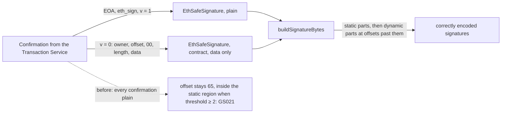

**Title:** `fix: keep EIP-1271 contract signatures when rebuilding a queued tx (GS021)`

---

## What it solves

Resolves: #ISSUE. #3673 appears to have the same underlying cause.

In a Safe with a threshold of 2 or more, Safe{Wallet} can't simulate or execute a queued transaction when a confirmation the Safe has to check is an EIP-1271 contract signature. The failure is GS021 and "Cannot estimate". I reproduced it with a passkey signer (`SafeWebAuthnSignerProxy`). #3673 reports it for a nested Safe owner.

## How this PR fixes it

- **The helper.** `toSafeSignature(signer, signature)` is new, in `packages/utils/src/utils/safeTransaction.ts`. It turns a confirmation as the Transaction Service returns it into an `EthSafeSignature`:
  - **v = 0:** it reads the encoded offset. The offset must lie past the 65-byte static part and point at a length word whose data runs exactly to the end of the signature. It then returns `new EthSafeSignature(signer, data, true)`, a contract signature carrying only its data.
  - **Anything else** (EOA, eth_sign, pre-approved v = 1, or a v = 0 signature that doesn't parse) comes back as `new EthSafeSignature(signer, signature)`. Its bytes are unchanged, as today.
- **The layout.** protocol-kit's `buildSignatureBytes` then places contract signatures' data after all the static parts and computes their offsets, the same way it does when protocol-kit signs with a contract owner.
- **The callers.** `createExistingTx` (web) and `addSignaturesToTx` (mobile) now use the helper instead of the inline plain-signature object.

## How to test it

**Unit tests** (`yarn workspace @safe-global/utils test src/utils/__tests__/safeTransaction.test.ts`, 11 tests):
- EOA, eth_sign and pre-approved (v = 1) signatures come back unchanged.
- A stored contract signature keeps only its data.
- Fixtures from a 2-of-2 Safe (EOA, contract) and a 3-of-3 Safe (contract, EOA, contract):
  - the rebuilt bytes equal the captured bytes
  - each contract offset points past every static part
  - input order doesn't matter
- Malformed v = 0 signatures stay plain: an offset inside the static part, an offset past the end, data shorter than its length, and trailing bytes.

The unit tests check encoding only. The fixtures come from a separate fork experiment:
- **Setup:** Safes 1.5.0 owned by throwaway keys, on a local fork of Base Sepolia.
- **Current layout:** the same confirmations laid out as `createExistingTx` does today revert with GS021.
- **Fixed layout:** it executes. `ExecutionSuccess` is emitted, the recipient's balance increases by the transferred amount, and the `SafeMultiSigTransaction` event logs exactly the bytes used as fixtures.
- **Control:** a 1-of-2 Safe works with both layouts, because the static region is only 65 bytes at a threshold of 1.
- The script is in #ISSUE.

**Manual:**
1. Use a Safe with a threshold of 2 whose owners include an EOA and a contract owner.
2. Propose in Safe{Wallet} and sign with the EOA.
3. Confirm with the contract owner through the Transaction Service.
4. Execute in Safe{Wallet}. Simulation should pass and the transaction should execute. Before this change it fails with GS021.

## Affected flows

- **Web:** executing a queued transaction with a contract-owner confirmation. Also simulating it (`QueuedTxSimulation`) and speeding it up (`SpeedUpModal`), both of which use `createExistingTx`.
- **Mobile:** mobile uses the same signature reconstruction in a shared helper, `addSignaturesToTx`. It is reached from execution, relay, WalletConnect, Ledger signing and execution, and the transaction checks. This PR updates that helper. Mobile behavior has not been verified on a device.

## Blast radius

- `packages/utils` gains one export, used by web and mobile.
- Signatures that aren't well-formed v = 0 contract signatures produce the same bytes as before. The unit tests check this.
- No API, store or feature-flag changes.

## Risks / not checked

- Not tested on a mobile device, or in any of the mobile flows listed above.
- The nested-Safe case from #3673 wasn't reproduced. The passkey case was, on a fork and on live Safes. Both are v = 0 contract signatures with a dynamic part.
- Correct encoding removes this GS021. It doesn't make a transaction succeed that would fail for other reasons.
- The unit tests were run in a node test environment on a partial install, not in the package's default jsdom environment. CI runs the full setup.

## Visual summary

Drafted with AI assistance; I reviewed the changes. Testing and limitations are documented above.

## Checklist

- [ ] I've tested the branch on mobile 📱
- [x] I've documented how it affects the analytics (if at all) 📊 (no effect)
- [x] I've written a unit/e2e test for it (if applicable) 🧑‍💻
- [x] I've listed affected flows and blast radius, and named what I did not verify 🎯

---

## CLA signature

With the submission of this Pull Request, I confirm that I have read and agree to the terms of the [Contributor License Agreement](https://safe.global/cla).
