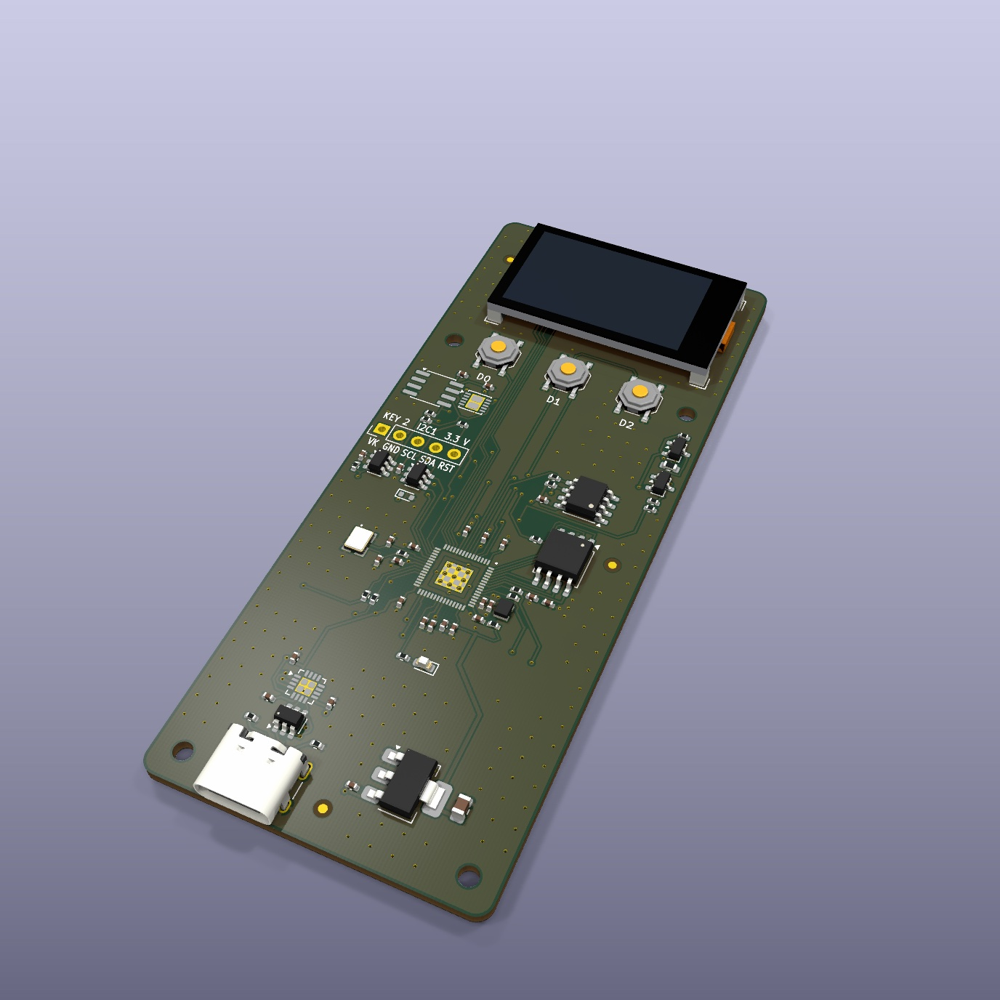
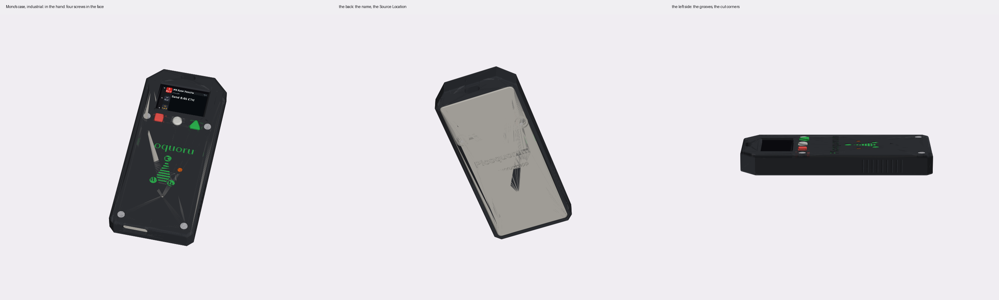

# hardware

Console and key electronics. The goals are in [`../docs/KICKOFF.md`](../docs/KICKOFF.md).

The work is on **Mono**. Everything else here is the board it comes from, the keys, the dev console
that runs the firmware today, or kept for the record.

| | what it is | where it stands |
|---|---|---|
| **[Mono](mono/README.md)** | the reference console: an RP2350A with no radio, the ATECC608C on the board, a 1.14″ screen and three buttons on a 40 × 89.5 mm bar | designed and routed, 2026-11-06. Its fab files pass `tools/keypcb jlc mono`. 20 ordered 2026-11-09 ([the order](../buildlog/2026-11-09-mono-order.md)), none arrived |
| **[Mono's case](../cad/consoles/README.md#mono)** | a printed shell and back panel, and [the industrial variant](../cad/consoles/README.md#mono-industrial) with cut corners and grooves | first drafts, not printed |
| [console-rp](console-rp/README.md) | the board Mono comes from: the same RP2350A, link, key, screen and pins, on 72 × 36 mm | 5 boards received 2026-11-04. The first is up on a bench script; the console's firmware for it isn't written |
| [key-c and the other keys](key-pcb/README.md) | the key as a part you plug in: an ATECC608C behind a USB-C receptacle | key-c P2 built and working; P3 drawn |
| [the dev console](DEV-CONSOLE.md) | a Pico 2 W, a Waveshare screen and an ATECC608 breakout, no soldering | runs the console image today |
| [prototypes/](prototypes/README.md) | the two ESP32-S3 boards with their own Wi-Fi: console-s3 and PicoquorumKey | both made; the first board of each runs |
| [archive/](archive/README.md) | earlier boards and builds, no longer worked on | as they were on 2026-11-11 |

## Mono

*KiCad's 3D render of the routed board. The panel is drawn as a box.*

Mono is a working name. It is the design the others are measured against:
- **No radio.** The USB-C reaches a serial chip and nothing else. A computer passes on Safe's queue;
  the console rebuilds every hash itself, and the key signs only that.
- **The key on the board,** an ATECC608C, and a site for a second key on a bus and a supply of its own.
- **Every part JLCPCB fits is on the front,** for Economic assembly; the screen goes on by hand. Nine
  pads on the back are for a pogo jig.
- **console-rp's pins,** so console-rp's image will run on it unchanged.

**Its case** is in [`cad/consoles/`](../cad/consoles/README.md), drawn by scripts:

| | script | build | outputs |
|---|---|---|---|
| Mono's case | [`mono.py`](../cad/consoles/mono.py) | `tools/case build mono` | [`out/mono/`](../cad/consoles/out/mono/) |
| the industrial variant | [`mono_ind.py`](../cad/consoles/mono_ind.py) | `tools/case build mono-industrial` | [`out/mono_ind/`](../cad/consoles/out/mono_ind/) |

[`cad/mono/`](../cad/mono/README.md) is the board itself as a print, to hold. The enclosure's open
questions (a guard over Sign, printed or aluminum, the name on the face) are in the kickoff's
[open decisions](../docs/KICKOFF.md#open-decisions).

## What is in this folder

- [`mono/`](mono/README.md): Mono's board. Its generator, the KiCad project, fab files, renders and
  [pins](mono/PINS.md)
- [`console-rp/`](console-rp/README.md): the first RP2350 console. Its
  [bring-up](console-rp/bench/BRINGUP.md), [the plan](console-rp/PLAN-2026-11-04.md) written the
  night it came up, and [a plan for a square rev B](console-rp/REV-B-PLAN-2026-11-05.md)
- [`key-pcb/`](key-pcb/README.md): the keys' boards, [key-c](key-pcb/key-c-usbc/README.md) among
  them, and how to order them ([ORDERING.md](key-pcb/ORDERING.md))
- [`DEV-CONSOLE.md`](DEV-CONSOLE.md), [`bom/`](bom/README.md) and [`wiring/`](wiring/): the dev
  console and the other builds from bought boards that the firmware has a profile for.
  [Build 1](wiring/BUILD1.md), [on a breadboard](wiring/BREADBOARD.md),
  [on an ESP32](wiring/ESP32.md), [on a Feather](wiring/FEATHER-S3.md), and the
  [perfboard wiring](wiring/SOLDERING.md) from picowallet (`tools/wiring`)
- [`prototypes/`](prototypes/README.md): console-s3 and PicoquorumKey, and the plan they were
  ordered from
- [`archive/`](archive/README.md): console-a (two of them), console-pocket, console-usb, the
  Feather's wings, and four builds that were written up and not wired

`tools/keypcb` checks, routes and writes fab files for the boards, wherever they are
(`tools/keypcb check mono`). `tools/case` rebuilds the printed cases.

## Every configuration

Two kinds: **builds**, put together from bought boards, and **boards** we design. The firmware
column is the console image's `BOARD` profile (`firmware/board.py`); a build's own test and demo
screens are bench scripts, never part of the image
([archive/builds/](archive/builds/README.md#firmware)).

| name | kind | the key | firmware | where it stands |
|---|---|---|---|---|
| **[Mono](mono/README.md)** | board | ATECC608C (SOIC-8) on the board; a second key's site, not fitted | console-rp's profile, not written | 20 ordered, none arrived |
| [console-rp](console-rp/README.md) | board | ATECC608C (SOIC-8) on the board | a `console-rp` profile, not written | 5 received 2026-11-04 ([order](../buildlog/2026-10-29-console-rp-order.md)); the first is up on a bench script |
| [key-c and the other keys](key-pcb/README.md) | board | — | — | key-c P2 built and working; P3 drawn |
| [dev console](DEV-CONSOLE.md) | build | ATECC608 breakout, STEMMA QT | `waveshare` | the no-solder build |
| [Build 1](wiring/BUILD1.md), [on a breadboard](wiring/BREADBOARD.md) | build | ATECC608 on TRRS jacks | `build1` | — |
| [ESP32 DevKit](wiring/ESP32.md) | build | ATECC608 breakout | `esp32` | the console ran on a WROVER |
| [Feather + adapters](wiring/FEATHER-S3.md) | build | key-c, STEMMA QT to USB-C adapters | `feather-s3`; bench in [wiring/feather-s3/](wiring/feather-s3/) | runs; chip 3 through the ceremony, 2026-10-22 |

Early prototypes ([prototypes/](prototypes/README.md)):

| name | kind | the key | firmware | where it stands |
|---|---|---|---|---|
| [console-s3](prototypes/console-s3/DESIGN.md) | board | ATECC608C on the board | `feather-s3` | 5 boards came 2026-11-02; board 1 runs ([its first day](../buildlog/2026-11-02-console-s3-first-board.md)) |
| [picoquorum-key](prototypes/picoquorum-key/README.md) | board | UDFN ATECC608C on the board; rev B adds a key port for key-c | `picoquorum-key`, picked by its key bus's pull-ups; the port needs a later image | boards made, rev B; the first reported working, 2026-11-03 ([build log](../buildlog/BUILDLOG.md)) |

Archived ([archive/](archive/README.md)):

| name | kind | the key | firmware | where it stood |
|---|---|---|---|---|
| [console-a (console-pcb)](archive/console-pcb/README.md) | board | key-c, USB-C | `build1` | designed |
| [console-a](archive/console-a/README.md) | board | pads | `waveshare` | designed, not ordered |
| [console-pocket](archive/console-pocket/README.md) | board | pads | `waveshare` | not checked in KiCad, not ordered |
| [console-usb](archive/console-usb/README.md) | board | ATECC608C on the board | `feather-s3`, plus firmware not written | not routed |
| [feather-wing a, b](archive/feather-wing/README.md) | board | key-c, USB-C | `feather-s3` | not ordered |
| [Feather pigtail](archive/builds/feather-pigtail/README.md) | build | key-c, a USB-C cable soldered to the pins | `feather-s3`; bench `swap.py`; a case | written up, not wired |
| [Feather knob](archive/builds/feather-knob/README.md) | build | key-c, a USB-C adapter on the header pins | `feather-knob` (knob and Boot); bench `dial.py` | written up, not wired |
| [pico-sign](archive/builds/pico-sign/README.md) | build | key-c in a cartridge, in a bay | `build1` (knob, hold-to-sign switch); case concepts | written up, not wired |
| [pico-sign-handheld](archive/builds/pico-sign-handheld/README.md) (Picoquorum Handheld) | build | key-c in a snap-shut cartridge, slid into a bay in the back | `build1`, `SCREEN = "2.4"`; a flat handheld case, [assembly](archive/builds/pico-sign-handheld/ASSEMBLY.md) | written up, not wired |

## Moved on 2026-11-11

Older notes, the build log's text and the comments in `firmware/board.py` and `firmware/lcd.py` name
these folders where they were:

| was | is |
|---|---|
| `hardware/console-s3/`, `hardware/picoquorum-key/` | `hardware/prototypes/` |
| `hardware/console-a/`, `console-pcb/`, `console-pocket/`, `console-usb/`, `feather-wing/`, `builds/` | `hardware/archive/` |
| `ORDER-PLAN-2026-10-24.md` | `hardware/prototypes/` |
| `CONSOLE-RP-PLAN-2026-11-04.md`, `CONSOLE-RP-REV-B-PLAN-2026-11-05.md` | `hardware/console-rp/PLAN-2026-11-04.md`, `REV-B-PLAN-2026-11-05.md` |

The firmware's comments wait for the next firmware change: editing them alone would be a new release
fingerprint (AGENTS.md, rule 2).

## License

Copyright Jason McPheron 2026.

This source describes Open Hardware and is licensed under the CERN-OHL-W v2
([LICENSE-HARDWARE](../LICENSE-HARDWARE), https://ohwr.org/cern_ohl_w_v2.txt). You may redistribute
and modify this source and make products using it under the terms of the CERN-OHL-W v2. This source
is distributed WITHOUT ANY EXPRESS OR IMPLIED WARRANTY, INCLUDING OF MERCHANTABILITY, SATISFACTORY
QUALITY AND FITNESS FOR A PARTICULAR PURPOSE. Please see the CERN-OHL-W v2 for applicable
conditions.

**Source Location:** https://github.com/jmcpheron/pico-quorum

As per CERN-OHL-W v2 section 4.1, should you make hardware based on these sources, you must keep
the Source Location visible on the product itself (its silkscreen, case or label) or, where it
doesn't fit, on its packaging or documentation.

The name and the mark on the boards are not part of this license ([TRADEMARK.md](../TRADEMARK.md)):
a board you change carries your name, with the Source Location.

- [ ] Put the Source Location on the silkscreen at the next key revision (key-c P3).
