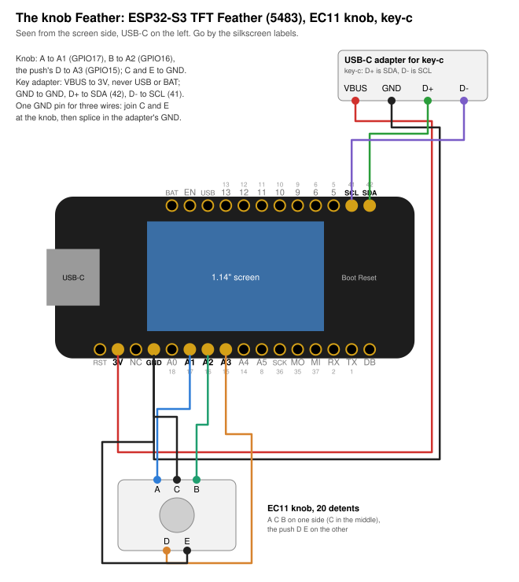

# The knob Feather

| | |
|---|---|
| board | Adafruit ESP32-S3 TFT Feather ([5483](https://www.adafruit.com/product/5483)), headers soldered |
| key | a key-c, on a USB-C adapter wired to the header pins |
| runs | the console image as `BOARD = "feather-knob"`; [`bench/dial.py`](bench/dial.py) first |
| case | none yet |
| status | written up 2026-10-25; not wired, not run on the board |

The Reverse TFT's sister board: the same 1.14″ 240 × 135 screen and the same ESP32-S3 with 2 MB of
PSRAM, but only Boot and Reset, no D1 or D2. An EC11 knob takes their place. Boot is Reject and
Back, the knob moves, and its push opens and, held, signs.



## Not the Reverse TFT's pins

From Adafruit's board files
([Adafruit-ESP32-S3-TFT-Feather-PCB](https://github.com/adafruit/Adafruit-ESP32-S3-TFT-Feather-PCB)),
the schematic's nets mapped to the module's GPIOs:

| | Reverse TFT (`feather-s3`) | this board (`feather-knob`) |
|---|---|---|
| key SDA, SCL | 3, 4 | **42, 41**, the SDA and SCL header pins |
| screen CS, DC, RST | 42, 40, 41 | **7, 39, 40** |
| screen SCK, MOSI, backlight | 36, 35, 45 | 36, 35, 45 |
| screen and I2C power | 7 | **21** |
| buttons | D0 (0), D1 (1), D2 (2) | Boot (0) only |
| battery gauge | MAX17048 at 0x36 | LC709203F at 0x0B in Adafruit's file; later boards have a MAX17048 at 0x36 |

So the `feather-s3` profile can't run here. On any ESP32-S3 the console still picks `feather-s3`,
unless `secrets.py` says `BOARD = "feather-knob"`.

CircuitPython starts both boards' screens the same way (MADCTL 0x68, column 40, row 53), so the
profile keeps `feather-s3`'s MADCTL 0x60 and offsets. Not yet seen on this board. If the picture is
upside down or shifted, that is the first thing to change.

## The knob

An EC11 with a push: 20 detents a turn, a 0.5 mm push, a 6 mm D-shaft on an M7 bushing. A, C and B
are on one side with C in the middle; the push's two pins, D and E, are on the other.

| knob pin | Feather pin | GPIO |
|---|---|---|
| A | **A1** | 17 |
| C | **GND** | |
| B | **A2** | 16 |
| D (the push) | **A3** | 15 |
| E (the push) | **GND** | |

- All three use the S3's own pull-ups. No resistors.
- None of them is a strapping pin, and none is used by the screen or the key.
- If a turn clockwise counts backwards, swap the A and B wires.
- The listing doesn't give pulses per turn. A 20-detent EC11 is usually 20 pulses, which is 4
  quadrature steps a detent, what `firmware/knob.py` expects. `bench/dial.py` shows the steps per
  detent. If one detent is 2 steps, say so and the profile changes.

## The key

A USB-C adapter for key-c, on four header pins (key-c: D+ carries SDA, D− carries SCL, VBUS is key
power):

| adapter | Feather pin |
|---|---|
| VBUS | **3V**. Never USB or BAT |
| GND | **GND** |
| D+ | **SDA** (GPIO42) |
| D− | **SCL** (GPIO41) |

- **One GND pin, three wires.** The Feather has one GND on its headers. Join the knob's C and E at
  the knob, then splice that wire and the adapter's GND to the GND pin, on a breadboard row or with a
  short Y-lead.
- Key-c has the receptacle. If the adapter is a receptacle too, put a short USB 2.0 C-to-C cable
  between them.
- Before the first key goes in: meter VBUS to GND (not a short), and D+ and D− to SDA and SCL.
- The Feather's SDA/SCL pull-ups are on GPIO21's rail, with the screen. The console and `bench/`
  drive it high first.
- Like the pigtail, this has none of wing-a's current limit or ESD diodes: the key is powered
  whenever the Feather is.

## First: the bench check

[`bench/dial.py`](bench/dial.py) shows the knob's detents and raw steps, the push and Boot, every
I2C address that answers, and the key at 0x60 (its serial, revision and profile). The push scans
again. It reads only. From the repository root:

```sh
export PICO_PORT=/dev/cu.usbmodem3101
B=hardware/builds/feather-knob/bench
mpremote connect $PICO_PORT fs mkdir :bench + \
  fs cp $B/board.py :bench/board.py + fs cp $B/tft.py :bench/tft.py + \
  fs cp firmware/atecc.py :bench/atecc.py + fs cp firmware/chipcfg.py :bench/chipcfg.py + \
  fs cp $B/dial.py :bench/dial.py + fs cp $B/main.py :main.py + reset
```

MicroPython 1.26.1's `ESP32_GENERIC_S3` build, as in [FEATHER-S3.md](../../wiring/FEATHER-S3.md#try-it).
`tft.py` here is the Reverse TFT's with this board's pins; `board.py` is a stand-in with the key's
bus, so `atecc.py` imports.

What to look for:
- the screen comes up the right way round
- one detent clockwise is +1 and +4 steps
- push and Boot read DOWN while held
- the key's serial when one is plugged in

`python3 hardware/builds/feather-knob/bench/dial_test.py` draws the screen on CPython against a
stand-in of the board and the emulator's virtual chip, and checks the pins, the counts and that only
reads reach the chip. It has not run on the board.

## Then: the console

In the board's `secrets.py`, beside the rest:

```python
BOARD = "feather-knob"
```

Then push the image as usual (`tools/fw push`, [docs/guide](../../../docs/guide/)).

| | on a review | anywhere else |
|---|---|---|
| Boot | Reject: one press, on any page, even while Sign is held | Back |
| turn clockwise | the next page (round to the first after the last) | the next row or choice |
| turn back | the page before; on the first page, out without rejecting | the one before |
| push | the next page not yet seen; once every page is seen, Sign, held 2 s (3 s when a page is red) | Open |

These are `feather-s3`'s rules: `lcd.Keys` hands the console a detent clockwise as D1, one back as
D1 held, the push as D2 and Boot as D0, so `quorum.three()` and the small screens run unchanged.
The rail down the left names what Boot (top), the turn (middle) and the push (bottom) do.

- **Maintenance:** the push held at power-up. Boot can't be: held at reset it starts the ROM
  bootloader.
- **Wi-Fi setup:** by itself when no network is saved, or Device → Wi-Fi on the console.

## The ceremony

A turn can't be held, so the Reverse TFT's arm (D0 + D1 held 3 s) can't be done here. The push is
the step key, and the rule is that the step key is never part of the arm. So:

| | |
|---|---|
| push on the banner | opens PROVISION |
| **Boot held 3 s** | the arm, for 60 s. Let go to start it |
| push | a step; on a permanent or GenKey step (C3, C4, C6, C9), held 3 s once armed, with 10 s or more of the arm left |
| one detent back | back |

`ALLOW_LOCK` and `ALLOW_GENKEY` in the board's `secrets.py` still gate every permanent step.
`node test-vectors/run-ceremony.mjs` walks C1–C10 on a virtual 608C this way. It also checks:
- the push held without the arm does nothing and arms nothing
- Boot let go at 2 s is no arm
- Boot and the push held together run no step
- with `ALLOW_LOCK` off, C3 locks nothing, armed or not
- Boot tapped isn't back; a detent back is
- with 9 s of the arm left, C6 says to arm again
- a refusal names Boot
- every screen fits 240 × 135

## What has run

- `python3 test-vectors/feather_s3_test.py`: the profile's pins and pulls, GPIO21 high, the knob on
  the pulse counter as D1/D1L/D2, Boot as D0, and the ceremony's key map, on CPython.
- `node test-vectors/run-console.mjs`: the console's three-key tests again as `feather-knob`.
- `node test-vectors/run-ceremony.mjs`: the ceremony above.
- `python3 hardware/builds/feather-knob/wiring.py --check`: the diagram's pins match `board.py`.

Not yet on the board:
- the screen's orientation
- the knob's direction and steps per detent
- `machine.Encoder` on the S3, which the ESP32 port has and build1 uses on a WROVER
