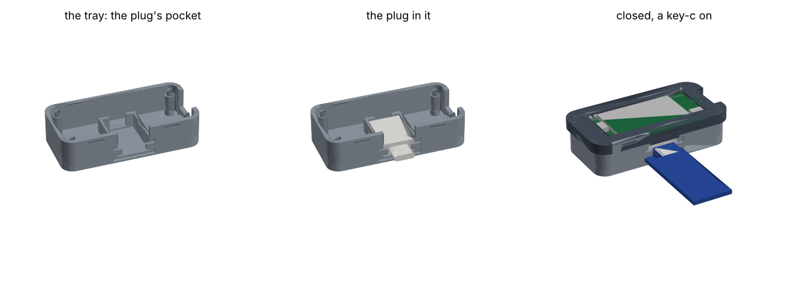

# The Feather pigtail

| | |
|---|---|
| board | Adafruit Feather ESP32-S3 Reverse TFT ([FEATHER-S3.md](../../wiring/FEATHER-S3.md)) |
| key | a key-c, on a USB-C cable whose other end is soldered to the Feather's pins |
| runs | the console image as `BOARD = "feather-s3"`, unchanged; [`bench/swap.py`](bench/swap.py) |
| case | [`case/`](case/case.py): a tray and a snap-on bezel; the plug sits in a pocket under the board, its shell out of the top edge |
| status | written up 2026-10-24; not wired, not printed |

The same Feather as the adapter build in [FEATHER-S3.md](../../wiring/FEATHER-S3.md), without
the STEMMA QT socket and the USB-C adapters. One USB-C cable is cut, and its four wires go straight
into the Feather's header holes. Its plug, outside the case, takes a key-c.

## The cable

A USB-C to USB-C cable, cut short behind one plug. That plug takes a key-c, which has the
receptacle. The case (v2) holds it under the board, so leave the wires about 40 mm long. The key uses only VBUS, GND, D+ and D− ([key-c](../../key-pcb/key-c-usbc/README.md):
D+ carries SDA, D− carries SCL, VBUS is key power).

A C-to-C cable has a CC wire, and some have more: SBU, the SuperSpeed pairs, VCONN on an e-marked
cable. Trim each of these back and insulate its end on its own. None goes to a Feather pin.

## The wiring

No headers. Each wire goes into its hole from the back (the side with the USB-C socket and the
module) and is soldered on the front, trimmed flush. The case's pocket holds the plug, so the
joints carry no strain.

| cable wire (the usual colour) | Feather pin | where |
|---|---|---|
| VBUS (red) | **3V** | 16-pin row, the second pin from the USB end |
| GND (black) | **GND** | 16-pin row, the fourth pin |
| D+ (green) | **SDA**, GPIO3 | 12-pin row, the last pin, at the antenna end |
| D− (white) | **SCL**, GPIO4 | 12-pin row, the one before it |
| shield, drain | trimmed back, or GND | |
| CC and any others | trimmed and insulated, not connected | |

- **3V, never USB or BAT.** USB is 5 V from the computer and BAT the battery. 3V is the Feather's
  always-on 3.3 V regulator, the pin wing-a takes its key power from.
- **The colours are only a convention.** Before soldering, meter each wire from its pin on the
  plug. Before the first key goes in, meter VBUS to GND on the plug: not a short.
- **GPIO7 must be high.** The Feather's own SDA and SCL pull-ups are on the rail it switches, with
  the screen. The console image and `bench/` both drive it high first.
- **No protection.** This build has none of wing-a's current limit, ESD diodes or power switch: the
  key is powered whenever the Feather is. That is fine on the bench. A key plugs in and out with the
  Feather on, as it does through the adapters.

The pin positions are from Adafruit's board file
([Adafruit-ESP32-S3-Reverse-TFT-Feather-PCB](https://github.com/adafruit/Adafruit-ESP32-S3-Reverse-TFT-Feather-PCB)):
3V and GND at (8.89, 1.27) and (13.97, 1.27) mm, SCL and SDA at (41.91, 21.59) and (44.45, 21.59),
from the corner at the USB end of the 16-pin row. 3V and GND are at the USB end, SDA and SCL at the
antenna end and the other edge, so the wires cross under the board.

## The swap screen

[`bench/swap.py`](bench/swap.py) reads whichever key is plugged in, and reads again when you press
D2, so you can swap keys and compare them. Like the adapter build's bench test it runs on its own,
from `/bench`, and is not part of any console image.

| | |
|---|---|
| D2 | scan again: wake the bus, list every address that answers, read the key at 0x60 |
| D1 | the key's slot table |
| D0 | back to the summary |

The summary shows:
- every address that answers. 0x36 is the battery gauge
- for 0x60: its serial, revision, profile (`chipcfg.identify`), and whether its config and data are
  locked
- slot 0's key fingerprint, the first 8 hex digits of its x (as the ceremony shows it), when slot 0
  holds a key
- **NEW KEY** when the serial differs from the last key read, **SAME KEY** when it doesn't
- NO KEY, with the addresses that did answer, when 0x60 doesn't

It never makes, uses or reads a private key, and never writes or locks anything. Reading slot 0's
public key is GenKey's public-key mode, which the console image already uses. A key whose slot 0
can't give its public key (an empty slot, or PubInfo clear) shows "no key in slot 0".

Copy it with the adapter build's `tft.py` and stand-in `board.py`, from the repository root:

```sh
export PICO_PORT=/dev/cu.usbmodem3101
F=hardware/wiring/feather-s3 P=hardware/builds/feather-pigtail/bench
mpremote connect $PICO_PORT fs mkdir :bench + \
  fs cp $F/board.py :bench/board.py + fs cp $F/tft.py :bench/tft.py + \
  fs cp firmware/atecc.py :bench/atecc.py + fs cp firmware/chipcfg.py :bench/chipcfg.py + \
  fs cp $P/swap.py :bench/swap.py + fs cp $P/main.py :main.py + reset
```

`main.py` at the top runs `/bench/swap.py`. To go back to the console, push its image as usual
(`tools/fw push`), which puts its own `main.py` back.

It has not run on the board yet. `python3 hardware/builds/feather-pigtail/bench/swap_test.py`
draws each screen on CPython, against a stand-in of the board and a stand-in chip, and checks the
text fits and the scan never calls a command that writes.

## The case

[`case/case.py`](case/case.py), CadQuery, as [cad/key](../../../cad/key/README.md) runs its
tray:

```sh
uv run --python 3.11 --with cadquery --with matplotlib python hardware/builds/feather-pigtail/case/case.py
```

It writes `case/out/`:

| file | what |
|---|---|
| `pigtail_tray_v2.stl`, `.step` | the tray, floor down, as it prints |
| `pigtail_bezel_v2.stl`, `.step` | the bezel, top face down, as it prints |
| `pigtail_case_v2.stl` | both on one plate |
| `pigtail_case_v2_assembly.step` | closed: tray, bezel, the Feather (boxes for its parts) and the plug, for CAD |
| `pigtail_case_v2_preview.png` | the pictures below |



### v2 (2026-10-24): the plug in a pocket

The plug, measured with calipers: the overmold is 12.4 mm across, 5.5 mm thick and 17.1 mm long.
Its shell is a standard USB-C plug's, 8.25 × 2.40 mm. It stands about 6.5 mm out of the
overmold, read off the photos, not measured.

- **The plug lies flat on the floor, under the board,** in the middle of the top edge: the D0
  edge, which is the top with the USB on the left. Its shell comes out through that wall, and a key-c
  plugs onto it from above.
- **Two keepers** stand in front of the overmold, one each side of the shell. Each covers 1.35 mm
  of the overmold's face. They take the pull when a key comes off, so the plug stays put. They
  are 2.4 mm tall about the shell's centre line, below where the key-c's board comes, and 9.7 mm
  apart, which leaves room for its receptacle (8.94 mm). A 1.2 mm recess round them takes the
  key-c's board, either way up. So a bare key-c goes all the way on, as it does on a loose plug.
- **A back stop** behind the overmold takes the push when a key goes on. A 7 mm notch in it lets
  the wires out.
- **The side walls** hold it 0.15 mm each side. Along each top edge, a small ramped lip
  reaches 0.35 mm in, so it clicks over the overmold's top when you press the plug down.
- **The slot** for the plug runs up through the top wall, so the plug goes in from above. A
  tongue under the bezel fills the slot down to the key's recess.
- **The board** sits on the same four corner posts as v1, now 8.8 mm above the floor (7.0 in v1).
  That leaves 0.3 mm between the overmold and the STEMMA QT socket, and 0.25 mm between the side
  walls and the module.
- **The wires** come out of the back stop's notch toward the bottom edge. SDA and SCL go right,
  under the module. 3V and GND go left round the pocket, along the floor, under the battery
  socket.
- The closed case is 58.1 × 30.2 × 14.2 mm.

**To put it together:**
1. Solder the wires first.
2. Press the plug into its pocket until the lips click. The shell goes between the keepers and
   the wires through the notch.
3. Lay the Feather on its pegs, screen up.
4. Click the bezel on.

**What the script checks:** that none of these overlap anywhere (52 pairs):
- the tray, the bezel and the board
- a box for each part on the board, front and back, at its datasheet height
- the four solder joints
- the plug
- a bare key-c pushed all the way on, either way up

It also checks that the bezel's opening leaves each front part bare. Its asserts check:
- the keepers miss the shell, the receptacle and the key's board
- the key's recess stays clear of the bottom and of the bezel's skirt

The preview is drawn by matplotlib, and its shading is rough. The STEP files were read back as
one valid solid each, and the STLs are closed (every edge shared by two triangles).

**Print:** the tray floor down and the bezel top face down, with no supports. Two places to look
at after the first print:
- The keepers' undersides are short flat overhangs, 1.2 mm deep.
- The lips' undersides are 0.35 mm ledges.

If the plug is loose or won't go in, change `POCKET_CLEAR` (0.15) or `LIP_PROUD` (0.35). If
your overmold measures differently, change `PLUG_W`, `PLUG_H` and `PLUG_L`. Then run the script
again. The click of the bezel is `SNAP_PROUD`, as in v1.

The board's numbers come from Adafruit's board file, not from calipers. The heights of its parts
and the key-c's receptacle are from their datasheets, not measured. Not printed yet.

### v1: the cable through the side wall

`out/pigtail_tray_v1.stl`, `pigtail_bezel_v1.stl`, `pigtail_case_v1.stl` and
`pigtail_case_v1_preview.png` are the first case, from commit `d690d32`. In it, a long cable came
in through the 16-pin side wall and a cable tie held it, and the plug was outside the case. It was
not printed. The script now builds only v2.
