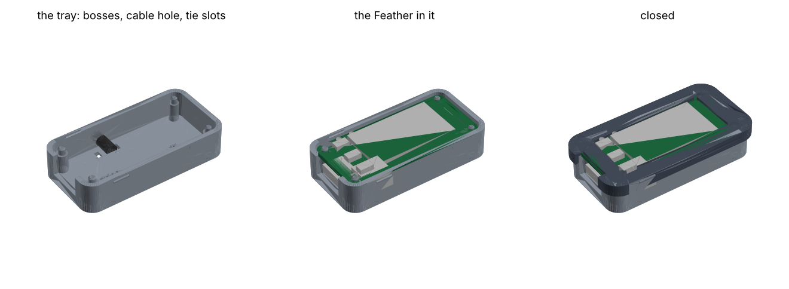

# The Feather pigtail

| | |
|---|---|
| board | Adafruit Feather ESP32-S3 Reverse TFT ([FEATHER-S3.md](../../wiring/FEATHER-S3.md)) |
| key | a key-c, on a USB-C cable whose other end is soldered to the Feather's pins |
| runs | the console image as `BOARD = "feather-s3"`, unchanged; [`bench/swap.py`](bench/swap.py) |
| case | [`case/`](case/case.py): a tray and a snap-on bezel; a cable tie holds the cable |
| status | written up 2026-10-24; not wired, not printed |

The same Feather as the adapter build in [FEATHER-S3.md](../../wiring/FEATHER-S3.md), without
the STEMMA QT socket and the USB-C adapters. One USB-C cable is cut, and its four wires go straight
into the Feather's header holes. Its plug, outside the case, takes a key-c.

## The cable

A USB-C to USB-C cable, one end cut off. The plug that's left takes a key-c, which has the
receptacle. The key uses only VBUS, GND, D+ and D− ([key-c](../../key-pcb/key-c-usbc/README.md):
D+ carries SDA, D− carries SCL, VBUS is key power).

A C-to-C cable has a CC wire, and some have more: SBU, the SuperSpeed pairs, VCONN on an e-marked
cable. Trim each of these back and insulate its end on its own. None goes to a Feather pin.

## The wiring

No headers. Each wire goes into its hole from the back (the side with the USB-C socket and the
module) and is soldered on the front, trimmed flush. The case's clamp holds the cable, so the
joints carry no strain.

| cable wire (the usual colour) | Feather pin | where |
|---|---|---|
| VBUS (red) | **3V** | 16-pin row, the second pin from the USB end |
| GND (black) | **GND** | 16-pin row, the fourth pin |
| D+ (green) | **SDA**, GPIO3 | 12-pin row, the last pin, at the antenna end |
| D− (white) | **SCL**, GPIO4 | 12-pin row, the one before it |
| shield, drain | trimmed back, or GND | |
| CC and any others | trimmed and insulated, not connected | |

- **3V, never USB or BAT.** USB is 5 V from the computer and BAT the battery. 3V is the Feather's
  always-on 3.3 V regulator, the pin wing-a takes its key power from.
- **The colours are only a convention.** Before soldering, meter each wire from its pin on the
  plug. Before the first key goes in, meter VBUS to GND on the plug: not a short.
- **GPIO7 must be high.** The Feather's own SDA and SCL pull-ups are on the rail it switches, with
  the screen. The console image and `bench/` both drive it high first.
- **No protection.** This build has none of wing-a's current limit, ESD diodes or power switch: the
  key is powered whenever the Feather is. That is fine on the bench. A key plugs in and out with the
  Feather on, as it does through the adapters.

The pin positions are from Adafruit's board file
([Adafruit-ESP32-S3-Reverse-TFT-Feather-PCB](https://github.com/adafruit/Adafruit-ESP32-S3-Reverse-TFT-Feather-PCB)):
3V and GND at (8.89, 1.27) and (13.97, 1.27) mm, SCL and SDA at (41.91, 21.59) and (44.45, 21.59),
from the corner at the USB end of the 16-pin row. 3V and GND are at the USB end, SDA and SCL at the
antenna end and the other edge, so the wires cross under the board.

## The swap screen

[`bench/swap.py`](bench/swap.py) reads whichever key is plugged in, and reads again when you press
D2, so you can swap keys and compare them. Like the adapter build's bench test it runs on its own,
from `/bench`, and is not part of any console image.

| | |
|---|---|
| D2 | scan again: wake the bus, list every address that answers, read the key at 0x60 |
| D1 | the key's slot table |
| D0 | back to the summary |

The summary shows:
- every address that answers. 0x36 is the battery gauge
- for 0x60: its serial, revision, profile (`chipcfg.identify`), and whether its config and data are
  locked
- slot 0's key fingerprint, the first 8 hex digits of its x (as the ceremony shows it), when slot 0
  holds a key
- **NEW KEY** when the serial differs from the last key read, **SAME KEY** when it doesn't
- NO KEY, with the addresses that did answer, when 0x60 doesn't

It never makes, uses or reads a private key, and never writes or locks anything. Reading slot 0's
public key is GenKey's public-key mode, which the console image already uses. A key whose slot 0
can't give its public key (an empty slot, or PubInfo clear) shows "no key in slot 0".

Copy it with the adapter build's `tft.py` and stand-in `board.py`, from the repository root:

```sh
export PICO_PORT=/dev/cu.usbmodem3101
F=hardware/wiring/feather-s3 P=hardware/builds/feather-pigtail/bench
mpremote connect $PICO_PORT fs mkdir :bench + \
  fs cp $F/board.py :bench/board.py + fs cp $F/tft.py :bench/tft.py + \
  fs cp firmware/atecc.py :bench/atecc.py + fs cp firmware/chipcfg.py :bench/chipcfg.py + \
  fs cp $P/swap.py :bench/swap.py + fs cp $P/main.py :main.py + reset
```

`main.py` at the top runs `/bench/swap.py`. To go back to the console, push its image as usual
(`tools/fw push`), which puts its own `main.py` back.

It has not run on the board yet. `python3 hardware/builds/feather-pigtail/bench/swap_test.py`
draws each screen on CPython, against a stand-in of the board and a stand-in chip, and checks the
text fits and the scan never calls a command that writes.

## The case

[`case/case.py`](case/case.py), CadQuery, as [cad/key](../../../cad/key/README.md) runs its
tray:

```sh
uv run --python 3.11 --with cadquery python hardware/builds/feather-pigtail/case/case.py
```

It writes `case/out/`: `pigtail_tray_v1.stl`, `pigtail_bezel_v1.stl` (top face down, as it
prints), both on one plate in `pigtail_case_v1.stl`, and `pigtail_case_v1_preview.png`.



- **The tray** holds the Feather screen up, on four bosses with a peg through each mounting hole
  (2.40 mm in the 2.5 mm holes, as the key tray's fit check found; 2.10 mm in the 2.2 mm holes at
  the antenna end). The board's underside is 7 mm above the floor: room for the battery socket,
  the module and the wires.
- **The Feather's USB-C** is open at the USB end, 13 mm wide, for a cable's overmold.
- **The cable** comes in through a hole in the wall on the 16-pin side, below the board. Thread
  the cut end in from outside before soldering. Inside, it lies on the floor, and a small cable
  tie (up to 2.5 mm wide) goes down one slot in the floor and up the other, around it; a groove
  under the floor keeps the tie's band below the bottom. `CABLE_D` is the cable's diameter. It
  starts at 4.0 mm. Measure yours, change it, and run the script again before printing.
- **The bezel** clicks onto the tray's walls with the key tray's bumps and groove. Its opening
  leaves the screen and all four front buttons (D0, D1, D2 and Reset) bare. It covers the two pin
  rows, 1 mm above the board, clear of the solder. Rings around the pegs stop 0.2 mm above the
  board, so it can't lift off them.
- The closed case is 58.1 × 30.2 × 12.4 mm. Underneath: the name, the Source Location and the
  cable size it was made for.

**What the script checks.** That the tray, the bezel, the board, a box for each part on the board
(front and back, at its datasheet height), the four solder joints and the cable don't overlap
anywhere: 47 pairs. And that the bezel's opening leaves each front part bare. The preview is drawn
by matplotlib and its shading is rough.

**Print:** the tray floor down, the bezel top face down, no supports. If the click is too stiff
or too soft, change `SNAP_PROUD` (0.35), as for the key tray.

The board's numbers come from Adafruit's board file, not from calipers. The heights of the parts
(the screen, the buttons, the USB-C socket, the battery socket) are from their usual datasheets,
not measured. Not printed yet.
