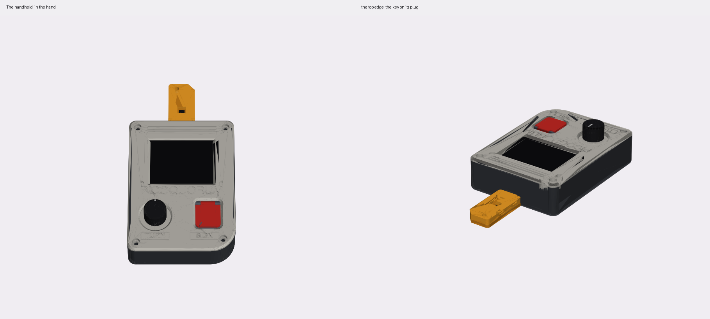
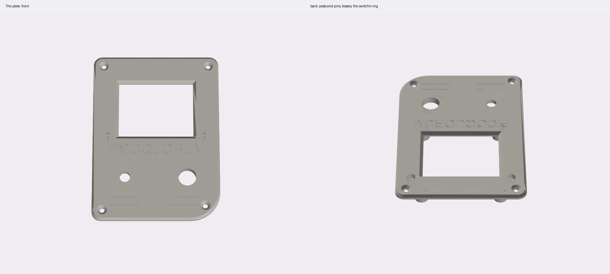
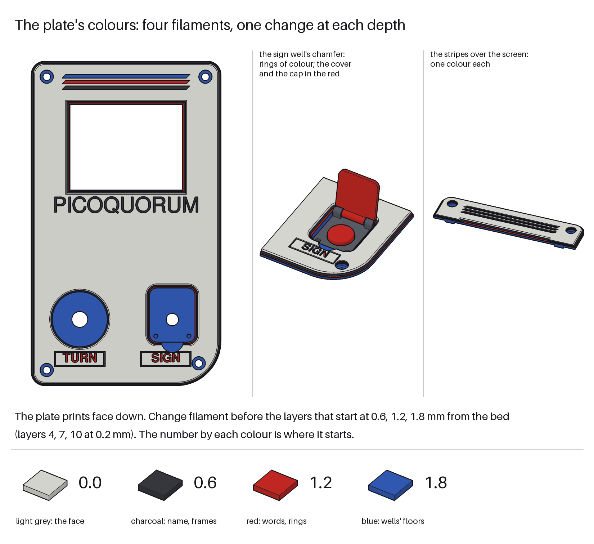
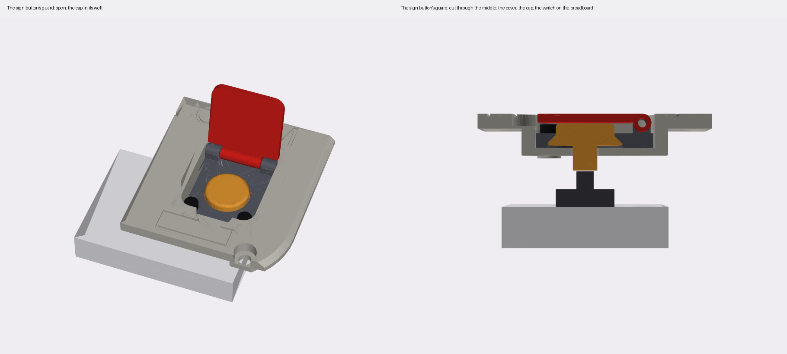
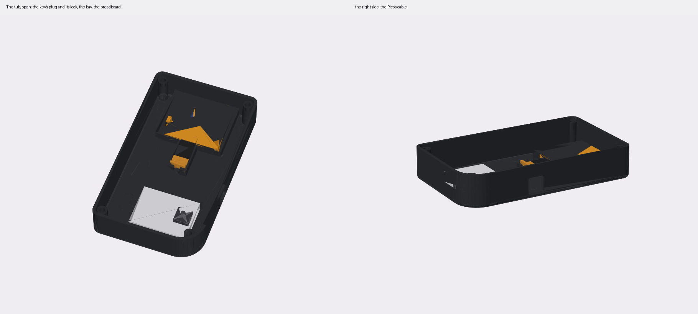
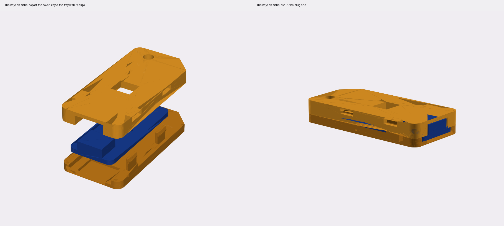
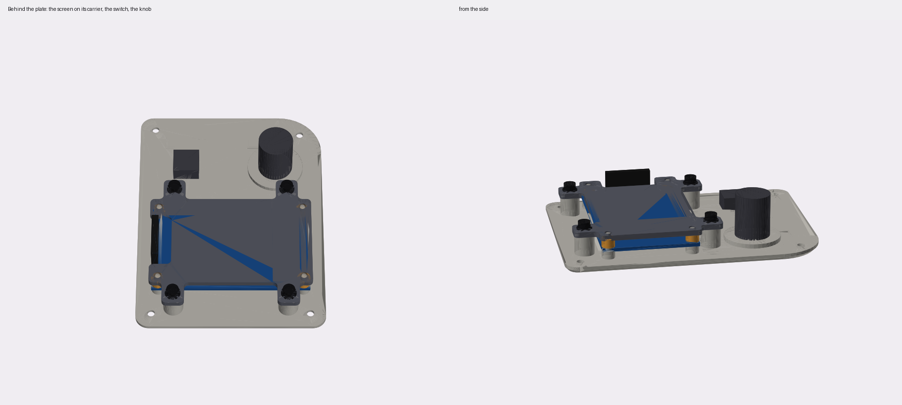

# PicoQuorum Handheld: a signing console you hold in two hands

*pico-sign-handheld*: pico-sign's knob, sign button and pins, with the 2.4″ screen and a Pico 2 W, in a slim
case that also lies flat on the desk.

**To build it:** [ASSEMBLY.md](ASSEMBLY.md), 16 steps with pictures, from the printed parts to a key in
its bay.

| | |
|---|---|
| board | a Pico 2 W (castellated), wires soldered to its pads: no headers |
| key | a key-c in [a cartridge](#the-keys-cartridge): two halves that snap shut, 48 × 54 mm, slid down into [a bay in the back](#the-keys-bay) onto a USB-C plug |
| runs | the console image as `BOARD = "build1"`, `SCREEN = "2.4"`, unchanged; `firmware/bench1.py` first |
| case | [the handheld](#the-case-the-handheld): a tub and a front plate, 86 × 147 × 30 mm, M3 into heat-set inserts; [put together step by step](ASSEMBLY.md) |
| status | written up 2026-11-02 for a demo; not printed, not wired, not run. The 2.4″ has not been seen working |

[pico-sign](../pico-sign/README.md) again, smaller: a demo to show the project, and a console that
works. The same knob and the same pins, with the 2.4″ screen in place of the 2.8″, in a flat case you hold
in two hands like a handheld game, or lay on the desk. The screen is across the top half. Under it the
knob is on the left and the sign button on the right, each sunk in a well; the sign button has a flip
cover. The key is a cartridge: it slides down into a bay in the back, as a game cartridge does, its label
out of the back and its top standing out of the top edge.



**In four colours**, by changing filament as the plate prints: [the colours](#the-colours).

## What is different from pico-sign

- **The screen** is the 2.4″ 240 × 320 SPI module with 8 pins, the one pico-sign started with:
  `SCREEN = "2.4"`.
- **The case** is the handheld, not the prism: 86 × 147 × 30 mm against the prism's 180 × 107 × 78.
- **The sign button is a 12 × 12 mm tactile switch** in a mini breadboard, under a printed cap, not the
  12 mm metal push switch. See [the sign button](#the-sign-button).
- **Most of the wiring is on the plate.** The Pico is on the screen's carrier, as on the prism, on a tail
  below the screen, and the knob is in the plate. The key's plug and the sign button's breadboard are in
  the tub.
- **No headers.** The case leaves 4 mm under the Pico's board, so the wires are soldered to its pads.
- **The controls are sunk in wells**, and the sign button has a [flip cover](#the-sign-buttons-cover).
- **The key's case is a wider cartridge** that snaps shut and slides into a bay in the back, not
  pico-sign's narrow cartridge, which is glued or screwed and plugs into a bay in the top. They don't fit
  each other's build.

Everything else is pico-sign's.

## Parts

- a Pico 2 W
- the 2.4″ IPS 240 × 320 SPI screen, 8 pins (VCC, GND, SCL, SDA, RST, DC, CS, BLK)
- an EC11 knob with push, 20 detents, a 6 mm D-shaft, an M7 bushing, and a cap about 18 mm across
- a 12 × 12 mm tactile switch and a mini breadboard (46 × 34.2 mm), and two flat jumper wires
- a key-c, and a USB-C plug on a short cable for it, as on [pico-sign](../pico-sign/README.md#the-key)
- two 4.7 kΩ resistors, the key's pull-ups
- thin stranded wire
- 20 mm of 1.75 mm filament, for the cover's hinge
- for the case: [the hardware](#the-hardware)

## The wiring

**The same pins as pico-sign.** Every table is in [pico-sign's README](../pico-sign/README.md#the-wiring):
the screen, the knob, the sign switch, the key and its pull-ups. Every signal is on Build 1's pin, so
the console image runs unchanged. `python3 hardware/builds/pico-sign/wiring.py --check` checks those pins
against `firmware/board.py`; it is not a different build there.

What changes is how the wires go:

- **Solder them to the Pico's pads.** There is no room for headers or Dupont housings.
- **The sign button** is wired as pico-sign's sign switch: one leg to pin 20 (GP15), the other to
  pin 18 (GND). A tactile switch's four legs are two pairs, joined inside; take two legs that are
  diagonally opposite, and meter them: they beep only while it's pressed. In the breadboard, wire their
  rows with flat jumpers.
- **The screen, the knob and the Pico are on the plate**, so their wires can be short. The key's plug and
  the sign button's breadboard are in the tub: give their wires about 12 cm, so the plate can lie face
  down beside the tub while you wire it.
- **The screen's header.** Solder the leads to its pins at the back. The case leaves 11.5 mm behind the
  board for pins and wire.

## The screen

`SCREEN = "2.4"`, with `BOARD = "build1"`, in the board's `secrets.py`. `firmware/board.py` drives the
2.4″ the same way as the 2.8″: an ST7789, 240 × 320, run landscape as 320 × 240.

**Not seen working.** pico-sign started with this screen and never got a picture from it. It may be an
ILI9341, not an ST7789. That needs inversion off, which is a firmware change. Try `bench1.py` first
(below).

**The header is on the left** (seen from the front), at the screen's left end. That is how build1 draws
the 2.8″ the right way up (`MADCTL = 0x60`). If the 2.4″ comes up upside down this way, the fix is
`MADCTL`. That is a firmware change and a new release fingerprint (AGENTS.md); it isn't made. The other
fix is in the case: `HEADER_SIDE = 1` in `handheld.py` moves the carrier's notch to the right. The
screen's posts don't change.

## The sign button

**A tactile switch, not the metal push switch.** The 12 mm metal switch from the music shop stands about
13 mm out of the panel and hangs about 28 mm behind it (the prism's numbers). Sunk under a flush cover,
that would make the case about 45 mm thick; sunk part way with no cover, about 40. A tactile switch under
a printed cap keeps it at 30.

**It must be momentary.** A tactile switch is. pico-sign's README says
[why it matters](../pico-sign/README.md#the-sign-switch): a switch that stays down would sign 2 s after
one tap.

**How it works.** The cap's head sits in the well, under the cover. Its plunger goes down through the
well's floor and stops 0.2 mm over the switch's stem. Press it, and it moves 0.55 mm before a flange under
the head stops on the floor: 0.2 mm to the stem, then 0.35 mm, a little more than a 12 × 12's usual
0.3 mm travel. The flange keeps the cap from falling out, and the stop keeps it from crushing the switch.

**The switch is in a mini breadboard** on the tub's floor (`SIGN_MOUNT = "breadboard"` in `handheld.py`):
- **The breadboard** is the bench's mini one: 46 × 34.2 mm (calipers), 17 holes along it. It lies across
  the case, under the button, its right-hand end 7.8 mm right of the button. Four L-shaped stops on the
  floor, 1.5 mm tall, put it there; they hold its corners, clear of the tabs on its sides. Stick it down
  with its own tape.
- **The switch** is a 12 × 12 mm tactile switch, across the centre channel, as it sits in the photo.
  Its centre goes on the **3rd column from the right-hand end** (its legs in the 2nd and 4th). That
  column is under the button.
- **Its wires:** two flat jumpers, from the rows of two diagonally opposite legs, to pins 20 (GP15) and
  18 (GND). Under the button there's only about 6.6 mm over the board, so Dupont leads standing up don't
  fit; flat jumpers do.
- **What the script checks:** the board clears the tub's corner post (1.1 mm), the carrier's screws
  (0.9 mm), the EC11 (7.1 mm) and the Pico's wires (14.4 mm).

**Measure two things before printing the cap:** the breadboard's height with its tape on (the script
takes 8.5 mm), and the switch's height pushed into the board, from the board's top to the stem's top (the
script takes 7.3 mm, a usual 12 × 12 × 7.3). They're `BREADBOARD` and `TACT` in `handheld.py`. Only the
cap's plunger changes with them, so a wrong guess means reprinting only the cap. The plunger reaches
3.1 mm below the well's floor; the script stops if the switch stands too tall for the space.

**Or the printed holder.** With `SIGN_MOUNT = "holder"`, a 6 × 6 mm switch sits in a printed holder
screwed behind the plate, on two more bosses, and the breadboard and its stops go. The script then writes
`handheld_tact_holder.stl`, and assembly.py draws a holder step. It was checked before the breadboard came
in, and not run since.

## What the controls do

The same as pico-sign: [the table](../pico-sign/README.md#what-the-controls-do). Turn for pages and
rows, push to open, hold the sign button to sign (every page seen first, 2 s, 3 s on a red page). The
knob's push on the Sign row, held, signs too.

## First: the bench check

As on [pico-sign](../pico-sign/README.md#first-the-bench-check), with `SCREEN = "2.4"`.
`bench1.py` only reads the chip. Leave its `JACKS = False`.

Look for TL at the top left and the bars red, green, blue, white. If the colours are a negative,
`INVERT = False` at the top of `bench1.py`; if that fixes it, the panel is likely an ILI9341 and the
console image needs that change too (not made). `bench1` doesn't show GP15; on the console, the sign
button on the home screen says "Sign button: only for signing".

Then the console as usual. The key must be provisioned already. Nothing in this build writes or locks a
chip.

## The case: the handheld

[`case/handheld.py`](case/handheld.py), CadQuery. A first draft to print and try.
[ASSEMBLY.md](ASSEMBLY.md) puts it together step by step, with pictures.

```sh
tools/case build handheld     # handheld.py, then assembly.py's pictures; `check` says what changed
```

Flat and portrait, 86 mm wide, 147 tall and 30 thick, corners rounded 6 mm. The bottom right corner,
under the sign button, is rounded 20 mm. The back's edge is rounded 3 mm and the face's chamfered 1.5 mm.
With a key in, it is 155 mm tall.

**Why 147.** Up the back, from the bottom: the sign button's breadboard under the controls, then the Pico,
then the key's plug in its holder, then the key's bay, the top 46 mm, behind the screen. The bay and its
floor take the back 10.4 mm there, where the Pico used to be, so the Pico moved down below the plug, and the
case grew 29 mm. It stays 30 thick. The screen stays 39 mm under the top edge, so the face has more room
between the name and the controls.

**Eight printed parts, and the key's two:**
- **The tub**, one piece, open at the face. It prints on its back. In it:
  - four posts at the corners, an M3 insert in each, for the plate's screws
  - [the key's bay](#the-keys-bay), in the back's top half, open at the top edge and at the back
  - the key's plug holder at the bay's foot
  - a 14 mm square hole in the right side for the Pico's cable
  - four L-shaped stops on the floor for the sign button's breadboard
  - four pockets 1 mm deep in the back for rubber feet
- **The plate**, 3 mm, printed face down. Four M3 × 8 socket head screws hold it to the tub's posts, their
  heads sunk 0.2 mm under the face in counterbores 6 mm across. The plate is 2 mm thicker under each
  (bosses on its back), and the posts 2 mm shorter, so 1.8 mm stays under each head and the screw goes
  6.2 mm into its insert.
- **The carrier**, 2.5 mm, behind the screen, with a tail below it. The Pico screws to the tail's back.
  Printed face down.
- **Four spacers**, 4 mm tubes that slip onto the screen's pins.
- **The plug lock**, which holds the key's plug up. It prints standing on its lip's face, its two bumps to the sides.
- **The guard's base and cover**, in the sign button's well. The base prints as it sits, the cover face
  down.
- **The sign button's cap**, printed head down.
- **The key's tray and cover**: [the cartridge](#the-keys-cartridge).

**On the plate:**
- the screen's window across the top, bevelled, 2 mm bigger than the active area
- on the back, the prism's screen mount. A post at each of the screen board's holes is a seat for the
  board, with a pin through it, the spacer and the carrier. Where the glass comes close, the seat is cut
  flat. Four 9 mm bosses above and below the screen, and two more lower down for its tail, each with an
  M3 insert, take the carrier.
- the knob on the left and the sign button on the right, 30 mm up from the bottom edge, each sunk in a
  well. The plate is thickened behind each well, 3 mm past its edge, so its floor stays thick:
  - **the knob's well:** round, 25 mm across and 3 mm deep, a 2 mm floor for the EC11's nut. The knob's
    cap stands about 12 mm out of the face, with 3.5 mm round it for your fingers.
  - **the sign button's well:** the guard's outline, 20.6 × 24.6 mm, 7 mm deep, a 1.5 mm floor. A
    notch under its bottom edge is for a thumbnail, to lift the cover. Behind its floor, two bosses for
    the guard's base's screws.
- a 23 × 7 mm frame under each, a 0.6 mm line cut 0.6 mm deep, with TURN and SIGN in it, cut 1.2 mm
- three stripes over the screen, cut 0.6, 1.2 and 1.8 mm ([the colours](#the-colours))
- PICOQUORUM cut between the controls and the window: 7.7 mm letters, 65 mm long (the script works it out)



### The colours



The plate prints face down, so its face is its first layers. Whatever is cut into the face shows the
colour printing at the depth of its floor. Change filament three times, at 0.6, 1.2 and 1.8 mm from the
bed (before layers 4, 7 and 10, at 0.2 mm layers), and each depth of cut is its own colour:

| from | colour (a suggestion) | shows |
|---|---|---|
| 0.0 mm | light grey | the face |
| 0.6 mm | charcoal | PICOQUORUM and the label frames, cut 0.6 mm; the nearest stripe |
| 1.2 mm | red | TURN and SIGN, cut 1.2 mm; the middle stripe |
| 1.8 mm | blue | the far stripe, cut 1.8 mm; the wells' floors and everything behind |

- **Rings.** Anything with sloped sides shows the colours in rings. That includes the window's 2 mm bevel, the knob well's 1.2 mm chamfer, the sign well's 1.8 mm chamfer and the plate's 1.5 mm edge chamfer.
- **The stripes.** Three 1.6 mm bars over the screen, with 45° ends, show the three colours under the face side by side.
- **The labels.** Their words are bold, 4.2 mm, so the strokes are wide enough to print. Longer words came out at 2.2 mm, too thin.
- **The other parts.** Print the guard's cover and the button cap in the red, and the rest in any colour.
- **Bridges.** The floors of the cuts print as short bridges over the hole, 0.6 to 1.8 mm off the bed, so they may look a little rougher than the face.
- **Changing it.** The depths, the colours and the words are `LAYER_CHANGES`, `COLOURS` and `LABELS` in `handheld.py`. Nothing checks the colours on a real print yet.

### The sign button's cover



A flip cover over the sign button, so it isn't pressed by accident. Shut, it is flush with the face. It
flips up toward the screen, and stops at 120°, where it rests on the well's chamfered edge.

- **The base** is a 3 mm plate, the well's shape, so it can't turn in it. Two M2 × 8 screws hold it,
  through it into the bosses behind the floor; their heads stand no higher than the cap's. It has a hole
  for the cap's head, a cone under it for the cap's flange, and a knuckle at each end of the hinge.
- **The cover** is 1.6 mm, with a knuckle between the base's two. Shut, it is 0.4 mm over the cap.
- **The pin** is a piece of 1.75 mm filament, 20 mm long, pushed through the three knuckles. It is tight
  in the base's (1.8 mm holes) and free in the cover's (2.0 mm). Trim it flush.
- **The cap** goes up through the base from underneath before the base goes in: its flange seats in the
  base's cone. Then the base, the cap and the cover go into the well together.

The cover stays shut by its own weight with the handheld flat, and by the pin's friction in your hands.
There is no latch.

### The key's bay

A slot down into the back's top half, as on a handheld game: open at the top edge, and open at the back, so
the cartridge's label shows from behind. The cartridge slides straight down it, its plug end first, onto
the key's USB-C plug standing up at the bay's foot. Its top stands 8 mm out of the top edge, to pull it
out by.

- **The channel** is the cartridge's width and 0.3 mm more each side, and 8.8 mm deep: the cartridge, 0.92
  mm in from the back, and 0.3 over its front. Its floor, 1.6 mm, keeps it out of the case's inside.
- **The grooves.** A tongue down each side of the cartridge runs in a groove in each side wall: 0.25 over
  and under it, 0.5 past its tip. The grooves guide it, and the lips behind them, 1.67 mm thick, keep it
  from falling out of the back. The plug is never the guide.
- **One way in.** A rib fills the bay's bottom left corner, 3 × 11.7 mm, round a notch in the cartridge.
  Upside down, the cartridge stops on the rib 8.6 mm over the foot, 2.1 mm before the plug's shell. Back to
  front, its tongues are toward the screen, out of the grooves' line, and it can't start in.
- **The click.** Two half-round bumps on the side walls, 6 mm under the top edge, click into dimples in the
  cartridge's sides when it's all the way in. On the way, they squeeze it 0.15 mm a side. Not tried: if
  it's too tight, sand the bumps. The USB-C receptacle's own latch holds it too.

**The plug** stands at the bay's foot, in the middle, pointing up. As on the prism, it is a cut cable's: its
overmold, 12.4 × 5.5 × 17.1 mm (calipers), ends flush with the floor the cartridge stands on, in a hole
with 0.2 mm round it, so only the metal shell stands up into the bay. The cartridge's receptacle comes
down onto it.

The plug's holder is the prism's, laid on the floor under the bay's foot. The channel's floor is the tub's
back, to keep the bay shallow. Its channel is open toward the face, and so is the slot for the cable in the
stop at its foot. Putting the plug in:
1. Drop it into the channel low, the cable down through the stop's slot. The channel has 9.4 mm below
   the plug's final place, so its shell clears the bay's foot.
2. Push it up into the foot's hole until the overmold is flush.
3. Drop **the lock** into the 9.4 mm under it, the cable in the lock's slot. Two bumps on the lock click
   into holes in the channel's walls. Its lip is to pull it out by.

Nothing but friction holds the plug up into its hole when the key comes out, as on the top-edge design
before it. If it lifts, a zip tie round the cable under the holder's stop keeps it down. Not tried.



### The key's cartridge

[`case/cartridge.py`](case/cartridge.py). Two halves that snap shut round a key-c, 48 × 54 × 7.56 mm:
about a game cartridge's shape, at key-c's thickness. Each half prints flat on its outside face, with no
supports. The tray is the back: its outside is the label side.



- **The tray** (the back) holds the board in a pocket 1.6 mm deep, the board's thickness. A 2.7 mm peg
  stands up through key-c's 3 mm lanyard hole, H1, so the board can't slide either way: plugging the key
  in pushes the board toward the grip, and pulling it off pulls the board toward the plug. A relief
  under the receptacle takes its shell tabs, which come through the board.
- **The cover** (the front, toward the screen when it's in) comes down on it. A rim 1 mm wide round the
  board's edge and a boss round the peg press the board flat. Inside, 2.2 mm over the parts and a pocket
  over the receptacle, open at the plug end. A window shows the ATECC608.
- **Four clips** stand up from the tray, two each side, near its edges. Each hooks 0.25 mm over a ledge
  in a window in the cover's side. Press the halves together and they click. To open it, push the four
  hooks in through the windows with a small screwdriver.
- **For the bay:** a tongue down each side of the tray, 1.2 mm out, stopping at the case's top edge; a
  notch 3 × 12 mm in the bottom left corner (seen from the front); a dimple in each side of the cover.
- **To hold:** the top 8 mm stand out of the case. Three grip grooves across each face there, a cut corner
  at the top right, and a lanyard hole at the top left.
- **The label:** a frame on the back, 38 × 28 mm, a groove 0.6 wide and 0.4 deep. A groove, not a recess:
  the back prints on the bed, and a recess would be a 38 mm bridge.
- The receptacle's face is flush with the plug end, so the plug goes all the way in.

**Not tried.** The clips are 0.8 mm thick and 5 mm long to the hook: about 1.7% strain to snap in, by the
usual cantilever sum. PLA takes about 2%, so PETG is the safer plastic. Print a pair and try it before the
key goes in. If the clips are loose, glue the halves.

key-c's numbers come from its board file: 16 × 36 × 1.6 mm, H1 3 mm at 14 mm from the centre, J1's
tabs at ±4.32 mm. The receptacle's front is taken to be flush with the board's edge: not measured.

### The carrier and the Pico

**Behind the plate**, the stack is the prism's: the screen board on its seats, a spacer on each pin, the
carrier, four M3 screws through the carrier into the bosses. The carrier is cut round the screen's header.
Behind the screen there is now only the carrier and the bay: the carrier's screw heads are 1.3 mm over the
bay's floor.

**The carrier's tail** goes on down below the screen, 69 mm wide, to 45 mm from the bottom edge. Two more
M3 screws hold its lower corners, into bosses beside the Pico's ends.

**The Pico** screws to the tail's back, as on the prism: four posts 6.5 mm tall, M2 screws cutting
their own thread. It lies across, between the sign button's breadboard and the key's plug holder (2.9 and
1.4 mm from them), its USB end to the right. The posts are the prism's: 4.5 mm across at the far end, 3.6
mm at the USB end, so they keep clear of the pads beside each hole, of the micro-USB plug and of the
socket.

- **Its parts face the carrier**, and so does its USB socket: the plug would hit the tub's floor the
  other way up. With headers, that is the usual way to solder them; here, with wires on the pads, just
  lay it that way.
- **Its cable** comes in through the square hole in the right side, once the plate is on. The plug goes
  straight in to the socket.
- Its wires, on the side away from the carrier, have 4 mm before the floor; the script leaves 1.3 mm more.

So the plate, with the screen, the carrier, the Pico and the knob on it, is one piece you can wire and try
on the bench before it goes in the tub; the sign button's switch joins it on two wires from the tub.



### The hardware

From the bench's kits (inserts are named thread × length × outside diameter):

| where | inserts | screws |
|---|---|---|
| the tub's corner posts, for the plate | 4 × M3\*6\*5, in 4.2 mm holes | 4 × M3 × 8 socket head, in counterbores |
| the plate's bosses, for the carrier | 6 × M3\*6\*5, in 4.2 mm holes | 6 × M3 × 8 socket head, with M3 washers |
| the carrier's posts, for the Pico | none: 1.8 mm holes, self-tapping | 4 × M2 × 8 socket head |
| the guard's base, into the plate | none: 1.8 mm holes, self-tapping | 2 × M2 × 8 socket head |
| the breadboard | none: its own tape, between four stops | none |
| the screen | none: four pins and four spacers | none |
| the feet | | 4 rubber strips, 6 × 35 mm |
| the guard's hinge | none | 20 mm of 1.75 mm filament |
| the key's cartridge | none: it snaps shut | none |

The insert holes and the 1.8 mm self-tapping holes are the prism's numbers, and neither has been tried.
Print one post and set an insert first.

### Putting it together

In short; [ASSEMBLY.md](ASSEMBLY.md) has it in 16 steps, with pictures.

1. **The plate:** the six boss inserts.
2. **The sign button's guard:** the cover on the base, the pin through. The cap up through the base
   from below. The three into the well, two M2 × 8 through the base.
3. **The knob** with its nut.
4. **The screen** face down onto its seats, the pins through its holes. A spacer on each pin, the
   carrier on, six M3 × 8 with washers.
5. **The Pico** onto the posts on the carrier's tail, parts toward the carrier, four M2 × 8.
6. **The wires** on the plate: the screen, the knob and the button to the Pico. Try it on the bench.
7. **The tub:** the four corner inserts. The key's plug and its lock at the bay's foot, as above; its pull-ups at the plug
   ([pico-sign's tables](../pico-sign/README.md#the-wiring)). The breadboard between its stops, the
   switch in it on the 3rd column from the right, two flat jumpers. The key's and the switch's wires to
   the Pico.
8. **Close it:** the plate onto the tub, four M3 × 8 socket heads into the counterbores. The feet in their pockets. The
   micro-USB cable in through the right side.
9. **The key:** into its tray, the peg through H1; the cover on, pressed until the four clips click.
   Then from the back, label out, down the bay's grooves onto its plug until it clicks.

### What the script checks

That the boxes standing in for the screen's glass, board, back parts and header, the carrier's screw
heads, the tactile switch and its breadboard, the knob, the key's plug and its shell, the cartridge in its
bay, the Pico, the room for its parts and wires, and its USB plug don't overlap the tub, the plate, the
carrier, the spacers, the plug lock or each other. That the guard's base, its screws' heads, the cap and
the cover clear each other, the plate and the knob, with the cover shut and opened 30°, 60° and 90°; and
that the cap, pressed to its stop, stays clear of the plate. And that the plate, its corner bosses
included, clears the tub when it's shut. 243 pairs, all clear.

For the key's bay, also: that the cartridge, slid in from the top, clears the tub, the plug's shell and
the overmold at six places on the way (1, 4, 7, 15, 30 and 45 mm up), all but the bumps, which squeeze it
on purpose. That upside down it stops on the rib before the plug's shell, and back to front it can't start
in. The closest:

| | mm |
|---|---|
| the USB end's posts to the micro-USB socket between them (a usual micro-B's, not measured) | 0.15 |
| the Pico's USB plug to its posts | 0.2 |
| the cap's plunger to the switch's stem, at rest | 0.2 |
| the Pico's posts to the nearest pin's pad, from the Pico's drawing | 0.21 |
| the cartridge to the bay, over and under its tongues | 0.25 |
| the cartridge to the bay, round its sides and over its front | 0.3 |
| the guard's cover to the cap's head | 0.4 |
| the carrier to the tub | 1.0 |
| the breadboard to the tub's corner post | 1.1 |
| the carrier's screw heads to the bay's floor | 1.3 |
| the Pico's wires to the tub's floor | 1.3 |
| the Pico to the key's plug holder | 1.4 |
| the Pico's plug to the hole in the side | 1.5 |
| the cartridge, upside down, to the plug's shell | 2.1 |
| the breadboard to the carrier's screws | 2.5 |
| the plug lock to the carrier | 2.8 |

It also checks that the bosses are deep enough for their inserts and the Pico's posts for their screws,
and that the switch leaves room for the plunger under the well's floor. In the cartridge, that key-c, its parts and its tabs don't
overlap either half, nor the halves each other (U1 is 1.14 mm under the cover). It is not a fit check:
the parts are boxes, and the screen's, the switch's and the breadboard's height are placeholders.

**Overhangs**, with the tub on its back: nine flat faces face down off the bed. They are all bridges:
- **the key's bay's floor: 48.6 mm across, 8.8 mm up.** The longest bridge in the build. If yours sags,
  put supports in the bay only; its floor's underside is hidden behind the cartridge
- the tops of the bay's two grooves: 1.7 mm across, 4 mm up
- the four feet's pockets: 6.6 mm across, 1 mm up
- the top of the key's plug hole in the bay's foot: 12.8 mm across
- the top of the Pico's cable hole in the right side: 14 mm across, its corners rounded 1.5 mm

With the plate face down, the wells' floors are bridges: the knob's 25 mm across, 3 mm up; the sign
button's 20.6 mm, 7 mm up, its plunger's hole in the middle. The thumbnail notch's top is one too, 2.5 mm
up. So are the four counterbores' floors, a ring round each screw's hole, 3.2 mm up. The rest are the
tops of the cuts for the colours: the name, the frames and the first stripe 0.6 mm up, the words and the
second stripe 1.2, the third stripe 1.8. Bridges of 20 to
25 mm print on most printers; if yours sags, put supports in the two wells only.

The cap prints head down: its flange's cone leans 45°, so it needs no support. The base's cone, printed
bottom down, is the same.

### Before printing

- **Measure the screen.** None of its numbers is measured. The board (72 × 44 × 1.6 mm), the glass
  (60.3 × 42.7 mm, 3.5 mm from the board's front to the glass's front) and the hole spacing
  (66 × 38 mm, 3.2 mm holes) are placeholders. The board and the glass come from pico-sign's first
  wedge ([`case.py`](../pico-sign/case/case.py)), which guessed them. The active area, 48.96 × 36.72 mm,
  is a 2.4″ 240 × 320 panel's. If the glass sits off the board's centre, set `SCREEN_DX`, as the prism
  did. All of it is `SCREEN_*` at the top of `handheld.py`. The script prints how close the glass comes
  to the holes.
- **Measure the switch and the breadboard's height** (`TACT`, `BREADBOARD`, above).
- **The key's plug** is the prism's: the cut cable's overmold, 12.4 × 5.5 × 17.1 mm. A different cable
  needs `PLUG_*` changed. The bay's depth follows the plug's axis, so measure it before printing the tub.
- **Print the cartridge first**, and try it in `handheld_bay_test.stl`, the tub's top only: the grooves,
  the rib and the bumps are not tried. It has the plug's holder and two corner posts, so the plug, its lock
  and a first insert can be tried in it too.
- **The Pico's plug:** a micro-USB overmold 11 × 8 mm is assumed (`USB_PLUG`).
- Print the plate first: every part's hole is in it.

| file in `case/out/` | what |
|---|---|
| `handheld_body.stl` | the tub, on its back, as it prints |
| `handheld_bay_test.stl` | the tub's top only, from the plug holder's foot up: to try the cartridge in the bay, the plug and its lock, and an insert, before the whole tub |
| `handheld_plate.stl` | the plate, face down |
| `handheld_carrier.stl`, `handheld_spacers.stl` | the carrier, face down, the Pico's posts up; the four spacers |
| `handheld_plug_lock.stl` | the lock for the key's plug, on its lip's face |
| `handheld_guard_base.stl`, `handheld_guard_cover.stl` | the sign button's guard: the base as it sits, the cover face down |
| `handheld_sign_cap.stl` | the sign button's cap, head down |
| `cartridge_tray.stl`, `cartridge_cover.stl` | the key's cartridge, each half on its outside face |
| `handheld_assembly.step` | closed, with a box for each part |
| `handheld_*.png`, `cartridge.png` | the pictures here |

Not printed yet. The pictures are matplotlib's, and its shading is rough: it draws some faces from behind
through the plate.
