# pico-sign: putting the prism together

Thirteen steps, from printed parts to a key on top. Each picture shows the step's new printed parts
in amber, what's already done in white, and what the step needs along the bottom. The pictures are
drawn from the case's own model ([`case/assembly.py`](case/assembly.py)), so they follow
[`case/prism.py`](case/prism.py)'s numbers. Nothing here has been put together yet: this is the
plan for the first build.

The wiring is in the [README](README.md#the-wiring). This page only says where the wires go in.

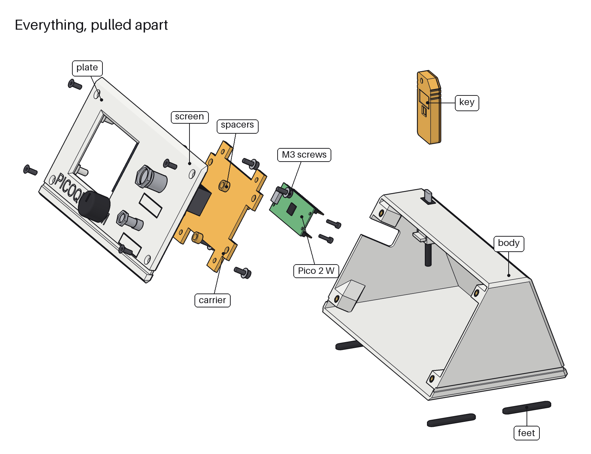

## What you need

### Printed

All in `case/out/prism/`, each in the way up it prints.

| part | file | how many |
|---|---|---|
| the body | `prism_body.stl` | 1 |
| the plate | `prism_plate.stl` | 1 |
| the carrier | `prism_carrier.stl` | 1 |
| the spacers | `prism_spacers.stl` (all four in one file) | 4 |
| the plug lock | `prism_plug_lock.stl` | 1 |

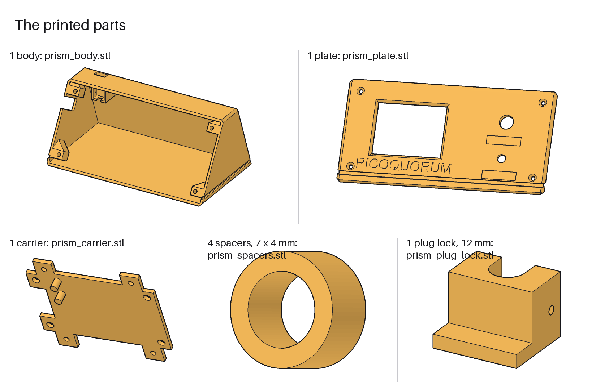

**The first plate** (printed 2026-10-30) has the screen's pins and bosses 1 mm left of where they
are now: on it, with the header on the right, the screen sits 1 mm off. A carrier made for it is not
`prism_carrier.stl`; it is one generated with the board's centre moved back 1 mm. The spacers are the
same either way.

### Hardware

| what | how many | where |
|---|---|---|
| M3 heat-set insert, M3\*6\*5 | 8 | 4 in the body's corner blocks, 4 in the plate's bosses |
| M3 × 8 countersunk screw | 4 | the plate into the body. **Not in the bench's kits** |
| M3 × 8 socket head screw | 4 | the carrier onto the plate's bosses |
| M3 washer | 4 | under those |
| M2 × 8 socket head screw | 2 | the Pico onto the carrier, at its far end. They cut their own thread |
| rubber strip, 6 × 35 mm | 4 | the body's feet |

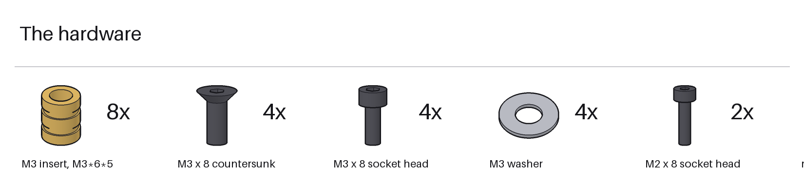

### Bought

- the 2.8″ screen
- a Pico 2 W with its headers soldered on, pins out of the side without parts (the usual way)
- the sign switch: a 12 mm metal push switch, **momentary** ([why](README.md#the-sign-switch)), its nut
- an EC11 knob, its nut, and a cap for its 6 mm D-shaft
- a USB-C plug on a short cable, for the key ([the key](README.md#the-key)), and two 4.7 kΩ resistors
- a micro-USB cable for the Pico
- Dupont leads
- a key-c in its cartridge

### Tools

- a soldering iron with an M3 heat-set insert tip
- hex keys: 2 mm (the countersunk screws), 2.5 mm (M3 socket heads), 1.5 mm (M2)
- a spanner or pliers for the two nuts
- a towel to lay the plate on

## 1. The body: an insert in each corner block

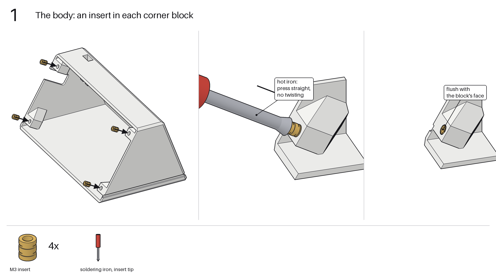

The plate screws into these four. Set the iron to the temperature your inserts' maker gives for your
plastic. Sit an insert on the tip, square to the hole, and let it sink in under its own weight with a
light push. Don't twist. Stop when it is flush with the block's face, take the iron straight out, and
let it cool before you touch it.

The insert holes are 4.2 mm, not tried yet. If the first one goes in loose or won't go, stop: the hole
(`M3_INSERT` in `prism.py`) needs changing. The plate's bosses use the same hole, so step 4 is a good
place to try one first.

## 2. The body: the feet

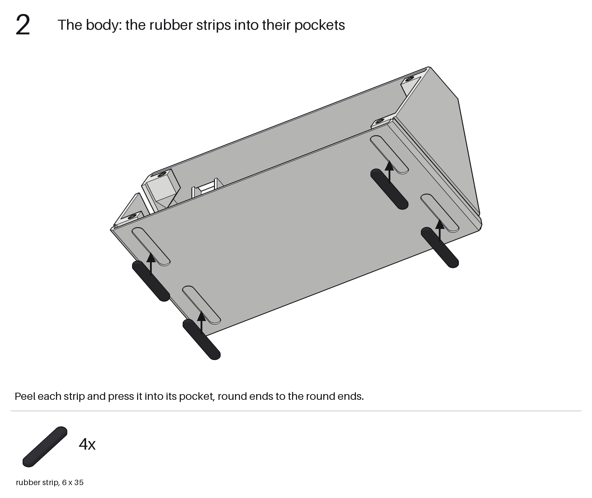

Peel each strip and press it into its pocket, round ends into the round ends.

## 3. The body: the key's USB-C plug

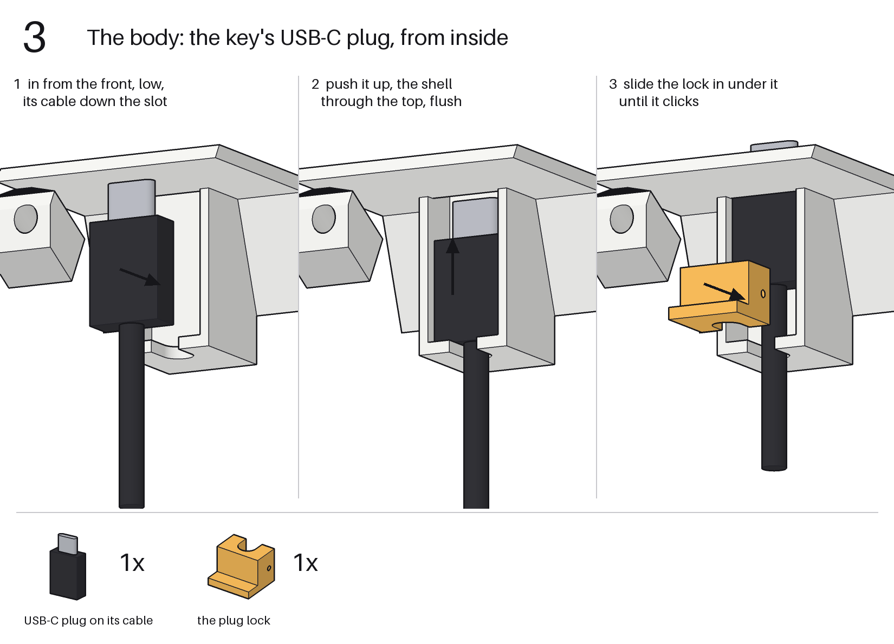

From inside the body, under the top, on the left:
1. Slide the plug into its holder from the front, low, its cable down through the slot in the holder's foot.
2. Push it up. The metal shell goes through the hole in the top, and the black overmold stops flush
   with the top.
3. Slide the lock in under it, the cable in the lock's slot, until its two bumps click. The lip at
   its front is to pull it out by.

Solder the plug's wires and the two pull-ups first ([the key](README.md#the-key)). Leave the wires
long enough to reach the Pico with the plate held in front of the body.

## 4. The plate: an insert in each of the carrier's bosses

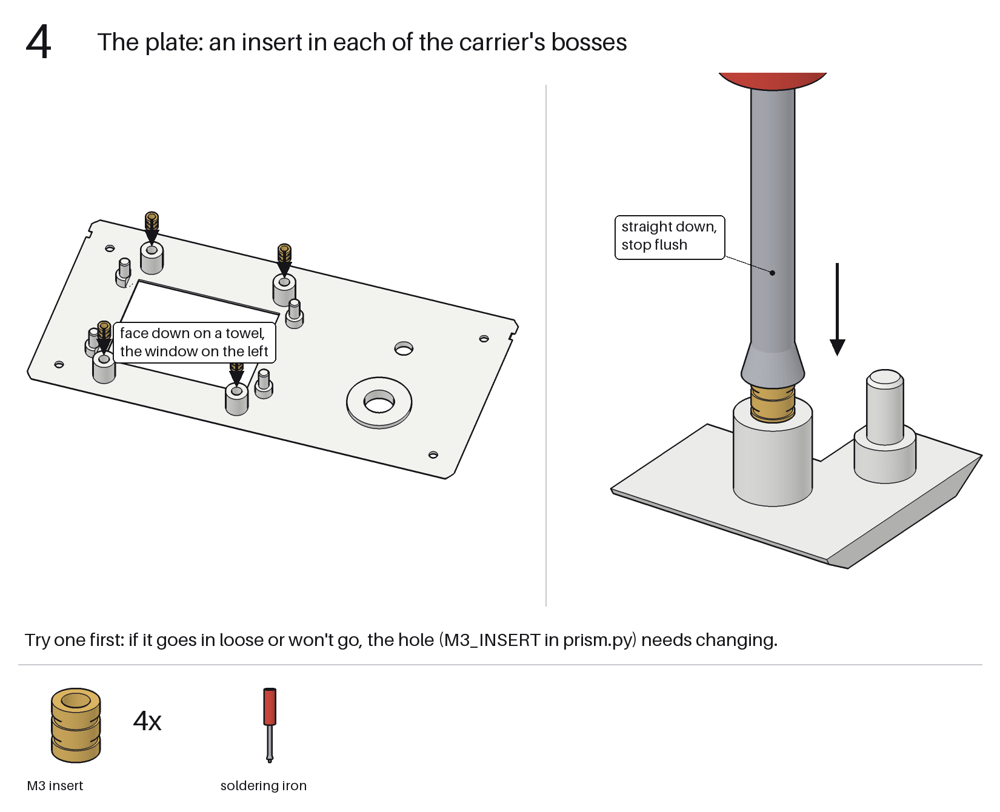

Lay the plate face down on a towel, the screen's window on the **left**. Everything from here to
step 10 is on its back. An insert in each of the four round bosses round the window, as in step 1.

## 5. The plate: the sign switch and the knob

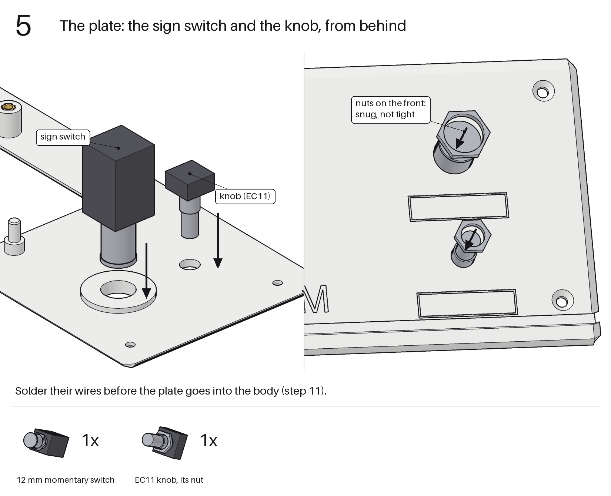

From behind: the sign switch into the top hole, through the thick ring, and the knob (EC11) into the
small hole under it. Turn the plate over and put each one's nut on the front. Snug, not tight. Solder
their wires before the plate goes into the body (step 11).

## 6. The plate: the screen onto its pins

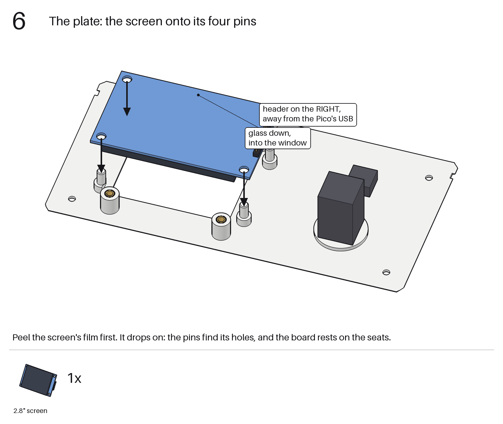

Back on its face. The screen goes glass down, its 8-pin header on the **right**, toward the controls
and away from the Pico's USB. Lower it onto the four pins. They go through its corner holes, and the
board rests on the posts' seats.

**The firmware draws this screen upside down until it changes.** It is set for the header on the left
(`MADCTL = 0x60` in `firmware/board.py`); on the right it needs `0xA0`. That change isn't made: it is
a new firmware release. The pins and posts are the same either way, so a screen turned the other way
round fits the same plate.

## 7. The plate: a spacer on each pin

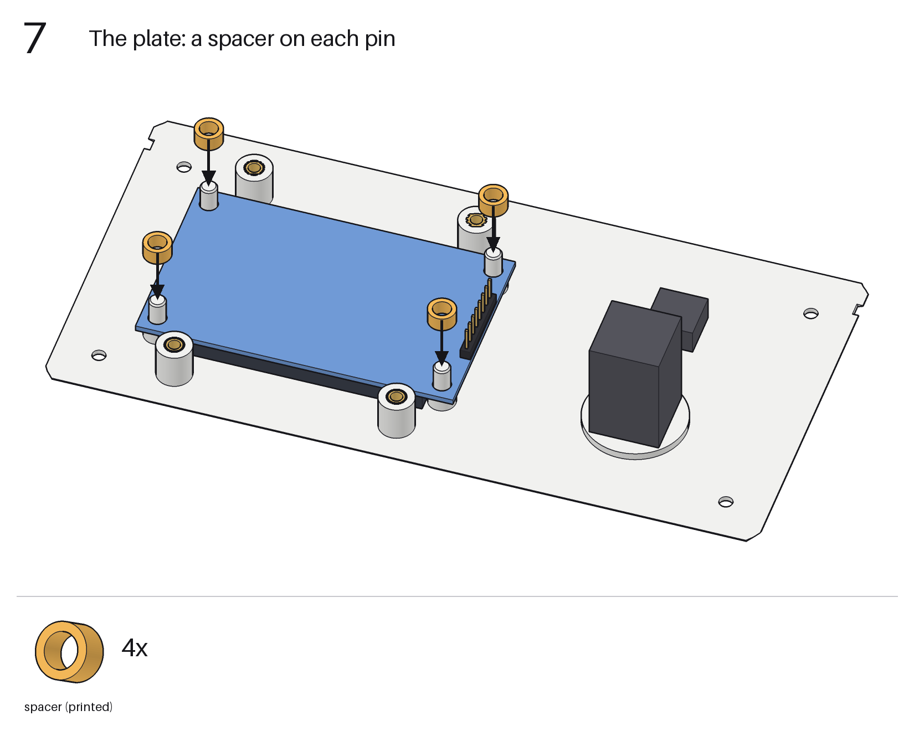

## 8. The plate: the carrier

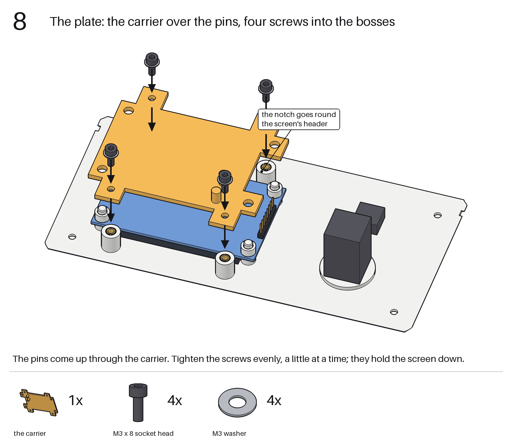

The carrier goes over the pins, its posts up, its notch round the screen's header. Four M3 × 8 socket
head screws, each with a washer, go through its ears into the bosses. Tighten them evenly, a little
at a time. They press the carrier onto the spacers, and the spacers hold the screen down on its seats.

## 9. The plate: the Pico

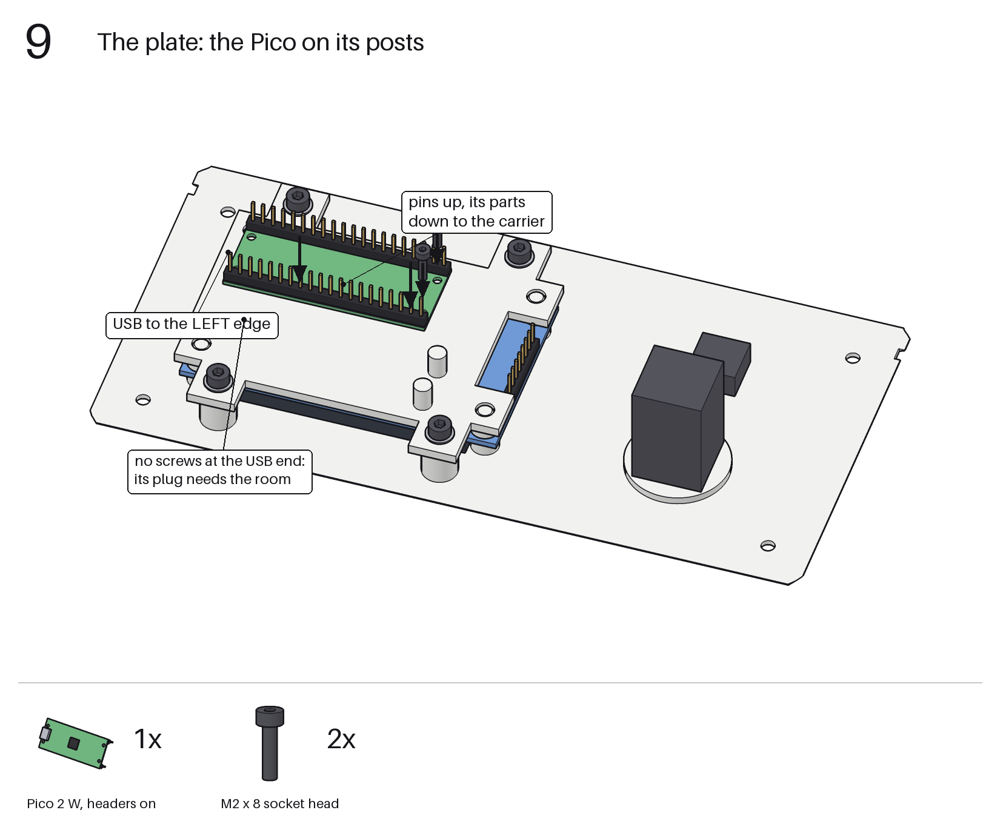

The Pico goes on its posts, its USB end to the **left** edge, its pins up and its parts down toward
the carrier. Two M2 × 8 screws, through the holes at its far end, into the two posts there. The posts
are 4.5 mm across with a 1.8 mm hole and no insert: each screw cuts its own thread, so turn it in
slowly and stop when the Pico is held. There are no posts at the USB end: the micro-USB plug needs
the room. Nothing holds that end but the two screws at the other.

## 10. The wires

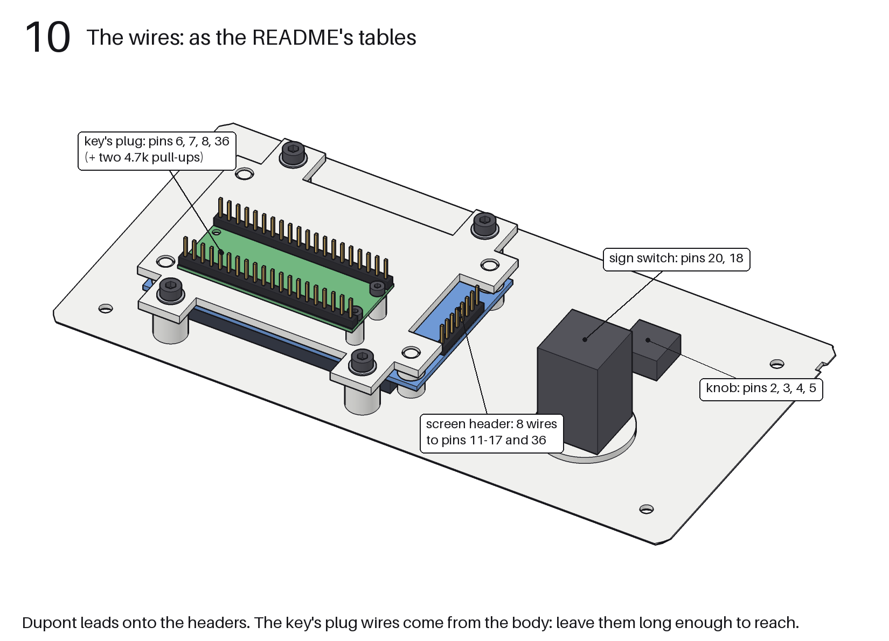

Dupont leads onto the headers, as the README's tables say:
- **The screen's header:** 8 wires, to pins 11 to 17 and 36.
- **The knob:** pins 2, 3, 4 and 5.
- **The sign switch:** pins 20 and 18.
- **The key's plug:** pins 6, 7, 8 and 36. These wires come from the body.

Pin 36 (3V3) feeds three things: splice them as the README says. Try it on the bench now, before
it is closed ([the bench check](README.md#first-the-bench-check)).

## 11. Into the body

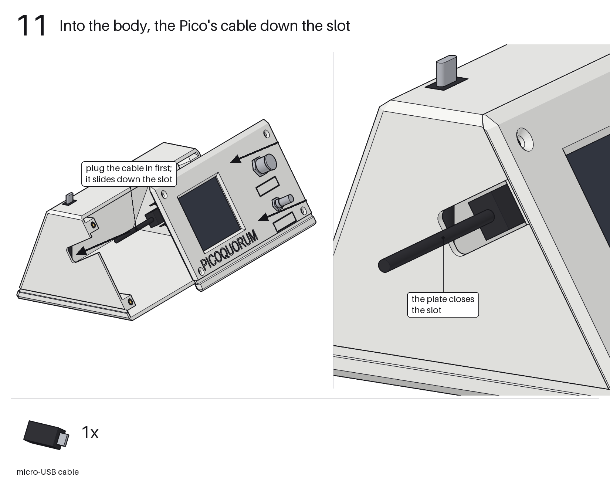

Plug the micro-USB cable into the Pico. Hold the plate in front of the body, lay the cable in the
slot in the body's left wall, and bring the plate in. The cable slides down the slot as the plate
goes in, and the plate closes the slot. Keep the key's wires clear of the Pico's pins and the
screen's header.

## 12. The plate's four screws

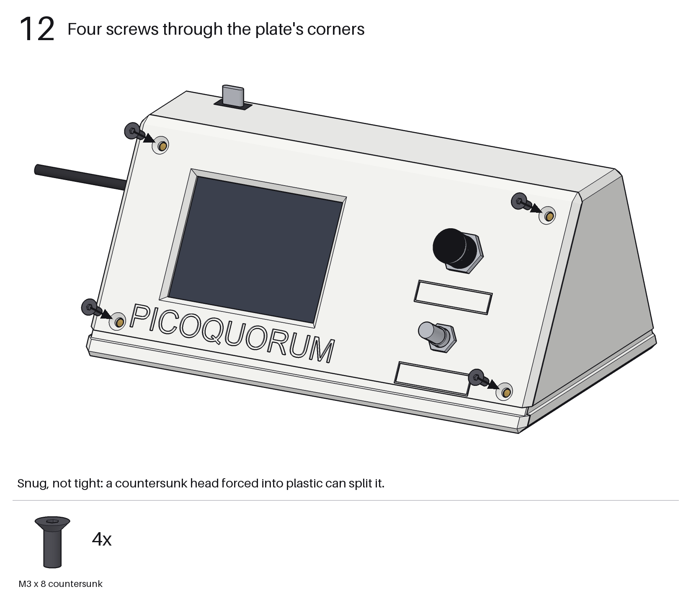

Four M3 × 8 countersunk screws through the plate's corners into the body's inserts. Snug, not tight:
a countersunk head forced into plastic can split it.

## 13. The knob's cap and a key

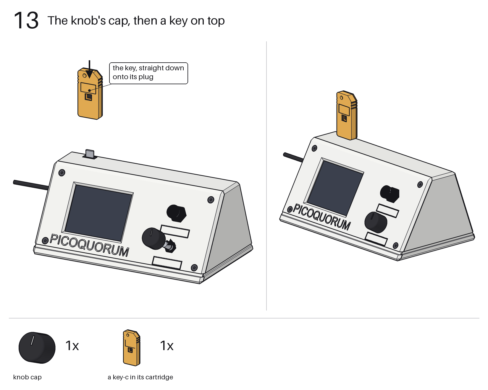

The cap onto the knob's shaft. Then a key, in its cartridge, straight down onto the plug in the top,
its chip's window to the front.

## Redrawing these pictures

```sh
tools/case build prism
```

It runs `prism.py` (the case, its checks and its STLs), then `assembly.py` (these pictures). The
pictures come from the model, so a change to `prism.py` shows here once it runs. The words on this
page don't: read them over after a change. `tools/case check prism` rebuilds and says which files
changed, and that every picture this page shows exists.
