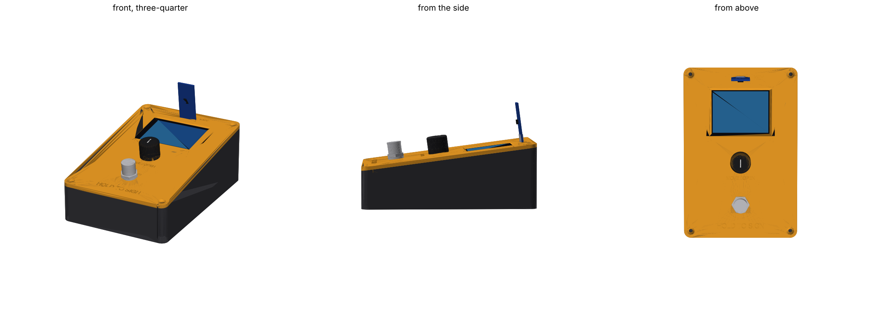
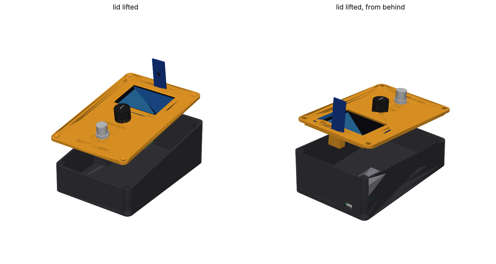

# pico-sign: a knob and a hold-to-sign switch

| | |
|---|---|
| board | a Pico 2 W (castellated), wires or headers soldered on |
| key | a key-c, on a USB-C plug that stands up out of the lid |
| runs | the console image as `BOARD = "build1"`, `SCREEN = "2.4"`, unchanged; `firmware/bench1.py` first |
| case | [`case/`](case/case.py): a wedge, a tray and a flat lid. Ideas in [case/IDEAS.md](case/IDEAS.md) |
| status | written up 2026-10-30 for a demo; not wired, not printed, not run |

Build 1 again, made into a box. A rotary knob does everything on the screen, and one metal push
switch is Sign: hold to sign. A key-c plugs in on top, so keys swap in and out. It is a hobby build: bought
parts, hand wiring, a printed case.


`python3 hardware/builds/pico-sign/wiring.py` redraws the diagram. With `--check` it only loads
`firmware/board.py` as build1 and stops if the pins below differ.

## Parts

- a Pico 2 W
- the 2.4″ ST7789 240 × 320 SPI screen from the six-pack of 2026-09-24
  ([KICKOFF](../../../docs/KICKOFF.md)). Not yet seen working: the one try, on the ESP32, showed
  nothing, and its wiring wasn't checked ([BUILDLOG](../../../buildlog/BUILDLOG.md), 2026-10-07)
- an EC11 knob with push, the one from Build 1: 20 detents, a 6 mm D-shaft, an M7 bushing
- the sign switch: a 12 mm metal push switch, **momentary** and normally open. See [the sign switch](#the-sign-switch)
- a key-c, and a USB-C plug for it: a C-to-C cable cut short behind one plug, as the
  [Feather pigtail](../feather-pigtail/README.md) uses, or a USB-C plug breakout
- two 4.7 kΩ resistors, the key's pull-ups
- for the case: four M3 × 8 countersunk screws, four M3 heat-set inserts, four M2 × 5 screws for the
  Pico, four small rubber feet

## The wiring

Every signal is on Build 1's pin ([BUILD1.md](../../wiring/BUILD1.md)), so the console image runs
with no change. Physical pins count from the USB end: 1–20 along one side, 40–21 back along the other.

### The screen

| screen pin | Pico pin | GPIO |
|---|---|---|
| VCC (or 3V3) | **36**, 3V3 OUT | |
| GND | **13** | |
| SCL (or CLK, SCK): the SPI clock | **14** | GP10 |
| SDA (or MOSI, DIN): SPI data | **15** | GP11 |
| CS | **12** | GP9 |
| DC (or RS) | **11** | GP8 |
| RST | **16** | GP12 |
| BLK (or BL, LED) | **17** | GP13 |

- Go by the names printed on your board. The order of the pins varies between makers.
- The screen's SCL and SDA are its SPI lines. They are not the key's I2C.
- 3.3 V only. Nothing goes to VBUS (40) or VSYS (39).

### The knob

| knob pin | Pico pin | GPIO |
|---|---|---|
| A | **4** | GP2 |
| C, the middle of the three | **3**, GND | |
| B | **5** | GP3 |
| SW1, the push | **2** | GP1 |
| SW2, the push's other leg | **3**, GND | |

- Join C and SW2 at the knob and run one ground wire to pin 3.
- The Pico's own pull-ups. No resistors.
- If clockwise moves backwards, swap A and B.

### The sign switch

| switch lug | Pico pin | GPIO |
|---|---|---|
| either | **20** | GP15 |
| the other | **18**, GND | |

GP15 is the Waveshare's A, which the console reads as Sign. Build 1 kept it for a Sign button.

### The key

key-c: D+ carries SDA, D− carries SCL, VBUS is the key's power
([key-c](../../key-pcb/key-c-usbc/README.md)).

| plug wire (the usual colour) | Pico pin | GPIO |
|---|---|---|
| VBUS (red) | **36**, 3V3 OUT. Never 40 (VBUS) | |
| GND (black) | **8** | |
| D+ (green) | **6** | GP4, SDA |
| D− (white) | **7** | GP5, SCL |
| CC, SBU, the rest | trimmed and insulated, each on its own | |

- **Pull-ups.** key-c has none. Solder a 4.7 kΩ from VBUS to D+ and another from VBUS to D−, at the
  plug. The Pico's internal pull-ups are about 50 kΩ: maybe enough at 100 kHz on short wires, not
  checked.
- **Three wires on 3V3.** Pin 36 feeds the screen, the key and the pull-ups. Splice them on a scrap of
  perfboard or with a short Y-lead.
- **The colours are only a convention.** Meter each wire from its pin on the plug. Before the first
  key goes in, meter VBUS to GND: not a short.
- **No protection.** As on the Feather pigtail: no current limit, no ESD diodes, no switch. The key is
  powered whenever the Pico is. Build 1's switched power on GP6 isn't in the console image yet
  ([BUILD1.md](../../wiring/BUILD1.md#firmware-to-do)), so this build doesn't wire it.
- **No key LED.** key-c P2 has none. P3's LED takes SBU from wing-a; nothing here drives it.

### Headers or wires

For tonight, header pins and female Dupont leads are quickest, and they come apart. For a box that
stays together, solder the wires straight to the castellated pads. The case leaves 22 mm above the
Pico's board for headers and Dupont housings.

## The sign switch

**It must be momentary.** Music shops sell 12 mm metal push switches for effects pedals, and most of
them are latching 3PDT (true bypass): press once and they stay closed. The console starts a Sign when the switch goes down and signs once it has been
held 2 s. A latching switch stays down by itself, so one tap would sign 2 s later with nobody
holding it. That breaks the rule that Sign is held. Use a momentary SPST, normally open (often sold
as "soft touch" or "momentary"). Meter it: it beeps only while pressed.

If yours is latching, don't use it for this build.

## What the controls do

The console's build1 rules, from `firmware/quorum.py`. Nothing here is new.

| | on a review | anywhere else |
|---|---|---|
| turn clockwise | the next page; past the last, the action rows | the next row or choice |
| turn back | the page before | the one before |
| push the knob | jumps to the rows; on Sign, held, signs; on Back, leaves it unsigned | open |
| **sign switch** | **Sign: every page seen first, then held 2 s (3 s when a page is red)** | says "Sign button: only for signing" |

- **There is no Reject button.** A cosigner can't reject a Safe transaction: not signing it is all
  it can do. A transaction is only cancelled when the owners execute another one at the same nonce.
  Today's console still has a Reject row on a review, but it only hides the transaction on this
  console. The v3 plan (`docs/quorum-ui/v3/`) drops it.

- **The sign switch is not the only way to sign.** The knob's push on the Sign row, held, signs too.
  Making the sign switch the only one is a firmware change and a new release fingerprint (AGENTS.md).
  Not done; ask first.
- Let go early and nothing is signed. A red page needs 3 s.
- **Maintenance:** the knob held down at power-up. **Wi-Fi setup:** by itself when no network is
  saved, or Device → Wi-Fi. (GP21 held at power-up starts it too, but nothing is wired to GP21 here.)

## First: the bench check

In the board's `secrets.py`, beside the rest:

```python
BOARD = "build1"
SCREEN = "2.4"
```

Then `tools/usb push`, `tools/usb`, `import wallet; wallet.stop()`, `import bench1`, as in
[BREADBOARD.md](../../wiring/BREADBOARD.md#try-it). `bench1.py` only reads the chip. Leave its
`JACKS = False`: the key is on 3V3, not on GP6.

What to look for:
- **the screen:** TL top left, the bars red, green, blue, white. If it's dark, check the wiring by
  the printed names first. Then `SPI_BAUD = 10_000_000` at the top of `bench1.py`. If it's upside
  down, `MADCTL`; if the colours are a negative, `INVERT = False`
- **the knob:** one click is one count, clockwise up, PUSH reads DOWN while pressed
- **the key:** BUS 60 and the chip's serial when a key-c is in

`bench1` doesn't show GP15 or GP21. Check them on the console: the sign switch on home says "Sign
button: only for signing".

**If the 2.4″ won't come up** after the wiring checks out, it may not be an ST7789. An ILI9341 is
the common other chip on 2.4″ boards. It takes most of the same start-up, but not inversion, so its
colours would come out as a negative. `bench1`'s `INVERT = False` would show that. The console has
no such setting for build1: it would be a firmware change and a new release fingerprint. The
2.8″ is proven on build1 (2026-09-27). It is the fallback, and the case's window would need
widening.

## Then: the console

Push the image as usual (`tools/fw push`, [docs/guide](../../../docs/guide/)). The key needs to be one
that is provisioned already. This build doesn't run a ceremony, and nothing in it writes or locks a
chip.

## The case

[`case/case.py`](case/case.py), CadQuery, like the pigtail's:

```sh
uv run --python 3.11 --with cadquery --with matplotlib python hardware/builds/pico-sign/case/case.py
```

| file | what |
|---|---|
| `out/pico_sign_base.stl` | the tray, floor down, as it prints |
| `out/pico_sign_lid.stl` | the lid, top face down, as it prints |
| `out/pico_sign_assembly.step` | closed, with a box for each part, for CAD |
| `out/pico_sign_preview.png`, `out/pico_sign_exploded.png` | the pictures below |




100 × 150 mm, 36 mm tall at the front and 56 at the back, so the lid slopes about 7.6°. On the lid,
from the front:
- the sign switch, on a ring 2 mm thicker underneath, because it is pressed hard
- the knob, centred above the sign switch: one knob, one switch
- the screen, landscape, in a bevelled window, its panel in a 1 mm pocket underneath
- the key dock: the plug's overmold in a sleeve under the lid, its face 1.2 mm under the top. The lid
  round the opening keeps it from pulling out when a key comes off. A key-c stands straight up out
  of the lid
- words cut 0.6 mm in: HOLD TO SIGN, MOVE / OPEN, KEY

The Pico lies on four posts on the floor, its USB out through the back wall. The lid sits on four
corner posts and a rim inside the walls, with four M3 screws into heat-set inserts.

**What the script checks:** only that the boxes standing in for the parts don't overlap the base,
the lid or each other, and that the sign switch's lugs clear the floor (3.7 mm). It is not a fit check.

**Before printing:**
- **Measure the screen.** `SCREEN_GLASS` and `SCREEN_PCB` are guesses. The window comes from the
  panel's active area (48.96 × 36.72 mm, a 2.4″ 240 × 320).
- **Measure the sign switch.** It assumes a 12 mm bushing and 28 mm of body and lugs under the lid.
- The plug is the pigtail's, by calipers. If yours differs, change `PLUG_*`.
- For tonight, hot glue holds the plug in its sleeve from below, and two strips of foam tape hold the
  screen.

**Print:** lid first, top face down, no supports. It is flat and quick, and every part's hole is in
it, so it tells you most of what's wrong. Then the base, floor down. The sign switch's ring wants solid
infill or 5 walls. Not printed yet.

The pictures are matplotlib's, and its shading is rough. Faces sometimes draw in the wrong order.

## The demo

[DEMO.md](DEMO.md): the story, the setup with the laptop's simulated Safe, the shots, and the key swap.
