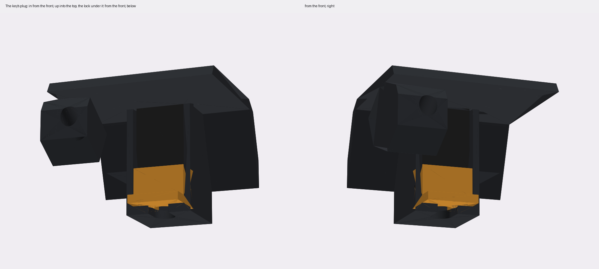
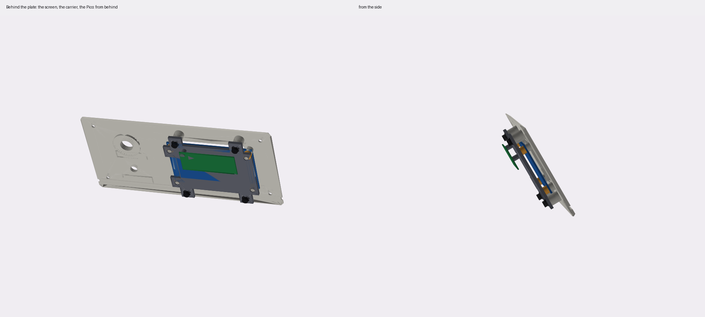
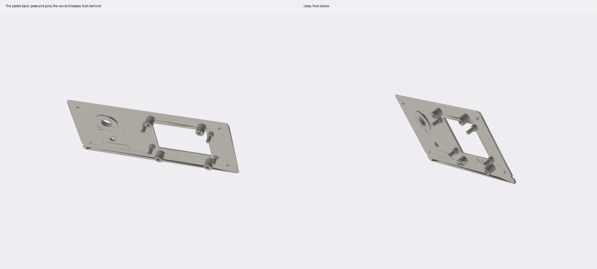
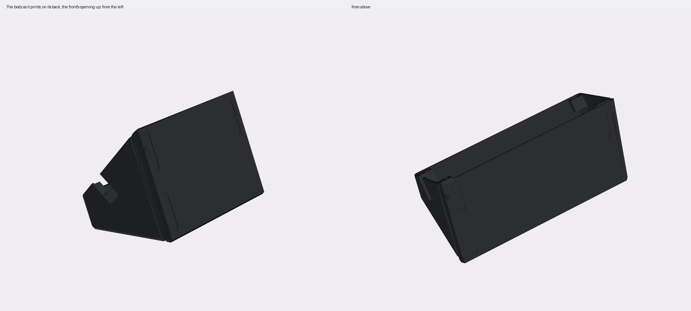

# pico-sign: a knob and a hold-to-sign switch

| | |
|---|---|
| board | a Pico 2 W (castellated), wires or headers soldered on |
| key | a key-c in a printed cartridge that slides into a bay ([case/CONCEPTS.md](case/CONCEPTS.md)) |
| runs | the console image as `BOARD = "build1"`, `SCREEN = "2.8"`, unchanged; `firmware/bench1.py` first |
| case | [the prism](#the-case-the-prism): a one-piece body and a front plate, M3 into heat-set inserts; [put together step by step](ASSEMBLY.md) |
| status | written up 2026-10-30 for a demo; not wired, not printed, not run |

Build 1 again, made into a box. A rotary knob does everything on the screen, and one metal push
switch is Sign: hold to sign. A key-c plugs in on top, so keys swap in and out. It is a hobby build: bought
parts, hand wiring, a printed case.


`python3 hardware/builds/pico-sign/wiring.py` redraws the diagram. With `--check` it only loads
`firmware/board.py` as build1 and stops if the pins below differ.

## Parts

- a Pico 2 W
- the 2.8″ IPS 240 × 320 SPI screen (ST7789) from the earlier build, the one Build 1 proved on the
  bench (2026-09-27). Same 8 pins as the 2.4″ this build started with
- an EC11 knob with push, the one from Build 1: 20 detents, a 6 mm D-shaft, an M7 bushing
- the sign switch: a 12 mm metal push switch, **momentary** and normally open. See [the sign switch](#the-sign-switch)
- a key-c, and a USB-C plug for it: a C-to-C cable cut short behind one plug, as the
  [Feather pigtail](../feather-pigtail/README.md) uses, or a USB-C plug breakout
- two 4.7 kΩ resistors, the key's pull-ups
- for the case: eight M3 heat-set inserts; four M3 × 8 countersunk screws, four M3 × 8 socket head
  screws with washers, two M2 × 8 socket head screws for the Pico; four rubber foot strips, 6 × 35 mm
  ([the hardware](#the-case-the-prism))

## The wiring

Every signal is on Build 1's pin ([BUILD1.md](../../wiring/BUILD1.md)), so the console image runs
with no change. Physical pins count from the USB end: 1–20 along one side, 40–21 back along the other.

### The screen

| screen pin | Pico pin | GPIO |
|---|---|---|
| VCC (or 3V3) | **36**, 3V3 OUT | |
| GND | **13** | |
| SCL (or CLK, SCK): the SPI clock | **14** | GP10 |
| SDA (or MOSI, DIN): SPI data | **15** | GP11 |
| CS | **12** | GP9 |
| DC (or RS) | **11** | GP8 |
| RST | **16** | GP12 |
| BLK (or BL, LED) | **17** | GP13 |

- Go by the names printed on your board. The order of the pins varies between makers.
- The screen's SCL and SDA are its SPI lines. They are not the key's I2C.
- 3.3 V only. Nothing goes to VBUS (40) or VSYS (39).

### The knob

| knob pin | Pico pin | GPIO |
|---|---|---|
| A | **4** | GP2 |
| C, the middle of the three | **3**, GND | |
| B | **5** | GP3 |
| SW1, the push | **2** | GP1 |
| SW2, the push's other leg | **3**, GND | |

- Join C and SW2 at the knob and run one ground wire to pin 3.
- The Pico's own pull-ups. No resistors.
- If clockwise moves backwards, swap A and B.

### The sign switch

| switch lug | Pico pin | GPIO |
|---|---|---|
| either | **20** | GP15 |
| the other | **18**, GND | |

GP15 is the Waveshare's A, which the console reads as Sign. Build 1 kept it for a Sign button.

### The key

key-c: D+ carries SDA, D− carries SCL, VBUS is the key's power
([key-c](../../key-pcb/key-c-usbc/README.md)).

| plug wire (the usual colour) | Pico pin | GPIO |
|---|---|---|
| VBUS (red) | **36**, 3V3 OUT. Never 40 (VBUS) | |
| GND (black) | **8** | |
| D+ (green) | **6** | GP4, SDA |
| D− (white) | **7** | GP5, SCL |
| CC, SBU, the rest | trimmed and insulated, each on its own | |

- **Pull-ups.** key-c has none. Solder a 4.7 kΩ from VBUS to D+ and another from VBUS to D−, at the
  plug. The Pico's internal pull-ups are about 50 kΩ: maybe enough at 100 kHz on short wires, not
  checked.
- **Three wires on 3V3.** Pin 36 feeds the screen, the key and the pull-ups. Splice them on a scrap of
  perfboard or with a short Y-lead.
- **The colours are only a convention.** Meter each wire from its pin on the plug. Before the first
  key goes in, meter VBUS to GND: not a short.
- **No protection.** As on the Feather pigtail: no current limit, no ESD diodes, no switch. The key is
  powered whenever the Pico is. Build 1's switched power on GP6 isn't in the console image yet
  ([BUILD1.md](../../wiring/BUILD1.md#firmware-to-do)), so this build doesn't wire it.
- **No key LED.** key-c P2 has none. P3's LED takes SBU from wing-a; nothing here drives it.

### Headers or wires

For tonight, header pins and female Dupont leads are quickest, and they come apart. For a box that
stays together, solder the wires straight to the castellated pads. The case leaves 22 mm above the
Pico's board for headers and Dupont housings.

## The sign switch

**It must be momentary.** Music shops sell 12 mm metal push switches for effects pedals, and most of
them are latching 3PDT (true bypass): press once and they stay closed. The console starts a Sign when the switch goes down and signs once it has been
held 2 s. A latching switch stays down by itself, so one tap would sign 2 s later with nobody
holding it. That breaks the rule that Sign is held. Use a momentary SPST, normally open (often sold
as "soft touch" or "momentary"). Meter it: it beeps only while pressed.

If yours is latching, don't use it for this build.

## What the controls do

The console's build1 rules, from `firmware/quorum.py`. Nothing here is new.

| | on a review | anywhere else |
|---|---|---|
| turn clockwise | the next page; past the last, the action rows | the next row or choice |
| turn back | the page before | the one before |
| push the knob | jumps to the rows; on Sign, held, signs; on Back, leaves it unsigned | open |
| **sign switch** | **Sign: every page seen first, then held 2 s (3 s when a page is red)** | says "Sign button: only for signing" |

- **There is no Reject button.** A cosigner can't reject a Safe transaction: not signing it is all
  it can do. A transaction is only cancelled when the owners execute another one at the same nonce.
  Today's console still has a Reject row on a review, but it only hides the transaction on this
  console. The v3 plan (`docs/quorum-ui/v3/`) drops it.

- **The sign switch is not the only way to sign.** The knob's push on the Sign row, held, signs too.
  Making the sign switch the only one is a firmware change and a new release fingerprint (AGENTS.md).
  Not done; ask first.
- Let go early and nothing is signed. A red page needs 3 s.
- **Maintenance:** the knob held down at power-up. **Wi-Fi setup:** by itself when no network is
  saved, or Device → Wi-Fi. (GP21 held at power-up starts it too, but nothing is wired to GP21 here.)

## First: the bench check

In the board's `secrets.py`, beside the rest:

```python
BOARD = "build1"
SCREEN = "2.8"
```

Then `tools/usb push`, `tools/usb`, `import wallet; wallet.stop()`, `import bench1`, as in
[BREADBOARD.md](../../wiring/BREADBOARD.md#try-it). `bench1.py` only reads the chip. Leave its
`JACKS = False`: the key is on 3V3, not on GP6.

What to look for:
- **the screen:** TL top left, the bars red, green, blue, white. If it's dark, check the wiring by
  the printed names first. Then `SPI_BAUD = 10_000_000` at the top of `bench1.py`. If it's upside
  down, `MADCTL`; if the colours are a negative, `INVERT = False`
- **the knob:** one click is one count, clockwise up, PUSH reads DOWN while pressed
- **the key:** BUS 60 and the chip's serial when a key-c is in

`bench1` doesn't show GP15 or GP21. Check them on the console: the sign switch on home says "Sign
button: only for signing".

**The 2.8″ is proven on build1** (2026-09-27): `MADCTL = 0x60`, inversion on, 24 MHz. If it comes up
upside down, the header is on the other side from Build 1's case: that is `MADCTL`. The prism puts the
header on the right, so on it the screen comes up upside down until `MADCTL` is `0xA0` for this build.
That is a firmware change, and a new release; it isn't made. (The 2.4″ this
build started with was never seen working; if you go back to it, it may be an ILI9341, which needs
inversion off: a firmware change.)

## Then: the console

Push the image as usual (`tools/fw push`, [docs/guide](../../../docs/guide/)). The key needs to be one
that is provisioned already. This build doesn't run a ceremony, and nothing in it writes or locks a
chip.

## The case: the prism

[`case/prism.py`](case/prism.py), CadQuery. A first draft to print and try.
[ASSEMBLY.md](ASSEMBLY.md) puts it together step by step, with pictures.

```sh
tools/case build prism     # prism.py, then assembly.py's pictures; `check` says what changed
```


A triangle seen from the side, 180 mm wide: the front plate slopes at 60°, a flat band 34 mm deep runs
along the top, and the back falls at 70°. 78 mm tall, 107 mm front to back.

**Four printed parts:**
- **The body**, one piece, open at the front. It prints on its back: the front's opening faces up
  and the desk's side is a wall, 180 × 93 × 98 mm. The four blocks that hold the plate's inserts
  stand out from the side walls, so under each, as it prints, a 45° chamfer runs down to its wall.
  Its outside edges are chamfered 2.5 mm. A channel 3 mm tall and 1.5 mm deep runs round the base,
  plate included, for a strip of another colour. Under it, four pockets 1 mm deep for the rubber
  feet, strips 6 × 35 mm with round ends (calipers), 0.3 mm round each: front to back, 14 mm in
  from each side, their ends 8 mm in from the front and back edges.
- **The plate**, 3 mm, printed face down, so the words are on the bed and the posts, pins and bosses
  stand up. Four M3 countersunk screws hold it, into heat-set inserts in blocks at the corners of the
  body's opening.
- **The carrier**, 2.5 mm, behind the screen. The Pico screws to its back. Prints face down, the
  Pico's posts up.
- **Four spacers**, 4 mm tubes that slip onto the screen's pins.
- **The plug lock**, 12.5 × 11 × 9.3 mm, that holds the key's plug up. Prints as it sits.

**On the plate:**
- the screen on the left, in a bevelled window. On the back, at the screen board's four holes
  (4.6 mm), a post with a 7 mm seat, 4.2 mm tall: the panel's 4.0 mm plus 0.2, so the board rests
  on the seats round its holes and the glass doesn't press the plate. Where the glass comes close to a
  hole, the seat is cut flat 0.3 mm from the glass's edge. On each seat a 4.2 mm pin goes on through
  the board, a spacer and the carrier, tapered at the tip. Drop the screen on and it is in place.
- four 9 mm bosses above and below the screen, each with an M3 insert: the carrier rests on them.
  The carrier is 1 mm bigger than the screen's board all round, for wall round its pin holes.
- the controls on the right:
  - the sign switch on top, a 12 mm metal push switch, on a ring 2 mm thicker behind the plate
    because it's pressed hard
  - the knob under that
  - under each, a 30 × 8 mm frame, a 0.6 mm line cut 0.6 mm deep, for a sticker or a printed label
- PICOQUORUM cut under the screen, as big as fits between the bottom screws, the window and the
  colour channel: 9.3 mm letters, 81 mm long (the script works it out and prints it)


**The key** plugs straight down onto a USB-C plug that stands in the top, on the screen's side
(24 mm from the left, just left of the Pico), near the back edge. The plug is a cut cable's: its
overmold, 12.4 × 5.5 × 17.1 mm (calipers), ends flush with the top in a hole with 0.2 mm round it, so
only the metal shell stands up and the key goes on all the way. The key, in its cartridge
([CONCEPTS.md](case/CONCEPTS.md#the-key-cartridge)), stands up out of the top, its chip window to
the front.

The plug's holder hangs from the top, built back to the back wall. Its channel is open at the front,
and so is the slot for the cable in the stop at its foot. Putting the plug in:
1. Slide it into the channel from the front, low, the cable down through the stop's slot. The channel
   has 9.4 mm under the plug's final place, so its shell clears the top's underside.
2. Push it up into the top's hole until the overmold is flush.
3. Slide **the lock** in under it, the cable into the lock's slot, which is open at its back end.
   It fills the 9.4 mm, so the plug can't drop when the key goes on, and two 0.3 mm bumps click into
   dimples in the channel's walls. Its front lip is to pull it out by.



**Inside:**
- behind the screen, a stack on the pins: the screen board, a spacer on each pin, then the carrier.
  The carrier is the board's size, with an ear out to each boss. Four screws through the ears into the
  bosses hold it, and through the spacers it holds the board down on its posts. The spacers leave 4 mm
  for the parts on the board's back. The carrier is cut round the screen's header, so its wires pass.
- the screen's header on the right (seen from the front), toward the controls, and the Pico's USB
  on the left: the screen's wires and the Pico's plug are at opposite ends.
- the Pico on two 6.5 mm posts on the carrier's back, at its far end from the USB. They are 4.5 mm
  across, to keep off the pads of the pins beside each hole, with a 1.8 mm hole an M2 × 8 screw cuts
  its own thread in. The USB end has no posts: on the first carrier its micro-USB plug hit them. Its
  USB points left (seen from the front), and its pins point away from the carrier: with the plate face
  down and the carrier on, the pins point up. With the headers soldered the usual way that puts its
  parts and USB socket toward the carrier. Soldered the other way, it fits too.
- the USB cable out through a 13 mm slot in the left wall, level with the Pico's USB, open to the
  wall's front edge. Plug the cable into the Pico first, lay it in the slot, and it slides down the
  slot as the plate goes on; the plate closes it. A closed hole would stop the plate 3 to 7 mm out
  (checked by moving the plate's stack and a 4 mm cable out along the plate's normal). The plug passes
  it whichever face its socket is on.
- the key's plug cable down from its holder, beside the Pico
- 27 mm between the sign switch's lugs and the floor








**The hardware**, from the kits on the bench (inserts are named thread × length × outside diameter):

| where | inserts | screws |
|---|---|---|
| the body's corner blocks, for the plate | 4 × M3\*6\*5, in 4.2 mm holes | 4 × M3 × 8 **countersunk**: not in the kit |
| the plate's bosses, for the carrier | 4 × M3\*6\*5, in 4.2 mm holes | 4 × M3 × 8 socket head, with M3 washers |
| the carrier's posts, for the Pico | none: 1.8 mm holes, self-tapping | 2 × M2 × 8 socket head, at the far end |
| the screen | none: four pins and four spacers | none |

The insert holes (`M3_INSERT`) are about 0.84 of the insert's outside diameter, not tried. Nor
is an M2 screw in a printed 1.8 mm hole (`PICO_SCREW_HOLE`). Print one boss and set an insert before printing the rest.

| file in `case/out/prism/` | what |
|---|---|
| `prism_body.stl` | the body, on its back, as it prints (180 × 93 × 98 mm) |
| `prism_plate.stl` | the plate, face down, the pins up |
| `prism_carrier.stl`, `prism_spacers.stl` | the carrier, the Pico's posts up; the four spacers |
| `prism_plug_lock.stl` | the lock for the key's plug |
| `prism_assembly.step` | closed, with a box for each part |
| `prism_*.png` | the pictures here |

**What the script checks:** that the boxes standing in for the screen's glass and board, the switch,
the knob, the plug, the cartridge, the Pico with its parts, wires and USB plug, and the carrier's screw heads
don't overlap the body, the plate, the carrier, the spacers, the plug lock or each other (181 pairs). The closest
are the carrier to the body (1.3 mm), the Pico's wires to the plug's holder (2.0 mm), the glass to the
seats' flats (0.3 mm) and the bosses to the screen's board (2.25 mm). The plug stand-in covers the socket on either
face of the Pico. Also that the bosses are deep enough for their inserts and the Pico's posts for
their screws, and how close the plug comes to the posts (1.0 mm) and the posts to the Pico's pin pads
(0.21 mm, from the Pico's drawing, not measured). It is not a fit
check.

**Overhangs:** the script turns the body as it prints and lists every flat face that leans more than
45° past upright and isn't on the bed. Four are left, none of them the insert blocks:
- the 2.5 mm chamfer along the top's back edge (717 mm²): it starts at the bed and leans 55°. A short
  lip; it may droop a little.
- the colour channel in the back (565 mm²): a 3 mm bridge, 1.5 mm off the bed
- the front side of the plug's hole in the top (31 mm²): a bridge 12.8 mm across, 2.4 mm deep
- the lower side of the Pico's cable slot in the left wall (56 mm²): the wall's 2.4 mm edge, 50°
  from upright

**Before printing:**
- **The screen** is measured with calipers: the board 80 × 48.5 × 1.5 mm, its holes 4.6 mm, the
  panel 4.0 mm from the board's front to the glass's front. The holes' centres come from their edges:
  35.1 inside and 44.6 outside top to bottom, so 39.85; 76.1 and 76.5 outside across, so about 71.7.
  **Fitted on the first plate (2026-10-30):** the screen sat well, but with its header on the right
  the posts wanted to be 1 mm toward the controls. The header is on the right (`HEADER_SIDE`), away
  from the Pico's USB: the glass sits 1 mm left of its holes' centre (`SCREEN_DX`), so the window
  stays put and the posts, the bosses and the carrier move 1 mm right. The first plate has them where
  they were, so its carrier is a separate one, made with the board's centre 1 mm back.
  **Still to measure:** the panel's outline and the visible area. The panel is a placeholder
  66.5 × 48.5 mm; the visible area is a 2.8″ 240 × 320 panel's usual 57.6 × 43.2 mm, centred on it.
  The seats' flats and the window follow them; the script prints how close the glass comes to a hole.
- **The key's plug:** the cut cable's overmold, 12.4 × 5.5 × 17.1 mm, as the Feather pigtail and
  the bench's cable both measured. A different cable needs the pocket (`PLUG_*`) changed.
- **The sign switch:** a 12 mm bushing and 28 mm of body under the plate, momentary.
- **The Pico's plug:** a micro-USB overmold of 11 × 8 mm is assumed (`USB_PLUG`). A fatter one may
  touch the carrier; measure yours.
- Print the plate first: every part's hole is in it.

Not printed yet. The pictures are matplotlib's, and its shading is rough.

**Earlier:** [CONCEPTS.md](case/CONCEPTS.md) has the four first concepts for the 2.8″ and the key
cartridge. [`case.py`](case/case.py) is the first wedge, for the 2.4″, with the key standing up.

## The demo

[DEMO.md](DEMO.md): the story, the setup with the laptop's simulated Safe, the shots, and the key swap.
