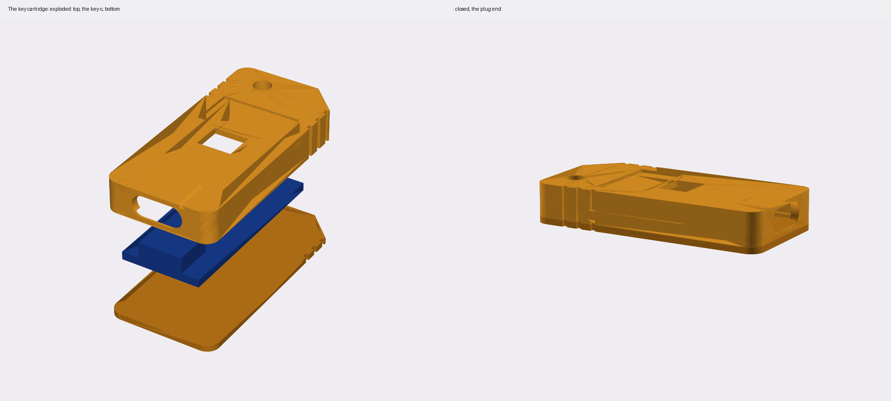
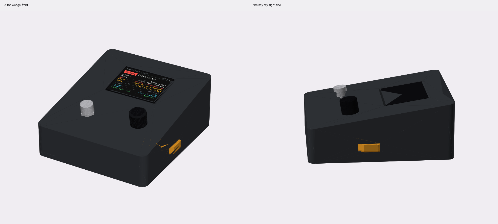
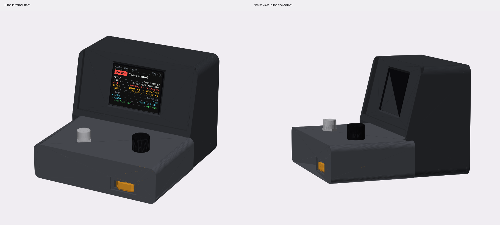
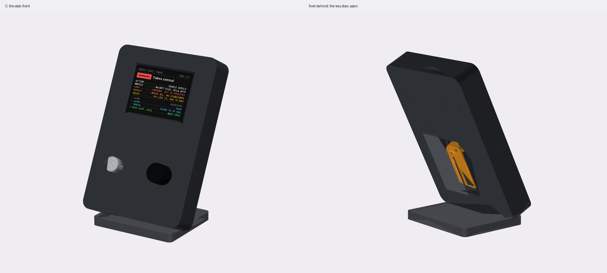
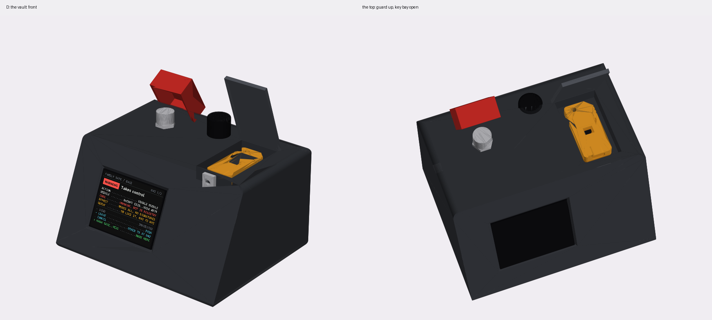

# Case concepts for the 2.8″ screen

> **A first round, 2026-10-31, to choose from.** Four bodies and one key cartridge, drawn by
> [`concepts.py`](concepts.py) in CadQuery:
>
> ```sh
> uv run --python 3.11 --with cadquery --with matplotlib --with pillow \
>     python hardware/builds/pico-sign/case/concepts.py [screen.png]
> ```
>
> The four bodies are massing models: solid, nothing inside placed, nothing checked for fit. They
> show size, shape, where things go and how the key goes in. The cartridge is drawn to key-c's own
> numbers and is meant to be printed and tried. The screens in the pictures show the checklist
> warning (`docs/quorum-ui/v3/checklist/320/03-warn.png` on the `boot-pixel` branch).

## The screen

pico-sign moves to the **2.8″ ST7789, 240 × 320**: the panel Build 1 proved on the bench
(2026-09-27). Same 8 wires, same pins. In the board's `secrets.py`: `SCREEN = "2.8"`.

Its numbers here are console-pcb's placeholder (`hardware/console-pcb/gen_console.py`):
- the module's board: 86 × 50 mm, the 8-pin header on the left
- M3 holes 3 mm in from each corner, 80 × 44 mm apart
- the active area: 57.6 × 43.2 mm (320 × 240 at 0.18 mm), here 3 mm right of the board's centre

**They aren't measured.** The case from the earlier project fits this screen, so its hole spacing
and window are the numbers to use. Change `SCREEN_*` at the top of `concepts.py`.

## The key cartridge

The key never stands up out of a case again. It lives in a cartridge, and the cartridge slides into
a bay.



- **22 × 46 × 7.6 mm**, two halves that close round a key-c for good. The top half holds the board
  in a pocket and has room over its parts. The bottom half is a 1.2 mm plate. Glue it, or use two M2
  screws if you want to be able to open it.
- **The plug end is open** to the key-c's USB-C receptacle: a 10.3 × 4.5 mm opening over the
  receptacle's face, set 0.6 mm in.
- **A window over the ATECC608.** You can see the chip: the key *is* that chip.
- **A label recess**, 16 × 9 mm, for the owner's name or the key's blockie.
- **One rear corner cut at 45°,** so it only goes into a bay label-up. USB-C doesn't care which way
  up; the label and the window do.
- **Grip ridges** down both sides at the grip end, and a 3.6 mm lanyard hole through it.
- **Print:** `out/concepts/cartridge_top.stl` and `cartridge_bottom.stl`, flat faces down, no
  supports. 0.2 mm layers; the walls are 1.2 mm, three perimeters.

**The console's side** of every bay is the same: a USB-C plug held rigidly at the bay's end, so the
cartridge's front sits against it and the plug's shell goes 6.5 mm into the cartridge. Two ways:
- the cut cable's overmold in a pocket, as in the Feather pigtail's case
- a small USB-C plug breakout, screwed upright at the bay's end, which locates better

Either way, a cartridge pulled out pulls against the bay, never against the joints.

**What hasn't been checked:** that a real key-c fits the pocket (the board's outline and the
receptacle's size are from the key's design files, not calipers), and that a plug reaches full
depth through the opening.

## The four

### A. The wedge



*A desk instrument.* The sloped box from the 2.4″ version, wider for the 2.8″: 130 × 150 mm, 36 mm
tall at the front and 60 at the back. The screen fills the upper lid. The sign switch is front left
and the knob front right.

**The key:** the cartridge slides into the **right-hand wall**, flat, and sits flush. Only its
grip shows, in a finger notch.
- **Good:** the simplest to print and build: the same tray and lid as before. The key is out of the
  way but easy to reach. Nothing sticks up.
- **Not so good:** looks like a pedal or a lab box, not a product. The key is easy to take, so
  nothing shows if someone did.

### B. The terminal



*A small terminal.* An upright body, 140 mm wide, with the screen in its face, tilted back 14° in a
hood. A low deck in front carries the sign switch and the knob. It goes with the checklist UI: a
machine that lists things.

**The key:** the cartridge goes into a **slot in the deck's front**, like a cartridge, under the
knob. Fully in, it sits flush.
- **Good:** the screen faces you at eye level, and the hood cuts glare. The deck is a natural place
  for hands. The key slot is in front of you, so you see it every time you sign. It has the most
  personality.
- **Not so good:** the biggest and the longest to print (two bodies, or one tall one with
  supports). The key slot faces anyone across the desk.

### C. The slab



*A panel on a stand.* A 104 × 156 × 24 mm slab leaning back 26° on a foot. The screen is at the top,
the sign switch and the knob under it. It could come off the foot and lie flat, or hang on a wall.

**The key:** the cartridge lies in a **compartment in the back**, behind a sliding door, like a
battery door. Closed, there is nothing to see.
- **Good:** the key is out of sight and out of reach of a casual hand: it takes turning the slab
  round. The narrowest footprint on a desk. The cleanest front.
- **Not so good:** swapping keys is the slowest of the four. A lean like this needs a heavy foot, or
  it tips when the switch is pressed hard.

### D. The vault



*A box that guards what's in it.* 150 × 120 × 84 mm with the screen in its sloped front. On top:
- the sign switch, under a **flip-up guard** (red), as KICKOFF wanted for Sign
- the knob
- the **key bay**, under a hinged lid

**The key:** the cartridge lies flat in the bay. The lid closes over it. A **hasp** takes a small
padlock or a **numbered tamper seal**, so anyone can see if the key bay has been opened since the
seal went on.
- **Good:** the only one where you can *see* that nobody touched the key. The guard makes Sign two
  deliberate moves: lift, then hold. It looks like what it is: a thing that protects a key.
- **Not so good:** the heaviest and the most parts (lid, guard, hasp, hinges). The guard is one more
  thing between you and signing, every time.

## Side by side

| | A wedge | B terminal | C slab | D vault |
|---|---|---|---|---|
| footprint | 130 × 150 | 140 × 148 | 104 × ~110 on its foot | 150 × 120 |
| the key | side wall, flush | deck front, flush | back compartment, door | top bay, lid, seal |
| key swap | quickest | quick | slow | slow (break the seal) |
| shows tampering | no | no | no | **yes** |
| Sign | switch | switch | switch | switch under a guard |
| print | lid ~2 h, base ~4 h | ~8 h | ~6 h | ~9 h and small parts |
| reads as | a lab instrument | a little terminal | a clean panel | a safe |

## Choosing

Two questions decide most of it:
1. **Should the case show that the key wasn't touched?** Then D, or D's lid and seal on another
   body.
2. **Is it a desk object you sign at, or a box you keep?** B and A are desk objects; C and D can
   live on a shelf or a wall.

The bay, the cartridge and the plug mount are the same in all four, so the body can change later
without changing the key.

## Next, once one is picked

1. Measure the 2.8″ (or take the earlier case's numbers) and the real key-c.
2. Print the cartridge and one bay block with the plug mount, and try them together first.
3. Then the body, hollow, with the screen's posts, the Pico's posts and the switch's ring, as the
   2.4″ wedge in [`case.py`](case.py) has them.
