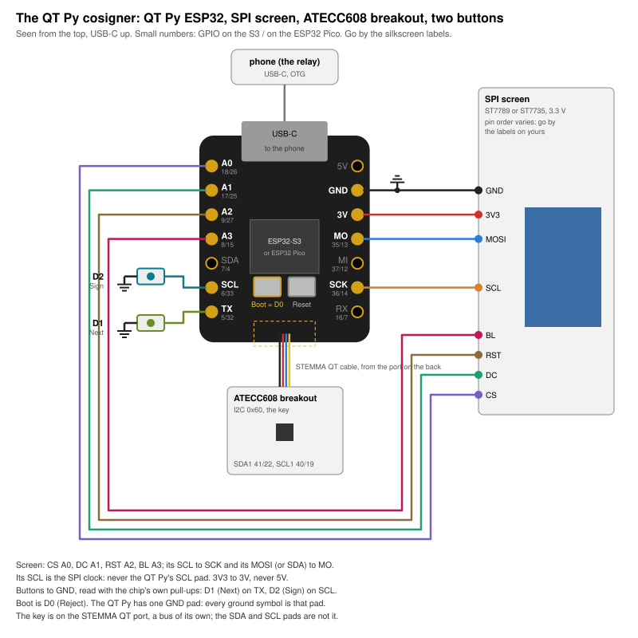
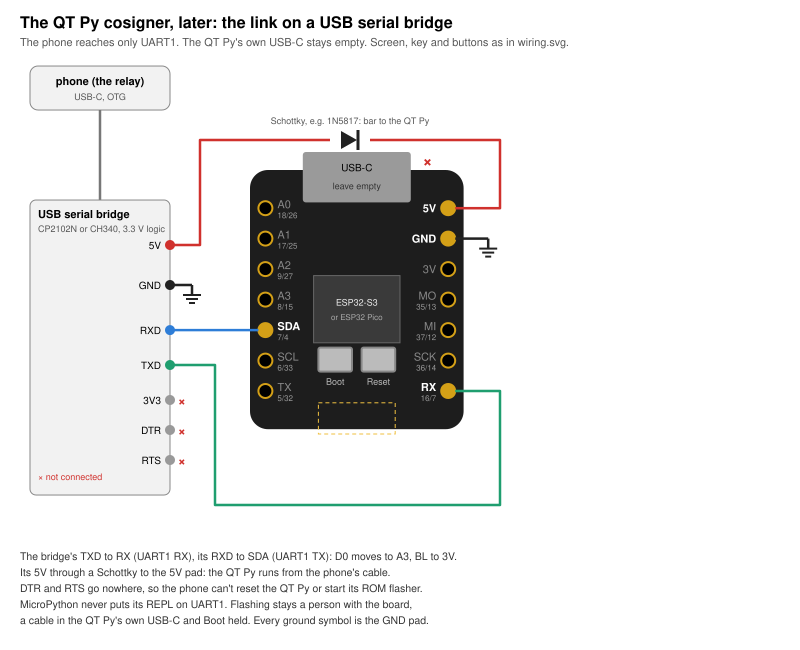

# The QT Py cosigner

| | |
|---|---|
| board | Adafruit QT Py ESP32-S3 with 2 MB PSRAM ([5700](https://www.adafruit.com/product/5700)); the QT Py ESP32 Pico ([5395](https://www.adafruit.com/product/5395)) has the same pads |
| key | Adafruit's ATECC608 breakout ([4314](https://www.adafruit.com/product/4314)) on a STEMMA QT cable |
| runs | nothing yet: the console image needs a `qtpy` profile and the USB link, [not written](#the-firmware-it-needs-not-written) |
| case | none yet |
| status | written up 2026-10-29 from a handoff; not wired, not run on the board |

The smallest console we can buy the parts for: a QT Py, a small SPI screen, an ATECC608 breakout
and two buttons, with a phone on its USB-C. The phone fetches the Safe's queue and posts the
signatures. The QT Py shows each transaction, rebuilds its hash, and has the key sign only that,
after you have seen every page and held Sign.

```
   Safe's service ── HTTPS ── phone (the relay) ── USB-C ── QT Py ESP32 ── STEMMA QT ── ATECC608
                              no key, no say in              screen, Boot + 2 buttons
                              what gets signed
```

It is [console-usb](../../console-usb/README.md)'s idea from bought boards: no radio in use, and a
link where the console asks and the phone only answers.



## What changed from the handoff, and why

The handoff (2026-10-29) asks for a QT Py, an ATECC608 breakout and an SPI screen, with an Android
phone as the host. The parts and the wiring are as it says. Four things are not:

- **No `SIGN <hash>` command.** The handoff has the phone send a 32-byte hash, the screen show it,
  and the chip sign it after a button press. That is a command that signs a digest the host hands
  over, which this project never adds ([AGENTS.md](../../../AGENTS.md), rules 1 and 3): a phone
  that lies about the hash gets a signature for whatever it likes, and a hash on a screen says
  nothing about what the transaction does. Also, the chip doesn't sign the Safe hash itself. Its
  key owns the Safe through Safe's passkey signer, so it signs
  `sha256(authenticatorData || sha256(clientDataJSON))`, with the Safe hash inside clientDataJSON
  ([`firmware/webauthn.py`](../../../firmware/webauthn.py)). So the console builds all of it:
  - the phone carries the queue as [console-usb's link](../../console-usb/README.md#the-link-what-the-computer-can-and-cant-do)
    does: the console asks for a URL on Safe's service, the phone answers with the body;
  - the console decodes the call, rebuilds the Safe hash from the fields it shows
    ([`firmware/safe_tx.py`](../../../firmware/safe_tx.py)), and the key signs only that;
  - no message names the chip, a digest or a signature to make.
- **The console image, not new Arduino firmware.** The handoff's firmware is PlatformIO and
  Arduino, reusing diykey's code. This repository's own Safe hash, decoder, passkey encoding and
  ATECC608 driver are MicroPython, tested on CPython and MicroPython against real Safe
  transactions (`test-vectors/`). The console image already runs on an ESP32-S3. A QT Py needs a
  board profile, not a rewrite in C++.
- **Three buttons, not one.** The console needs Reject, one easy press, apart from Sign, held. So
  Boot is D0 (Reject and Back), and two tactile switches are D1 (Next) and D2 (Sign). These are
  the Feather's `feather-s3` rules ([FEATHER-S3.md](../../wiring/FEATHER-S3.md)).
- **Later, not the QT Py's own USB.** On the S3 the USB-C is MicroPython's REPL, and the computer
  on the other end can restart the chip into its ROM flasher. On the ESP32 Pico the CH9102 is wired
  to UART0, the REPL, with Adafruit's auto-reset. Either way the phone could run any code on the
  board, and have the chip sign any digest. For the bench that is the same as any dev board. For a
  cosigner left plugged into a phone it isn't, so the link moves to UART1 on a serial bridge whose
  DTR and RTS go nowhere ([below](#later-the-link-on-a-serial-bridge)), as console-usb does.

## Which QT Py

Both have the same 14 pads, a STEMMA QT port on the back, Boot and Reset. Their GPIOs differ, so
the firmware goes by board, and this README gives both.

| | QT Py ESP32-S3 (5426, 5700) | QT Py ESP32 Pico (5395) |
|---|---|---|
| chip | ESP32-S3 | ESP32-PICO-V3-02 |
| USB | the chip's own; shows up as an Espressif device | a WCH CH9102 USB serial chip; shows up as a WCH serial port |
| PSRAM | none on 5426, 2 MB on 5700 | 2 MB |
| buy | **5700**. The console has run on an S3 with 2 MB of PSRAM (the Feather), never on one without | works for the link; no USB of its own for a later security-key mode |

Which one you have: read the chip's marking, or plug it into a computer and see which of the two
it shows up as.

## The pins

From CircuitPython's board files for the three boards (`pins.c`, 2026-10-29). Both S3 boards have
the same map.

| pad | S3 GPIO | Pico GPIO | what |
|---|---|---|---|
| **A0** | 18 | 26 | screen CS |
| **A1** | 17 | 25 | screen DC |
| **A2** | 9 | 27 | screen RST |
| **A3** | 8 | 15 | screen BL |
| **SCK** | 36 | 14 | screen SCL (the clock) |
| **MO** | 35 | 13 | screen MOSI |
| **TX** | 5 | 32 | D1, Next: a button to GND |
| **SCL** | 6 | 33 | D2, Sign: a button to GND |
| **SDA** | 7 | 4 | the link, later: UART1 TX to the bridge's RXD |
| **RX** | 16 | 7 | the link, later: UART1 RX from the bridge's TXD |

And off the pads:

| | S3 GPIO | Pico GPIO | |
|---|---|---|---|
| Boot | 0 | 0 | D0: Reject and Back. Held at reset it starts the ROM flasher, so never a power-up key |
| STEMMA QT SDA1, SCL1 | 41, 40 | 22, 19 | the key's bus: `I2C(1)` in MicroPython, `Wire1` in Arduino |
| NeoPixel, its power | 39, 38 | 5, 8 | unused |

- **No boot pins in use** but Boot itself. On the Pico, A3 is GPIO15, a boot pin that only
  silences the ROM's boot log. MI (GPIO12 there) sets the flash voltage at reset, so it is left
  free.
- **The SDA and SCL pads are not the key's bus.** On both boards the STEMMA QT port has a bus of its
  own. Here the pads are a button and the link.
- MI is free on both.

## The screen

The handoff's screen has 8 pins: BL, RST, DC, SCL, MOSI, CS, 3V3 and GND, likely an ST7789 or an
ST7735. Its driver and size aren't known yet.

| screen | QT Py |
|---|---|
| GND | **GND** |
| 3V3 | **3V**. Not 5V unless the module says it takes 5 V |
| SCL | **SCK**. This is the SPI clock. Never the QT Py's SCL pad |
| MOSI (some modules print SDA) | **MO** |
| CS | **A0** |
| DC | **A1** |
| RST | **A2**, or tie it to 3V |
| BL | **A3**, or tie it to 3V for always on |

- Modules put these 8 pins in different orders. The diagram draws them in the order that wires
  cleanly; go by the labels printed on yours.
- The console's three-button screens are drawn for 240 × 135, the Feather's 1.14″ ST7789. That
  panel is the one to buy. The console also drives 160 × 128 ST7735S and 320 × 240 ST7789 panels
  (`firmware/board.py`), but not yet with three buttons.
- On jumper wires keep SPI at 24 MHz, as Build 1 does, until the picture is clean.

## The key

A STEMMA QT cable from the QT Py's port, on the back, to the breakout. No other wiring.

- The breakout answers at 0x60.
- The port's power is the QT Py's 3.3 V. CircuitPython's map names no pin that switches it, as
  the Feather's GPIO7 does.
- Before you change anything on the chip, find out whether it is configured and locked, and how.
  The console's Device screen and the bench reads tell you; nothing here writes or locks it. An
  ATECC608's locks can't be undone ([docs/LOCKING.md](../../../docs/LOCKING.md)).

## The buttons

| | QT Py | on a review | anywhere else |
|---|---|---|---|
| D0 | **Boot** | Reject: one press, on any page, even while Sign is held | Back |
| D1 | a tactile switch, **TX** to **GND** | the next page; held 1 s, the one before | the next row or choice |
| D2 | a tactile switch, **SCL** to **GND** | the next page not yet seen; once every page is seen, Sign, held 2 s (3 s when a page is red) | Open |

- All three are read with the chip's own pull-ups and pressed low. No resistors.
- **One GND pad.** The screen and both buttons need it. Join the buttons' ground legs, then splice
  that wire and the screen's GND to the pad, on a breadboard row or with a short Y-lead. Every
  ground symbol in the diagrams is that pad.
- A guarded Sign button and a separate Reject button are later.

## Later: the link on a serial bridge



| bridge | QT Py |
|---|---|
| TXD | **RX**, UART1 RX |
| RXD | **SDA**, UART1 TX |
| GND | **GND** |
| 5V | **5V**, through a Schottky (1N5817 or alike), its bar at the QT Py. Adafruit asks for a diode when 5V is an input |
| 3V3 | nothing |
| DTR, RTS | **nothing** |

- A 3.3 V USB serial breakout, a CP2102N or a CH340, whose DTR and RTS are pins you can leave
  unconnected. Not one wired for an ESP32's auto-reset.
- The phone gets a byte pipe to code the console runs. It can't reach the REPL, reset the QT Py or
  start its flasher: MicroPython never puts its REPL on UART1, and DTR and RTS go nowhere.
- The QT Py's own USB-C stays empty. Flashing is a person with the board: a cable there and Boot
  held, as today.
- On the ESP32 Pico, the CH9102 is still on the board, on UART0; with nothing in its USB-C it
  carries nothing.

What the phone can do then is what any lying transaction service can do: show transactions that
don't exist, hold back ones that do, misstate the owners or who has signed, drop the signature on
its way out. It can't get a signature for anything but what the screen showed and you held Sign
for. The check that it shows you the right queue is yours: the verify code against the proposer's,
and the Safe's other owners. [console-usb](../../console-usb/README.md#the-link-what-the-computer-can-and-cant-do)
says the same at more length.

## The firmware it needs (not written)

- **A `qtpy` profile in `firmware/board.py`:** the pins above, `THREE`, D0 D1 D2 pressed low
  (`HIGH` empty), the key on `I2C(1)` at 41/40, nothing to power up. On an S3 the image now picks
  `feather-s3`, or `picoquorum-key` when GPIO16 and 17 read high. The link holds GPIO16 (RX) high,
  so `qtpy` must come from `secrets.BOARD`, before that look, as `feather-knob` does. On a plain
  ESP32 the image always picks `esp32`, the DevKit's pins, so the ESP32 Pico needs that changed
  too, and its own map; or the build is the S3 only.
- **The link,** shared with console-usb: the console's requests to Safe's service on UART1 in
  place of HTTPS, and a relay on the phone. The handoff's first choice for the phone is a page in
  Chrome on Android over Web Serial or WebUSB; neither has been tried here with this board.
- **A bench script** in `bench/`, read-only, as [feather-knob's dial.py](../feather-knob/bench/dial.py):
  the screen the right way up, the three buttons, the key's serial at 0x60.

Each is a firmware change, so a new release fingerprint ([AGENTS.md](../../../AGENTS.md)).

## Steps

1. Wire the screen; the bench script draws on it.
2. The key answers at 0x60; its serial and public key on the screen.
3. The `qtpy` profile: the console's screens on the QT Py, signing on a testnet over Wi-Fi, as the
   Feather does. Nothing else changes.
4. The link on the QT Py's own USB, from a desktop relay, on the bench.
5. The same from Android Chrome.
6. The link on the bridge. Now it is a cosigner you can leave plugged in.
7. A confirmation on Base Sepolia, then Base with a few dollars ([docs/LADDER.md](../../../docs/LADDER.md)).
8. The same on a Rabbit R1 running Android.

The handoff's three demos, as they come out here:
- **The match.** The phone shows the transaction and its verify code; the screen shows its own
  pages and the same code. Hold Sign; the confirmation goes back.
- **The mismatch.** A relay that changes a field: the screen shows the change and a different verify
  code. Reject. A relay that changes the hash the service claims: the console refuses before any
  page.
- **Portability.** Unplug it, plug it into another phone: the same key, the same owner address.

## Open

- **The screen's driver and size.** Read the listing. The 1.14″ 240 × 135 ST7789 is the one the
  console's three-button screens are drawn for.
- **The ATECC608's state.** Configured and locked already? Which slot holds the key? Nothing gets
  locked until that is known and the config is the one meant.
- **USB host power on the R1** once it runs Android. If it gives none, an OTG Y-cable or a powered
  hub.
- **Web Serial or WebUSB on Android Chrome** with a CP2102N or a CH340: not tried.

## What was checked

- The pads and GPIOs: CircuitPython's `pins.c` for `adafruit_qtpy_esp32s3_nopsram`,
  `adafruit_qtpy_esp32s3_4mbflash_2mbpsram` and `adafruit_qtpy_esp32_pico`, read 2026-10-29.
- `python3 hardware/builds/qtpy-cosigner/wiring.py --check`: both diagrams are what the script
  draws, and the pin table above is the script's.

Not checked: anything on a board. The pad positions in the diagrams are drawn to the board's size,
not measured; go by the silkscreen.
