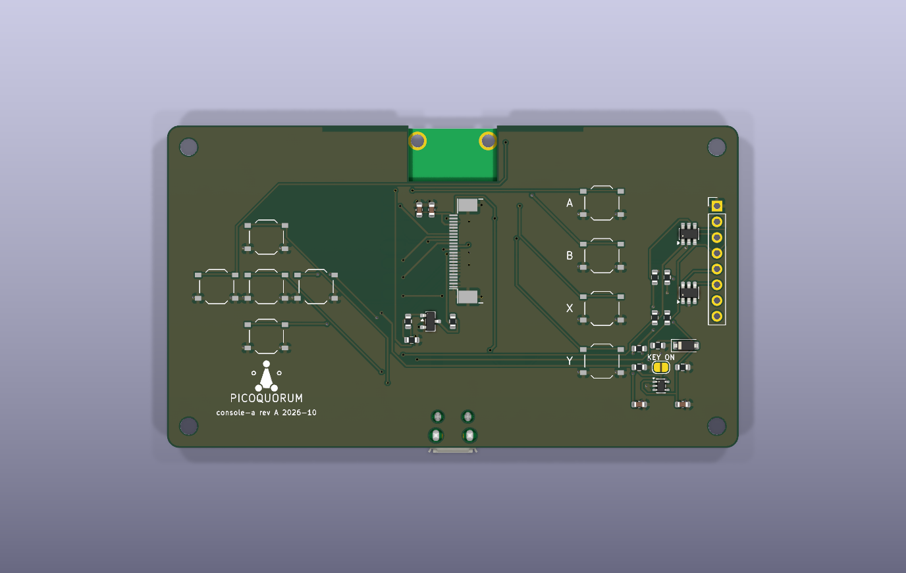

# The console PCB, rev A ("console-a")

> **Status: designed and checked, not ordered.** ERC 0, DRC 0, nothing unconnected, schematic
> parity clean (`tools/keypcb check console-a/console-a`, 2026-10-07, KiCad 10.0.6). No board has been made
> and nothing on it has been tried on a bench. Before ordering, see
> [what to check first](#check-these-before-ordering).

Not to be confused with [`console-pcb/console-a`](../console-pcb/README.md), the one-board Build 1
(2.8″ screen, knob, USB-C plug), drawn in parallel. Both are called console-a, so `tools/keypcb`
names this one `console-a/console-a`.

One board that holds the whole console: a Pico 2 W, a bare 1.3″ 240×240 color panel, nine buttons,
and pads for the key. It's wired exactly like the Waveshare Pico-LCD-1.3, so **the console image
runs on it unchanged**. It keeps `BOARD = "waveshare"` (the default), with no firmware change and
no new release.

| front | back |
|---|---|
|  |  |

These are KiCad renders, without the panel. The front shows the panel's connector where the panel
will sit. On the back, the Pico 2 W is soldered flat, chips facing out.

| | |
|---|---|
| Board | 92 × 52 mm, 2 layers, 1.6 mm, lead-free HASL, a notch in the top edge under the Pico's antenna, 4 × M2.5 holes |
| JLCPCB places | on the front: 9 buttons, the panel connector, the key-port parts, the backlight switch (30 parts, 3 of them Extended). On the back, if you ask: the Pico 2 W |
| You plug in | the panel's flex, into J2 (no solder) |
| You solder | the key's wires to J3, and the Pico if JLCPCB doesn't |
| Files | `console-a/` (KiCad 10), fab files in `console-a/fab/`, made by [`gen.py`](gen.py) |

How to order it: [ORDERING.md](ORDERING.md).

## Two ways to build it

It's the same board and the same Gerbers either way. Only the BOM and CPL you upload differ.

| | Pico soldered by you | Pico soldered by JLCPCB |
|---|---|---|
| Files | `fab/bom.csv`, `fab/cpl.csv` | `fab/factory-pico/bom.csv`, `fab/factory-pico/cpl.csv` |
| JLCPCB fits | the 30 front parts | the same 30, plus U1, the Pico 2 W, on the back |
| Assembly | one side | both sides, with X-ray (JLCPCB requires it for this part) |
| The Pico | you buy one without headers (about $7) and solder 40 pads by hand | LCSC **C42394205**, Raspberry Pi SC1633 (the Pico 2 W without headers), $11.68 on 2026-10-07 |
| You still do | the panel, the key's wires | the panel, the key's wires |

The factory route costs more per board (the dearer Pico, a second side, X-ray), but nobody holds an
iron to 40 pads per console. JLCPCB had 82 in stock on 2026-10-07. For more, pre-order them into
your JLCPCB parts library before the order. Parts there can only be used in assembly, not shipped
to you. Only JLCPCB's quote shows the real price, and its preview shows how they'll place a module
on the back. Check both before paying (ORDERING.md).

## The pin map

This is the Waveshare board's map, and `firmware/board.py`'s. `gen.py` has it as one table,
`PINS`. `python3 hardware/console-a/gen.py check` (or `tools/keypcb check console-a/console-a`) checks it
three ways: against `firmware/board.py`, against the emulator's `emu/core/runtime.mjs`, and against
the nets on the saved board.

| signal | GPIO | | signal | GPIO |
|---|---|---|---|---|
| LCD DC | GP8 | | A (Sign) | GP15 |
| LCD CS | GP9 | | B (Back) | GP17 |
| LCD SCK | GP10 | | X (Device) | GP19 |
| LCD MOSI | GP11 | | Y (Reject) | GP21 |
| LCD RST | GP12 | | up | GP2 |
| LCD backlight | GP13 | | down | GP18 |
| key SDA | GP4 | | left | GP16 |
| key SCL | GP5 | | right | GP20 |
| key power enable | GP6 | | press (centre) | GP3 |
| key DETECT (spare pad) | GP7 | | key CC1 | GP27 (ADC1) |
| spare pad | GP26 | | key CC2 | GP28 (ADC2) |

The buttons pull their GPIO to ground. The firmware's internal pull-ups do the rest, so there are no
resistors. The d-pad is five buttons: four directions and a centre press. A, B, X and Y sit in a
column to the right of the screen, top to bottom, the way the emulator draws them.

## The panel

**ZJY130T-IF05** (its drawing says ZJY133T-IF05): 1.3″ IPS, 240×240, ST7789VW driver, 4-wire SPI,
two white backlight LEDs. It has a 24-pin, 0.5 mm flex tail that folds behind the panel. It's from
the same ZJY 1.3″ family as the Waveshare board's panel. The Waveshare schematic's 12 panel pins
match ZJY133T-IG01, the solder-tail sibling.
- Datasheet: the ZJY133T-IF05 spec, published by both sellers in
  [Getting the right panel](#getting-the-right-panel). LCSC doesn't stock this panel.
- Wiring, as on the Waveshare board:
  - The backlight is switched on its low side by Q1 (SS8050) from GP13, with a 10 Ω resistor in
    series. That's about 30 mA.
  - IM1/2 and RD are tied high, which selects SPI. DB0–DB7 are tied to ground. TE isn't used.
- **Pin 9 is the SPI clock, and pin 10 is D/C.** The datasheet's pin table calls them "D/C" and
  "WR", but its descriptions say so, and that's how the ST7789 works in 4-wire mode.
- **Contact k on J2 is panel pin 25 − k.** J2 sits turned so the flex goes in from the right, which
  puts J2's own pin 1 at the bottom. The panel's pin 1 is at the top. The schematic does the
  swap, so the nets are right on the copper.
- **Why the flex goes to the right.** The firmware sets MADCTL 0x70 (row/column exchange and X
  mirror, no RAM offset). From the native portrait view, with the flex at the bottom, that turns the
  picture a quarter turn so the flex ends up on the picture's right side. Waveshare's photos agree:
  their wider bezel is on the button side. If the picture comes out rotated anyway, nothing on the
  board needs to change except the panel's way round. See the checklist below.
- J2 is a Jushuo **AFC07-S24FCA-00** (LCSC C262567): a bottom-contact, slide-lock 0.5 mm connector,
  2 mm tall. It sits under the panel, 12.8 mm in from the panel's right edge. That's where the folded
  tail ends on the drawing.
- The panel rests on 2–2.5 mm foam tape, over J2 and the small parts under it.

## Getting the right panel

Many 1.3″ screens look alike, and most of them won't fit J2. The right one is all of these:
- **ZJY133T-IF05** (also sold as ZJY130T-IF05)
- 1.3″ IPS, 240×240, ST7789V or ST7789VW driver
- a **24-pin plug-in flex at 0.5 mm pitch**, 12.5 mm wide, made to fold behind the panel

**Where to buy it.** These two sellers publish the ZJY133T-IF05 datasheet. Their pin tables are
identical to the one this board was designed to (compared on 2026-10-07):

| seller | listing | price on 2026-10-07 |
|---|---|---|
| Adafruit | [4520](https://www.adafruit.com/product/4520), "1.3 240x240 Wide Angle TFT LCD Display, bare" | $12.50, $11.25 at 10+, $10 at 100+ |
| Smart Prototyping | [102108](https://www.smart-prototyping.com/1_3-inch-TFT-IPS-Bare-Display-ST7789-SPI-240-240): **pick "Plug-in type 24pin"**, not the default 12-pin welded type | $8.90, $8 at 30+, $7.50 at 100+ |

Adafruit's page says the panel wants a bottom-contact connector, and J2 is one.

**Another seller, or a cheaper one.** Ask for the datasheet before buying, and check that its pin
table matches this one line for line. No datasheet, no order.

| pin | name | pin | name | pin | name |
|---|---|---|---|---|---|
| 1 | LEDA | 9 | D/C (the SPI clock) | 17 | DB4 |
| 2 | LEDK | 10 | WR (D/C in SPI) | 18 | DB5 |
| 3 | GND | 11 | RD | 19 | DB6 |
| 4 | VDD | 12 | SDA | 20 | DB7 |
| 5 | IOVCC | 13 | DB0 | 21 | TE |
| 6 | IM1/2 | 14 | DB1 | 22 | NC |
| 7 | RESET | 15 | DB2 | 23 | GND |
| 8 | CS | 16 | DB3 | 24 | GND |

**Look-alikes that won't work:**
- the same panel with the **12-pin solder tail** (the one on the Waveshare board)
- red or blue breakout boards with a 7- or 8-pin header
- round 1.28″ GC9A01 panels
- 1.3″ ST7735 panels
- 1.54″ and 1.69″ panels, and 240×280 panels
- anything whose tail isn't 24 contacts at 0.5 mm

**Check each batch when it arrives:**
1. Count 24 contacts, and measure the tail's end: 12.5 mm wide.
2. Fold the tail behind the panel the way it will sit, and look at the contacts. They should face
   away from the panel, toward the board.
3. First article: plug one into an assembled board and flash the console image. The picture should
   be upright with the flex on its right, and the backlight should light. Then fit the rest.

**Getting panels into each console.** JLCPCB can't fit or ship the panels, so they come to you:
- Buy them yourself, with about 10% spare: tails tear.
- Fitting one takes about a minute and no solder:
  1. Slide J2's latch out.
  2. Push the tail in straight, contacts down.
  3. Slide the latch back.
  4. Fold the panel over onto 2–2.5 mm foam tape.
- For consoles you hand out, fit and test each panel before it leaves (step 3 above for every
  unit). Or ship the panel loose with the four steps on a card, if the people building them are
  comfortable with a 0.5 mm latch.

## The key port

J3 is a row of eight 2.54 mm through-hole pads on the right edge, for wires to a USB-C receptacle or
straight to a key. From the top:

| J3 | net | key-c |
|---|---|---|
| 1 | GND | GND |
| 2 | KEY_VBUS | VBUS |
| 3 | SDA | D+ |
| 4 | SCL | D− |
| 5 | CC1 | CC1 |
| 6 | CC2 | CC2 |
| 7 | GP7 (DETECT) | spare |
| 8 | GP26 | spare |

Behind the pads is the circuit that [PROPOSALS.md](../key-pcb/PROPOSALS.md#the-console-end-of-key-c)
asks for before the port is more than a bench socket:

- **U2, TPS22945:** a load switch from 3V3, with a 100 mA current limit, enabled by GP6 (pulled
  down by R4). A phone or a shorted cable gets 100 mA, not the Pico's whole supply.
- **D1, B5819W Schottky:** sits between U2 and VBUS, so a charger's 5 V can't reach U2's output,
  the pull-ups, or 3V3. The TPS22945 doesn't block reverse current itself (datasheet 9.1.3). The
  diode does, and the key gets about 3.0 V, inside the ATECC608's 2.0–5.5 V.
- **R7, R8:** 2.2 kΩ pull-ups on SDA and SCL, to the switched supply (KEY_PWR), never to 3V3. A
  key with its power off isn't fed through its I2C pins.
- **R5, R6:** bleed KEY_PWR and VBUS down, so a key really loses power when U2 turns off.
- **CC1 and CC2 are read separately,** on GP27 and GP28, each through its own 10 kΩ Rp to 3V3:
  - A key's 5.1 kΩ Rd reads about 1.1 V.
  - An e-marked cable's Ra (about 1 kΩ) reads about 0.3 V.
  - Nothing connected reads 3.3 V.
  - A key shows exactly one Rd.
  - A charger's Rp (56 kΩ to 5 V) can lift a CC pin to about 3.6 V. That's inside the RP2350's
    rating, and the current is tens of µA.
- **U3, U4, USBLC6-2SC6:** ESD arrays on SDA/SCL and CC1/CC2, as on the key.

**Today's console image doesn't switch GP6.** Only `firmware/bench1.py` does, so a key on J3 gets
no power from the console as shipped. Two ways to use it:

1. Close **JP1 "KEY ON"** with a blob of solder. R11 (10 kΩ) then holds U2 on whenever the console
   is on. You keep the current limit and the 5 V block, but not the power cut when a key comes out.
   Because it goes through R11, firmware that drives GP6 low later still wins.
2. Run firmware that does what `bench1.py` does: wait for the key, switch GP6, scan. Reading CC
   needs new firmware too. Both are firmware changes, so a new release
   (`docs/RELEASES.md`), and not part of this board.

## Check these before ordering

These come from datasheets and photos, not from a board on the bench.

- [ ] **Buy one panel first** and look at its tail:
  - Is it 24 pins at 0.5 mm, with the pin table above?
  - Which face are the contacts on, once the tail is folded behind the panel?
  - J2 as ordered is bottom-contact (contacts toward the PCB), which is what Adafruit says this
    panel wants. If the folded tail's contacts face up anyway, order **AFC07-S24ECA-00 (C262643)**
    instead: same footprint, other contact side.
- [ ] Check the folded tail's length: its end should reach about 12.8 mm in from the panel's
  edge, at J2's latch.
- [ ] Check the orientation on a Waveshare board you already have: the flex should come out on
  the right side of the picture. If not, turn the panel's outline on the board (and J2 with it)
  before ordering.
- [ ] Check every part's rotation and pin 1 in JLCPCB's placement preview, especially J2, U2, U3,
  U4, Q1 and D1 (on key-c, a SOIC-8 and a SOT-23-6 came up 90° off).
- [ ] Hold a Pico 2 W on the back:
  - Its antenna end sits over the notch.
  - Its USB plug clears the bottom edge.
  - The two USB-connector pegs drop into their holes.

## How it's made

[`gen.py`](gen.py) writes the whole KiCad project from scratch. `tools/keypcb gen-console-a` runs it
with KiCad's Python. It reuses the key boards' helpers (`../key-pcb/gen.py`):
- **The schematic** is drawn from one parts table. Every pin gets a short wire and its net's
  label, so the drawing is plain, not pretty.
- **[`router.py`](router.py) lays the tracks.** It's a small two-layer router: A* on a 0.25 mm
  grid, 0.25 mm tracks, 0.15 mm clearance, 0.6/0.3 mm vias. It's pure Python.
  - A few things are placed by hand first, with the reasons in `gen.py`: the ground stubs under
    J2's body, J2's RD contact, U2's ground pin, and the runs of same-net contacts on J2.
  - Every front ground pad gets a via to the back pour.
  - KiCad's DRC then checks all of it again.
- **The Pico's footprint** is KiCad's `RaspberryPi_Pico_W_SMD_HandSolder` with two changes,
  written to `lib/console.pretty`:
  - Its three SWD through-holes are gone: they would land under J2. Flashing is over USB.
  - Its "RF Copper Keep Out" is gone, because DRC flags the module's own end pads against it. A
    pour-free strip along the top edge keeps its intent.

As with the key boards, once you edit the board in KiCad, the KiCad files are the source of truth:
don't run `gen.py` again, or your edits are lost. The routing is DRC-clean, not hand-polished.
Around J2 it's dense, and you may want to tidy it in the GUI.

**Not on this board, on purpose:** a battery, a USB-C receptacle for the key (J3 takes wires), a
rotary knob, SWD pads, and an enclosure.

## Log

- **2026-10-08:**
  - **Factory-soldered Pico** added as a second assembly option (`fab/factory-pico/`). The board,
    the Gerbers and the default BOM and CPL are unchanged.
  - U1's part number corrected to SC1633, the Pico 2 W without headers (SC1634 is the version
    with headers).
  - "Getting the right panel" added: Adafruit 4520 confirmed as the same ZJY133T-IF05.

- **2026-10-07:** rev A designed: the parts chosen, routed, checked (ERC 0, DRC 0, parity clean,
  pin map matched three ways), and the fab files written. Not ordered.
